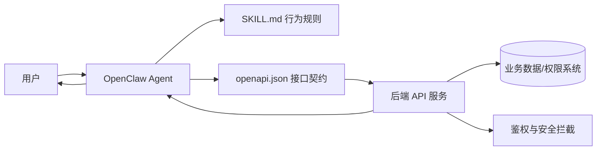
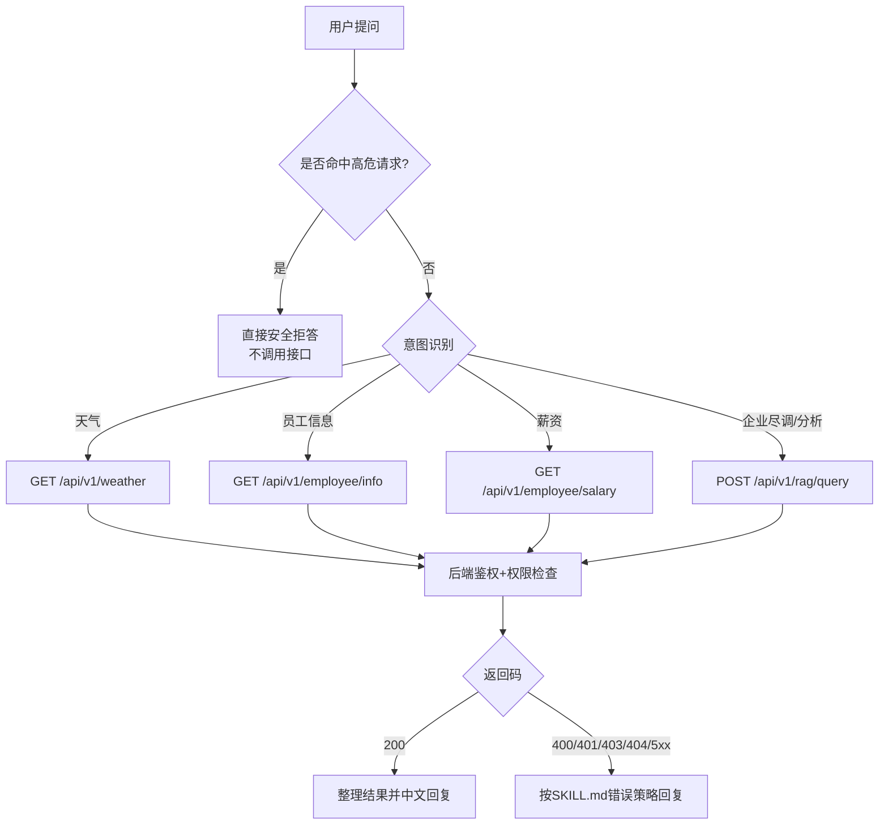

# OpenClaw Skill 新手完整指南（从 0 到可发布）

这份 README 面向第一次接触 OpenClaw Skill 的学员。  
目标是让你不仅“会用”，而且理解：

1. 为什么需要 `SKILL.md`、`openapi.json`、`CHANGELOG.md`  
2. 这三个文件各自解决什么问题、为什么这样写  
3. OpenClaw 与后端是如何对接、调用链路如何流转  
4. 如何把 Skill 发布到 ClawHub，并避免常见坑  

---

## 1) 先建立整体认知：一个 Skill 到底是什么？

你可以把 Skill 理解成“给 Agent 的一份可执行工作说明书 + 工具接线图”。

- `SKILL.md`：告诉 Agent **能做什么、不能做什么、遇到错误怎么回复**
- `openapi.json`：告诉 Agent **后端接口长什么样、参数怎么传、返回什么**
- `CHANGELOG.md`：告诉平台和使用者 **这个版本改了什么、升级风险是什么**

如果缺少其中任意一个，都会有明显问题：

- 没有 `SKILL.md`：Agent 行为不稳定，可能越界回答、错误处理不一致
- 没有 `openapi.json`：Agent 不知道怎么调用后端接口
- 没有 `CHANGELOG.md`：版本演进不可追踪，发布审核和回滚都困难

---

## 2) 目录结构与每个文件的价值

当前目录：

- `SKILL.md`
- `openapi.json`
- `CHANGELOG.md`
- `README.md`

### `SKILL.md` 的意义与价值（行为层）

`SKILL.md` 主要负责“行为与策略”，不是接口细节。它告诉模型：

- 这个 Skill 的业务目标是什么（天气、员工信息、薪资、尽调问答）
- 必须遵守哪些安全规则（Basic Auth、禁止越权、注入拦截）
- 用户不同意图要调用哪个工具（如尽调类问题优先走 `POST /api/v1/rag/query`）
- 接口错误码出现时应该如何安全回复（400/401/403/404/5xx）

为什么必须写这些内容？

- 因为大模型默认“会尽力回答”，如果没有明确边界，可能出现：
  - 擅自猜测接口
  - 错误时泄露内部细节
  - 遇到 403 继续枚举 `user_id`
- `SKILL.md` 的作用就是把“可回答性”约束成“可审计、可控、可复现”的行为。

### `openapi.json` 的意义与价值（工具层）

`openapi.json` 主要负责“接口契约”，它定义：

- 服务器地址（`servers`，默认 `http://fastapi_backend:8000`）
- 统一鉴权方案（`BasicAuth`）
- 每个接口的路径、方法、参数、请求体、响应结构
- 每个错误码的含义（例如 401 认证失败、403 权限不足）

为什么必须写这些内容？

- 因为 Agent 调用工具需要机器可读协议，不是自然语言猜测。
- OpenAPI 是标准格式，能让 OpenClaw 正确生成调用参数并解析返回结果。
- 接口契约清晰，前后端与 AI 行为才能稳定协作。

### `CHANGELOG.md` 的意义与价值（发布层）

`CHANGELOG.md` 是版本“变更证明”。它回答：

- 新版本新增了什么能力？
- 修改了哪些规则？
- 是否有行为变化（比如安全拒答策略升级）？

为什么发布时强烈建议带上它？

- 便于审核：发布平台和使用方能快速了解变化影响
- 便于回滚：线上问题时能快速定位“从哪个版本开始变化”
- 便于协作：团队成员能统一认知，减少口头传达误差

---

## 3) OpenClaw Skill 的对接架构（你需要理解的“全景图”）



解读：

- 用户发出问题后，Agent 先受 `SKILL.md` 约束（“该不该调用、怎么回复”）
- 一旦需要调用工具，Agent 按 `openapi.json` 的契约去请求后端
- 后端执行鉴权、权限控制和注入拦截，再返回结果
- Agent 按 `SKILL.md` 的回复策略输出给用户

---

## 4) 调用流程图（从用户问题到最终回答）



---

## 5) 为什么现在这份 `SKILL.md` 要这样写？

你会看到它包含以下关键块，这些都是“必须项”：

1. Frontmatter（`name/description/version`）
   - 用于 Skill 标识、发布版本管理、平台展示
2. 能力边界（只允许调用 `openapi.json` 中定义的接口）
   - 防止模型编造路径、降低错误和安全风险
3. 鉴权强制要求（每次请求都带 Basic Auth）
   - 保证后端能做身份识别与审计归因
4. 中文参数 URL 编码要求
   - 避免请求因编码问题失败或语义偏差
5. 高危触发词策略
   - 抵御提示词注入、凭证套取、越权请求
6. 错误码回复规范
   - 确保模型在异常时“稳态响应”，不泄露内部信息

一句话总结：`SKILL.md` 不是“说明文档”，它是 Agent 的“行为防火墙”。

---

## 6) 为什么现在这份 `openapi.json` 要这样写？

你会看到它包含：

- `securitySchemes.BasicAuth` + 顶层 `security`
  - 表示所有接口默认要求 Basic Auth
- `servers` 带 `host` 变量
  - 便于在不同环境替换服务地址
- 每个 path 定义 `operationId`
  - 让调用映射更稳定可追踪
- 完整请求/响应 schema
  - 让 Agent 正确构造请求并解析字段
- 对 401/403/400 等错误语义做明确描述
  - 帮助模型采取正确的后续策略

一句话总结：`openapi.json` 不是“给人看的介绍”，它是 Agent 的“工具接线协议”。

---

## 7) 实际对接要点（你自己构建 Skill 时照着做）

### 第一步：准备基础文件

至少准备：

- `SKILL.md`
- `openapi.json`
- `CHANGELOG.md`

### 第二步：保证鉴权闭环

- 在 Skill `.env` 中提供：

```env
BASIC_AUTH_USERNAME=user02
BASIC_AUTH_PASSWORD=<password>
```

- 不要把凭证硬编码到提示词、示例对话或代码里
- 无凭证时直接提示配置，不要盲目调用接口

### 第三步：保证中文 Query 参数可用

正确示例（推荐）：

```bash
curl -sG "http://127.0.0.1:8000/api/v1/weather" \
  --data-urlencode "city=上海" \
  -u "user02:<password>"
```

错误示例（不要这样）：

```bash
curl "http://127.0.0.1:8000/api/v1/weather?city=上海" -u "user02:<password>"
```

### 第四步：验证错误处理行为

至少验证以下场景：

- 401：凭证错误时，是否提示用户检查账号密码
- 403：越权时，是否停止枚举并给出合规答复
- 400：注入/恶意输入时，是否拒答且不泄露内部规则
- 5xx：是否隐藏内部异常细节

---

## 8) 为什么 ClawHub 发布必须重视 `CHANGELOG.md`？

发布不是“上传文件”，而是“交付一个可持续演进的产品版本”。

`CHANGELOG.md` 的核心价值：

- 对使用者：快速判断是否要升级、升级后影响什么
- 对维护者：快速定位问题版本，支持回滚和复盘
- 对平台审核：提升可读性与可信度，减少沟通成本

建议遵循语义化版本（SemVer）：

- `MAJOR`：不兼容变更（如接口含义变化）
- `MINOR`：向后兼容的新能力
- `PATCH`：向后兼容的问题修复

---

## 9) 发布到 ClawHub 的注意事项（以及“为什么”）

发布前请逐条确认：

1. `SKILL.md` frontmatter 完整（`name/description/version`）
   - 为什么：平台需要识别与展示版本元信息
2. `openapi.json` 可被 JSON 解析，结构合法
   - 为什么：工具注册失败会导致 Skill 无法调用后端
3. `servers` 地址对 OpenClaw 运行环境可达（如 `fastapi_backend:8000`）
   - 为什么：本机可达不等于容器可达，网络不通会导致全部调用失败
4. 鉴权要求明确且可执行（Basic Auth + `.env`）
   - 为什么：无身份就无法做权限与审计，属于高风险配置
5. 中文参数处理已验证（URL 编码）
   - 为什么：避免线上出现“中文查询偶发失败”
6. 403/400 回复策略符合安全约束
   - 为什么：防止越权引导和内部信息泄露
7. `CHANGELOG.md` 与版本号一致
   - 为什么：确保发布说明与实际内容一致，便于治理

---

## 10) 推荐发布命令

首次发布：

```bash
clawhub publish ./openclaw_skills \
  --slug Cskill \
  --name "Cskill（银行对公尽调演示）" \
  --version 1.2.1 \
  --changelog-file ./openclaw_skills/CHANGELOG.md \
  --tags latest
```

后续迭代（版本号与 `SKILL.md` 中 `version` 保持一致）：

```bash
clawhub publish ./openclaw_skills \
  --slug Cskill \
  --name "Cskill（银行对公尽调演示）" \
  --version 1.2.1 \
  --changelog-file ./openclaw_skills/CHANGELOG.md \
  --tags latest
```

---

## 11) 学员实操路线（照此顺序练习）

1. 先读 `SKILL.md`，理解行为边界与安全规则  
2. 再读 `openapi.json`，理解每个接口的参数与返回  
3. 用 curl 验证 200/401/403/400 场景  
4. 修改一个小版本（如补充一条规则）并更新 `CHANGELOG.md`  
5. 使用 `clawhub publish` 发一个新版本  
6. 回看线上行为，确认“意图识别 -> 调用 -> 错误处理”全链路符合预期

做到以上 6 步，你就已经具备独立构建和发布 OpenClaw Skill 的能力。

---

## 12) 银行对公场景：授信客户与尽调查询

当前版本核心接口：

- `GET /api/v1/customer-companies`
- `POST /api/v1/rag/query`（尽调向量片段问答）

作用：

- 模拟**银行对公客户经理**：查询可管户授信客户的公司名称、法人信息（脱敏）、纳税识别号（脱敏），以及四类**模拟尽调摘要**（经营与行业、授信申请概要、风险关注点、尽调结论）；默认叙事背景为客户拟向银行申请融资
- 按部门做数据隔离：普通员工/经理仅看本部门客户，管理员可看全量
- RAG 仅在员工授权公司范围内检索尽调片段，与上表客户名单一致
