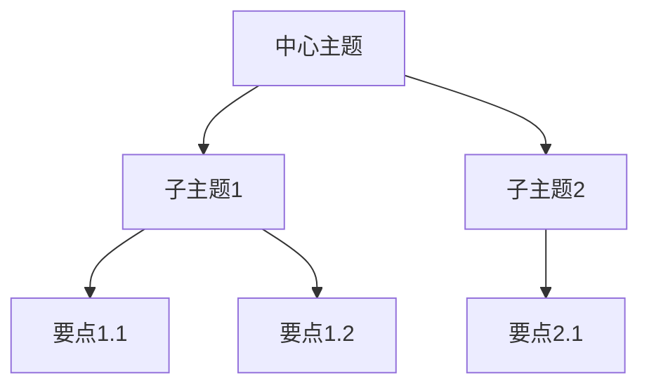

---
AIGC:
    ContentProducer: Minimax Agent AI
    ContentPropagator: Minimax Agent AI
    Label: AIGC
    ProduceID: d2273f36f5c7165555d755d78cc19917
    PropagateID: d2273f36f5c7165555d755d78cc19917
    ReservedCode1: 304402204489d74864d5724957934ff187ab2f2a299adf463c61a9118357ca74ec50293502202b771208c9f8d6ba04d2aa33e6010154baf6e52b9e3a3bc7e8a3abd0dc8a65f6
    ReservedCode2: 304402203d11308a5a01810c63236381c306f439a2b63513729f37677d6ba8a69a02aeac022064e6c7d65121097916e66267aa733e02f4f77a490713a6b1251868bb76a67280
description: 将录音文件识别并总结成录音纪要和脑图。当用户要求转录音频、总结会议记录、整理访谈内容、生成脑图、将 MP3/WAV/M4A 等音频转换为文字稿和思维导图时使用。
name: audio-summary
---

# 录音识别与总结技能

## 功能概述

本技能将音频文件转换为结构化的文字纪要和可视化脑图，支持中文自动识别。

## 支持格式

- **输入音频**：MP3、WAV、M4A、AAC、OGG、FLAC
- **输出格式**：Markdown 文档 + Mermaid 思维导图 + JSON 结构化数据

## 工作流程

### 步骤 1：音频转录

使用 `audios_understand` 工具进行音频转录：

```
输入：音频文件路径（MP3/WAV/M4A等）
处理：自动语言检测 + 语音识别
输出：完整文字稿
```

### 步骤 2：生成录音纪要

将转录内容整理为结构化的会议纪要：

```markdown
# 录音纪要

## 基本信息
- 日期：[自动提取或用户补充]
- 时长：[音频时长]
- 参与人：[如可识别]

## 核心议题
1. [主题1]
2. [主题2]
...

## 详细内容
### 议题一
- 关键点：...
- 决策：...
- 行动项：...

## 总结
[简要总结]
```

### 步骤 3：生成脑图（Mermaid）

自动提取关键概念和层级关系，生成思维导图：



### 步骤 4：生成 JSON 结构化数据

输出可程序化处理的结构化数据：

```json
{
  "summary": "会议概述",
  "topics": [
    {
      "title": "议题标题",
      "key_points": ["要点1", "要点2"],
      "decisions": ["决策1"],
      "action_items": [{"task": "任务", "owner": "负责人", "deadline": "期限"}]
    }
  ],
  "participants": ["参与者列表"],
  "date": "日期",
  "duration": "时长"
}
```

## 输出文件命名规范

- 纪要文件：`{原文件名}_纪要.md`
- 脑图文件：`{原文件名}_脑图.md`
- JSON 文件：`{原文件名}_结构化.json`

## 使用示例

**触发方式**：
- "帮我转录这个录音"
- "将 MP3 文件转换为文字稿"
- "总结这段会议录音"
- "生成脑图"
- "整理访谈记录"

**典型工作流**：
1. 用户提供音频文件
2. 系统自动转录为文字
3. 智能提取关键信息和结构
4. 生成纪要和脑图
5. 提供 Markdown 和 JSON 格式输出

## 注意事项

1. **音频质量**：清晰、无噪音的音频转录准确率更高
2. **多人对话**：自动识别说话人（如可区分）
3. **专业术语**：自动保留并适当标注
4. **语言混合**：支持中英文混合内容
