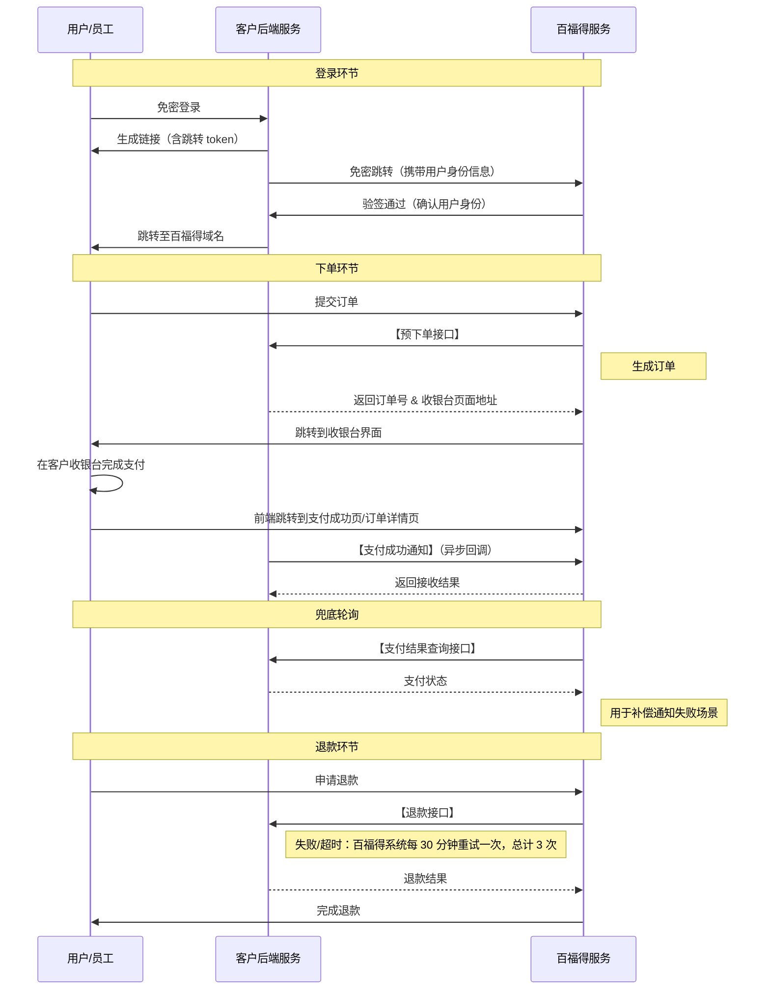

# 三方收银台对接规范

- **能力 ID**：BFD-012
- **所属模块**：商城交付 / 支付与资产 / 对接规范
- **父能力**：BFD-004 资金形式 - 三方收银台（本文件是其工程实施侧详细规范）
- **适用场景**：
  - 客户已有自建收银台/电商系统，希望百福得商城商品嵌入到客户自有支付流程
  - 客户希望**完全自有支付闭环**（所有资金由客户管理，不走百福得收银台）
  - 部分场景：客户给百福得开通收款商户号，仅用于收取订单中的现金部分
- **核心功能**：
  客户侧需要实现 **3 个必备 + 1 个可选 API** 供百福得调用，覆盖下单、支付通知、补偿查询、退款完整链路。
  - **必备**：预下单接口 / 退款接口 / 支付结果查询接口
  - **可选**：余额查询接口（如提供，可在百福得展示用户余额）

---

## 0. 与 BFD-011 三方积分对接规范的关键差异

> 售前/实施阶段与客户沟通时，**必须**先讲清楚这两条路径的本质差异：

| 维度 | BFD-011 三方积分 | BFD-012 三方收银台 |
| --- | --- | --- |
| 支付**主导方** | 百福得主导（百福得收银台内完成下单支付） | 客户主导（百福得把订单交给客户收银台处理） |
| 资金**归属** | 在百福得收银台体系内 | **完全客户管理**，与百福得收银台无关 |
| 支付**模式** | 同步调用扣款接口 | 异步通知（前端跳转收银台 + 后台支付回调） |
| 关键 API | 积分余额扣减接口（同步） | 预下单接口（返回收银台页面地址） |
| 余额查询 | 必选 | **可选**（如提供可在百福得展示） |
| 退款 | 分批多次退款 + 幂等 | **分批多次退款 + 幂等**（一致） |
| 退款重试策略 | 30 分钟一次，最多 3 次 | **30 分钟一次，最多 3 次**（一致） |

---

## 1. 对接时序图

**时序关键点**：
- 登录入口在客户侧（与 BFD-011 一致）
- **支付入口在客户侧**：百福得通过预下单拿到收银台地址 → 前端跳转 → 用户在客户收银台完成支付
- 支付结果通过**客户异步通知**告知百福得（**不是同步调用**）
- 通知失败时，百福得通过**支付结果查询接口**补偿
- 退款机制与 BFD-011 完全一致（分批 + 幂等 + 30 分重试）

---

## 2. 4 个 API 详细规范

### 2.1 余额查询接口（**可选**）

**用途**：百福得在用户进入收银台时，**展示**客户账户余额（仅展示，不影响支付流程）。

**对接要求**：
- **可选项**：如客户提供此接口，可优化用户体验（百福得展示"您还有 XX 元可用"）；如不提供，**百福得也能正常完成支付流程**
- 客户积分系统的用户账号必须与百福得用户数据**保持一致**

**实施建议**：
- 优先级：低（不影响核心支付流程）
- 如客户决定实现，建议实时性（不接受 T+1）

---

### 2.2 预下单接口（**核心 API**）

**用途**：用户在百福得商城提交订单后，百福得调用客户预下单接口，**获取客户收银台页面地址**，然后前端跳转。

**关键约定**：

#### 2.2.1 幂等性
- 双方以**订单号**作为收银台支付单据号幂等键
- 同一笔订单号**只能支付一次**（不能出现重复支付扣款）
- 客户侧必须按订单号做幂等控制

#### 2.2.2 ⚠️ 入参规范（重要）
- 预下单接口**只传订单主数据**：
  - 订单号
  - 支付金额
  - （其他订单级主数据）
- ⚠️ **不推荐传参涉及订单商品信息**（尤其是商品金额、税率等明细）
- 原因：避免客户收银台按商品明细做独立核算，导致与百福得订单对账不一致

#### 2.2.3 出参规范
- 出参中**必须**包含**收银台页面地址**（URL）
- 百福得拿到地址后，会在前端打开该页面给用户完成支付
- 收银台地址应支持：
  - HTTPS 协议
  - 移动端 H5 适配（百福得多终端交付 BFD-003 涉及 H5 嵌入场景）
  - 必要的鉴权参数（防止地址被未授权访问）

#### 2.2.4 同步 vs 异步
- 预下单接口**同步返回**收银台地址
- 实际支付是**异步流程**（用户在收银台完成后，由客户通过支付成功通知告知百福得）
- **不要混淆**：预下单是同步，支付是异步

---

### 2.3 退款接口

**用途**：发生售后退款（BFD-008）时，百福得调用客户 API 发起退款。

**关键约定**：
- ⚠️ **支持分多次退款**：
  - 一笔订单**可对应多次退款**（部分退款场景必须支持）
  - 与 BFD-008 售后的"不支持整单退款、必须按 SKU 分批"是同一约束
- ⚠️ **每次退款的幂等性**：
  - 每次退款调用必须有**唯一的退款单号**（不能与正向支付订单号复用，也不能与历次退款单号重复）
  - 客户侧以退款单号做幂等控制
- ⚠️ **不超额退款**：
  - 多次退款的总和**不能超过**原订单支付金额
  - 客户侧需做退款金额累计校验，超过则拒绝
- ⚠️ **百福得侧重试策略**：
  - 当退款接口返回失败或网络超时，**百福得系统会间隔 30 分钟自动重试**，**总计最多 3 次**
  - 客户侧需保证退款接口的**幂等性**（3 次重试不会导致重复退款）

---

### 2.4 支付结果查询接口（兜底轮询）

**用途**：当客户的**支付成功通知失败**时，百福得主动查询支付结果，防止订单状态异常。

**使用场景**：
- 客户成功完成支付 → 客户系统向百福得发起"支付成功通知"（异步回调）
- 通知**失败**（网络问题、客户系统异常等）→ 百福得不知道支付是否完成
- 解决：百福得通过**支付结果查询接口**主动轮询 → 客户返回实际支付状态

**关键约定**：
- 客户侧必须**实现重试通知**（多次重试失败后再放弃） + 百福得也会主动查
- 若客户侧**不支持重试通知**，**必须**提供本查询接口由百福得做补偿查询
- 客户侧需要持久化所有支付订单的执行结果（建议保留 30 天以上），按订单号可反查
- 查询频率：百福得侧通常在通知失败后**延迟 30 秒 - 1 分钟**开始轮询，间隔 1-2 分钟，最长持续到订单创建后 24 小时

**与 BFD-011 §2.4 的差异**：
- BFD-011（积分扣款同步）查询接口是用于解决"扣款接口网络超时"
- BFD-012（收银台异步）查询接口是用于解决"客户支付成功通知失败"
- 两者机制相同（都按订单号反查），但**触发场景不同**

---

## 3. 联调 Checklist（售前/实施阶段使用）

> 销售/客户成功在与客户谈三方收银台对接时，**必须**逐条确认：

- [ ] 客户收银台系统用户账号体系与百福得打通（BFD-002 已对齐）
- [ ] 客户理解"支付主导权归客户"——百福得只做订单交付，**支付流程在客户侧完成**
- [ ] 客户理解**预下单接口的入参规范**（只传订单主数据，不传商品明细）
- [ ] 客户收银台地址支持 HTTPS + 移动端 H5 适配
- [ ] 客户实现订单号维度的幂等控制（防重复支付）
- [ ] 客户理解并接受**分多次退款**机制（BFD-008 / BFD-012 §2.3）
- [ ] 客户实现退款金额累计校验（防超额）
- [ ] 客户实现"支付成功通知"的重试机制
- [ ] 客户实现"支付结果查询接口"（兜底轮询）
- [ ] 客户侧订单历史保留 ≥ 30 天（支持反查）
- [ ] 客户侧 3 个必备 API 已完成内部测试，提交百福得联调
- [ ] 联调环境已就绪，测试账号、测试数据齐备

**可选**（如客户选择实现）：
- [ ] 余额查询接口（用于百福得展示用户余额）

---

## 4. 典型客户场景

- 场景 1：某大型零售集团已有自己的会员电商和收银台，希望百福得商城商品嵌入到自家 APP 收银流程 → **标准三方收银台对接**，3-4 周联调上线
- 场景 2：某金融客户希望用自有积分体系 + 自有收银台混合支付，积分部分用 BFD-011、现金部分用 BFD-012 → **双路径组合**（需售前评估）
- 场景 3：某跨境电商希望员工福利订单可以走境外支付通道 → 三方收银台可对接境外收单机构，**但需额外评估合规与税务**
- 场景 4：客户希望百福得只对接"现金收款"部分，积分部分走自有体系 → **百福得收款商户号**路径（部分客户会开），需走 KYC

---

## 5. 注意事项 / 限制

- ⚠️ **预下单入参规范**：传商品明细会导致客户收银台与百福得对账不一致，**售前必须讲清楚**
- ⚠️ **支付主导权转移**：选择三方收银台后，**支付环节的所有问题（支付失败、退款失败、对账不一致）首先由客户侧排查**，百福得只负责订单交付与通知接收
- ⚠️ **收银台地址的稳定性**：客户收银台地址变更时需提前通知百福得（避免用户跳转 404）
- ⚠️ **HTTPS 证书**：收银台地址必须 HTTPS，证书过期会直接导致用户无法支付
- ⚠️ **跨境场景**：三方收银台对接境外收单需评估个保法、数据出境、外汇合规
- ⚠️ **KYC**：如客户给百福得开通收款商户号，KYC 流程需要 1-2 周提前启动
- **不要承诺**："百福得可以同步通知客户"——BFD-012 是异步通知模式，强行同步会破坏客户收银台设计

---

## 6. 与 BFD-011 的复用与差异

**可复用部分**（客户同一套系统既想做积分对接又想做收银台对接时）：
- 登录环节（免密登录机制相同）
- 退款接口（机制、幂等、重试策略完全一致）
- 账号体系打通要求（必须与百福得用户一致）

**必须独立实现**：
- 预下单接口 vs 积分余额扣减接口（完全不同的设计）
- 支付结果查询接口触发场景不同（异步通知失败 vs 同步扣款超时）
- 余额查询接口（收银台可选，积分必选）

**实施建议**：若客户同时需要两种对接，建议**优先做收银台对接**（BFD-012 包含支付全链路），再叠加积分对接（BFD-011）；避免两个支付路径同时上线增加联调复杂度。

---

## 7. 关联能力

- **父能力**：BFD-004 资金形式（本文件是其工程实施侧详细规范）
- **兄弟规范**：BFD-011 三方积分对接规范（支付主导方、API 形态不同）
- **强关联**：
  - BFD-002 组织管理（账号体系一致是本规范的前置条件）
  - BFD-003 多终端交付（收银台地址需支持 H5 适配）
  - BFD-006 权益合规（支付环节的合规校验）
  - BFD-008 售后（分批退款约束与本规范一致）
  - BFD-009 结算开票（多支付路径对账与开票依赖此能力，特别是开专票的合规路径）
