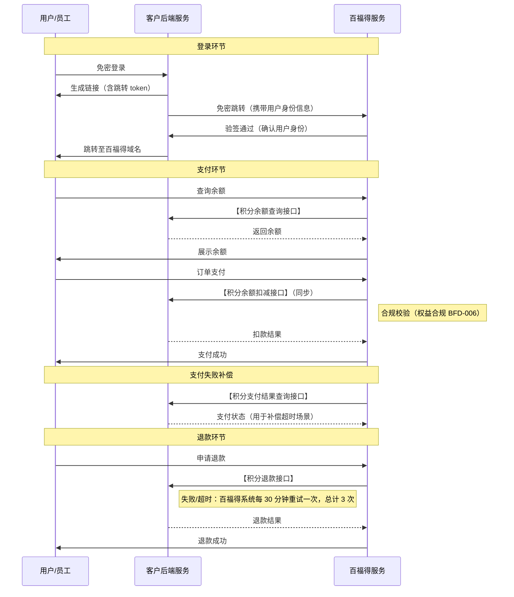

# 三方积分对接规范

- **能力 ID**：BFD-011
- **所属模块**：商城交付 / 支付与资产 / 对接规范
- **父能力**：BFD-004 资金形式 - 三方积分（本文件是其工程实施侧详细规范）
- **适用场景**：
  - 客户已有自有积分体系（游戏币、会员积分、电商积分、银行积分等），需要按 BFD-004"三方积分"路径对接百福得商城
  - 客户研发/IT 团队需要按本规范实现 4 个 API 接口
  - 百福得实施/技术对接在联调前需要明确接口规范、幂等约定、重试策略
- **核心功能**：
  客户侧需要实现 **4 个 API** 供百福得调用，覆盖登录、支付、补偿、退款完整链路。
- **对接要求**：
  - 客户积分系统用户账号体系必须与百福得用户数据**保持一致**（如不一致，需在 BFD-002 组织管理中先打通）
  - 如客户有**多类型积分余额**（如游戏币 + 会员积分 + 商城积分），需提前同步信息，由百福得评估多类型对接的方案可行性
  - 客户侧 4 个 API 的开发、测试、联调、灰度上线

---

## 1. 对接时序图

**时序关键点**：
- 登录入口在客户侧（员工先到客户系统，再免密跳转到百福得）
- 支付入口在百福得侧（百福得主导收银台流程，调用客户 API 完成扣款）
- 扣款是**同步**调用，不是异步回调
- 合规校验在百福得侧完成（基于 BFD-006 权益合规规则）
- 退款失败/超时由百福得侧发起重试（30 分钟一次，最多 3 次）

---

## 2. 4 个 API 详细规范

### 2.1 积分余额查询接口

**用途**：百福得在用户进入收银台、提交订单前，实时查询客户积分系统中的用户余额。

**对接前置要求**：
- ⚠️ **客户积分系统的用户账号必须与百福得用户数据保持一致**（账号 ID 体系需先打通，通常在 BFD-002 组织管理阶段解决）
- 如客户有**多类型积分余额**（如游戏币、会员积分、商城积分等多套），需提前同步：
  - 各类型积分的余额
  - 各类型积分的可用商品范围
  - 各类型积分的优先级（默认用哪种）
  - 由百福得评估多类型对接的方案可行性（**部分复杂场景可能不支持**）

**关键约定**：
- 实时性：百福得期望**实时余额**（不接受 T+1 或准实时）
- 频率：用户每次进入收银台 + 每次提交订单前会调用，**注意客户侧限流策略**

---

### 2.2 积分余额扣减接口

**用途**：百福得在用户提交订单、扣款环节，调用客户 API 完成实际积分扣减。

**关键约定**：
- ⚠️ **幂等性**：
  - 双方以**支付流水号**作为幂等键
  - 同一笔支付流水号**不能重复扣款**（即客户侧必须做幂等控制，重复调用同一流水号只能扣一次）
  - 此约定是**支付安全底线**，联调时必查
- ⚠️ **同步支付**：
  - 扣款接口必须**同步返回结果**（成功/失败 + 扣减后余额）
  - **不能是异步回调**（不接受"先返回受理中，再通过 webhook 通知结果"模式）
  - 如客户侧只能做异步，需在售前阶段告知，由百福得评估是否支持
- 合规校验：百福得在拿到扣款结果后，会基于 BFD-006 权益合规规则做二次校验

---

### 2.3 积分退款接口

**用途**：发生售后退款（BFD-008）时，百福得调用客户 API 退积分给用户。

**关键约定**：
- ⚠️ **支持分多次退款**：
  - 一笔正向支付流水号**可对应多次退款**（部分退款场景必须支持）
  - 与 BFD-008 售后的"不支持整单退款、必须按 SKU 分批"是同一约束的不同表达
- ⚠️ **每次退款的幂等性**：
  - 每次退款调用必须有**唯一的退款流水号**（不能与正向支付流水号复用，也不能与历次退款流水号重复）
  - 客户侧以退款流水号做幂等控制
- ⚠️ **不超额退款**：
  - 多次退款的总和**不能超过**原正向支付金额
  - 客户侧需做退款金额累计校验，超过则拒绝
- ⚠️ **百福得侧重试策略**：
  - 当退款接口返回失败或网络超时，**百福得系统会间隔 30 分钟自动重试**，**总计最多 3 次**
  - 客户侧需保证退款接口的**幂等性**（3 次重试不会导致重复退款）

---

### 2.4 积分支付结果查询接口

**用途**：补偿查询支付失败的结果，用于解决"扣款接口超时但实际可能已成功"的场景。

**关键约定**：
- ⚠️ **使用场景**：百福得调用客户**扣款接口失败**时（通常是接口请求超时），通过本接口**反查实际支付结果**
  - 场景：百福得发起扣款 → 网络超时 → 百福得不知道扣款是否成功
  - 解决：百福得调用本接口 → 客户返回"实际已成功 / 实际失败"
  - **避免出现"百福得显示支付失败、但客户积分已扣"的不一致**
- 查询依据：百福得传入**支付流水号**，客户返回该笔流水的实际状态
- 客户侧必须能基于支付流水号反查（保留历史记录至少 7 天，建议保留 30 天）

---

## 3. 联调 Checklist（售前/实施阶段使用）

> 销售/客户成功在与客户谈三方积分对接时，**必须**逐条确认：

- [ ] 客户积分系统用户账号体系与百福得打通（BFD-002 已对齐）
- [ ] 客户积分类型已梳理（单类型 / 多类型），多类型场景已由百福得评估通过
- [ ] 客户理解并接受 4 个 API 的**幂等性**要求
- [ ] 客户理解并接受**同步支付**模式（非异步）
- [ ] 客户理解并接受**分多次退款**机制
- [ ] 客户实现退款金额累计校验（防超额）
- [ ] 客户实现支付结果反查能力（保留 7+ 天历史）
- [ ] 客户侧 4 个 API 已完成内部测试，提交百福得联调
- [ ] 联调环境已就绪，测试账号、测试数据齐备

---

## 4. 典型客户场景

- 场景 1：某游戏公司已有游戏币体系，员工希望用游戏币在福利商城兑换节日礼品 → 4 个 API 全量对接，游戏币单类型，2-3 周联调上线
- 场景 2：某零售集团同时有"会员积分"和"商城积分"两套体系，希望员工可用任一类型积分 → 多类型积分场景，**售前阶段必须先评估可行性**，由百福得技术确认后再签合同
- 场景 3：某银行客户积分系统只能异步回调扣款结果 → 同步支付硬性约束不满足，**需走商务评估是否走定制化方案**（或引导客户改造为同步）

---

## 5. 注意事项 / 限制

- **同步 vs 异步**：异步扣款接口的客户**不直接支持**，需走定制化评估；不要承诺"先接异步、后续再改"
- **多类型积分**：超过 3 种积分类型同时对接，**强烈建议**做 POC 验证，避免后期翻车
- **历史记录保留**：支付结果反查依赖客户侧历史记录，**合同条款中建议明确保留时长**
- **限流策略**：高频余额查询可能触发客户侧限流，需提前评估 QPS
- **网络稳定性**：客户侧 API 稳定性直接影响百福得支付成功率，**建议客户侧做监控告警**

---

## 6. 关联能力

- **父能力**：BFD-004 资金形式（本文件是其工程实施侧详细规范）
- **强关联**：
  - BFD-002 组织管理（账号体系一致是本规范的前置条件）
  - BFD-006 权益合规（扣款后百福得侧做合规校验）
  - BFD-008 售后（分批退款与本规范的分多次退款约束一致）
- **联动决策**：
  - 资金形式的选择与 BFD-009 结算开票（开票模式依赖资金形式）紧密相关
  - 跨境/外籍员工场景需单独评估币种与合规
