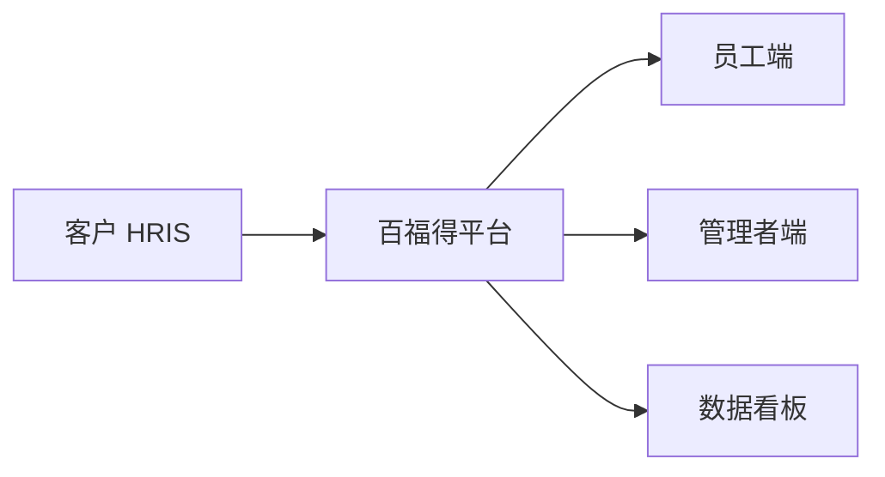

# 结构化方案模板

按问题类型选对应分支填空。空括号 `（...）` 是需要根据客户问题填入的内容。

---

## 售前咨询类（Pre-sales）

适用：客户问"你们能不能做 XX" / "有没有适合我的方案"。

```markdown
# 售前方案：<客户或场景名>

## 1. 客户背景
- **行业**：（金融/互联网/制造/...）
- **规模**：（员工数 / 分子公司数）
- **已有系统**：（HRIS / OA / 飞书 / 钉钉 / 企业微信 / ...）
- **现状痛点**：（客户原话中的痛点，1-3 条）

## 2. 核心诉求
（一句话总结客户真正想解决的问题）

## 3. 推荐能力
| 推荐能力 | 能力 ID | 匹配度 | 解决客户哪个痛点 |
| --- | --- | --- | --- |
| （能力 1） | BFD-XXX | 高/中/低 | ... |
| （能力 2） | BFD-XXX | 高/中/低 | ... |

## 4. 推荐理由
- （针对客户具体场景，说为什么是这个能力而不是别的）

## 5. 预期效果
- 业务效果：（如"提升员工福利感知度 XX%""降低福利发放人力 XX%")
- 数字化效果：（如"福利发放数据可追溯""HR 报表自动化"）

## 6. 下一步行动
- [ ] 安排产品演示（时长 / 重点演示模块）
- [ ] 申请试用账号
- [ ] 商务对接（价格 / 合同 / 实施周期）
- [ ] 客户案例参考（提供 1-2 个同行业案例）

## 7. 风险与前提
- （方案落地的前置条件，例如需要客户提供员工花名册、需要 IT 配合 SSO 对接等）
```

---

## 技术支持类（Technical Support）

适用：客户问"百福得 XX 功能怎么用 / 出错了 / 怎么对接"。

```markdown
# 技术支持单：<问题简述>

## 1. 问题描述
- **现象**：（客户看到的具体表现）
- **复现步骤**：（1... 2... 3...）
- **影响范围**：（所有用户 / 部分用户 / 单点）
- **首次出现时间**：（必填，用于判断是否平台故障）

## 2. 涉及能力
- **能力名称**：（百福得 XX 模块）
- **能力 ID**：BFD-XXX
- **涉及接口/页面**：（具体 API / 后台页面路径）

## 3. 排查路径（按顺序执行）
1. （先做最低成本的检查，例如"确认参数 X 是否正确"）
2. （中成本检查，例如"看日志 / 抓包"）
3. （高成本检查，例如"复现 + 提工单"）

每个排查步骤要写：**检查什么 + 期望结果 + 如果不符的下一步动作**

## 4. 常见原因（基于历史工单）
- 原因 1：（占比约 XX%，例如 SSO 证书过期）
- 原因 2：（占比约 XX%，例如回调地址配置错误）
- 原因 3：（占比约 XX%，例如账户权限不足）

## 5. 升级路径
- 自助解决 → 客户成功 → 研发支持 → 平台故障（按问题严重程度）
- **当前问题建议升级到哪一级**：（例如"建议直接联系客户成功"）
- **对接人**：（角色 + 联系方式获取方式）

## 6. 临时绕过方案
（如排查期间需要给客户的临时解决方案，避免业务停摆）
```

---

## 方案设计类（Solution Design）

适用：客户描述完整业务场景，要求输出能力组合方案。

```markdown
# 方案设计：<场景名>

## 1. 场景描述
- **客户业务背景**：（行业 / 规模 / 业务模式）
- **核心场景**：（例如"覆盖员工入职-在岗-离职全周期的激励体系"）
- **设计目标**：（业务目标 + 数字化目标）

## 2. 推荐能力组合
| 阶段 / 场景 | 能力名称 | 能力 ID | 角色 |
| --- | --- | --- | --- |
| 入职 | （欢迎礼包） | BFD-XXX | 拉新体验 |
| 在岗 | （弹性福利） | BFD-XXX | 长期激励 |
| 在岗 | （节日礼品） | BFD-XXX | 仪式感 |
| 离职 | （纪念礼品） | BFD-XXX | 雇主品牌 |
| 全周期 | （数据看板） | BFD-XXX | 效果衡量 |

## 3. 架构 / 流程示意
（用文字 + 可选 mermaid 描述，例：

）

## 4. 落地步骤
| 阶段 | 周期 | 关键动作 | 客户配合事项 |
| --- | --- | --- | --- |
| 1. 需求确认 | 1 周 | ... | 提供员工花名册 |
| 2. 能力开通 | 1 周 | ... | IT 配合 SSO 对接 |
| 3. 配置上线 | 2 周 | ... | HR 审核权益内容 |
| 4. 试运行 | 2 周 | ... | 收集员工反馈 |
| 5. 全量上线 | 1 周 | ... | 全员通知 |

## 5. 约束与权衡
- （方案 A vs 方案 B 的取舍，例如"全自选 vs 部分自选"对成本和体验的影响）
- （合规风险，例如数据出境、个保法要求）
- （平台能力边界，例如"目前不支持 XX 场景"）

## 6. 预估投入
- **实施周期**：（合计 X 周）
- **客户配合资源**：（HR X 人天 + IT X 人天）
- **百福得侧资源**：（客户成功 + 实施 + 技术对接）

## 7. 效果衡量
- 业务指标：（员工福利使用率 / 满意度 NPS）
- 数字化指标：（发放效率 / 数据完整度）
```

---

## 通用要求

- 任何方案末尾都要标注：**"⚠️ 本方案基于现有能力库，平台能力以最新产品文档为准"**
- 涉及能力 ID 时必须真实存在于 `_index.md`，不可虚构
- 涉及价格、合同细节时**只给框架，不给具体数字**，引导走商务流程
