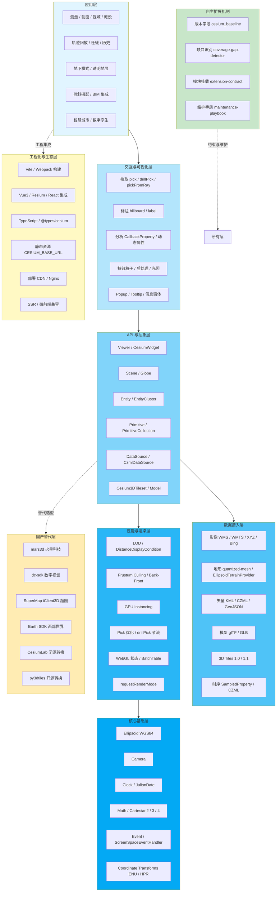

# Cesium 技术体系架构

> 8 层架构图(Mermaid)+ 各层职责说明。

## 完整架构图



## 各层职责

### 1. 核心基础层(Foundation)
地球数学与运行时支撑。改这里 = 改 Cesium 本体,99% 的项目不会碰。
- **WGS84 Ellipsoid**:地球椭球模型
- **Camera**:相机控制(setView / flyTo / lookAt)
- **Clock + JulianDate**:时间轴,时序数据驱动
- **Coordinate Transforms**:ENU / HPR / ECEF 转换
- **Cartesian2/3/4**:坐标与向量

### 2. 数据接入层(Data Sources)
所有数据进入 Cesium 的入口。
- 影像:ArcGIS / 天地图 / 高德 / Bing / Mapbox / 自定义 XYZ
- 地形:CesiumTerrainProvider(quantized-mesh)/ EllipsoidTerrainProvider
- 矢量:KML / CZML / GeoJSON / TopoJSON
- 3D 模型:glTF / GLB / 3D Tiles(b3dm/i3dm/pnts/cmpt 在 1.1 弃用)
- 时序:CZML / SampledProperty

### 3. API 与抽象层(API & Abstractions)
开发者直接打交道的对象。
- **Viewer**:一站式入口
- **Entity vs Primitive**:高层 vs 底层(性能与开发效率的权衡)
- **Cesium3DTileset**:大规模 3D 数据加载的核心

### 4. 交互与可视化层(Interaction & Visualization)
让用户"摸得到"。
- ScreenSpaceEventHandler(鼠标 / 触摸)
- pick / drillPick / pickFromRay(拾取)
- Billboard / Label(标注)
- CallbackProperty(动态属性)

### 5. 性能与渲染层(Performance & Rendering)
数据量大时必看。
- LOD / Frustum Culling / DistanceDisplayCondition
- GPU Instancing / BatchTable
- requestRenderMode / maximumScreenSpaceError
- 性能诊断:PerformanceDisplay + Chrome DevTools

### 6. 应用层(Applications)
真正解决业务问题的功能组合。
- 测量 / 剖面 / 视域 / 淹没
- 轨迹回放 / 迁徙 / 历史
- 地下模式 / 透明地层
- 倾斜摄影 / BIM 集成

### 7. 工程化与生态层(Engineering & Ecosystem)
把 Cesium 装进现代前端工程。
- Vite / Webpack 静态资源拷贝
- Vue / React 绑定(vue-cesium / resium / cesium-use)
- TypeScript 类型
- 部署 / CDN / SSR 兼容

### 8. 国产替代层(Domestic Alternatives)
基于 Cesium 的二次封装,降低开发门槛。
- mars3d / dc-sdk / Earth SDK / SuperMap iClient3D
- CesiumLab(数据转换)/ py3dtiles(开源转换)

### ⭐ 自主扩展机制(Self-Evolution)
让本参考文档能"自我进化"。
- 版本字段追踪官方基线
- 缺口识别提示未覆盖需求
- 模块挂载契约保证扩展规范
- 维护者手册周期任务清单

## 数据流图

```
原始数据 (BIM / 倾斜摄影 / 点云 / 影像 / 矢量)
   ↓ 数据转换
3D Tiles 1.1 / quantized-mesh / glTF / GeoJSON
   ↓ Provider 加载
Cesium3DTileset / CesiumTerrainProvider / ImageryLayer
   ↓ 渲染对象
Primitive / Entity / 3D Tileset
   ↓ 拾取 / 交互
PickResult → 业务逻辑 → UI 更新
   ↓ 输出
交互式 3D 地球应用
```

## 选型决策树

```
问:你的场景是什么?
├─ 静态展示 / 全球影像 + OSM Buildings
│  └─ Cesium 原生 + Viewer 一行代码
├─ 国内地图 / 行政区划
│  └─ 换 Bing 底图为天地图 / 高德 XYZ
├─ 大量自定义业务点(>1k 个)
│  └─ BillboardCollection + Primitive
├─ 大量时间动态轨迹
│  └─ CZML + SampledPositionProperty
├─ 大规模倾斜摄影 / BIM
│  └─ Cesium3DTileset + 自定义 server
├─ 想少写代码 / 拿现成组件
│  └─ mars3d / vue-cesium / dc-sdk
├─ 政务 / 信创 / 国密
│  └─ SuperMap iClient3D
├─ 地下场景 / 地质可视化
│  └─ depthTestAgainstTerrain + clippingPlanes
└─ 性能极致顶 / 100k+ 实时轨迹
   └─ Primitive + LOD + 拆 DrawCommand
```

---

**本架构图来源**:综合自 [cesium.com/docs/tutorials](https://cesium.com/docs/tutorials)、[github.com/CesiumGS/3d-tiles](https://github.com/CesiumGS/3d-tiles)、[Bright Coding Blog: CesiumJS architecture](http://blog.brightcoding.dev/2025/07/14/cesiumjs-the-open-source-engine-powering-next-generation-3d-globes-and-maps) 以及多个开源社区的总结。详见 `references/official-sites.md`。