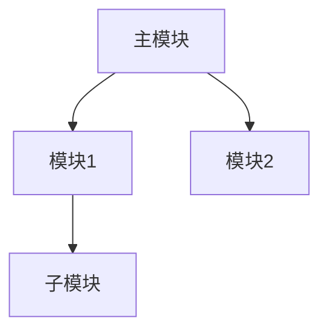

---
AIGC:
    ContentProducer: Minimax Agent AI
    ContentPropagator: Minimax Agent AI
    Label: AIGC
    ProduceID: 732ea147a462be85dbf622321cfca4ab
    PropagateID: 732ea147a462be85dbf622321cfca4ab
    ReservedCode1: 30450221009c349f30ad107760ed6356604821167cd4bf37dc263d9f875e3869f284abed760220661d9b43f0700bef2bf958acbcd3d7e78fb70cb988f3613022e103ecc675ad9e
    ReservedCode2: 3044022000f35485f335b827866c445cb7503522b7b666f32ea99196db8079798b282fd702207d90cceca7b45dba54e1316586377849e9c93093c703419e34ea74997b86c849
description: 整理和总结大规模代码仓库，生成可视化图结构。当用户要求"分析代码仓库"、"整理代码结构"、"生成代码图"、"代码可视化"、"理解代码库"、"代码库概览"时使用。
name: code-repo-visualizer
---

# 代码仓库可视化分析器

## 功能概述

自动扫描和分析代码仓库，提取文件结构、模块关系和依赖图，生成可视化的图结构报告，帮助用户快速理解整个代码库。

## 工作流程

### 步骤 1：仓库扫描

使用 `Glob` 工具扫描代码仓库结构：

```
pattern: "**/*"
path: <用户指定路径>
```

识别：
- 编程语言文件（.py, .js, .ts, .java, .go, .rs 等）
- 配置文件（.json, .yaml, .xml, .toml 等）
- 目录结构

### 步骤 2：文件分类与解析

根据文件扩展名分类：

| 语言 | 扩展名 | 依赖关键词 |
|------|--------|-----------|
| Python | .py | import, from...import |
| JavaScript/TypeScript | .js, .ts, .jsx, .tsx | import, require, export |
| Java | .java | import, package |
| Go | .go | import |
| Rust | .rs | use, mod |

使用 `Read` 工具读取关键文件，解析导入/依赖语句。

### 步骤 3：构建图结构

基于分析结果构建：

1. **文件树**：目录层级结构
2. **依赖图**：文件间导入关系
3. **模块图**：包/模块聚合关系

使用 Mermaid 语法生成图结构：



### 步骤 4：生成可视化报告

使用 `render_mermaid` 工具渲染图结构，并生成总结报告。

## 输出格式

### 1. 结构概览

```
📁 代码仓库结构
├── src/              # 源代码目录
│   ├── components/    # 组件目录
│   ├── utils/         # 工具函数
│   └── main.ts        # 入口文件
├── tests/             # 测试目录
└── package.json       # 项目配置
```

### 2. 依赖关系图

Mermaid 格式的可视化依赖图，展示模块间的调用关系。

### 3. 关键指标

- 总文件数
- 代码行数（按语言分布）
- 模块数量
- 依赖复杂度

## 使用示例

```
用户：请分析当前项目的代码结构
→ 执行仓库扫描和分析流程
→ 输出结构概览 + 依赖图 + 关键指标
```

## 注意事项

1. **大仓库处理**：对于超过 1000 个文件的大型仓库，优先分析核心目录
2. **循环依赖检测**：标记可能的循环依赖问题
3. **排除非必要文件**：忽略 node_modules, __pycache__, .git 等目录
