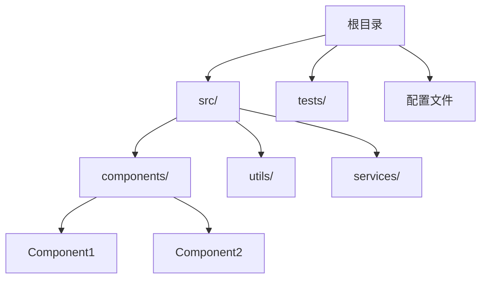
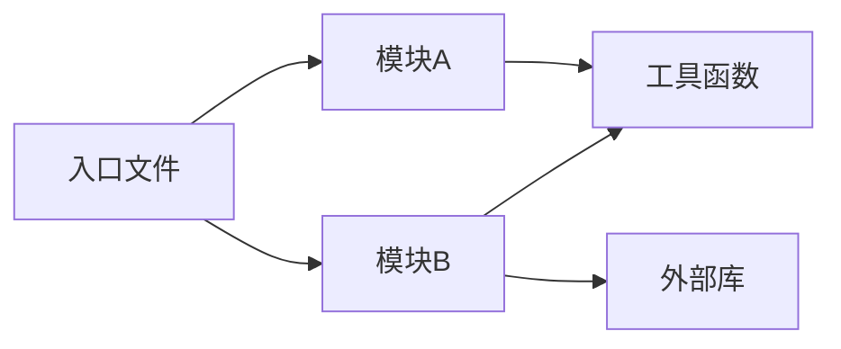
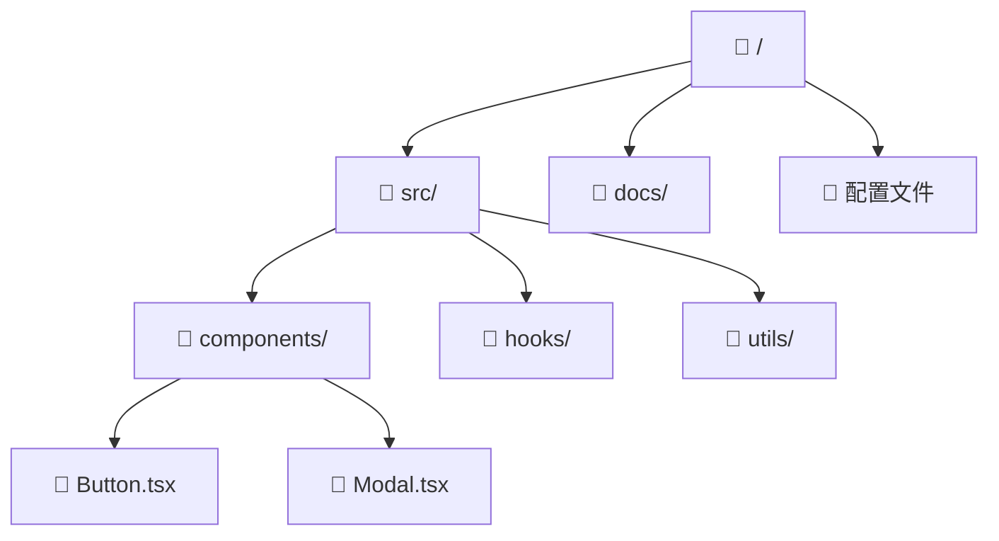
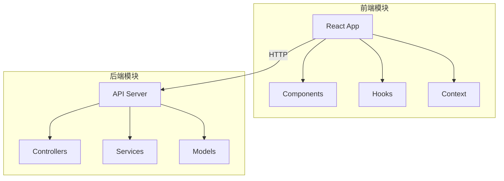
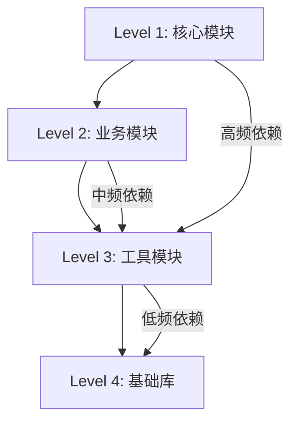

---
AIGC:
    ContentProducer: Minimax Agent AI
    ContentPropagator: Minimax Agent AI
    Label: AIGC
    ProduceID: b1ccc2899606640dccab65f0f1f43914
    PropagateID: b1ccc2899606640dccab65f0f1f43914
    ReservedCode1: 30450221008ba454dc5b68eaf633cb5c260fc443109ed9ea1921e890748b1201d1f44800380220695090e2ed9e61ff6685d9bc97660e62e7b773d8fb2c2c7e699763b646705f1e
    ReservedCode2: 30430220207adc739310f2530f800ce98328958be560cf53a0adbab4bcb47c38ef147f6b021f1e1304ca7f762822d65fc41109b4fa70270d19c71fb17fccf8f98aa9b5d2a4
---

# Mermaid 图结构生成参考

## 基础图结构

### 1. 树状结构图 (graph TD)

### 2. 依赖关系图 (graph LR)

### 3. 文件夹层级图

## 进阶图结构

### 4. 带颜色的模块分组

### 5. 依赖深度分析

## 特殊符号转义

Mermaid 中特殊字符需要转义：

| 特殊字符 | 转义写法 |
|---------|---------|
| `<` | `&lt;` |
| `>` | `&gt;` |
| `"` | `&quot;` |
| `.` | 无需转义 |
| `#` | 无需转义 |
| 空格 | 使用 `[ ]` 包裹文本 |
