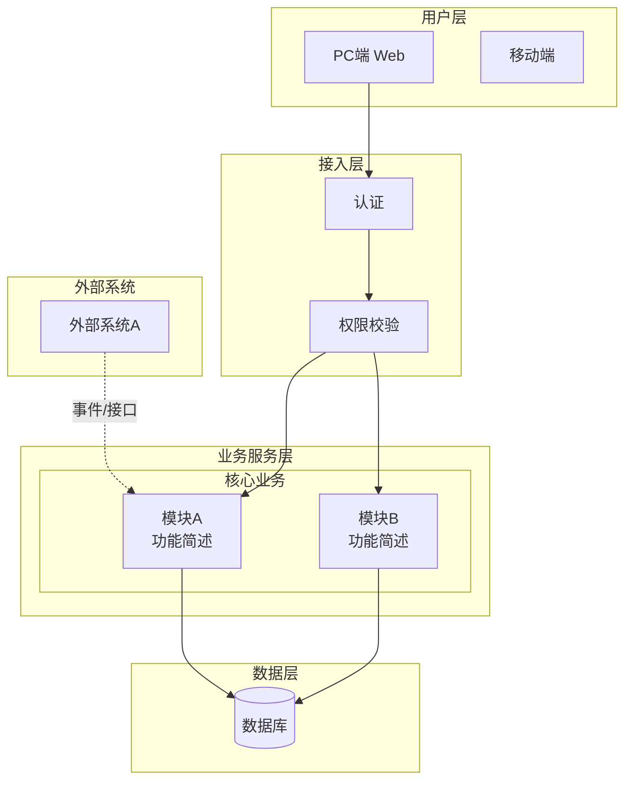
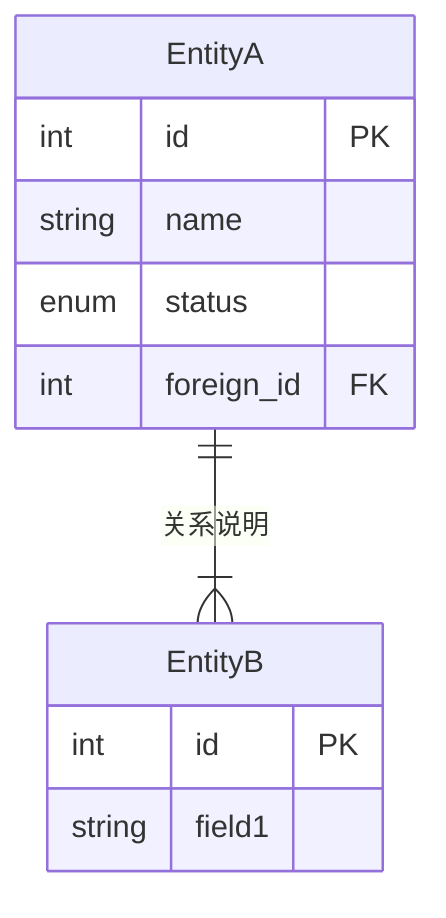
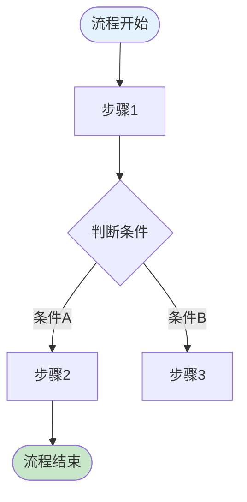
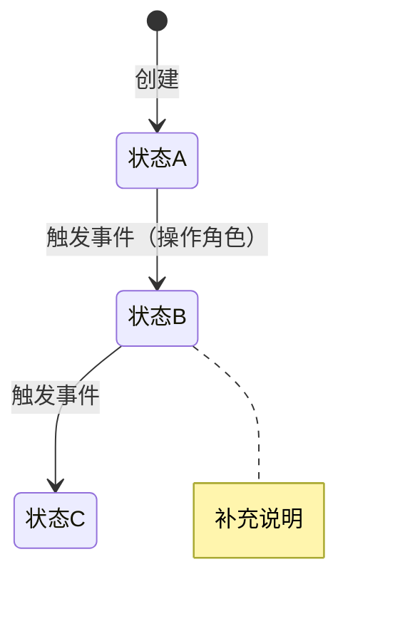

# 第10章 功能需求 — 生成指引

> 这是 PRD 中最核心、最大的章节。

## 章节目标

以结构化方式详尽描述产品的功能设计，包括产品框架、功能详解和异常处理。

> 💡 方法论基础：
> - 产品框架：《决胜B端》自顶向下设计（框架图→数据模型→流程→页面→权限→字段）
> - 数据建模：ER建模三步法（找实体→梳关系→定属性）
> - 规则描述：五种规则类型（事实、约束、触发条件、推论、计算）

## 10.1 产品框架概述

所有图表使用 Mermaid 语法生成。

### 10.1.1 应用架构图

使用 `graph TB`，用 `subgraph` 分层（用户层、接入层、业务服务层、数据层、外部系统）。

````md

````

### 10.1.2 数据模型图

使用 `erDiagram` 语法，ER图后附实体说明表格。

````md

````

关系符号：`||--||` 一对一，`||--|{` 一对多，`}|--|{` 多对多

### 10.1.3 核心业务流程图

使用 `flowchart TD`，用颜色区分不同角色和关键状态。

````md

````

### 10.1.4 状态机图

使用 `stateDiagram-v2`，状态机图后附状态转换明细表。

````md

````

### 10.1.5 功能清单

| 子系统 | 页面 | PC端 | H5端 | App端 | 说明 |
| --- | --- | --- | --- | --- | --- |
| {子系统A} | {页面1} | ✓ | — | — | |

## 10.2 产品需求详解

对每个功能模块，按以下三段式结构生成：

```md
#### 10.2.X {模块名称}功能详解

##### 业务流程图
{该模块的详细业务流程}

##### 页面交互

**{页面名称}**

**查询条件：**
| 字段名称 | 默认值 | 字段类型 | 备注 |
| --- | --- | --- | --- |

**列表字段：**
| 字段名称 | 默认值 | 字段类型 | 开放修改 | 必输项 | 备注 |
| --- | --- | --- | --- | --- | --- |

**操作按钮：**
| 按钮名称 | 操作说明 | 触发条件 | 权限要求 |
| --- | --- | --- | --- |

##### 业务规则

> 💡 规则五种类型：事实、约束、触发条件、推论、计算

| 编号 | 规则类型 | 规则描述 |
| --- | --- | --- |
| R1 | 约束 | {如：订单金额不可为负数} |
| R2 | 触发条件 | {如：当库存低于安全库存时，自动触发补货提醒} |
| R3 | 计算 | {如：订单总额 = Σ(商品单价 × 数量) - 优惠金额} |
```

## 10.3 异常情况处理方案

```md
| 异常类型 | 异常场景 | 处理方案 |
| --- | --- | --- |
| 网络异常 | 提交操作时断网 | 本地暂存，恢复后自动重试 |
| 并发冲突 | 多人同时编辑同一记录 | 乐观锁 + 冲突提示 |
| 数据异常 | 外部系统返回错误数据 | 校验拦截 + 错误日志 |
| 误操作 | 误删除重要数据 | 软删除 + 回收站 |
| 业务异常 | 审批超时无人处理 | 超时提醒 → 升级提醒 → 自动转派 |
```

## AI 功能设计（如适用）

```md
##### AI 功能设计

**任务特征分析（确定性-容错性四象限）：**
| 分析维度 | 评估 |
| --- | --- |
| 确定性 | 高/低 |
| 容错性 | 高/低 |
| 推荐交互模式 | {六脉神剑中的具体模式} |

**六脉神剑交互模式**：封装API / CUI嵌入GUI / Chat / Copilot / 辅助填充 / 后台自动化

- **降级方案**：{AI 不可用时的回退方案}
- **监控指标**：{准确率、使用率、弃用率等}
```

## 不同产品类型侧重差异

| 功能类型 | 10.1 侧重 | 10.2 侧重 | 10.3 侧重 |
| --- | --- | --- | --- |
| 业务型 | ER图+流程图+状态机都必须完整 | 每个模块的角色交互和审批流程 | 审批异常、数据一致性 |
| 工具型 | 简化模型，强调使用流程 | 操作效率和快捷方式 | 数据丢失防护、撤销操作 |
| 交易型 | ER图+交易流程图+状态机 | 交易闭环各环节的规则 | 支付异常、库存并发、对账 |
| 基础服务型 | API结构+调用流程 | 接口规范和参数说明 | 服务降级、限流、重试 |

## 质量标准

- [ ] 10.1 业务型/交易型产品有完整ER模型
- [ ] 10.1 有状态流转的实体都有状态机
- [ ] 10.2 每个模块按"流程→交互→规则"三段式
- [ ] 10.2 规则按五种类型分类
- [ ] 10.3 至少覆盖5类异常场景
