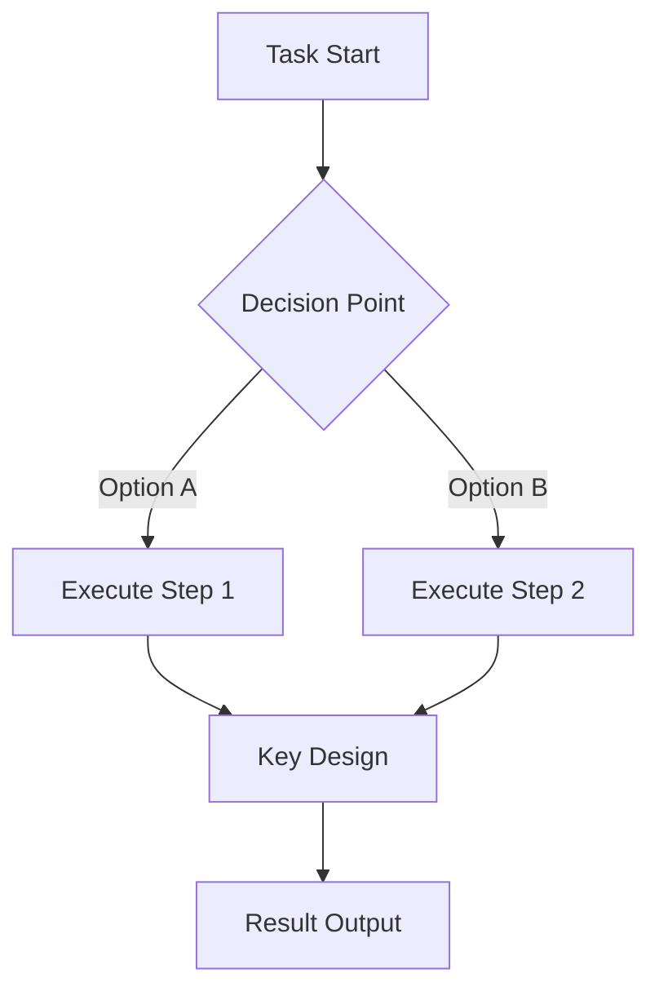

---
AIGC:
    ContentProducer: Minimax Agent AI
    ContentPropagator: Minimax Agent AI
    Label: AIGC
    ProduceID: f52b0d562f28a1d3e9067e135f9fafe8
    PropagateID: f52b0d562f28a1d3e9067e135f9fafe8
    ReservedCode1: 3044022037e6ca7f051e5cbbefa06af905e91dc47bbe086aa567a3fdab973f6ab87bfb800220519ea3fed5f4bb64d81eeb79670b5f64e726bc43254f8c9c4225469a0147689b
    ReservedCode2: 3046022100daf9933da02267826b4e754e7c687cb29f3dffd9954d7e87a1015213de16c9de022100bcc0b5ccca4b0f588caeca21f12f45dfe07e9afb0a73d7239544fb83a813474c
---

# Dev Thought Mirror

## Core Purpose

Transform AI's "invisible thinking process" when solving programming tasks into "visible knowledge" for learning, helping developers maintain growth while pursuing efficiency.

## Output Principles

### 1. Concise & Efficient
- High-level thinking and key decision points
- Essential explanations at key locations
- Avoid redundant details

### 2. Hybrid Presentation
- Text explanation + key node visualization (Mermaid diagrams)
- Structured output for quick browsing and understanding

### 3. Self-Reflection
- Guide AI to perform self-reflection and reasoning reconstruction
- Proactively extract teachable content based on task context

---

## Output Dimensions

Intelligently select relevant dimensions based on task type:

| Dimension | Description | Applicable Scenarios |
|-----------|-------------|---------------------|
| **Problem Decomposition** | How to break complex tasks into executable subtasks | Daily coding, Architecture design |
| **Solution Selection** | Why choose Plan A over Plan B, trade-offs considered | Tech selection, Code refactoring |
| **Technical Decisions** | Tools/commands/APIs used and why | Daily coding, Debugging |
| **Code Design** | Design logic and data structure choices for key code | Architecture, Refactoring |
| **Debugging Process** | Error investigation path and fix methods | Debugging |
| **Knowledge Gaps** | Uncertainties or newly learned knowledge points | Tech learning |
| **Transferable Patterns** | Reusable methodologies from this task | All scenarios |

---

## Output Format Template

```
## Task Overview
Brief description of the task goal and background

## Core Thinking
[Concise task-solving main path, visualized with flowchart]

## Key Decision Points
### Decision 1: ...
   - Considerations: ...
   - Reason for choice: ...

### Decision 2: ...
   - Considerations: ...
   - Reason for choice: ...

## Technical Highlights
- [Key point 1]: explanation
- [Key point 2]: explanation

## Transferable Experience
- [Reusable methods/approaches learned from this task]

## Knowledge Extension
- [Related extended learning suggestions, optional]
```

## Visualization Nodes

When tasks involve procedural thinking, use Mermaid flowcharts:



## Trigger Commands

Users can trigger via:

**English:**
- "analyze thinking" / "analyze this task"
- "explain decisions" / "explain why"
- "show reasoning"
- "learn this approach"
- "thinking summary" / "retrospective"

**中文:**
- "分析思路" / "分析一下"
- "解释决策" / "为什么这样做"
- "说说你的思考过程"
- "学习这个方案"
- "思路总结" / "复盘"

**口语化 (Colloquial):**
- "说说你怎么想的"
- "怎么做到的"
- "给我讲讲这个"
- "这一步是为什么"

## Usage Examples

**User Input:** "analyze thinking: help me optimize this query performance"

**AI Output:**
1. First understand current performance bottlenecks
2. Analyze possible optimization approaches (indexing, query rewriting, caching, etc.)
3. Explain reasons for choosing specific approach
4. Show flowchart of optimization path
5. Summarize transferable performance optimization experience

---

## Design Philosophy

> "Efficiency and growth need not be opposites. By making thinking visible, we can make AI both an efficient assistant and a valuable learning companion."
