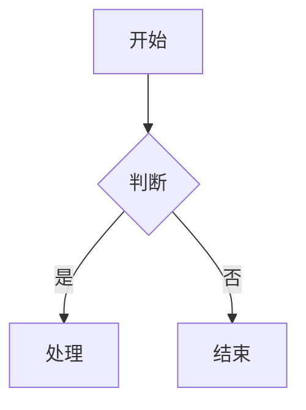
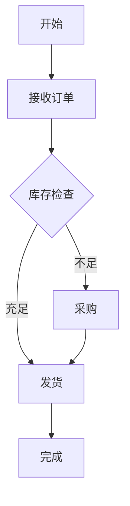

# 文档图表生成技能

配合Word等文档使用的图表生成、搜索、命名和插入工具。

## 核心能力

### 1. 图片搜索与抓取

**工具**: `images_search_and_download`

- 根据用户描述的图表内容搜索相关图片
- 支持技术架构图、流程图、示意图等
- 自动下载并保存到工作目录

### 2. 图表生成

#### Mermaid 图表

生成代码示例：


**工具**: `render_mermaid`

#### Matplotlib 数据图表

```python
import matplotlib.pyplot as plt

# 生成数据图表
fig, ax = plt.subplots()
ax.plot([1, 2, 3], [4, 5, 6])
plt.savefig('chart.png')
```

**工具**: `image_synthesize`

### 3. 智能命名

命名规则：`{类型}_{主题}_{序号}_{时间戳}.{格式}`

示例：
- `flowchart_order_process_001_20240101.png`
- `architecture_microservice_diagram.png`
- `chart_sales_data_line.png`

### 4. 插入位置定位

分析文档结构，确定图表插入的最佳位置：
- 章节标题后
- 相关段落旁
- 列表项目后

## 工作流程

### 流程A：图片搜索插入

```
用户需求 → 分析需求 → 搜索图片 → 下载保存 → 命名处理 → 生成插入代码 → 输出
```

1. **分析需求**
   - 图表类型（流程图、架构图、示意图）
   - 主题关键词
   - 风格要求（简洁、专业、技术等）

2. **搜索与下载**
   - 使用 `images_search_and_download` 搜索
   - 验证图片质量
   - 保存到 `imgs/` 目录

3. **生成插入代码**
   - 输出 Markdown 图片语法
   - 输出 Word/LibreOffice 插入代码
   - 提供相对路径引用

### 流程B：Mermaid 图表生成

```
用户需求 → 分析结构 → 生成Mermaid代码 → 渲染预览 → 输出代码和图片
```

1. **分析图表结构**
   - 确定节点和连接关系
   - 选择合适的图表类型（flowchart、sequence、class等）

2. **生成代码**
   - 使用 Mermaid 语法
   - 添加样式注释

3. **渲染输出**
   - 渲染为 SVG/PNG
   - 提供可编辑代码

### 流程C：数据图表生成

```
数据描述 → 生成图表代码 → 执行渲染 → 输出图片
```

1. **数据收集**
   - 用户提供数据或描述数据范围
   - 确定图表类型（柱状图、折线图、饼图等）

2. **生成图表**
   - 使用 `image_synthesize` 生成
   - 或生成 Python 代码让用户执行

## 输入规范

### 必要信息

| 字段 | 说明 | 示例 |
|------|------|------|
| `图表类型` | 流程图/架构图/数据图表/示意图 | 流程图 |
| `主题` | 图表的主要内容 | 订单处理流程 |
| `目标位置` | 文档中插入位置（可选） | 第3章之后 |

### 可选信息

| 字段 | 说明 | 示例 |
|------|------|------|
| `风格` | 简洁/专业/技术 | 技术 |
| `格式` | png/svg/mermaid | png |
| `数据` | 具体数据（用于数据图表） | 见下方 |

### 数据图表数据格式

```json
{
  "类型": "柱状图",
  "标题": "2024年Q1销售数据",
  "数据": {
    "labels": ["一月", "二月", "三月"],
    "values": [120, 150, 180]
  }
}
```

## 输出规范

### 标准输出

```markdown
## 图表已生成

**文件名**: `flowchart_order_process_001.png`
**位置**: `imgs/flowchart_order_process_001.png`
**尺寸**: 800x600px

### 插入代码

**Markdown**:
```markdown

```

**Word (Alt+Shift+I)**:
```
imgs/flowchart_order_process_001.png
```

### 预览
[Mermaid渲染预览]
```

### Mermaid 图表输出

```markdown
## Mermaid 图表

**类型**: 流程图
**文件**: `imgs/flowchart_order_001.svg`

### 代码


### 渲染结果
[Mermaid渲染图片]
```

## 目录结构

```
workspace/
├── imgs/                    # 图表存储目录
│   ├── flowchart_*.png
│   ├── architecture_*.svg
│   └── chart_*.png
├── docs/                    # 文档目录（可选）
└── chart_config.json        # 图表配置
```

## 与其他技能的配合

### 与文档生成技能配合

当用户生成完整文档时：
1. 调用 `doc-chart-generator` 生成所需图表
2. 获取图表路径和插入代码
3. 将图表代码嵌入到文档生成流程中

### 配合模式

```python
# 示例：文档生成流程中的图表插入
chart_request = {
    "type": "architecture",
    "topic": "微服务架构",
    "position": "第2章"
}

# 调用图表生成
chart_result = await generate_chart(chart_request)

# 获取插入信息
insert_code = chart_result["markdown_embed"]
chart_path = chart_result["file_path"]
```

## 错误处理

| 错误类型 | 处理方式 |
|---------|---------|
| 搜索无结果 | 建议使用 Mermaid 生成替代方案 |
| 图片下载失败 | 重试3次，失败则生成占位符 |
| 图表类型不支持 | 返回支持的类型列表 |
| 命名冲突 | 自动添加序号后缀 |

## 配置选项

### chart_config.json

```json
{
  "output_dir": "imgs",
  "naming_pattern": "{type}_{topic}_{index}_{timestamp}",
  "default_format": "png",
  "preferred_resolution": "1080P",
  "supported_types": ["flowchart", "sequence", "class", "architecture", "data"]
}
```

## 快捷命令

| 命令 | 功能 |
|------|------|
| `生成流程图 [主题]` | 快速生成流程图 |
| `搜索架构图 [关键词]` | 搜索并下载架构图 |
| `生成数据图表 [类型]` | 生成数据可视化图表 |
| `插入图表 [文件名]` | 生成文档插入代码 |
