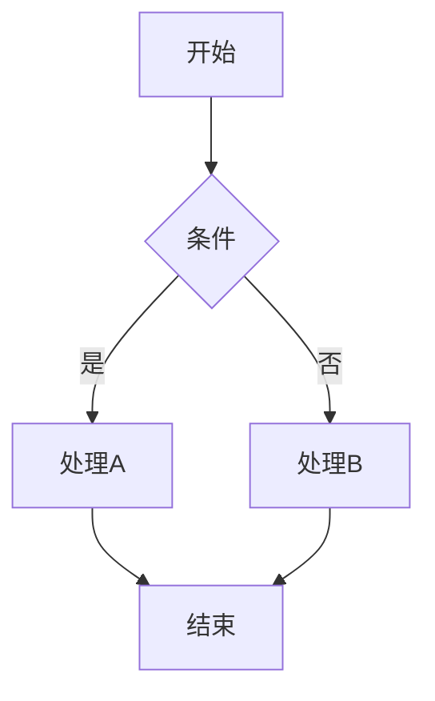
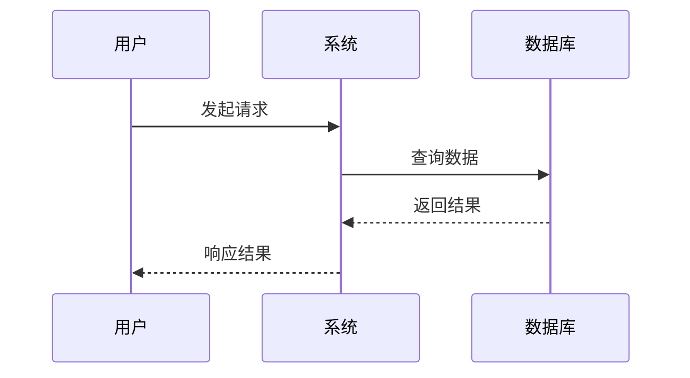
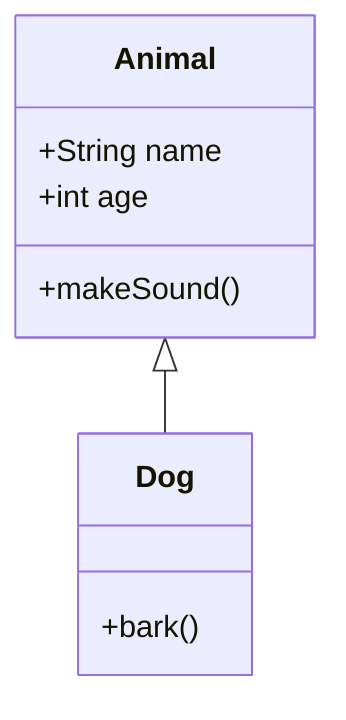
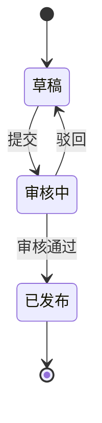
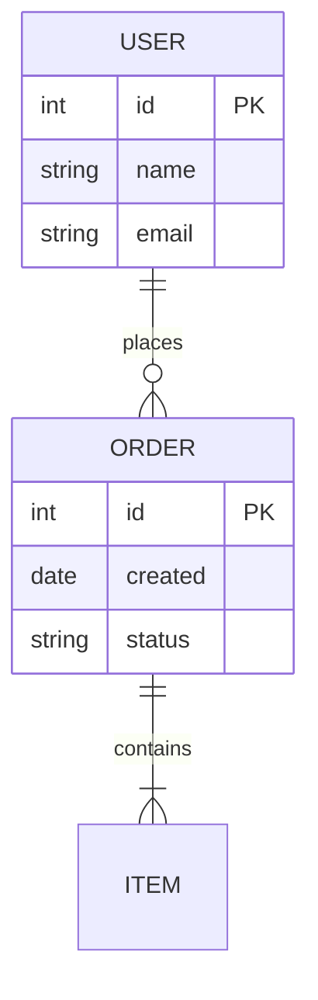

# 图表类型参考

## Mermaid 图表类型

### 1. 流程图 (Flowchart)



**适用场景**: 业务流程、决策流程、步骤说明

### 2. 序列图 (Sequence)



**适用场景**: 系统交互、API调用时序

### 3. 类图 (Class)



**适用场景**: 面向对象设计、类关系

### 4. 状态图 (State)



**适用场景**: 状态流转、生命周期

### 5. 实体关系图 (ER)



**适用场景**: 数据库设计、数据模型

## 数据图表类型

### 1. 柱状图 (Bar Chart)

适用于：比较不同类别的数据大小

### 2. 折线图 (Line Chart)

适用于：展示数据趋势变化

### 3. 饼图 (Pie Chart)

适用于：展示占比关系

### 4. 散点图 (Scatter)

适用于：展示两个变量的相关性

### 5. 热力图 (Heatmap)

适用于：展示矩阵数据

## 架构图模板

### 微服务架构

```
┌─────────────┐     ┌─────────────┐
│   前端应用   │────▶│  API网关    │
└─────────────┘     └──────┬──────┘
                           │
         ┌─────────────────┼─────────────────┐
         ▼                 ▼                 ▼
┌─────────────┐   ┌─────────────┐   ┌─────────────┐
│   用户服务   │   │   订单服务   │   │   商品服务   │
└─────────────┘   └─────────────┘   └─────────────┘
         │                 │                 │
         └─────────────────┼─────────────────┘
                           ▼
                  ┌─────────────┐
                  │    数据库    │
                  └─────────────┘
```

### 分层架构

```
┌─────────────────────────────────────────┐
│              表现层 (Presentation)       │
├─────────────────────────────────────────┤
│              业务层 (Business)           │
├─────────────────────────────────────────┤
│              数据层 (Data Access)        │
├─────────────────────────────────────────┤
│              基础设施层 (Infrastructure) │
└─────────────────────────────────────────┘
```

## 提示词模板

### 架构图提示词

```
生成一张专业的[系统名称]架构图，风格为[简洁/技术/现代]，
包含以下组件：[组件列表]，
使用[颜色主题]，标注清晰的层级关系。
```

### 流程图提示词

```
创建一个[流程名称]的流程图，使用Mermaid语法，
清晰展示[主要步骤]，包含[判断节点/循环]，
使用标准流程图符号。
```

### 数据图表提示词

```
生成一张[图表类型]展示[数据主题]，
包含以下数据点：[具体数据]，
使用[配色方案]，标题为"[标题文字]"。
```
