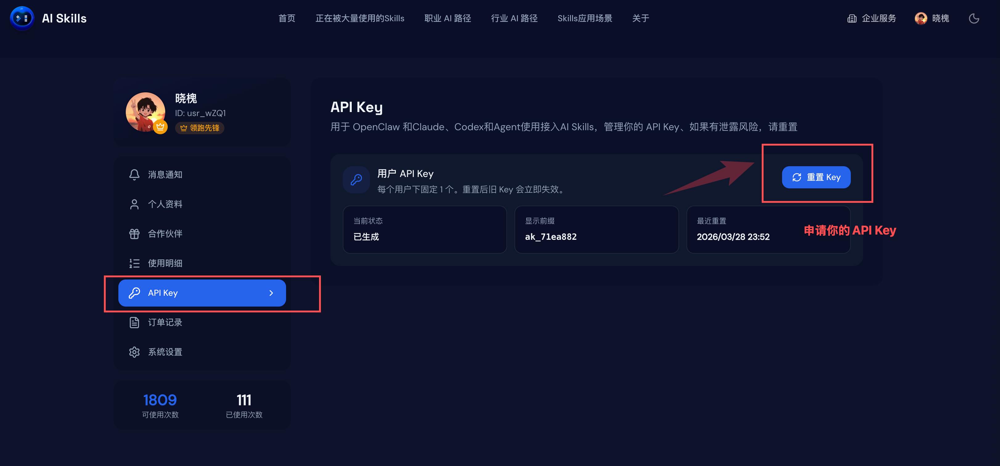
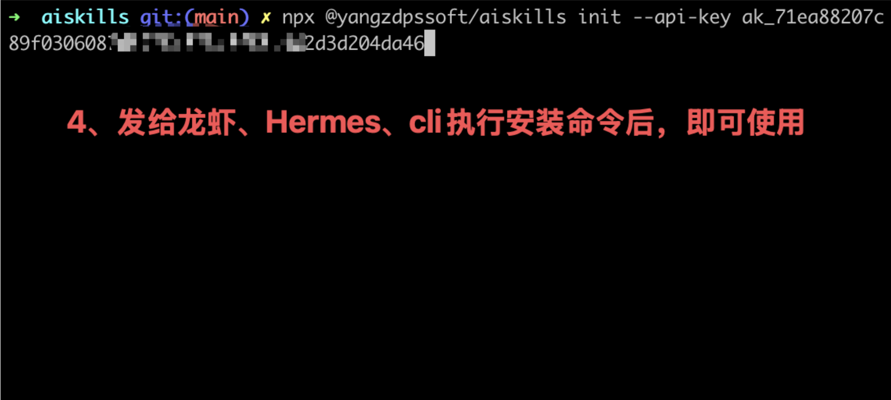

# AI Skills Library: Valuable AI Skills for Every Scenario

> Most people still use AI by "asking one question and getting one answer". AI Skills ([ai-skills.ai](https://ai-skills.ai/)) wants to take a different approach: break AI capabilities into executable Skills that can be called like looking up a dictionary. Whether you enter from AI Skills official website, skills.sh, or ClawHub, follow these 5 steps to complete the integration first, then continue to the current skill description.


## Quick Start

### 1. Scan Login


First complete scan login on AI Skills official website to ensure API Key, installation commands, and skill calls are all bound to the same account.

### 2. Apply for API Key



After login, go to the API Key page to apply for a key. Both CLI installation and skill execution will read AISKILLS_API_KEY.

### 3. Copy Installation Command


Copy the installation command from AI Skills official website, skills.sh, or ClawHub page. Prefer using the official CLI to avoid manual parameter stitching.

### 4. Execute Installation Command



Return to terminal and execute the installation command. CLI will write AISKILLS_API_KEY and call the downstream skills add to complete skill installation.

### 5. Successfully Obtain Skill


After successful installation, you will see the corresponding Skill in your agent's skill list. You can call it directly and replicate it in your workflow.

## Current Skill: douyin-kol-search

### Overview

Douyin high commercial value KOL finder

### When to Use

**Applicable Scenarios**

- the user asks who is worth collaborating with
- the user asks who sells best
- the user asks for Douyin benchmark accounts
- the user asks for same-track / competitor / similar creators on Douyin

**Typical User Questions**

- Who is worth collaborating with?
- Who sells best?
- Help me find some Douyin benchmark accounts
- Help me find similar creators in parenting / beauty / local food discovery tracks

**Not For**

- the user wants a hot topic list
- the user wants rising topic discovery
- the user wants comment analysis

**Adjacent Skill Selection**

- use `douyin-hotlist-overall` for hot content
- use `douyin-realtime-hot-rise` for topic opportunity discovery

### Invocation Method

Directly call AI Skills API via exported Python runner:

### Command Examples

**Filter by Track and Follower Range**

```bash
python3 scripts/run.py --params '{"keyword":"Shenzhen BBQ Bar","contentTag":"tag-48","followerRange":"10-100"}'
```

**Search KOL by Keyword Only**

```bash
python3 scripts/run.py --params '{"keyword":"Shenzhen BBQ Bar"}'
```

**Search KOL by Category Only**

```bash
python3 scripts/run.py --params '{"contentTag":"tag-48"}'
```

### Parameter Description

| Parameter | Type | Required | Default | Description |
| --- | --- | --- | --- | --- |
| `contentTag` | string | No | - | Content tag code, pass tag-{id}. Can search by track using only this field. Specific mapping below; at least one of `keyword` or `contentTag` is required |
| `keyword` | string | No | - | Track keyword, such as "Shenzhen BBQ Bar". At least one of `keyword` or `contentTag` is required |
| `followerRange` | string | No | - | Format "min-max", unit is 10k, e.g. `10-100` means 100k to 1M followers |

Parameter constraint: at least one of `keyword` or `contentTag` is required.

For complete machine-readable parameter structure, see `references/form-schema.json`.

### Content Tag Reference

#### `contentTag`

Field description: Content category

| Tag | Value |
| --- | --- |
| Beauty | `tag-1` |
| Fashion | `tag-6` |
| Pets | `tag-11` |
| Reviews | `tag-15` |
| Gaming | `tag-23` |
| Anime | `tag-25` |
| Travel | `tag-27` |
| Automotive | `tag-31` |
| Lifestyle | `tag-36` |
| Music | `tag-41` |
| Dance | `tag-46` |
| Food | `tag-48` |
| Parenting | `tag-55` |
| Sports & Fitness | `tag-60` |
| Tech & Digital | `tag-64` |
| Education & Training | `tag-68` |
| Looks | `tag-72` |
| Talent & Skills | `tag-79` |
| Entertainment | `tag-85` |
| Art & Culture | `tag-87` |
| Finance & Investment | `tag-91` |
| Agriculture | `tag-95` |
| Comedy & Drama | `tag-97` |
| Relationships | `tag-100` |
| Gardening | `tag-102` |
| Casual | `tag-130` |
| Real Estate | `tag-139` |
| Home & Living | `tag-1001` |
| Media | `tag-1002` |

### Supported Input Format

Current skill directly accepts JSON parameters, no share link parsing involved.

### Example Request

The example parameters below can be passed directly to `scripts/run.py`. The runner will send them to AI Skills API.

```bash
python3 scripts/run.py --params '{"keyword":"Shenzhen BBQ Bar","contentTag":"tag-48","followerRange":"10-100"}'
```

Equivalent `--params` JSON:

```json
{
  "keyword": "Shenzhen BBQ Bar",
  "contentTag": "tag-48",
  "followerRange": "10-100"
}
```

### Response Example

```json
{
  "success": true,
  "data": {
    "keyword": "Shenzhen BBQ Bar",
    "platformSource": "_1",
    "pagination": {
      "page": 1,
      "pageSize": 20,
      "total": 1
    },
    "items": [
      {
        "uid": "kol-1",
        "nickname": "Shenzhen BBQ King",
        "region": "Guangdong Shenzhen",
        "followerCount": 560000,
        "interactionRate30d": 0.082,
        "convertIndex": 82,
        "spreadIndex": 76,
        "starIndex": 91,
        "expectedPlayCount": 320000,
        "price20_60": 180000,
        "contentTags": [
          "Food"
        ]
      }
    ],
    "searchStrategy": {
      "usedFallback": true,
      "droppedFilters": [
        "contentTag"
      ],
      "localContentTagFilterApplied": true
    }
  },
  "meta": {
    "executionTime": 842,
    "cached": false
  }
}
```

### Key Points in Results

- `data.items`: KOL list, focus on `starIndex`, `convertIndex`, `spreadIndex`
- `data.searchStrategy`: Whether filter fallback occurred, useful for judging if results are loose matches
- `item.contentTags`: KOL track tags, used to verify if category filter is accurate

### Pre-run Preparation

- `AISKILLS_BASE_URL`: default `https://ai-skills.ai`
- `AISKILLS_API_KEY`: required for authentication calls
- `AISKILLS_TENANT_ID`: default `default`

### Notes

Current export package is automatically generated by AI Skills site directory. Runtime backend still points to the AI Skills API/workflow corresponding to `douyin-kol-search`.
