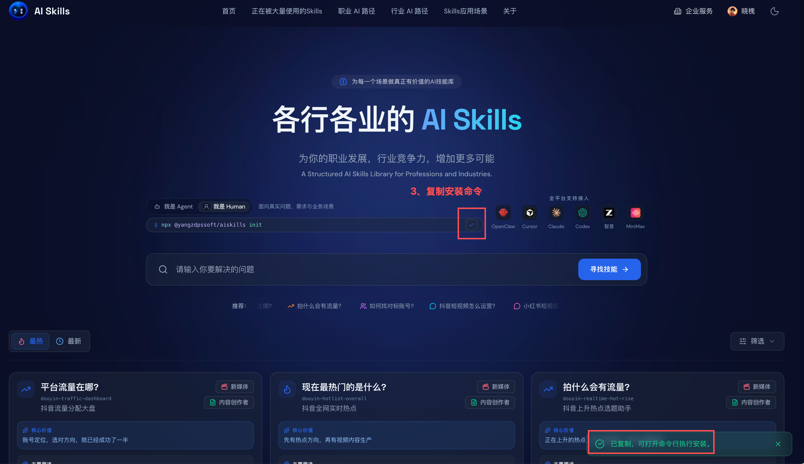
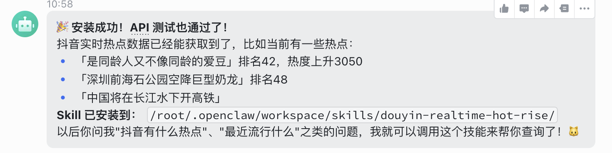

# AI Skills Library: Valuable AI Skills for Every Scenario

> Most people still use AI by "asking one question and getting one answer". AI Skills ([ai-skills.ai](https://ai-skills.ai/)) wants to take a different approach: break AI capabilities into executable Skills that can be called like looking up a dictionary.


## Quick Start

### 1. Scan Login


### 2. Apply for API Key


### 3. Copy Installation Command


### 4. Execute Installation Command


### 5. Successfully Obtain Skill


## Current Skill: douyin-traffic-dashboard

### Overview

Douyin traffic distribution overview

### When to Use

**Applicable Scenarios**

- the user asks where Douyin traffic is going
- the user asks which categories are getting more traffic
- the user wants a platform-level directional read

**Typical User Questions**

- Where is Douyin platform traffic going?
- Which content categories are getting more traffic recently?
- Which tracks are worth increasing content investment now?

**Not For**

- the user wants specific rising topics
- the user wants a real-time hot list
- the user wants creators or benchmark accounts

**Adjacent Skill Selection**

- use `douyin-realtime-hot-rise` for rising topic discovery
- use `douyin-hotlist-overall` for real-time hot topics

### Invocation Method

Directly call AI Skills API via exported Python runner:

### Command Examples

**View Full Platform Traffic Distribution**

```bash
python3 scripts/run.py --params '{}'
```

### Parameter Description

Current skill does not require additional parameters:

```bash
python3 scripts/run.py --params '{}'
```

### Response Example

```json
{
  "success": true,
  "data": {
    "categories": [
      {
        "label": "Food",
        "value": "9000",
        "hotCount": 128,
        "percentage": 14,
        "icon": "utensils",
        "description": "Store exploration, cooking, food reviews",
        "group": "life"
      },
      {
        "label": "Sports",
        "value": "5000",
        "hotCount": 96,
        "percentage": 11,
        "icon": "dumbbell",
        "description": "Events, athletes, training content",
        "group": "knowledge"
      }
    ],
    "total": 32,
    "timeRange": "Douyin platform real-time traffic share",
    "updateTime": "2026-04-24T11:30:00.000Z"
  },
  "meta": {
    "executionTime": 842,
    "cached": false
  }
}
```

### Key Points in Results

- `data.categories`: Platform traffic category list, focus on `percentage` and `hotCount`
- `category.value`: Category code, can be directly replicated to other skill filter parameters
- `data.updateTime`: Traffic distribution snapshot time

### Pre-run Preparation

- `AISKILLS_BASE_URL`: default `https://ai-skills.ai`
- `AISKILLS_API_KEY`: required for authentication calls
- `AISKILLS_TENANT_ID`: default `default`

### Notes

Current export package is automatically generated by AI Skills site directory.
