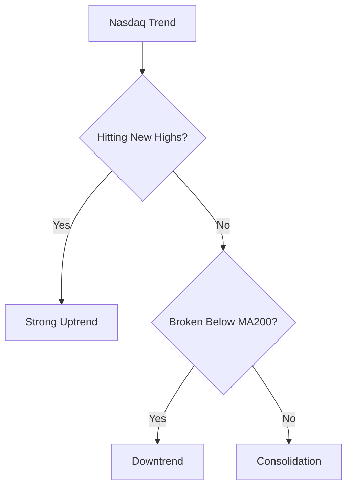

# ETF Analysis Framework Reference Guide

## Gold ETF Deep Analysis Guide

### 1. Gold Pricing Mechanism

#### 1.1 Core Pricing Factors

Gold pricing is determined by three main factors:

| Factor Category | Specific Indicators | Correlation with Gold |
|----------------|-------------------|---------------------|
| USD Factors | Real interest rates, Dollar index | Negative |
| Safe-Haven Demand | Geopolitical events, financial crises, market volatility | Positive |
| Physical Demand | Central bank buying, jewelry demand, investment demand | Positive |

#### 1.2 Real Interest Rate Framework

Real US interest rates serve as the anchor for gold pricing:

- **Rising real rates**: Opportunity cost of holding gold increases, gold pressured
- **Falling real rates**: Opportunity cost of holding gold decreases, gold benefits
- **Fed Dot Plot**: Reflects officials' expectations for future rate path

**Historical Patterns:**
- During Fed rate cut cycle in 2024, gold hit record highs
- Gold prices hovered around $2640-2650/oz in early 2025

#### 1.3 Central Bank Gold Buying

Global central bank gold purchases are key price support:

- **De-dollarization trend**: Central banks increasing gold reserves
- **Announcement effect**: Central bank buying announcements have significant psychological impact
- **Structural divergence**: Asian vs European central bank buying/selling dynamics

**Key Data Points:**
- Global central bank gold purchases hit record highs in 2024
- China, Poland, Turkey are major gold buying countries

### 2. Gold ETF Classification

| Type | Representative Products | Characteristics |
|------|------------------------|-----------------|
| Physical Gold ETF | GLD, 518880 | Track spot gold price, minimum tracking error |
| Gold Stock ETF | 159315 | Track gold mining stocks, combines gold price and stock volatility |
| Gold QDII | - | Can invest in overseas gold assets |

### 3. Technical Analysis Points

#### 3.1 Key Level Identification

- **Historical highs**: $2531/oz in August 2024
- **Psychological levels**: $2600, $2700, $3000
- **Moving averages**: MA20, MA60, MA200 support/resistance

#### 3.2 Trend Identification

- **Uptrend**: Gold makes higher highs, higher lows
- **Downtrend**: Gold makes lower highs, lower lows
- **Consolidation**: Price oscillating within range

### 4. Risk Factors

#### 4.1 High-Price Risk

- Gold at historical highs
- Increased short-term correction risk
- Caution advised when chasing

#### 4.2 Policy Risk

- Fed unexpectedly hawkish
- Sharp USD rebound

#### 4.3 Liquidity Risk

- Liquidity dry-up during extreme market volatility
- ETF premium/discount widening

---

## Nasdaq ETF Deep Analysis Guide

### 1. Nasdaq Index Characteristics

#### 1.1 Index Composition

Nasdaq 100 Index characteristics:

| Feature | Description |
|---------|-------------|
| Weight concentration | Apple, Microsoft, Google, Amazon, Nvidia top 5 weights >40% |
| Sector concentration | Tech stocks >50% of index |
| Growth attributes | High growth, high volatility, high valuation |

#### 1.2 Major Products

| Product | Code | Characteristics |
|---------|------|----------------|
| QQQ | QQQ | Most active Nasdaq ETF in US market |
| Nasdaq ETF | 513300 | Investable Nasdaq ETF in China |
| Nasdaq ETF | 159941 | Another investable option |

### 2. Price Drivers

#### 2.1 Macro Factors

| Factor | Impact Mechanism | Observables |
|--------|-----------------|-------------|
| Fed Policy | Hikes compress valuations → Nasdaq falls | FOMC meetings, dot plot |
| Economic Data | Good data → earnings → index rises | GDP, CPI, NFP |
| Inflation | High inflation → tightening expectations → growth stocks pressured | CPI, PPI |

#### 2.2 Market Sentiment

- **VIX Index**: Fear index, rising VIX bearish for Nasdaq
- **Fear & Greed Index**: Reflects market sentiment extremes
- **Fund Flows**: Tech ETF net inflows/outflows

#### 2.3 Valuation Levels

Nasdaq 100 valuation indicators:

- **P/E Ratio**: Current vs historical average
- **PEG Ratio**: Measures if growth is overvalued
- **Tech weight in S&P 500**: Checks if tech positioning too crowded

### 3. Technical Analysis Framework

#### 3.1 Trend Identification

#### 3.2 Key Signals

**Bullish Signals:**
- Nasdaq futures up pre-market
- Mega-cap tech earnings beat expectations
- Fed dovish signals

**Bearish Signals:**
- Nasdaq futures down >1% pre-market
- Tech stocks experiencing mass selling
- Treasury yields surging

### 4. Risk Factors

#### 4.1 Interest Rate Risk

Tech stocks highly sensitive to rates:

- Rising rates → lower present value of future cash flows → valuation compression
- Nasdaq often underperforms value stocks during rate hike cycles

#### 4.2 Concentration Risk

Top 5 weighted stocks have outsized index impact:

- Apple/Microsoft earnings miss
- Nvidia GPU demand changes
- Single sector risk exposure

#### 4.3 Bubble Risk

When Nasdaq at historical valuation extremes:

- Any negative news can trigger sharp corrections
- Stop-loss discipline especially important

---

## News Event Impact Quick Reference

### Gold News Impact

| Event Type | Expected Direction | Impact Level |
|------------|-------------------|--------------|
| Fed rate cut | Bullish | High |
| Geopolitical escalation | Bullish | High |
| Major central bank buying | Bullish | Medium-High |
| Dollar index surges | Bearish | High |
| Gold ETF large outflows | Bearish | Medium |
| Crude oil price surge | Bullish | Medium |

### Nasdaq News Impact

| Event Type | Expected Direction | Impact Level |
|------------|-------------------|--------------|
| Fed rate cut | Bullish | High |
| Tech earnings beat | Bullish | High |
| Treasury yields surge | Bearish | High |
| Nasdaq futures plunge | Bearish | High |
| AI positive news | Bullish | Medium-High |
| Tighter regulation | Bearish | Medium |

---

## Signal Rating Quantification Standards

### Comprehensive Scoring Model

| Dimension | Weight | Scoring Factors |
|-----------|--------|----------------|
| Fundamentals | 40% | Macro environment, corporate earnings, policy support |
| Technicals | 30% | Trend, momentum, support/resistance |
| Sentiment | 30% | Fund flows, market sentiment, institutional positioning |

### Rating Thresholds

| Total Score | Recommendation | Description |
|-------------|----------------|-------------|
| 8-10 points | Strong Buy | Multiple factors aligned upward |
| 6-8 points | Cautious Buy | Bullish bias with some uncertainty |
| 4-6 points | Hold | Neutral, waiting for signals |
| 2-4 points | Cautious Sell | Bearish bias, risk management needed |
| 0-2 points | Strong Sell | Trend clearly downward |

---

## Useful Tools and Resources

### Recommended News Sources

1. **Financial Media**: Wind, Eastmoney, Tonghuashun (China)
2. **International**: Reuters, Bloomberg, Yahoo Finance
3. **Central Bank Info**: Federal Reserve, World Gold Council

### Key Dashboard Indicators

**Gold:**
- Spot gold price (XAU/USD)
- Dollar Index (DXY)
- US real bond yields
- COMEX gold futures positioning
- Global central bank gold buying data

**Nasdaq:**
- Nasdaq 100 Index
- QQQ price
- VIX fear index
- Treasury yield curve
- Tech earnings calendar
