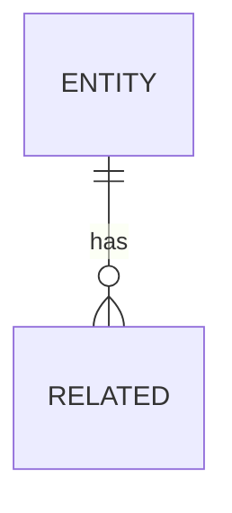
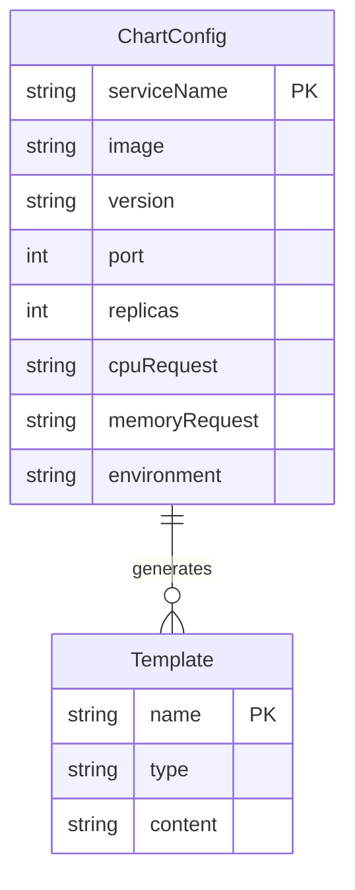

# 需求文档模板

## 概述

需求文档从用例中抽取功能/非功能需求，是开发实现的直接依据。

## 文档结构

```markdown
# 需求规格：[需求名称]

**需求ID**: REQ-NNN
**来源用例**: UC-NNN
**创建日期**: YYYY-MM-DD
**负责人**: [姓名]
**状态**: Draft / Review / Approved / Implemented
**优先级**: Critical / High / Medium / Low

## 简要描述

[一句话描述需求内容]

## 详细说明

[详细描述需求的功能、行为、约束]

## 验收标准

### AC-NNN-1: [验收标准名称]

**Given**: [前置条件]
**When**: [触发动作]
**Then**: [期望结果]

### AC-NNN-2: [验收标准名称]

**Given**: [前置条件]
**When**: [触发动作]
**Then**: [期望结果]

## 功能需求

### 输入

| 字段 | 类型 | 必填 | 验证规则 |
|:-----|:-----|:-----|:---------|
| [字段名] | [类型] | Yes/No | [规则] |

### 输出

| 字段 | 类型 | 说明 |
|:-----|:-----|:-----|
| [字段名] | [类型] | [说明] |

### 业务逻辑

```pseudo
// 伪代码描述业务逻辑
IF [条件] THEN
  [操作]
ELSE
  [备选操作]
END IF
```

## 非功能需求

### 性能要求

| 指标 | 要求 |
|:-----|:-----|
| 响应时间 | [要求] |
| 吞吐量 | [要求] |

### 安全要求

- [安全要求1]
- [安全要求2]

### 兼容性要求

- [兼容性要求1]

## 接口定义

### API 端点

```
[HTTP方法] /api/v1/[路径]
```

### 请求示例

```json
{
  "field": "value"
}
```

### 响应示例

```json
{
  "result": "success"
}
```

## 数据模型



## 衍生测试用例

| 测试ID | 测试名称 | 类型 |
|:-------|:---------|:-----|
| TC-NNN | [测试名称] | Positive / Negative / Boundary |

## 技术约束

- [约束1]
- [约束2]

## 依赖关系

| 依赖ID | 依赖类型 | 说明 |
|:-------|:---------|:-----|
| REQ-NNN | Prerequisite / Dependent | [说明] |

## 备注

[其他补充信息]
```

## 示例

```markdown
# 需求规格：Helm Chart 生成器

**需求ID**: REQ-003
**来源用例**: UC-001
**创建日期**: 2024-03-30
**负责人**: 李四
**状态**: Approved
**优先级**: High

## 简要描述

系统自动根据微服务配置生成符合规范的 Helm Chart。

## 详细说明

Helm Chart 生成器接收微服务配置参数（镜像、端口、资源限制等），自动生成完整的 Helm Chart，包括：
- Deployment 模板
- Service 模板
- ConfigMap 模板（如果需要）
- Ingress 模板（如果需要）

生成的 Chart 必须符合 Helm 最佳实践和公司内部规范。

## 验收标准

### AC-003-1: 基础 Chart 生成

**Given**: 用户提供了微服务基础配置（镜像名称、版本、端口）
**When**: 系统生成 Helm Chart
**Then**: Chart 包含正确的 Deployment 和 Service 模板

### AC-003-2: 资源配置生成

**Given**: 用户配置了 CPU 和内存限制
**When**: 系统生成 Helm Chart
**Then**: Deployment 模板包含正确的 resources 字段

### AC-003-3: 多环境支持

**Given**: 用户选择不同的目标环境
**When**: 系统生成 Helm Chart
**Then**: Chart 使用对应环境的 values 文件

## 功能需求

### 输入

| 字段 | 类型 | 必填 | 验证规则 |
|:-----|:-----|:-----|:---------|
| serviceName | string | Yes | 小写字母、数字、连字符，最多 63 字符 |
| image | string | Yes | 有效的 Docker 镜像引用 |
| version | string | Yes | 语义化版本号 |
| port | integer | Yes | 1-65535 |
| replicas | integer | No | 默认 1，范围 1-100 |
| cpuRequest | string | No | Kubernetes 资源格式，如 "100m" |
| memoryRequest | string | No | Kubernetes 资源格式，如 "256Mi" |
| environment | enum | Yes | dev, staging, prod |

### 输出

| 字段 | 类型 | 说明 |
|:-----|:-----|:-----|
| chartPath | string | 生成的 Chart 目录路径 |
| templates | string[] | 生成的模板文件列表 |
| values | object | 默认 values.yaml 内容 |

### 业务逻辑

```pseudo
FUNCTION generateHelmChart(config):
  // 验证输入
  IF NOT validateConfig(config) THEN
    RETURN error("Invalid configuration")
  END IF
  
  // 创建 Chart 目录结构
  chartDir = createChartDirectory(config.serviceName)
  
  // 生成 Chart.yaml
  generateChartYaml(chartDir, config)
  
  // 生成模板文件
  templates = []
  templates.add(generateDeployment(config))
  templates.add(generateService(config))
  
  IF config.ingressEnabled THEN
    templates.add(generateIngress(config))
  END IF
  
  // 生成 values.yaml
  generateValuesYaml(chartDir, config)
  
  RETURN success(chartDir, templates)
END FUNCTION
```

## 非功能需求

### 性能要求

| 指标 | 要求 |
|:-----|:-----|
| Chart 生成时间 | < 500ms |
| 并发生成数 | > 100/秒 |

### 安全要求

- 生成的模板不包含硬编码的敏感信息
- 敏感配置通过 Kubernetes Secrets 管理

### 兼容性要求

- Helm 3.x 兼容
- Kubernetes 1.24+ 兼容

## 接口定义

### API 端点

```
POST /api/v1/charts/generate
```

### 请求示例

```json
{
  "serviceName": "user-service",
  "image": "registry.example.com/user-service",
  "version": "1.2.0",
  "port": 8080,
  "replicas": 3,
  "cpuRequest": "100m",
  "memoryRequest": "256Mi",
  "environment": "staging"
}
```

### 响应示例

```json
{
  "chartPath": "/charts/user-service",
  "templates": [
    "templates/deployment.yaml",
    "templates/service.yaml"
  ],
  "values": {
    "replicaCount": 3,
    "image": {
      "repository": "registry.example.com/user-service",
      "tag": "1.2.0"
    }
  }
}
```

## 数据模型



## 衍生测试用例

| 测试ID | 测试名称 | 类型 |
|:-------|:---------|:-----|
| TC-003 | 基础 Chart 生成测试 | Positive |
| TC-004 | 无效服务名测试 | Negative |
| TC-005 | 边界值端口测试 | Boundary |
| TC-006 | 多环境配置测试 | Positive |

## 技术约束

- 使用 Go template 语法
- 遵循 Helm Chart 最佳实践
- 支持自定义模板扩展

## 依赖关系

| 依赖ID | 依赖类型 | 说明 |
|:-------|:---------|:-----|
| REQ-001 | Prerequisite | 需要先有微服务选择功能 |
| REQ-002 | Prerequisite | 需要先有环境配置功能 |

## 备注

生成的 Chart 需要支持后续的自定义修改。
```

## AI Agent 执行指导

### 从需求生成代码

1. 分析接口定义
2. 实现业务逻辑
3. 在代码注释中标记需求 ID：`// REQ-NNN: 实现说明`

### 代码中的需求追溯

```typescript
/**
 * Helm Chart 生成器
 * @req REQ-003
 */
export class HelmChartGenerator {
  /**
   * 生成 Helm Chart
   * @req REQ-003
   * @ac AC-003-1 基础 Chart 生成
   * @ac AC-003-2 资源配置生成
   */
  generate(config: ChartConfig): ChartResult {
    // 实现...
  }
}
```

### 校验检查清单

- [ ] 需求 ID 格式正确（REQ-NNN）
- [ ] 来源用例已关联
- [ ] 验收标准使用 Given-When-Then 格式
- [ ] 接口定义完整
- [ ] 衍生测试用例已关联
