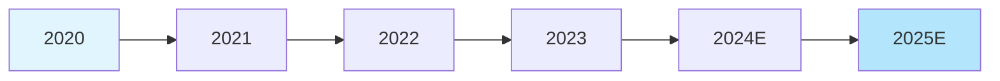
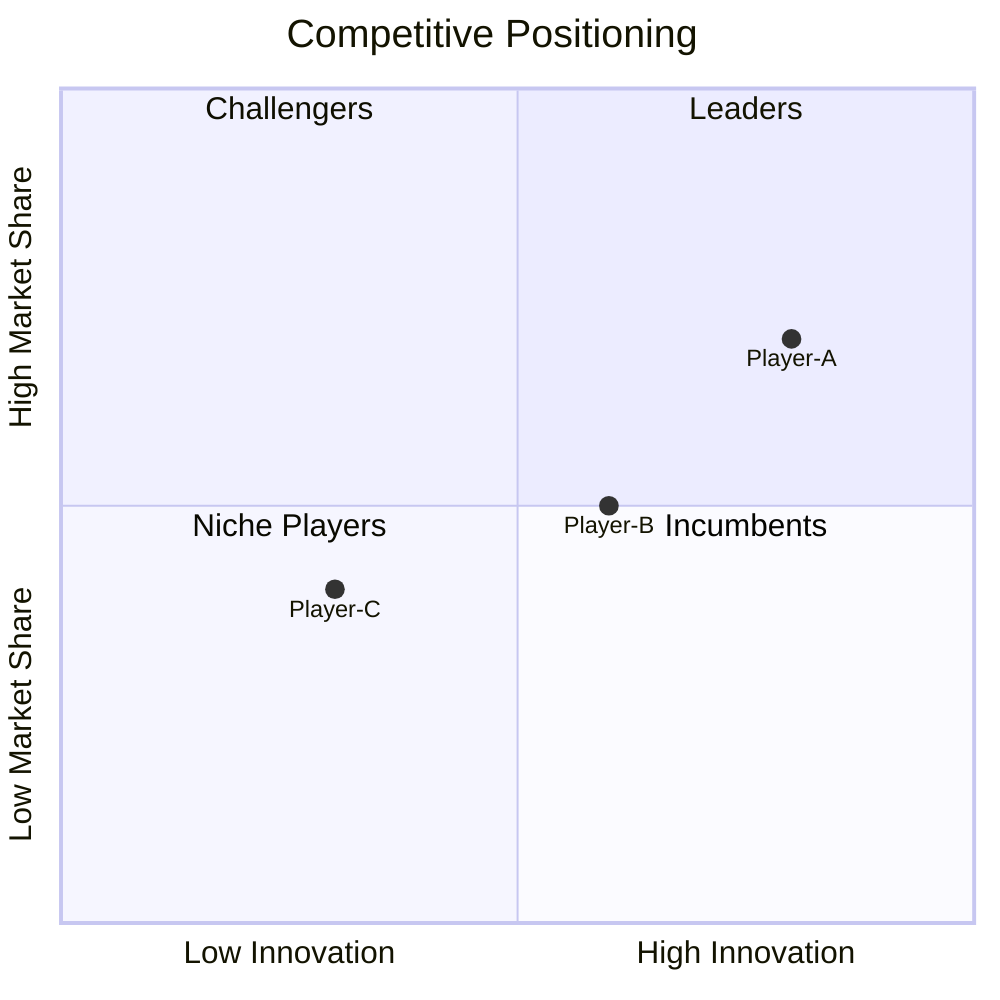

# Industry Research Templates

## Template 1: New Energy Vehicle Industry Report (China Focus)

**Input**: "2024 China EV industry, in-depth analysis, market trends and competitive landscape"

**Output**:
```
# 2024年中国新能源汽车行业深度研究报告

**报告日期**: 2024年3月
**研究范围**: 中国大陆市场
**报告类型**: 深度分析

---

## 执行摘要

### 核心发现
- 2024年中国新能源汽车销量预计突破1200万辆，同比增长25%
- 插电混动车型增速超纯电动，市场结构多元化
- 头部企业集中度提升，前五企业份额超65%
- 出口成为新增长引擎，2024年出口量预计达150万辆

### 关键洞察
- 价格战加速行业洗牌，中小企业生存压力加剧
- 智能驾驶技术成为核心竞争维度
- 充电基础设施短板待补，政策加码支持

### 战略建议
1. 关注插电混动细分赛道机会
2. 重视智能化技术布局
3. 关注出海布局的头部企业

---

## 一、行业概述

### 1.1 定义与分类

新能源汽车（NEV）指采用新型动力系统，主要或全部依靠新型能源驱动的汽车，包括：

| 类型 | 主要技术路线 | 代表企业 |
|------|-------------|---------|
| 纯电动汽车(BEV) | 锂电池+电机 | 比亚迪、特斯拉 |
| 插电混动(PHEV) | 燃油+电动双模式 | 理想、问界 |
| 燃料电池汽车(FCV) | 氢燃料电池 | 丰田、现代 |

### 1.2 市场规模

**2024年市场预测**:
| 指标 | 2022 | 2023 | 2024E | YoY |
|------|------|------|-------|-----|
| 销量(万辆) | 689 | 950 | 1200 | +26% |
| 渗透率 | 25% | 33% | 45% | +12pp |
| 市场规模(亿元) | 12,000 | 15,500 | 19,000 | +23% |

*数据来源: 中国汽车工业协会, 2024年3月*

### 1.3 产业链分析

```
上游: 电池原材料(锂、钴、镍)
    ↓
中游: 动力电池、电机、电控
    ↓
下游: 整车制造
    ↓
后市场: 充电桩、维保、回收
```

---

## 二、市场趋势

### 2.1 纯电vs混动结构变化

| 类型 | 2022 | 2023 | 2024E |
|------|------|------|-------|
| 纯电动(BEV) | 80% | 72% | 65% |
| 插电混动(PHEV) | 20% | 28% | 35% |

**趋势解读**: 插电混动增速显著，主要原因:
- 里程焦虑缓解
- 成本优势显现
- 多场景适用性

### 2.2 智能化成为核心竞争维度

| 智能配置 | 2022 | 2024E | 渗透率变化 |
|----------|------|-------|-----------|
| L2辅助驾驶 | 45% | 75% | +30pp |
| 高速NOA | 5% | 35% | +30pp |
| 城市NOA | <1% | 15% | +15pp |

### 2.3 价格战加速行业洗牌

2024年初降价潮:
- 比亚迪: 多款车型降价2-4万元
- 特斯拉: Model 3/Y降价1.4万元
- 问界: M5降价2万元

**影响分析**:
- 消费者受益，但观望情绪加重
- 中小企业盈利空间压缩
- 行业集中度预计进一步提升

---

## 三、竞争格局

### 3.1 市场集中度

| 排名 | 企业 | 2023份额 | 2024E份额 |
|------|------|----------|----------|
| 1 | 比亚迪 | 35% | 38% |
| 2 | 特斯拉 | 12% | 10% |
| 3 | 理想汽车 | 6% | 8% |
| 4 | 广汽埃安 | 5% | 5% |
| 5 | 蔚来 | 4% | 4% |
| 其他 | - | 38% | 35% |

### 3.2 头部企业策略对比

| 企业 | 核心优势 | 主要市场 | 战略重点 |
|------|---------|---------|---------|
| 比亚迪 | 垂直整合 | 全价格带 | 纯电+混动双轮驱动 |
| 特斯拉 | 品牌+智能化 | 中高端 | 成本优化+全球扩张 |
| 理想 | 产品定义 | 中大型SUV | 增程+家庭市场 |
| 蔚来 | 用户服务 | 高端 | 换电+生态 |

---

## 四、政策环境

### 4.1 支持性政策

| 政策 | 内容 | 影响 |
|------|------|------|
| 购置税减免 | 延续至2027年 | 成本优势延续 |
| 充电桩建设 | 2024年新建60万个 | 补齐基础设施 |
| 以旧换新 | 补贴1-2万元 | 刺激消费需求 |

### 4.2 监管趋势

- 双积分政策趋严
- 碳排放标准提升
- 数据安全监管加强

---

## 五、风险评估

### 5.1 市场风险
- 增速放缓超预期
- 价格战持续压缩利润
- 消费者观望情绪

### 5.2 运营风险
- 原材料价格波动
- 供应链韧性考验
- 技术迭代投入大

### 5.3 外部风险
- 贸易摩擦影响出口
- 补贴退坡压力
- 竞争加剧

---

## 六、未来展望

### 6.1 2025-2030年预测

| 指标 | 2025E | 2027E | 2030E |
|------|-------|-------|-------|
| 销量(万辆) | 1500 | 2000 | 2800 |
| 渗透率 | 55% | 70% | 90% |

### 6.2 增长驱动力
- 技术进步(电池、智驾)
- 成本下降(规模效应)
- 政策支持(双碳目标)
- 消费升级(换购需求)

### 6.3 投资机会
1. 头部整车企业(规模+技术)
2. 核心零部件(电池、热管理)
3. 智能化增量部件(智驾芯片、传感器)

---

## 七、结论与建议

### 主要结论
1. 中国新能源汽车市场进入成熟期，增速放缓但总量持续增长
2. 插电混动细分赛道增速亮眼
3. 智能化成为核心差异化维度
4. 价格战加速行业洗牌，强者恒强

### 投资建议
1. 关注插电混动布局完善的企业
2. 重视智能驾驶技术领先标的
3. 警惕低价竞争导致的盈利风险

---

## 数据来源

- 中国汽车工业协会 (CAAM)
- 乘联会 (CPCA)
- 盖世汽车研究院
- 各企业年报及公告
- 国家发改委、工业和信息化部政策文件

---

## 附录

### A. 术语解释
- NOA: Navigate on Autopilot，领航辅助驾驶
- BEV: Battery Electric Vehicle，纯电动汽车
- PHEV: Plug-in Hybrid Electric Vehicle，插电式混合动力汽车

### B. 相关图表
[数据可视化图表待补充]

### C. 重点企业简介
[企业详细信息待补充]
```

---

## Template 2: AI Healthcare Industry Report

**Input**: "AI in healthcare industry, global market analysis, 2024 trends"

**Output Structure**:
```
# AI Healthcare Industry Report

## Executive Summary
## 1. Industry Overview
### 1.1 Market Definition
### 1.2 Market Size
### 1.3 Segmentation
## 2. Key Trends
### 2.1 Technology Trends
### 2.2 Application Trends
### 2.3 Investment Trends
## 3. Competitive Landscape
### 3.1 Market Players
### 3.2 M&A Activity
### 3.3 Startup Ecosystem
## 4. Regulatory Environment
## 5. Risk Assessment
## 6. Future Outlook
## 7. Conclusions
```

---

## Template 3: E-commerce Industry Brief

**Input**: "China e-commerce industry, 2024 outlook, brief report"

**Output Structure**:
```
# China E-commerce Industry Brief

## Quick Summary (1 page)
## Market Overview
## Key Players
## Trends
## Outlook
```

---

## Data Visualization Examples

### Market Growth Chart


### Value Chain


### Competitive Positioning


---

## Citation Examples

### Report Structure Citation
```
[来源机构](年份). 报告标题. 发布日期.
```

### Data Citation
```
数据来源: IDC, 《全球行业追踪报告》, 2024年3月
```

### Chart Citation
```
图1: 中国新能源汽车销量趋势 (数据来源: 中汽协, 2024)
```
