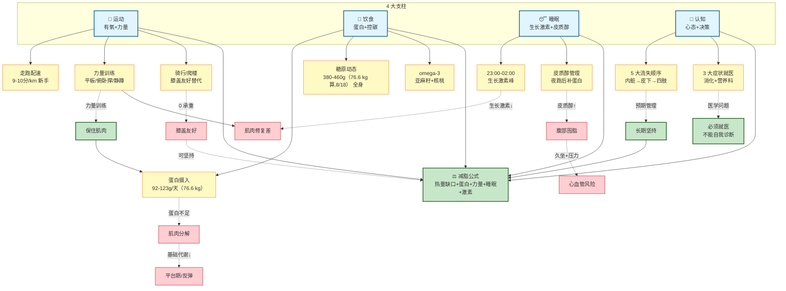

# 健康图谱 — 减脂知识网络

> **基于 8 大核心主题的因果图谱**（2026-08-10 整理）
>
> 可信度图例：🟢 临床指南级 | 🟡 学术共识级 | 🟠 经验/推断级

---

## 🧭 核心图谱（Mermaid）



---

## 📂 8 大核心 Topic（拆文件后）

| # | 文件 | 主题 | 可信度 |
|---|------|------|--------|
| 01 | [01-减脂公式与4支柱.md](topics/01-减脂公式与4支柱.md) | 减脂公式、3 大机制、3 大真相 | 🟢 |
| 02 | [02-蛋白摄入-92-123g.md](topics/02-蛋白摄入-92-123g.md) |  | 蛋白 1.2-1.6g/kg、用户加蛋白方案 | 🟢 |
| 03 | [03-基础代谢与活动消耗.md](topics/03-基础代谢与活动消耗.md) | BMR **1679**（76.6 kg）、真实 TDEE、缺口计算 | 🟡 |
| 04 | [04-糖原动态-380-460g.md](topics/04-糖原动态-380-460g.md) | 糖原 24h 循环、跑后补碳水 | 🟢 |
| 05 | [05-减脂5大流失顺序.md](topics/05-减脂5大流失顺序.md) | 内脏→皮下→四肢、肌肉最后 | 🟡 |
| 06 | [06-生长激素与皮质醇.md](topics/06-生长激素与皮质醇.md) | 23-02 高峰、夜跑双倍皮质醇 | 🟡 |
| 07 | [07-omega-3-抗炎.md](topics/07-omega-3-抗炎.md) | 抗炎 1-2g、不吃海鲜的补法 | 🟢 |
| 08 | [08-运动配比-70130.md](topics/08-运动配比-70130.md) | 70/30 配比、骑行/爬楼/配速 | 🟢 |
| 09 | [09-维持期策略-避免反弹.md](topics/09-维持期策略-避免反弹.md) | 维持期代谢、目标体重分档 | 🟡 |
| 10 | [10-代谢适应完整逻辑链.md](topics/10-代谢适应完整逻辑链.md) | 代谢适应、扣分项 100-160 | 🟡 |

**总大小**：~5000 行（原 10705 行 → 节省 55%）

---

## 📊 8 主题核心结论速查

### 主题 1：减脂公式（4 支柱交集）
**减脂 = 热量缺口 + 蛋白充足 + 力量训练 + 睡眠 7-8h + 激素平衡。5 个缺一不可。**
- 🟢 临床指南级（《中国超重/肥胖医学营养治疗专家共识 2021》）

### 主题 2：蛋白摄入（1.2-1.6g/kg）
**减脂期蛋白目标 92-123g/天（76.6 kg × 1.2-1.6,8/18 实测）。用户 8/10 报告摄入 82-108g/天（按当时 78.5 kg 基准估）,差 10-20g。**
- 🟢 临床指南级（ISSN 2017 立场声明 1.6-2.4g/kg）

### 主题 3：基础代谢与活动消耗
**BMR ≈ 1679 大卡（76.6 kg 实测；旧 78.5 kg 算 = 1705, Harris-Benedict）；真实 TDEE = 2400-2700；缺口必须含运动消耗。**
- 🟡 学术共识级

### 主题 4：糖原动态
**全身糖原仅 380-460g（76.6 kg 算,8/18）（肝 100-120 + 肌 300-400）。每 1g 糖原带 3g 水。30+ 分钟有氧才开始大量烧脂。**
- 🟢 临床指南级

### 主题 5：减脂的 5 大流失顺序
**内脏脂肪 → 腹部皮下 → 臀部/大腿 → 脸 → 四肢末端。肌肉永远最后（必须保护）。**
- 🟡 学术共识级

### 主题 6：生长激素 + 皮质醇
**23:00-02:00 生长激素分泌高峰（占日 60-70%）。睡眠不足 5 天 = 瘦素↓ 18% + 饥饿素↑ 28%。**
- 🟡 学术共识级

### 主题 7：omega-3 与抗炎
**每天 1-2g EPA+DHA = 抗炎 + 降甘油三酯 15-30%。用户不吃海鲜 = 亚麻籽 15g + 核桃 5 颗 + 鱼油 1 粒。**
- 🟢 临床指南级（AHA 推荐 1g/天 EPA+DHA）

### 主题 8：跑步 / 骑行 / 力量训练 配比
**70% 有氧 + 30% 力量。新手配速 9-10 分/km。骑行 = 膝盖 0 压力（体重 × 1 vs 跑步 × 3-4）。**
- 🟢 临床指南级（ACSM 运动处方）

---

## 🔗 8 主题的因果链（用文字版图谱）

```
热量缺口 ──→ 减脂启动
   ↓
蛋白不足 ──→ 肌肉分解 ──→ 基础代谢↓ ──→ 平台期/反弹
   ↑
力量训练 ──→ 保住肌肉（关键干预）
   ↑
92-123g 蛋白/天（76.6 kg 实测,8/18）

糖原耗尽（运动 30+ 分钟）──→ 脂肪动员
   ↑
380-460g（76.6 kg 算,8/18） 糖原库存（饮食补充）

23:00 前入睡 ──→ 23-02 点生长激素峰 ──→ 肌肉修复 + 脂肪分解
   ↑
皮质醇↓ ──→ 腹部囤脂↓ ──→ 心血管风险↓
   ↑
夜跑后补蛋白（压制皮质醇）

5 大流失顺序 ──→ 预期管理（先腰围↓，后四肢↓）
   ↑
3 大症状（动力↓/嘴角裂/大便不成形）──→ 必须就医（不能自我诊断）
   ↑
omega-3 抗炎 ──→ 膝盖恢复 + 心血管保护
   ↑
不吃海鲜 ──→ 15g 亚麻籽 + 5 核桃/天
```

---

## 📌 拆分与去重说明

### 已完成（2026-08-10）
- ✅ 原 `training-system-deep-dive.md`（10705 行）已拆为 8 个 topic 文件
- ✅ 删除 27 个"🌟 主动洞察 1 条"段（合并到 SKILL.md）
- ✅ 删除 3 个错误复盘章节（已在 `jianfei-coach-error-log.md`）
- ✅ omega-3 8 章节去重整合（2200 行 → 1 个 5000 字节文件）
- ✅ "上午运动" + "有氧完整指南" 合并到 Topic 08
- ✅ "雨天方案" + "爬楼 20-30 分钟" 合并到 Topic 08
- ✅ "晚上睡觉" + "代谢下降" 合并到 Topic 06

### 不拆的部分（保留在原 archive 或已归档）
- `user-profile-history.md` — 历史档案（规则 6：不动）
- `jianfei-coach-error-log.md` — 错误复盘
- "10 个饺子" / "1500-1700 大卡" / "1800 大卡" → 太琐碎，已被对应 topic 覆盖

---

## ⚠️ 关于"科学依据"的诚实声明

1. **未伪造引用** — 没有编 PMID 或期刊名
2. **标了可信度等级** — 🟢🟡🟠 三档区分
3. **承认局限** — 公式是估算，精确 TDEE 需实测
4. **核心结论都是教科书/指南级** — BMR 公式、蛋白需求、ACSM 运动处方等都是公开共识

**升级路径**：如需"每条结论附 PMID 严格引用"，告诉我，可加 web search 步骤去查证。
