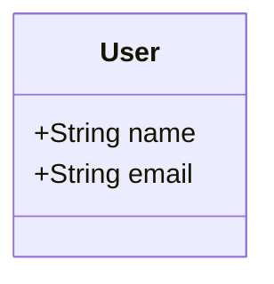
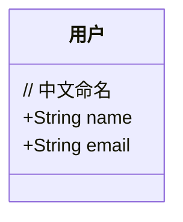
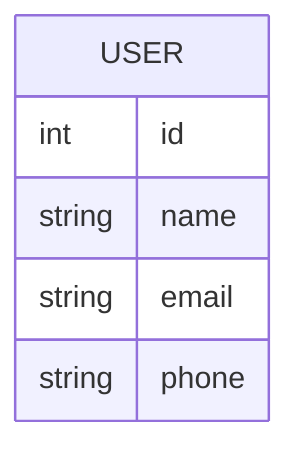
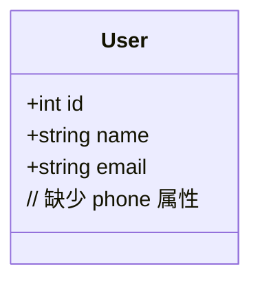
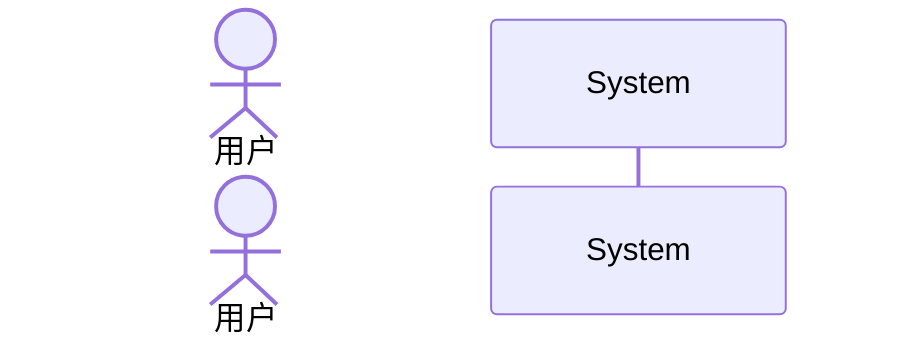
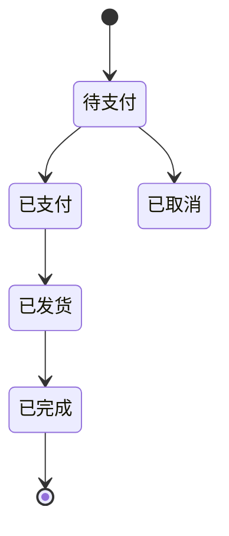
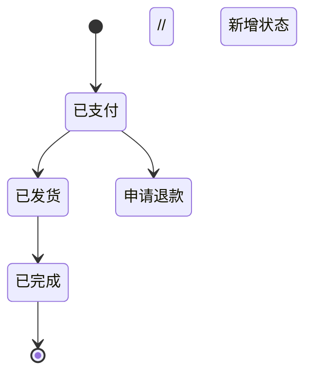
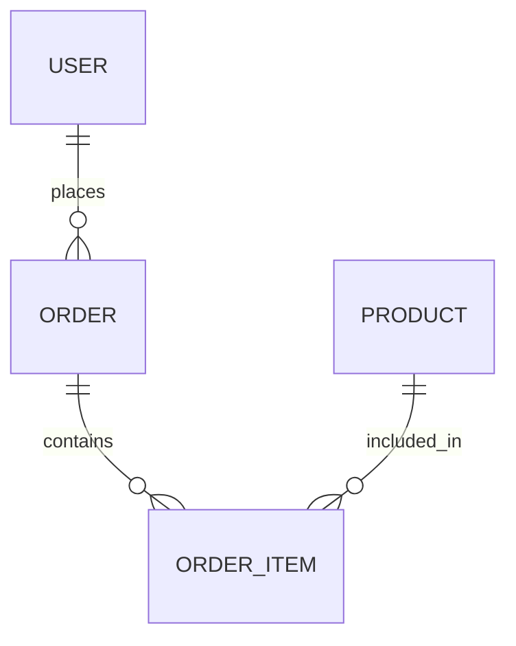

# 跨文件校验规则

## 目录

1. [概述](#概述)
2. [跨文件引用校验](#跨文件引用校验)
3. [跨文件实体一致性校验](#跨文件实体一致性校验)
4. [跨文件逻辑一致性校验](#跨文件逻辑一致性校验)
5. [项目结构建议](#项目结构建议)
6. [最佳实践](#最佳实践)

## 概述

在大型 Markdown 项目中，文档之间存在引用关系、共享实体和逻辑关联。跨文件校验确保整个文档体系的一致性和完整性。

### 校验能力

| 校验类型 | 说明 | 错误级别 |
|:---------|:-----|:---------|
| **跨文件引用** | 检查文件间链接的有效性 | 警告 |
| **实体一致性** | 检查同一实体在不同文件中的定义 | 警告 |
| **逻辑一致性** | 检查流程、状态描述的一致性 | 警告 |

### 使用方式

```bash
# 校验多个文件（启用跨文件校验）
npx ts-node scripts/markdown-validator.ts docs/**/*.md

# 校验所有 Markdown 文件
npx ts-node scripts/markdown-validator.ts *.md

# 校验指定文件
npx ts-node scripts/markdown-validator.ts README.md CONTRIBUTING.md CHANGELOG.md
```

## 跨文件引用校验

### 引用类型

| 类型 | 语法 | 说明 |
|:-----|:-----|:-----|
| **文件链接** | `[文本](文件.md)` | 链接到其他 Markdown 文件 |
| **锚点链接** | `[文本](文件.md#章节)` | 链接到其他文件的章节 |
| **相对路径** | `[文本](./dir/file.md)` | 相对当前文件的路径 |
| **绝对路径** | `[文本](/docs/file.md)` | 相对项目根目录的路径 |

### 校验规则

#### 规则 1：文件存在性检查

检查跨文件链接指向的文件是否存在。

**正确示例：**

```markdown
<!-- 在 docs/api.md 中 -->
详见 [安装指南](./installation.md)
```

如果 `docs/installation.md` 存在，校验通过。

**错误示例：**

```markdown
<!-- 在 docs/api.md 中 -->
详见 [配置说明](./config.md)
```

如果 `docs/config.md` 不存在：

```
⚠️  [第 1 行] 跨文件链接 "./config.md" 指向的文件不存在
    💡 建议: 检查文件路径是否正确
```

#### 规则 2：锚点有效性检查

检查跨文件链接中的锚点是否存在于目标文件中。

**正确示例：**

```markdown
<!-- 在 README.md 中 -->
参见 [API 文档 - 认证](docs/api.md#认证)
```

如果 `docs/api.md` 中有 `## 认证` 章节，校验通过。

**错误示例：**

```markdown
<!-- 在 README.md 中 -->
参见 [API 文档 - 错误码](docs/api.md#错误码)
```

如果 `docs/api.md` 中没有对应的章节：

```
⚠️  [第 1 行] 跨文件锚点 "错误码" 在目标文件中不存在
    💡 建议: 检查章节标题是否正确
```

#### 规则 3：相对路径解析

正确处理不同层级的相对路径。

**项目结构：**

```
project/
├── README.md
├── docs/
│   ├── api.md
│   ├── guide/
│   │   ├── quickstart.md
│   │   └── advanced.md
│   └── reference/
│       └── config.md
```

**正确的相对路径：**

| 源文件 | 目标文件 | 相对路径 |
|:-------|:---------|:---------|
| `README.md` | `docs/api.md` | `docs/api.md` |
| `docs/api.md` | `README.md` | `../README.md` |
| `docs/guide/quickstart.md` | `docs/api.md` | `../api.md` |
| `docs/guide/quickstart.md` | `docs/reference/config.md` | `../reference/config.md` |

### 图片引用校验

同样检查跨文件的图片引用：

```markdown
<!-- 检查图片文件是否存在 -->


```

## 跨文件实体一致性校验

### 实体定义

实体是文档中描述的核心对象，可能出现在多个文件中：

| 实体类型 | 来源 | 示例 |
|:---------|:-----|:-----|
| **业务实体** | 图表、表格 | 用户、订单、商品 |
| **系统组件** | 架构图 | API服务、数据库、缓存 |
| **参与者** | 时序图、用例图 | 用户、管理员、系统 |
| **状态** | 状态图 | 待支付、已支付、已完成 |

### 校验规则

#### 规则 1：命名一致性

同一实体在不同文件中应使用一致的命名。

**问题示例：**

**文件 1: `docs/user-guide.md`**
````markdown

````

**文件 2: `docs/api-reference.md`**
````markdown

````

**校验输出：**
```
🔗 实体一致性:
  1. [WARNING] 实体 "User/用户" 在不同文件中被定义为不同类型
     涉及文件: user-guide.md, api-reference.md
```

#### 规则 2：属性一致性

同一实体的属性在不同文件中应一致。

**问题示例：**

**文件 1: `docs/database.md`**
````markdown

````

**文件 2: `docs/api.md`**
````markdown

````

**校验输出：**
```
🔗 实体一致性:
  1. [WARNING] 实体 "USER" 在不同文件中的属性定义不一致
     涉及文件: database.md, api.md
     缺少属性: phone
```

#### 规则 3：类型一致性

同一实体在不同上下文中的类型应一致。

**问题示例：**

**文件 1: `docs/business.md`**
````markdown
用户是系统的核心实体，包括基本信息和权限设置。
````

**文件 2: `docs/architecture.md`**
````markdown

````

如果同时存在 `User` 和 `用户` 两种命名：

```
🔗 实体一致性:
  1. [WARNING] 实体命名不一致: User, 用户
     涉及文件: business.md, architecture.md
     💡 建议: 统一实体命名规范
```

## 跨文件逻辑一致性校验

### 校验范围

| 类型 | 说明 | 检查内容 |
|:-----|:-----|:---------|
| **状态定义** | 状态图中的状态 | 同一业务流程的状态是否一致 |
| **流程描述** | 流程图/时序图 | 同一流程在不同文件中是否一致 |
| **关系定义** | 实体关系图 | 同一关系在不同文件中是否一致 |

### 校验规则

#### 规则 1：状态定义一致性

同一业务流程的状态定义应一致。

**问题示例：**

**文件 1: `docs/order-flow.md`**
````markdown

````

**文件 2: `docs/refund-flow.md`**
````markdown

````

**校验输出：**
```
📋 逻辑一致性:
  1. state-mismatch: 状态定义不一致
     涉及文件: order-flow.md, refund-flow.md
     描述: order-flow.md 有 0 个独有状态，refund-flow.md 有 1 个独有状态 (申请退款)
```

#### 规则 2：流程描述一致性

描述同一流程的图表应保持一致。

**问题示例：**

**文件 1: `docs/user-login-flow.md`**
````markdown
用户登录流程：
1. 输入用户名和密码
2. 系统验证
3. 验证成功 -> 登录成功
4. 验证失败 -> 显示错误，返回步骤1
````

**文件 2: `docs/api-guide.md`**
````markdown
```mermaid
graph TD
  A[输入用户名密码] --> B{验证}
  B -->|成功| C[返回Token]
  // 缺少失败处理
```
````

**校验输出：**
```
📋 逻辑一致性:
  1. flow-mismatch: 流程图与时序图之间可能存在逻辑不一致
     涉及文件: user-login-flow.md, api-guide.md
     描述: 流程图缺少失败处理分支
```

#### 规则 3：关系定义一致性

实体关系在不同文件中应一致。

**问题示例：**

**文件 1: `docs/database-design.md`**
````markdown

````

**文件 2: `docs/api-design.md`**
````markdown
```mermaid
classDiagram
  User "1" --> "*" Order : places
  Order "1" --> "1" OrderItem : contains  // 应该是 1:N
```
````

**校验输出：**
```
📋 逻辑一致性:
  1. relationship-mismatch: 实体关系定义不一致
     涉及文件: database-design.md, api-design.md
     描述: Order-OrderItem 关系不一致: 1:N vs 1:1
```

## 项目结构建议

### 推荐目录结构

```
project/
├── README.md                    # 项目主文档
├── docs/
│   ├── index.md                 # 文档首页
│   ├── getting-started/         # 入门指南
│   │   ├── installation.md
│   │   ├── quickstart.md
│   │   └── configuration.md
│   ├── guides/                  # 详细指南
│   │   ├── user-guide.md
│   │   └── admin-guide.md
│   ├── api/                     # API 文档
│   │   ├── overview.md
│   │   ├── authentication.md
│   │   └── endpoints.md
│   ├── architecture/            # 架构文档
│   │   ├── overview.md
│   │   ├── components.md
│   │   └── data-model.md
│   └── reference/               # 参考文档
│       ├── config.md
│       └── glossary.md
├── assets/                      # 静态资源
│   ├── images/
│   └── diagrams/
└── templates/                   # 文档模板
```

### 文档间引用规范

#### 使用相对路径

```markdown
✅ 推荐:
详见 [安装指南](../getting-started/installation.md)

❌ 不推荐:
详见 [安装指南](/docs/getting-started/installation.md)
```

#### 统一命名规范

```markdown
✅ 推荐:
- 实体命名统一：User、Order、Product
- 文件命名统一：user-guide.md、order-flow.md
- 章节命名统一：## 概述、## 快速开始

❌ 不推荐:
- 混用中英文：用户/User
- 文件命名不一致：userGuide.md、order-flow.md
```

### 文档索引

建议创建文档索引文件：

````markdown
# 文档索引

## 快速开始

- [安装指南](getting-started/installation.md)
- [快速入门](getting-started/quickstart.md)
- [配置说明](getting-started/configuration.md)

## 详细指南

- [用户指南](guides/user-guide.md)
- [管理员指南](guides/admin-guide.md)

## API 参考

- [API 概述](api/overview.md)
- [认证说明](api/authentication.md)
- [接口列表](api/endpoints.md)

## 架构文档

- [系统架构](architecture/overview.md)
- [组件说明](architecture/components.md)
- [数据模型](architecture/data-model.md)
````

## 最佳实践

### 1. 文档组织

````markdown
✅ 推荐:
- 按功能/主题分目录
- 每个目录有索引文件
- 相关文档放在一起
- 共享资源统一管理

❌ 不推荐:
- 所有文档放根目录
- 文档分散无组织
- 资源文件分散
````

### 2. 引用管理

````markdown
✅ 推荐:
- 使用相对路径引用
- 定期检查引用有效性
- 引用时提供上下文

示例:
关于安装的详细说明，请参见 [安装指南](../getting-started/installation.md#依赖要求)。
````

### 3. 实体定义

````markdown
✅ 推荐:
- 建立实体词汇表
- 统一命名规范
- 在主文档中定义核心实体

在 docs/reference/glossary.md 中：

## 术语表

| 术语 | 定义 |
|:-----|:-----|
| User | 系统用户，包括普通用户和管理员 |
| Order | 用户订单，记录购买信息 |
| Product | 商品，系统销售的商品项 |
````

### 4. 变更管理

````markdown
✅ 推荐:
- 实体变更时更新所有相关文档
- 使用全局搜索检查一致性
- 在 PR 中说明文档变更

变更检查清单:
- [ ] 更新实体定义文档
- [ ] 更新相关图表
- [ ] 更新 API 文档
- [ ] 更新示例代码
- [ ] 运行跨文件校验
````

### 5. 校验流程

````bash
# 在 CI/CD 中添加校验步骤

# 校验所有文档
npx ts-node scripts/markdown-validator.ts docs/**/*.md

# 只校验变更的文件（Git hook）
git diff --name-only --diff-filter=d HEAD | grep '\.md$' | xargs -r npx ts-node scripts/markdown-validator.ts

# 生成校验报告
npx ts-node scripts/markdown-validator.ts docs/**/*.md > validation-report.txt
````

### 6. 协作规范

````markdown
✅ 推荐:
- 文档编写遵循统一模板
- 新增文档更新索引
- 删除文档检查引用
- 重大变更通知团队

文档模板:

---
title: 文档标题
description: 文档描述
last_updated: 2024-01-01
---

# 文档标题

## 概述

文档简要说明。

## 详细内容

...

## 相关链接

- [相关文档1](path/to/doc1.md)
- [相关文档2](path/to/doc2.md)
````

### 7. 自动化校验

**GitHub Actions 配置示例：**

````yaml
name: Markdown Validation

on:
  push:
    paths:
      - '**.md'
  pull_request:
    paths:
      - '**.md'

jobs:
  validate:
    runs-on: ubuntu-latest
    steps:
      - uses: actions/checkout@v3
      
      - name: Setup Node.js
        uses: actions/setup-node@v3
        with:
          node-version: '18'
      
      - name: Install dependencies
        run: npm install -g ts-node typescript
      
      - name: Run validation
        run: npx ts-node scripts/markdown-validator.ts docs/**/*.md
      
      - name: Upload report
        if: always()
        uses: actions/upload-artifact@v3
        with:
          name: validation-report
          path: validation-report.txt
````
