# Markdown 图表绘制完整指南

## 目录

1. [表格](#表格)
2. [Mermaid 流程图 (Flowchart)](#mermaid-流程图-flowchart)
3. [Mermaid 时序图 (Sequence Diagram)](#mermaid-时序图-sequence-diagram)
4. [Mermaid 类图 (Class Diagram)](#mermaid-类图-class-diagram)
5. [Mermaid 状态图 (State Diagram)](#mermaid-状态图-state-diagram)
6. [Mermaid 实体关系图 (ER Diagram)](#mermaid-实体关系图-er-diagram)
7. [Mermaid 用例图 (User Journey)](#mermaid-用户旅程图-user-journey)
8. [Mermaid 甘特图 (Gantt)](#mermaid-甘特图-gantt)
9. [Mermaid 饼图 (Pie Chart)](#mermaid-饼图-pie-chart)
10. [Mermaid 思维导图 (Mindmap)](#mermaid-思维导图-mindmap)
11. [Mermaid 其他图表](#mermaid-其他图表)
12. [图片插入](#图片插入)
13. [最佳实践](#最佳实践)

---

## 表格

### 1. 基础表格

#### 标准格式

```markdown
| 列名 1 | 列名 2 | 列名 3 |
|--------|--------|--------|
| 数据 1 | 数据 2 | 数据 3 |
| 数据 4 | 数据 5 | 数据 6 |
```

**渲染效果：**

| 列名 1 | 列名 2 | 列名 3 |
|--------|--------|--------|
| 数据 1 | 数据 2 | 数据 3 |
| 数据 4 | 数据 5 | 数据 6 |

### 2. 对齐方式

```markdown
| 左对齐 | 居中 | 右对齐 |
|:-------|:----:|-------:|
| 内容   | 内容 | 内容   |
```

**说明：**
- `:-------` 左对齐
- `:----:` 居中对齐
- `-------:` 右对齐

**渲染效果：**

| 左对齐 | 居中 | 右对齐 |
|:-------|:----:|-------:|
| 文本内容 | 文本内容 | 数字 123 |
| 左侧对齐 | 居中显示 | 456.78 |

### 3. 表格中使用格式化内容

#### 使用代码

```markdown
| 命令 | 功能 | 示例 |
|:-----|:-----|:-----|
| `npm install` | 安装依赖 | `npm install lodash` |
| `npm run dev` | 启动开发服务器 | `npm run dev --port 3000` |
```

#### 使用强调

```markdown
| 状态 | 说明 |
|:-----|:-----|
| **高优先级** | 需要立即处理 |
| *中优先级* | 本周内完成 |
| ~~已废弃~~ | 不再使用 |
```

#### 使用链接和图片

```markdown
| 资源 | 链接 |
|:-----|:-----|
| [GitHub](https://github.com) | 代码托管平台 |
|  | 图标示例 |
```

### 4. HTML 表格（高级格式）

#### 基础 HTML 表格

```html
<table>
  <thead>
    <tr>
      <th>列 1</th>
      <th>列 2</th>
      <th>列 3</th>
    </tr>
  </thead>
  <tbody>
    <tr>
      <td>数据 1</td>
      <td>数据 2</td>
      <td>数据 3</td>
    </tr>
  </tbody>
</table>
```

#### 合并单元格（跨列）

```html
<table>
  <tr>
    <th>姓名</th>
    <th colspan="2">联系方式</th>
  </tr>
  <tr>
    <td>张三</td>
    <td>电话: 123</td>
    <td>邮箱: zhang@example.com</td>
  </tr>
  <tr>
    <td>李四</td>
    <td>电话: 456</td>
    <td>邮箱: li@example.com</td>
  </tr>
</table>
```

**渲染效果：**

<table>
  <tr>
    <th>姓名</th>
    <th colspan="2">联系方式</th>
  </tr>
  <tr>
    <td>张三</td>
    <td>电话: 123</td>
    <td>邮箱: zhang@example.com</td>
  </tr>
</table>

#### 合并单元格（跨行）

```html
<table>
  <tr>
    <th>类别</th>
    <th>项目</th>
    <th>状态</th>
  </tr>
  <tr>
    <td rowspan="2">前端</td>
    <td>Vue 组件</td>
    <td>完成</td>
  </tr>
  <tr>
    <td>React 组件</td>
    <td>进行中</td>
  </tr>
  <tr>
    <td rowspan="2">后端</td>
    <td>API 接口</td>
    <td>完成</td>
  </tr>
  <tr>
    <td>数据库设计</td>
    <td>计划中</td>
  </tr>
</table>
```

**渲染效果：**

<table>
  <tr>
    <th>类别</th>
    <th>项目</th>
    <th>状态</th>
  </tr>
  <tr>
    <td rowspan="2">前端</td>
    <td>Vue 组件</td>
    <td>完成</td>
  </tr>
  <tr>
    <td>React 组件</td>
    <td>进行中</td>
  </tr>
</table>

#### 带样式的表格

```html
<table>
  <thead>
    <tr style="background-color: #f0f0f0;">
      <th style="padding: 10px;">功能</th>
      <th style="padding: 10px;">技术栈</th>
      <th style="padding: 10px;">状态</th>
    </tr>
  </thead>
  <tbody>
    <tr>
      <td style="text-align: center;">前端界面</td>
      <td>Vue 3 + TypeScript</td>
      <td style="color: green; font-weight: bold;">✅ 完成</td>
    </tr>
    <tr style="background-color: #fafafa;">
      <td style="text-align: center;">后端 API</td>
      <td>Node.js + Express</td>
      <td style="color: orange; font-weight: bold;">🚧 进行中</td>
    </tr>
  </tbody>
</table>
```

### 5. 复杂表格示例

```markdown
| 模块 | 功能 | 技术栈 | 状态 | 负责人 |
|:-----|:-----|:-------|:----:|:-------|
| **用户模块** | 用户注册登录 | JWT Auth | ✅ | 张三 |
| | 权限管理 | RBAC | ✅ | 张三 |
| **订单模块** | 订单创建 | Redis Queue | 🚧 | 李四 |
| | 支付集成 | Stripe API | 📋 | 李四 |
| **报表模块** | 数据统计 | Chart.js | 📋 | 王五 |
| | 导出功能 | ExcelJS | 📋 | 王五 |
```

---

## Mermaid 流程图 (Flowchart)

### 1. 基本语法

````markdown
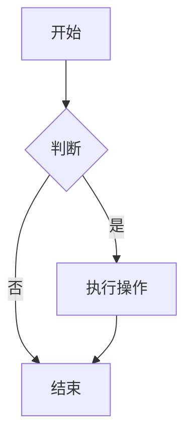
````

### 2. 图表方向

| 方向代码 | 说明 | 示例 |
|:--------|:-----|:-----|
| `TB` 或 `TD` | 从上到下 (Top to Bottom) | `graph TB` |
| `BT` | 从下到上 (Bottom to Top) | `graph BT` |
| `LR` | 从左到右 (Left to Right) | `graph LR` |
| `RL` | 从右到左 (Right to Left) | `graph RL` |

### 3. 节点形状

````markdown

````

**渲染效果：**

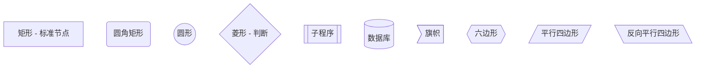

### 4. 连接线样式

````markdown
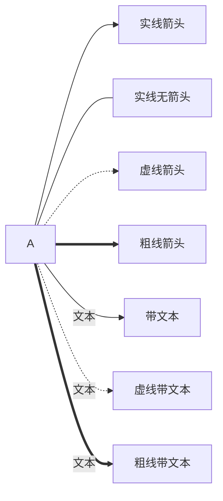
````

### 5. 特殊连接方式

#### 多重连接

````markdown
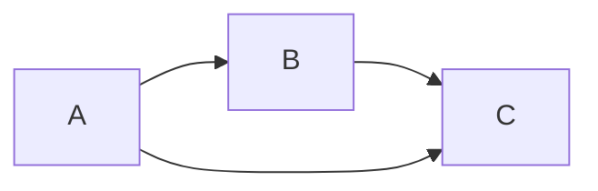
````

#### 链式连接

````markdown
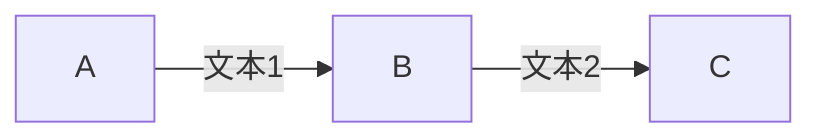
````

### 6. 子图 (Subgraph)

````markdown
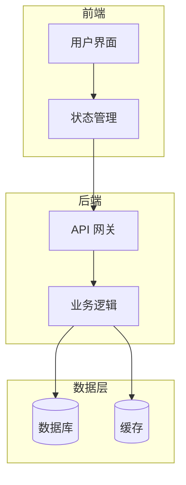
````

### 7. 完整流程图示例

**用户登录流程：**

````markdown
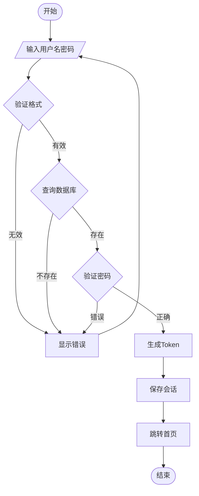
````

**系统架构图：**

````markdown
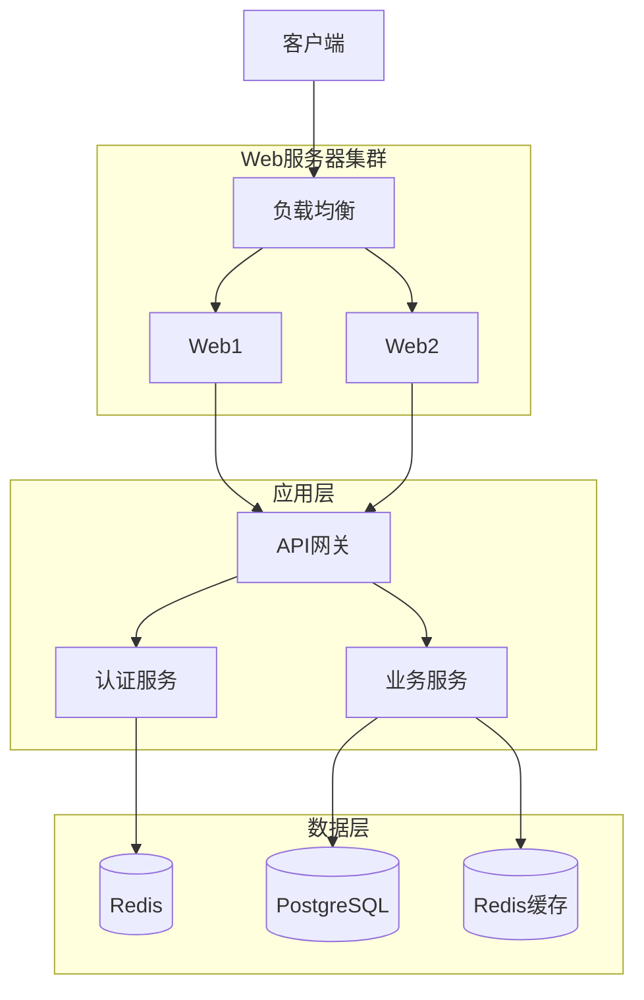
````

---

## Mermaid 时序图 (Sequence Diagram)

### 1. 基本语法

````markdown
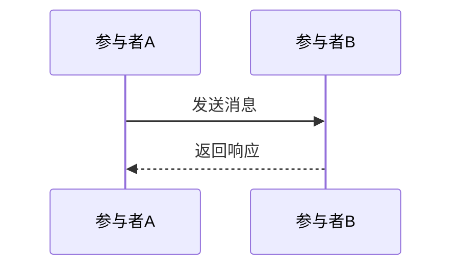
````

### 2. 参与者定义

````markdown
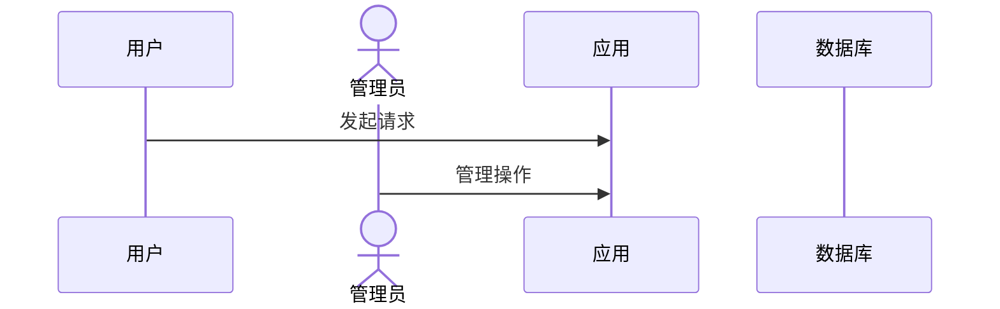
````

**说明：**
- `participant`：参与者
- `actor`：角色（使用小人图标）

### 3. 消息类型

| 语法 | 类型 | 说明 |
|:-----|:-----|:-----|
| `->>` | 实线箭头 | 同步请求 |
| `-->>` | 虚线箭头 | 返回响应 |
| `--)` | 实线开放箭头 | 异步消息 |
| `--x` | 实线叉号 | 失败/拒绝 |
| `->>+` | 激活 | 激活参与者 |
| `-->>-` | 停用 | 停用参与者 |

### 4. 激活框 (Activation)

````markdown
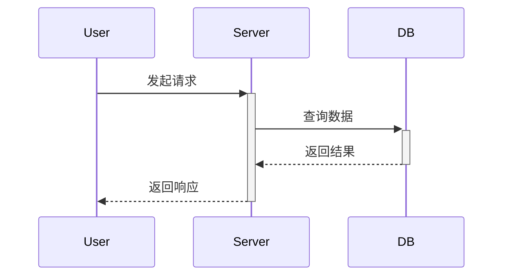
````

### 5. 循环 (Loop)

````markdown
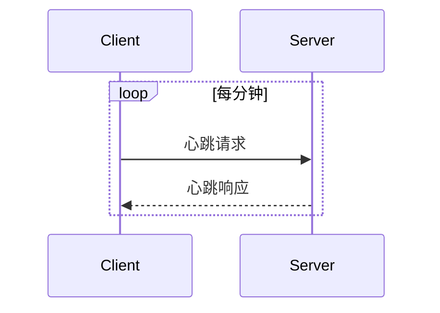
````

### 6. 条件分支 (Alt/Else)

````markdown
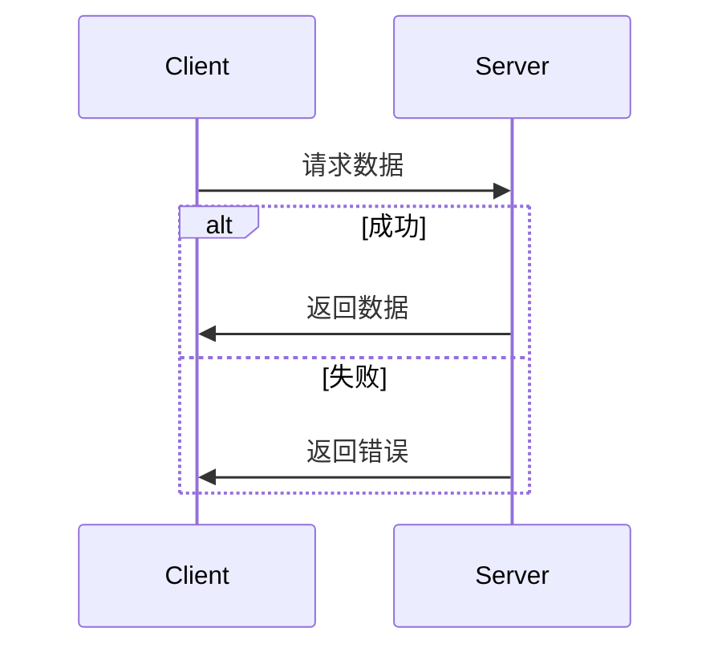
````

### 7. 可选操作 (Opt)

````markdown
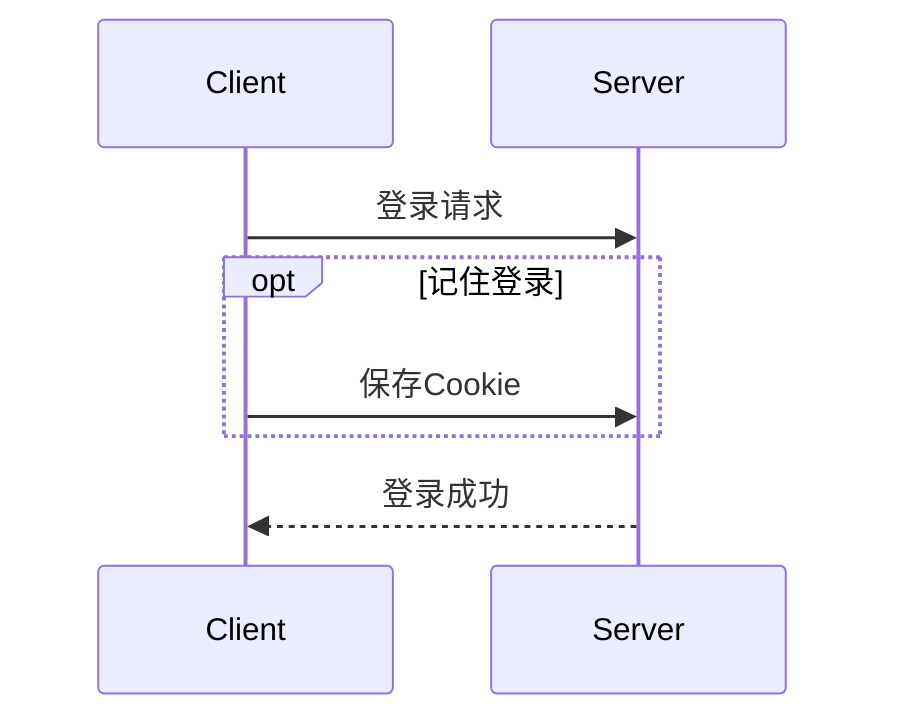
````

### 8. 并行处理 (Par)

````markdown
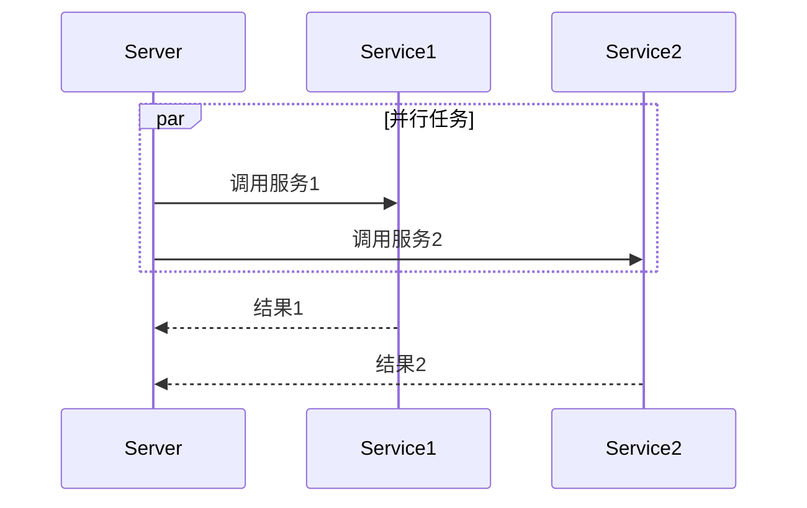
````

### 9. 注释 (Note)

````markdown
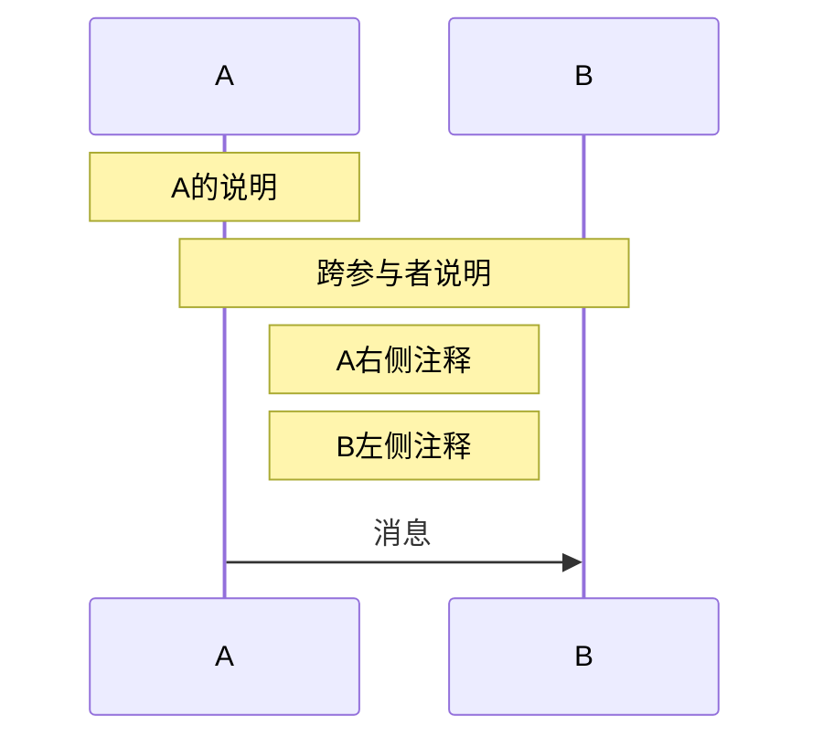
````

### 10. 完整时序图示例

**用户认证流程：**

````markdown
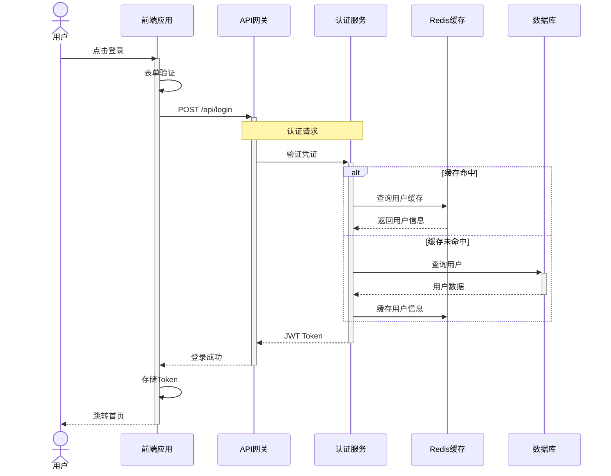
````

---

## Mermaid 类图 (Class Diagram)

### 1. 基本语法

````markdown
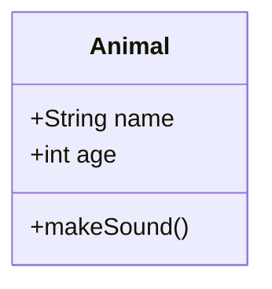
````

### 2. 类成员可见性

| 符号 | 可见性 | 说明 |
|:-----|:-------|:-----|
| `+` | Public | 公有 |
| `-` | Private | 私有 |
| `#` | Protected | 受保护 |
| `~` | Package/Internal | 包内可见 |

### 3. 类的关系

| 关系 | 语法 | 说明 |
|:-----|:-----|:-----|
| 继承 | `<\|--` | is-a 关系 |
| 组合 | `*--` | 强拥有关系 |
| 聚合 | `o--` | 弱拥有关系 |
| 关联 | `-->` | 使用关系 |
| 依赖 | `..>` | 依赖关系 |
| 实现 | `..\|>` | 接口实现 |

### 4. 完整类图示例

````markdown
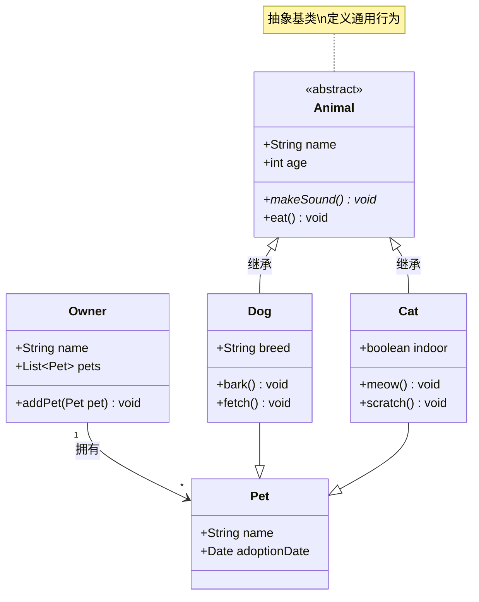
````

### 5. 接口与抽象类

````markdown
```mermaid
classDiagram
    class IRepository {
        <<interface>>
        +find(id) Entity
        +save(entity) void
        +delete(id) void
    }
    
    class BaseRepository {
        <<abstract>>
        #Connection connection
        +find(id) Entity*
        +save(entity) void
    }
    
    class UserRepository {
        +findByEmail(email) User
        +find(id) User
    }
    
    IRepository <|.. BaseRepository
    BaseRepository <|-- UserRepository
```
````

### 6. 泛型类

````markdown
```mermaid
classDiagram
    class Cache~T~ {
        -Map~string,T~ store
        +get(key) T
        +set(key, value) void
        +delete(key) void
    }
    
    class User {
        +String name
        +String email
    }
    
    Cache~User~ : getUser(id) User
```
````

---

## Mermaid 状态图 (State Diagram)

### 1. 基本语法

````markdown
```mermaid
stateDiagram-v2
    [*] --> 状态A
    状态A --> 状态B : 事件
    状态B --> [*]
```
````

### 2. 状态类型

#### 简单状态

````markdown
```mermaid
stateDiagram-v2
    [*] --> 待处理
    待处理 --> 处理中 : 开始处理
    处理中 --> 已完成 : 处理完成
    已完成 --> [*]
```
````

#### 复合状态（嵌套状态）

````markdown
```mermaid
stateDiagram-v2
    [*] --> 未登录
    
    state 未登录 {
        [*] --> 访客模式
        访客模式 --> 输入凭据
        输入凭据 --> 验证中
    }
    
    state 已登录 {
        [*] --> 浏览
        浏览 --> 编辑
        编辑 --> 浏览
    }
    
    未登录 --> 已登录 : 登录成功
    已登录 --> 未登录 : 登出
```
````

#### 并发状态

````markdown
```mermaid
stateDiagram-v2
    [*] --> 激活
    
    state 激活 {
        [*] --> 并发状态
        state 并发状态 {
            [*] --> 线程1
            [*] --> 线程2
            
            线程1 --> 线程1完成
            线程2 --> 线程2完成
        }
        并发状态 --> [*]
    }
    
    激活 --> [*]
```
````

### 3. 选择节点 (Choice)

````markdown
```mermaid
stateDiagram-v2
    [*] --> 检查状态
    
    state 检查状态 <<choice>>
    检查状态 --> 成功 : 验证通过
    检查状态 --> 失败 : 验证失败
    
    成功 --> 处理数据
    失败 --> 错误处理
    
    处理数据 --> [*]
    错误处理 --> [*]
```
````

### 4. 分叉与合并 (Fork/Join)

````markdown
```mermaid
stateDiagram-v2
    state 分叉 <<fork>>
    state 合并 <<join>>
    
    [*] --> 分叉
    分叉 --> 任务1
    分叉 --> 任务2
    分叉 --> 任务3
    
    任务1 --> 合并
    任务2 --> 合并
    任务3 --> 合并
    
    合并 --> [*]
```
````

### 5. 完整状态图示例

**订单状态流转：**

````markdown
```mermaid
stateDiagram-v2
    [*] --> 待支付
    
    待支付 --> 已支付 : 支付成功
    待支付 --> 已取消 : 取消订单
    待支付 --> 已取消 : 超时未支付
    
    已支付 --> 待发货 : 确认订单
    已支付 --> 退款中 : 申请退款
    
    待发货 --> 已发货 : 发货
    待发货 --> 退款中 : 申请退款
    
    已发货 --> 已收货 : 确认收货
    已发货 --> 退款中 : 申请退货
    
    已收货 --> 已完成 : 订单完成
    已收货 --> 退款中 : 申请售后
    
    state 退款中 {
        [*] --> 退款审核
        退款审核 --> 退款处理
        退款处理 --> [*]
    }
    
    退款中 --> 已退款 : 退款成功
    退款中 --> 已支付 : 退款拒绝
    
    已完成 --> [*]
    已取消 --> [*]
    已退款 --> [*]
```
````

---

## Mermaid 实体关系图 (ER Diagram)

### 1. 基本语法

````markdown
```mermaid
erDiagram
    ENTITY {
        type attribute
    }
```
````

### 2. 实体属性

````markdown
```erDiagram
    USER {
        int id PK "主键"
        string name
        string email UK "唯一键"
        datetime created_at
    }
```
````

**属性类型说明：**
- `PK`：主键 (Primary Key)
- `FK`：外键 (Foreign Key)
- `UK`：唯一键 (Unique Key)

### 3. 关系类型

| 关系 | 语法 | 说明 |
|:-----|:-----|:-----|
| 一对一 | `\|\|--\|\|` | 1:1 |
| 一对多 | `\|\|--o{` | 1:N |
| 多对一 | `}o--\|\|` | N:1 |
| 多对多 | `}o--o{` | M:N |
| 一对零或多 | `\|\|--o\|` | 1:0+ |
| 零或一对一 | `\|o--\|\|` | 0/1:1 |

### 4. 完整 ER 图示例

**电商系统数据模型：**

````markdown
```erDiagram
    USER ||--o{ ORDER : "下单"
    USER ||--o{ ADDRESS : "拥有"
    USER {
        int id PK
        string username UK
        string email UK
        string password_hash
        string phone
        datetime created_at
        datetime updated_at
    }
    
    ORDER ||--|{ ORDER_ITEM : "包含"
    ORDER {
        int id PK
        int user_id FK
        string order_no UK
        decimal total_amount
        string status
        datetime created_at
    }
    
    ORDER_ITEM }|--|| PRODUCT : "商品"
    ORDER_ITEM {
        int id PK
        int order_id FK
        int product_id FK
        int quantity
        decimal unit_price
        decimal subtotal
    }
    
    PRODUCT ||--o{ ORDER_ITEM : "被购买"
    PRODUCT }|--|| CATEGORY : "分类"
    PRODUCT {
        int id PK
        string name
        string description
        decimal price
        int stock
        string image_url
        int category_id FK
    }
    
    CATEGORY ||--o{ PRODUCT : "包含"
    CATEGORY {
        int id PK
        string name
        string description
    }
    
    ADDRESS {
        int id PK
        int user_id FK
        string receiver_name
        string phone
        string province
        string city
        string district
        string detail_address
        boolean is_default
    }
```
````

---

## Mermaid 用户旅程图 (User Journey)

### 1. 基本语法

````markdown
```mermaid
journey
    title 用户旅程标题
    section 章节1
      任务1: 5: 用户
      任务2: 3: 用户
```
````

### 2. 完整示例

**用户购物旅程：**

````markdown
```mermaid
journey
    title 用户购物旅程
    section 发现商品
      浏览首页: 5: 用户
      搜索商品: 4: 用户
      查看详情: 5: 用户
    section 购买决策
      加入购物车: 4: 用户
      继续浏览: 3: 用户
      查看评价: 5: 用户
    section 下单支付
      填写地址: 3: 用户
      选择支付方式: 4: 用户, 系统
      完成支付: 5: 用户, 系统
    section 收货评价
      等待发货: 2: 用户
      确认收货: 5: 用户
      评价商品: 4: 用户
```
````

**说明：**
- 数字表示满意度（1-5分）
- 参与者可以是多个（用逗号分隔）

---

## Mermaid 甘特图 (Gantt)

### 1. 基本语法

````markdown
```mermaid
gantt
    title 项目计划
    dateFormat YYYY-MM-DD
    section 阶段
    任务名 :任务ID, 开始日期, 持续时间
```
````

### 2. 任务定义方式

```markdown
任务名 :任务ID, 2024-01-01, 7d           # 指定开始日期和持续时间
任务名 :任务ID, 2024-01-01, 2024-01-07  # 指定开始和结束日期
任务名 :任务ID, after 前置任务, 5d      # 在前置任务后开始
```

### 3. 任务状态

- `:active` 进行中
- `:done` 已完成
- `:crit` 关键任务

### 4. 完整甘特图示例

````markdown
```mermaid
gantt
    title 项目开发计划
    dateFormat YYYY-MM-DD
    axisFormat %m/%d
    
    section 需求阶段
    需求调研     :done, req, 2024-01-01, 5d
    需求分析     :done, analysis, after req, 3d
    原型设计     :done, proto, after analysis, 5d
    
    section 设计阶段
    架构设计     :done, arch, after proto, 3d
    数据库设计   :done, db, after arch, 2d
    UI设计       :active, ui, after proto, 7d
    
    section 开发阶段
    后端开发     :active, backend, 2024-01-20, 14d
    前端开发     :active, frontend, 2024-01-22, 12d
    接口联调     :api, after backend, 5d
    
    section 测试阶段
    单元测试     :test1, after api, 3d
    集成测试     :test2, after test1, 4d
    性能测试     :crit, perf, after test2, 3d
    
    section 部署上线
    预发布环境   :crit, staging, after perf, 2d
    生产部署     :crit, prod, after staging, 1d
```
````

### 5. 排除非工作日

````markdown
```mermaid
gantt
    title 工作日项目计划
    dateFormat YYYY-MM-DD
    excludes weekends
    
    section 开发
    功能开发 :dev, 2024-01-01, 10d
```
````

---

## Mermaid 饼图 (Pie Chart)

### 1. 基本语法

````markdown
```mermaid
pie showData
    title 饼图标题
    "分类1" : 30
    "分类2" : 20
```
````

### 2. 完整示例

**技术栈占比：**

````markdown
```mermaid
pie showData
    title 项目技术栈占比
    "JavaScript" : 35
    "TypeScript" : 25
    "Python" : 20
    "Go" : 12
    "Others" : 8
```
````

**用户来源分析：**

````markdown
```mermaid
pie
    title 用户来源渠道
    "搜索引擎" : 40
    "社交媒体" : 25
    "直接访问" : 20
    "外部链接" : 15
```
````

---

## Mermaid 思维导图 (Mindmap)

### 1. 基本语法

````markdown
```mermaid
mindmap
    root(中心主题)
        分支1
            子分支1
            子分支2
        分支2
            子分支3
```
````

### 2. 节点形状

````markdown
```mermaid
mindmap
    root((圆形中心))
        [方框节点]
        (圆角节点)
        ))双圆节点((
        }}六边形节点{{
```
````

### 3. 完整思维导图示例

**项目规划：**

````markdown
```mermaid
mindmap
    root((电商平台))
        用户系统
            注册登录
            个人信息
            权限管理
        商品系统
            商品管理
            分类管理
            库存管理
        订单系统
            购物车
            订单流程
            支付集成
        营销系统
            优惠券
            促销活动
            积分系统
        数据分析
            用户分析
            销售报表
            商品分析
```
````

**技术架构：**

````markdown
```mermaid
mindmap
    root((系统架构))
        前端
            Vue.js
            React
            小程序
        后端
            Node.js
                Express
                Koa
            Python
                Django
                FastAPI
        数据存储
            MySQL
            MongoDB
            Redis
        基础设施
            Docker
            Kubernetes
            CI/CD
```
````

---

## Mermaid 其他图表

### 1. Git 图 (Git Graph)

````markdown
```mermaid
gitGraph
    commit
    commit
    branch develop
    checkout develop
    commit
    commit
    checkout main
    merge develop
    commit
```
````

### 2. C4 图 (C4 Diagram)

````markdown
```mermaid
C4Context
    title 系统架构图
    Person(user, "用户", "系统使用者")
    System(app, "应用系统", "Web应用")
    SystemDb(db, "数据库", "PostgreSQL")
    
    Rel(user, app, "使用")
    Rel(app, db, "读写")
```
````

### 3. 要求图 (Requirement Diagram)

````markdown
```mermaid
requirementDiagram
    requirement test_req "测试需求" {
        id: 1
        text: "需求描述"
        risk: high
        verifymethod: test
    }
    
    element test_entity "测试实体" {
        type: simulation
    }
    
    test_entity - satisfies -> test_req
```
````

---

## 图片插入

### 1. 基本语法

```markdown


```

### 2. 本地图片

```markdown

```

### 3. 网络图片

```markdown

```

### 4. 控制图片尺寸

```markdown


```

### 5. 图片对齐

```markdown
<div align="center">
  
  <p>图片说明文字</p>
</div>
```

### 6. 带链接的图片

```markdown
[](https://example.com)
```

---

## 最佳实践

### 1. 选择合适的图表类型

| 数据类型 | 推荐图表 | 说明 |
|:---------|:---------|:-----|
| 流程/流程 | Flowchart | 展示决策分支和流程走向 |
| 系统交互 | Sequence Diagram | 展示对象间的消息传递 |
| 数据结构 | Class Diagram | 展示类结构和关系 |
| 状态变化 | State Diagram | 展示状态流转 |
| 数据模型 | ER Diagram | 展示实体关系 |
| 用户体验 | User Journey | 展示用户行为路径 |
| 时间安排 | Gantt Chart | 展示项目进度 |
| 占比分析 | Pie Chart | 展示比例关系 |
| 知识结构 | Mindmap | 展示思维层次 |

### 2. 表格设计原则

- 列数不超过 5-6 列
- 使用对齐提升可读性
- 数字列右对齐
- 文本列左对齐
- 表头加粗或使用代码格式
- 复杂表格使用 HTML 实现

### 3. Mermaid 图表规范

- 节点命名清晰简洁
- 控制节点数量（建议不超过 20 个）
- 使用有意义的方向
- 添加适当的注释
- 复杂图表使用子图分组

### 4. 图表可读性

- 保持图表简洁，避免过度复杂
- 使用一致的命名规范
- 添加必要的说明和注释
- 合理使用颜色和样式

### 5. 平台兼容性

**Mermaid 支持情况：**

| 平台 | 支持情况 | 说明 |
|:-----|:--------|:-----|
| GitHub | ✅ | 原生支持 |
| GitLab | ✅ | 原生支持 |
| VS Code | ✅ | 需安装插件 |
| Typora | ✅ | 原生支持 |
| Notion | ❌ | 不支持 |
| Confluence | ⚠️ | 需插件 |

**在线验证工具：**
- Mermaid Live Editor: https://mermaid.live/
- 可用于验证语法和预览效果

---

## 常见问题

### 1. Mermaid 图表不渲染

**原因**：平台不支持或语法错误

**解决**：
- 检查 Mermaid 语法
- 确认平台支持 Mermaid
- 使用在线编辑器验证

### 2. 表格对齐无效

**原因**：部分平台不支持

**解决**：
- 使用 HTML 表格替代
- 使用 CSS 类定义对齐

### 3. 图片无法显示

**原因**：路径错误或图片不存在

**解决**：
- 检查文件路径
- 使用绝对路径测试
- 确认图片格式支持

### 4. 特殊字符显示错误

**原因**：Mermaid 需要转义特殊字符

**解决**：
- 使用引号包裹文本
- 避免在节点名中使用特殊符号

### 5. 中文显示异常

**原因**：编码问题或字体不支持

**解决**：
- 确保文件使用 UTF-8 编码
- 使用支持中文的字体
- 在 Mermaid 中用引号包裹中文文本

---

## PlantUML 图表完整指南

PlantUML 是一个开源项目，支持快速绘制多种 UML 图表。相比 Mermaid，PlantUML 提供更完整的 UML 2.5 标准支持。

### PlantUML 基础语法

#### 基本格式

````markdown
```plantuml
@startuml
' 图表内容
@enduml
```
````

**注意：** 部分平台（如 GitHub）需要在代码块中包含完整的 `@startuml` 和 `@enduml` 标记。

### 1. 用例图 (Use Case Diagram)

用例图展示系统功能与用户（参与者）之间的交互关系。

````markdown
```plantuml
@startuml
left to right direction
actor 用户 as User
actor 管理员 as Admin

package "电商系统" {
  usecase "浏览商品" as UC1
  usecase "加入购物车" as UC2
  usecase "下单" as UC3
  usecase "管理商品" as UC4
  usecase "处理订单" as UC5
}

User --> UC1
User --> UC2
User --> UC3
Admin --> UC4
Admin --> UC5

UC1 ..> UC2 : <<extend>>
UC2 ..> UC3 : <<include>>
@enduml
```
````

**用例图元素：**
- `actor`：参与者（用户、系统等）
- `usecase`：用例（系统功能）
- `package`：包（系统边界）
- 关系类型：
  - `-->` 关联关系
  - `..>` 依赖关系
  - `<<include>>` 包含关系
  - `<<extend>>` 扩展关系

### 2. 类图 (Class Diagram)

类图展示系统的静态结构，包括类、接口、属性、方法和关系。

#### 基本类定义

````markdown
```plantuml
@startuml
class Animal {
  +String name
  +int age
  +void eat()
  +void sleep()
}

class Dog extends Animal {
  +String breed
  +void bark()
}

class Cat extends Animal {
  +boolean indoor
  +void meow()
}

interface Pet {
  +void play()
}

Dog ..|> Pet
Cat ..|> Pet
@enduml
```
````

#### 类成员可见性

| 符号 | 可见性 | 说明 |
|:-----|:-------|:-----|
| `+` | Public | 公有成员 |
| `-` | Private | 私有成员 |
| `#` | Protected | 受保护成员 |
| `~` | Package | 包内可见 |

#### 类关系类型

| 关系 | 语法 | 说明 |
|:-----|:-----|:-----|
| 继承 | `<|--` | 类继承父类 |
| 实现 | `<\|..` | 实现接口 |
| 组合 | `*--` | 强拥有（生命周期一致） |
| 聚合 | `o--` | 弱拥有（可分离） |
| 关联 | `-->` | 使用关系 |
| 依赖 | `..>` | 依赖关系 |

#### 完整类图示例

````markdown
```plantuml
@startuml
' 样式设置
skinparam classAttributeIconSize 0

interface IRepository<T> {
  +find(id: int): T
  +save(entity: T): void
  +delete(id: int): void
}

abstract class BaseService<T> {
  #repository: IRepository<T>
  +getById(id: int): T
  +save(entity: T): void
}

class UserService {
  -userRepository: UserRepository
  +findByEmail(email: string): User
  +authenticate(email: string, password: string): bool
}

class UserRepository {
  -db: Database
  +find(id: int): User
  +findByEmail(email: string): User
}

class User {
  -id: int
  -email: string
  -passwordHash: string
  +validatePassword(password: string): bool
}

IRepository <|.. UserRepository
BaseService <|-- UserService
UserService --> UserRepository : uses
UserRepository --> User : manages
@enduml
```
````

### 3. 时序图 (Sequence Diagram)

时序图展示对象之间的交互顺序。

#### 基本时序图

````markdown
```plantuml
@startuml
actor 用户 as User
participant "前端应用" as App
participant "API网关" as API
participant "认证服务" as Auth
database "数据库" as DB

User -> App: 点击登录
activate App

App -> API: POST /api/login
activate API

API -> Auth: 验证凭证
activate Auth

Auth -> DB: 查询用户
activate DB
DB --> Auth: 用户数据
deactivate DB

alt 认证成功
    Auth --> API: JWT Token
    API --> App: 登录成功
    App --> User: 跳转首页
else 认证失败
    Auth --> API: 错误信息
    API --> App: 401 Unauthorized
    App --> User: 显示错误
end

deactivate Auth
deactivate API
deactivate App
@enduml
```
````

#### 时序图元素

**参与者类型：**
- `actor`：角色（用小人图标表示）
- `participant`：普通参与者
- `boundary`：边界对象
- `control`：控制对象
- `entity`：实体对象
- `database`：数据库

**消息类型：**
- `->`：同步消息（实线箭头）
- `-->`：返回消息（虚线箭头）
- `->>`：异步消息
- `->x`：失败消息

**分组结构：**
- `alt/else`：条件分支
- `opt`：可选执行
- `loop`：循环
- `par`：并行执行
- `group`：分组

#### 高级时序图示例

````markdown
```plantuml
@startuml
autonumber

participant Client
participant "Load Balancer" as LB
participant "Service A" as SA
participant "Service B" as SB
participant "Cache" as Cache
database "Database" as DB

group 初始化
    Client -> LB : 请求
    LB -> SA : 转发请求
end

group 数据获取
    SA -> Cache : 查询缓存
    activate Cache
    
    alt 缓存命中
        Cache --> SA : 返回数据
    else 缓存未命中
        Cache --> SA : 未命中
        SA -> SB : 请求数据
        activate SB
        SB -> DB : 查询数据库
        activate DB
        DB --> SB : 数据
        deactivate DB
        SB --> SA : 数据
        deactivate SB
        SA -> Cache : 更新缓存
    end
    
    deactivate Cache
end

SA --> LB : 响应
LB --> Client : 返回结果
@enduml
```
````

### 4. 活动图 (Activity Diagram)

活动图展示业务流程或算法流程。

#### 基本活动图

````markdown
```plantuml
@startuml
start
:用户发起请求;
:验证参数;

if (参数有效?) then (是)
  :查询数据库;
  
  if (数据存在?) then (是)
    :返回数据;
  else (否)
    :返回404;
  endif
  
else (否)
  :返回400错误;
endif

stop
@enduml
```
````

#### 活动图元素

- `start` / `stop`：开始和结束
- `:活动;`：活动节点
- `if/then/else/endif`：条件判断
- `while/is/endwhile`：循环
- `fork/fork again/end fork`：并行分支
- `|swimlane|`：泳道

#### 泳道活动图

````markdown
```plantuml
@startuml
|用户|
start
:提交订单;

|系统|
:验证库存;
if (库存充足?) then (是)
  :创建订单;
  :扣减库存;
  
  |支付网关|
  :处理支付;
  
  if (支付成功?) then (是)
    |系统|
    :更新订单状态;
    :发送确认邮件;
    
    |用户|
    :收到确认;
  else (否)
    |系统|
    :恢复库存;
    :订单失败;
  endif
  
else (否)
  :提示库存不足;
endif

stop
@enduml
```
````

### 5. 状态图 (State Diagram)

状态图展示对象的状态变化。

#### 基本状态图

````markdown
```plantuml
@startuml
[*] --> 待支付

待支付 --> 已支付 : 支付成功
待支付 --> 已取消 : 取消订单

已支付 --> 待发货 : 确认订单
已支付 --> 退款中 : 申请退款

待发货 --> 已发货 : 发货
待发货 --> 退款中 : 申请退款

已发货 --> 已收货 : 确认收货
已发货 --> 退款中 : 申请退货

已收货 --> 已完成 : 订单完成
已收货 --> 退款中 : 申请售后

退款中 --> 已退款 : 退款成功
退款中 --> 已支付 : 退款拒绝

已完成 --> [*]
已取消 --> [*]
已退款 --> [*]
@enduml
```
````

#### 复合状态

````markdown
```plantuml
@startuml
state "未登录" as NotLoggedIn {
  state "访客模式" as Guest
  state "输入凭据" as InputCredentials
  state "验证中" as Validating
  
  [*] --> Guest
  Guest --> InputCredentials : 点击登录
  InputCredentials --> Validating : 提交
}

state "已登录" as LoggedIn {
  state "浏览" as Browsing
  state "编辑" as Editing
  
  [*] --> Browsing
  Browsing --> Editing : 开始编辑
  Editing --> Browsing : 完成编辑
}

NotLoggedIn --> LoggedIn : 登录成功
LoggedIn --> NotLoggedIn : 登出
@enduml
```
````

### 6. 组件图 (Component Diagram)

组件图展示系统的物理组件及其依赖关系。

````markdown
```plantuml
@startuml
package "前端层" {
  [Web应用] as Web
  [移动应用] as Mobile
}

package "API层" {
  [API网关] as Gateway
  [认证服务] as Auth
  [业务服务] as Business
}

package "数据层" {
  database "主数据库" as MasterDB
  database "从数据库" as SlaveDB
  [缓存] as Cache
}

package "外部服务" {
  [支付网关] as Payment
  [消息队列] as MQ
}

Web --> Gateway : HTTPS
Mobile --> Gateway : HTTPS

Gateway --> Auth : gRPC
Gateway --> Business : gRPC

Auth --> MasterDB : JDBC
Business --> SlaveDB : JDBC
Business --> Cache : Redis

Business --> Payment : REST
Business --> MQ : AMQP

MasterDB ..> SlaveDB : 复制
@enduml
```
````

### 7. 部署图 (Deployment Diagram)

部署图展示系统的物理部署架构。

````markdown
```plantuml
@startuml
node "客户端" {
  [浏览器] as Browser
  [移动App] as App
}

node "Web服务器" {
  [Nginx] as Nginx
  [Node.js应用] as NodeApp
}

node "应用服务器" {
  [Java应用] as JavaApp
  [消息队列] as MQ
}

node "数据库服务器" {
  database PostgreSQL
  database Redis
}

node "文件存储" {
  [OSS存储] as OSS
}

Browser --> Nginx : HTTP/HTTPS
App --> Nginx : HTTP/HTTPS
Nginx --> NodeApp : 反向代理
NodeApp --> JavaApp : RPC
JavaApp --> PostgreSQL : JDBC
JavaApp --> Redis : Redis协议
JavaApp --> OSS : SDK
JavaApp --> MQ : AMQP
@enduml
```
````

### 8. 对象图 (Object Diagram)

对象图展示某一时刻对象实例及其关系。

````markdown
```plantuml
@startuml
object User1 {
  id = 1
  name = "张三"
  email = "zhang@example.com"
}

object Order1 {
  orderId = "ORD-001"
  status = "已支付"
  total = 299.00
}

object Order2 {
  orderId = "ORD-002"
  status = "待支付"
  total = 199.00
}

object Product1 {
  name = "Python教程"
  price = 99.00
}

object Product2 {
  name = "Java教程"
  price = 89.00
}

User1 --> Order1 : 拥有
User1 --> Order2 : 拥有
Order1 --> Product1 : 包含
Order1 --> Product2 : 包含
@enduml
```
````

### 9. ER 图 (Entity Relationship Diagram)

PlantUML 也支持实体关系图。

````markdown
```plantuml
@startuml
entity "用户" as user {
  *id : INT <<PK>>
  --
  username : VARCHAR(50)
  email : VARCHAR(100) <<UK>>
  password_hash : VARCHAR(255)
  created_at : DATETIME
}

entity "订单" as order {
  *id : INT <<PK>>
  --
  user_id : INT <<FK>>
  order_no : VARCHAR(32) <<UK>>
  total_amount : DECIMAL(10,2)
  status : VARCHAR(20)
  created_at : DATETIME
}

entity "商品" as product {
  *id : INT <<PK>>
  --
  name : VARCHAR(200)
  price : DECIMAL(10,2)
  stock : INT
  category_id : INT <<FK>>
}

entity "订单项" as order_item {
  *id : INT <<PK>>
  --
  order_id : INT <<FK>>
  product_id : INT <<FK>>
  quantity : INT
  unit_price : DECIMAL(10,2)
}

user ||--o{ order : "下单"
order ||--|{ order_item : "包含"
product ||--o{ order_item : "被购买"
@enduml
```
````

### 10. 网络图 (Network Diagram)

````markdown
```plantuml
@startuml
nwdiag {
  network dmz {
    address = "210.x.x.x/24"
    
    web01 [address = "210.x.x.1"]
    web02 [address = "210.x.x.2"]
  }
  
  network internal {
    address = "172.x.x.x/24"
    
    web01 [address = "172.x.x.1"]
    web02 [address = "172.x.x.2"]
    db01 [address = "172.x.x.100"]
    db02 [address = "172.x.x.101"]
  }
}
@enduml
```
````

### 11. 思维导图 (Mindmap)

````markdown
```plantuml
@startmindmap
* 电商平台
** 用户系统
*** 注册登录
*** 个人中心
*** 权限管理
** 商品系统
*** 商品管理
*** 分类管理
*** 库存管理
** 订单系统
*** 购物车
*** 订单流程
*** 支付集成
** 营销系统
*** 优惠券
*** 促销活动
*** 积分系统
left side
** 技术架构
*** 前端
**** Vue.js
**** React
*** 后端
**** Node.js
**** Python
*** 数据库
**** MySQL
**** Redis
@endmindmap
```
````

### 12. 甘特图 (Gantt Diagram)

````markdown
```plantuml
@startgantt
projectscale daily
saturday are closed
sunday are closed

2024-01-01 to 2024-02-28

[需求分析] as [TASK1] lasts 5 days
[原型设计] as [TASK2] lasts 5 days
[架构设计] as [TASK3] lasts 3 days
[后端开发] as [TASK4] lasts 14 days
[前端开发] as [TASK5] lasts 12 days
[测试] as [TASK6] lasts 7 days
[部署] as [TASK7] lasts 2 days

[TASK2] starts at [TASK1]'s end
[TASK3] starts at [TASK2]'s end
[TASK4] starts at [TASK3]'s end
[TASK5] starts at [TASK3]'s end
[TASK6] starts at [TASK4]'s end and [TASK5]'s end
[TASK7] starts at [TASK6]'s end

[TASK1] is colored in lightblue
[TASK2] is colored in lightblue
[TASK4] is colored in lightgreen
[TASK5] is colored in lightgreen
[TASK6] is colored in salmon
[TASK7] is colored in coral
@endgantt
```
````

### PlantUML 样式定制

#### 常用样式设置

````markdown
```plantuml
@startuml
' 设置皮肤
skinparam backgroundColor #FFFFFF
skinparam defaultFontName Microsoft YaHei

' 类图样式
skinparam class {
  BackgroundColor White
  ArrowColor Black
  BorderColor Black
  AttributeIconSize 0
}

' 时序图样式
skinparam sequence {
  ArrowColor Black
  ActorBorderColor Black
  LifeLineBorderColor Black
}

' 状态图样式
skinparam state {
  BackgroundColor White
  BorderColor Black
  ArrowColor Black
}
@enduml
```
````

### PlantUML vs Mermaid 对比

| 特性 | PlantUML | Mermaid |
|:-----|:---------|:--------|
| UML 标准支持 | UML 2.5 完整支持 | 部分支持 |
| GitHub 支持 | ⚠️ 需要插件 | ✅ 原生支持 |
| 图表类型 | 丰富（10+ 种） | 适中（8 种） |
| 语法复杂度 | 较高 | 较低 |
| 自定义能力 | 强大 | 有限 |
| 渲染速度 | 较慢 | 快 |
| 适用场景 | 正式 UML 建模 | 快速流程图 |

### PlantUML 最佳实践

1. **图表选择**：
   - 需要完整 UML 建模 → 使用 PlantUML
   - 快速简单图表 → 使用 Mermaid
   - GitHub 文档 → 优先 Mermaid

2. **命名规范**：
   - 使用有意义的参与者名称
   - 添加别名提高可读性
   - 保持命名风格一致

3. **注释使用**：
   - 使用单引号 `'` 添加注释
   - 在复杂图表中添加说明

4. **布局优化**：
   - 使用 `left to right direction` 控制方向
   - 使用 `package` 组织相关元素
   - 避免交叉连线

### 在线工具

- PlantUML 官方服务器：http://www.plantuml.com/plantuml
- PlantUML 在线编辑器：https://plantuml-editor.kkeisuke.com/
- VS Code 插件：PlantUML (jebbs.plantuml)

---

## 常见问题

### 1. Mermaid 图表不渲染

**原因**：平台不支持或语法错误

**解决**：
- 检查 Mermaid 语法
- 确认平台支持 Mermaid
- 使用在线编辑器验证：https://mermaid.live/

### 2. PlantUML 图表不显示

**原因**：需要渲染服务或插件

**解决**：
- GitHub：需要使用外部渲染服务或插件
- VS Code：安装 PlantUML 插件
- 使用在线工具生成图片后插入

### 3. 中文显示问题

**PlantUML 解决方案**：
```plantuml
@startuml
skinparam defaultFontName Microsoft YaHei
' 或使用其他中文字体
@enduml
```

### 4. 图表过于复杂

**解决**：
- 使用子图或包分组
- 拆分为多个小图表
- 添加注释说明
- 简化不必要的细节

### 5. 平台兼容性

**Markdown 平台支持情况：**

| 平台 | Mermaid | PlantUML | 表格 | HTML |
|:-----|:--------|:---------|:-----|:-----|
| GitHub | ✅ | ⚠️ 需插件 | ✅ | ⚠️ 受限 |
| GitLab | ✅ | ✅ | ✅ | ✅ |
| Notion | ❌ | ❌ | ✅ | ❌ |
| Typora | ✅ | ✅ | ✅ | ✅ |
| VS Code | ✅ 插件 | ✅ 插件 | ✅ | ✅ |
