# 文档实体与逻辑一致性校验指南

## 目录

1. [概述](#概述)
2. [实体映射关系校验](#实体映射关系校验)
3. [实体一致性校验](#实体一致性校验)
4. [图表间关系校验](#图表间关系校验)
5. [逻辑表达一致性校验](#逻辑表达一致性校验)
6. [双重校验模式](#双重校验模式)
7. [校验脚本使用](#校验脚本使用)

## 概述

本文档定义了 Markdown 文档中实体、逻辑、图表之间的一致性校验规则，确保文档表达准确、逻辑清晰、前后一致。

### 为什么需要一致性校验？

1. **避免混淆**：同一实体在不同位置定义不一致会导致理解困难
2. **保证准确**：流程描述与图表表达不一致会导致误解
3. **提升质量**：统一规范的文档更具专业性
4. **便于维护**：一致的文档更容易更新和扩展

### 校验范围

```
┌─────────────────────────────────────────────────────┐
│                  文档一致性校验                      │
├─────────────────────────────────────────────────────┤
│                                                     │
│  ┌──────────────┐    ┌──────────────┐             │
│  │  文本描述    │◄──►│  图表表达    │             │
│  └──────────────┘    └──────────────┘             │
│         │                   │                      │
│         ▼                   ▼                      │
│  ┌──────────────────────────────────────┐         │
│  │          实体注册表                   │         │
│  │  (统一管理所有实体定义)               │         │
│  └──────────────────────────────────────┘         │
│         │                   │                      │
│         ▼                   ▼                      │
│  ┌──────────────┐    ┌──────────────┐             │
│  │  脚本校验    │    │  智能体校验  │             │
│  └──────────────┘    └──────────────┘             │
│                                                     │
└─────────────────────────────────────────────────────┘
```

## 实体映射关系校验

### 什么是实体？

实体是文档中描述的核心对象，包括：
- **业务实体**：用户、订单、商品、支付等
- **系统组件**：服务、数据库、缓存、消息队列等
- **状态**：待支付、已支付、已完成等
- **参与者**：用户、管理员、系统等

### 实体来源识别

#### 1. 从文本中提取

**标题中的实体：**
```markdown
## 用户管理
### 订单处理
#### 支付流程
```
提取实体：用户、订单、支付

**表格中的实体：**
```markdown
| 实体 | 属性 | 说明 |
| 用户 | id, name | 用户信息 |
| 订单 | id, amount | 订单信息 |
```
提取实体：用户、订单

#### 2. 从图表中提取

**类图中的类：**
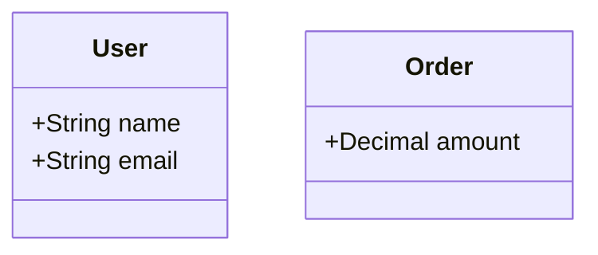
提取实体：User (用户), Order (订单)

**时序图中的参与者：**
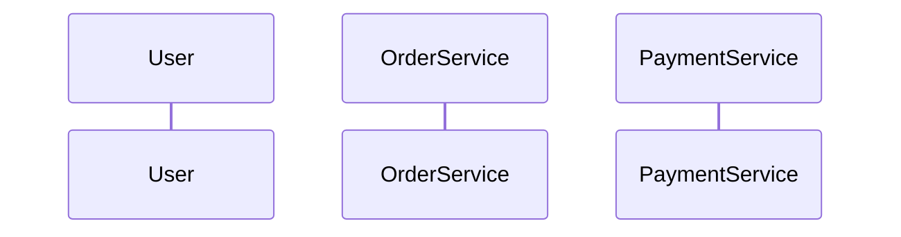
提取实体：User, OrderService, PaymentService

**状态图中的状态：**
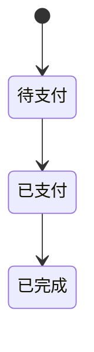
提取实体状态：待支付、已支付、已完成

**PlantUML 类定义：**
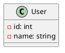
提取实体：User

### 实体映射关系表

建立实体映射关系表，记录实体在不同位置的定义：

| 实体名称 | 来源类型 | 来源位置 | 属性/特征 | 定义 |
|:---------|:---------|:---------|:----------|:-----|
| 用户 | 标题 | 第 10 行 | - | H2 标题 |
| User | Mermaid 类图 | 第 25 行 | name, email | 类定义 |
| 用户 | PlantUML 类图 | 第 45 行 | id, name | 类定义 |
| 待支付 | 状态图 | 第 60 行 | - | 状态定义 |

### 校验规则

#### 规则 1：实体命名一致性

**检查项：** 同一实体在不同位置是否使用一致的命名。

**问题示例：**
```markdown
## 用户管理
...

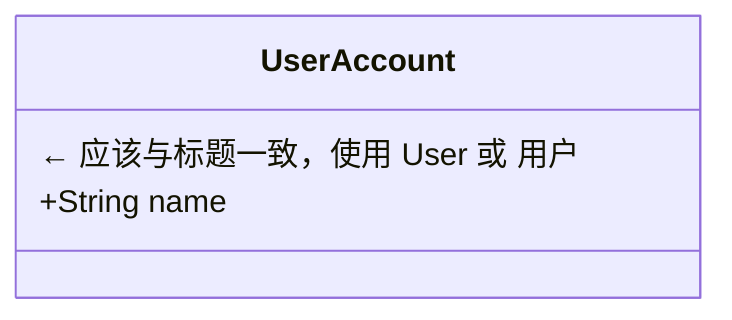
```

**修正建议：**
- 统一使用中文名或英文名
- 确定命名规范：业务描述用中文，技术实现用英文
- 建立命名映射表

#### 规则 2：属性定义一致性

**检查项：** 同一实体的属性在不同图表中是否一致。

**问题示例：**

图表 1：
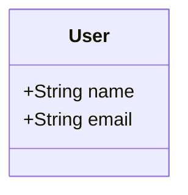

图表 2：
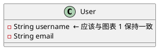

**修正建议：**
- 统一属性命名
- 确保属性类型一致
- 使用同一份实体定义文档

#### 规则 3：实体完整性

**检查项：** 文档中提到的实体是否都在图表中有定义。

**问题示例：**
```markdown
## 订单处理流程

订单处理涉及用户、商品、支付、库存四个实体。

```mermaid
classDiagram
  class User
  class Product
  class Payment
  ← 缺少 Inventory (库存) 实体
```
```

**修正建议：**
- 检查所有提到的实体
- 补充缺失的实体定义
- 或删除文档中未定义的实体引用

## 实体一致性校验

### 实体注册表

建立统一的实体注册表：

```
┌─────────────────────────────────────────────────────┐
│                 实体注册表                          │
├─────────────────────────────────────────────────────┤
│                                                     │
│  实体名: 用户 (User)                               │
│  ├─ 类型: class                                    │
│  ├─ 属性:                                          │
│  │   ├─ id: int                                    │
│  │   ├─ name: string                               │
│  │   └─ email: string                              │
│  ├─ 关系:                                          │
│  │   ├─ 拥有 → 订单 (1:N)                          │
│  │   └─ 使用 → 地址 (1:N)                          │
│  └─ 定义来源:                                       │
│      ├─ Mermaid 类图 (第 25 行)                    │
│      ├─ PlantUML 类图 (第 45 行)                   │
│      └─ ER 图 (第 80 行)                           │
│                                                     │
└─────────────────────────────────────────────────────┘
```

### 一致性检查流程

```
开始
  │
  ▼
扫描文档 ──► 提取所有实体定义
  │
  ▼
建立实体注册表
  │
  ▼
检查命名一致性 ◄────────┐
  │                     │
  ├─ 不一致 → 报告问题  │
  │                     │
  ▼                     │
检查属性一致性          │
  │                     │
  ├─ 不一致 → 报告问题  │
  │                     │
  ▼                     │
检查关系一致性          │
  │                     │
  ├─ 不一致 → 报告问题  │
  │                     │
  ▼                     │
检查状态定义一致性      │
  │                     │
  ├─ 不一致 → 报告问题 ─┘
  │
  ▼
输出校验报告
  │
  ▼
结束
```

### 常见不一致问题

#### 问题 1：属性名称不一致

```
位置 1: User.name
位置 2: User.username
位置 3: User.userName
```

**解决方案：** 统一为 `name` 或 `username`

#### 问题 2：属性类型不一致

```
位置 1: User.age: int
位置 2: User.age: string
位置 3: User.age: Integer
```

**解决方案：** 统一为 `int` 或使用包装类型 `Integer`

#### 问题 3：关系定义不一致

```
位置 1: User --> Order (1:N)
位置 2: User --> Order (1:1)  ← 错误
位置 3: Order --> User (N:1)  ← 正确
```

**解决方案：** 统一关系定义，使用一致的表述方向

## 图表间关系校验

### 图表标识

为图表添加唯一标识，便于引用和校验：

**HTML 锚点方式：**
```markdown
<a id="user-flow-diagram"></a>

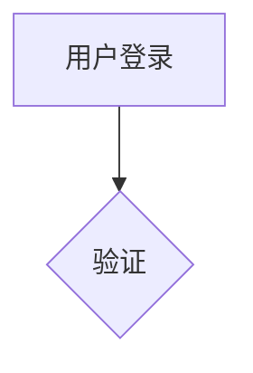
```

**注释方式：**
```markdown
<!-- diagram: user-flow-diagram -->


```

### 图表引用

在文档中引用图表：

```markdown
用户登录流程如 [用户登录流程图](#user-flow-diagram) 所示。

具体交互细节参见 [登录时序图](#login-sequence)。
```

### 校验规则

#### 规则 1：图表引用有效性

**检查项：** 图表引用是否指向存在的图表。

**错误示例：**
```markdown
详情参见 [流程图](#process-flow)。

<!-- 实际图表 ID 是 user-flow，不是 process-flow -->
```

#### 规则 2：图表逻辑一致性

**检查项：** 多个图表描述同一流程时是否一致。

**问题示例：**

流程图：
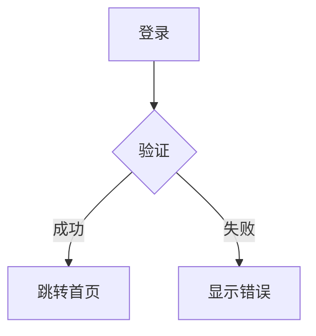

时序图：
```mermaid
sequenceDiagram
  User->>System: 登录
  System->>DB: 验证
  DB-->>System: 结果
  System-->>User: 返回
  ← 缺少失败分支
```

**修正建议：** 在时序图中添加 `alt/else` 分支处理失败情况

#### 规则 3：图表与文本一致性

**检查项：** 图表内容是否与文本描述一致。

**问题示例：**
```markdown
## 用户登录流程

用户登录需要经过三个步骤：
1. 输入用户名密码
2. 系统验证
3. 跳转首页

```mermaid
graph TD
  A[输入凭证] --> B[验证]  ← 步骤 1 不精确
  B --> C[登录成功]        ← 缺少失败处理
```
```

**修正建议：**
- 步骤描述精确对应
- 添加失败分支处理

### 图表关系映射

建立图表关系映射表：

| 图表 ID | 类型 | 描述内容 | 相关图表 | 引用的实体 |
|:--------|:-----|:---------|:---------|:-----------|
| user-flow | 流程图 | 用户登录流程 | login-seq | User, System |
| login-seq | 时序图 | 登录交互细节 | user-flow | User, Auth, DB |
| order-state | 状态图 | 订单状态流转 | order-class | Order |
| order-class | 类图 | 订单实体定义 | order-state | Order, User |

## 逻辑表达一致性校验

### 流程逻辑一致性

#### 检查流程步骤对应

当文档用不同方式描述同一流程时，检查步骤是否对应：

| 描述方式 | 步骤 1 | 步骤 2 | 步骤 3 | 步骤 4 |
|:---------|:-------|:-------|:-------|:-------|
| 文字描述 | 输入凭证 | 验证格式 | 查询数据库 | 返回结果 |
| 流程图 | 输入 → 验证 → 查询 → 返回 | ✅ | ✅ | ✅ | ✅ |
| 时序图 | User→App→API→DB | ✅ | ✅ | ✅ | ✅ |

**发现问题：** 如果时序图缺少"验证格式"步骤，则不一致。

#### 检查分支完整性

**流程图有分支：**
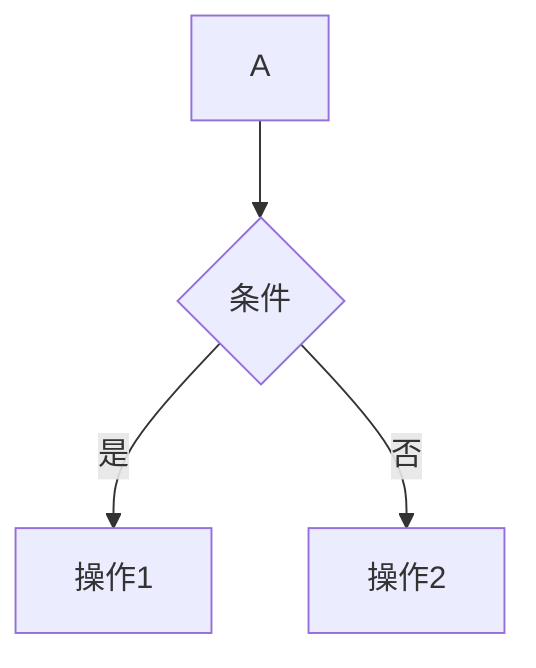

**文字描述应包含：**
```markdown
当条件满足时，执行操作1；否则执行操作2。
```

**检查项：**
- [ ] 所有分支都有对应处理
- [ ] 分支条件描述一致
- [ ] 分支结果描述完整

### 状态逻辑一致性

#### 状态定义一致性

**状态图：**
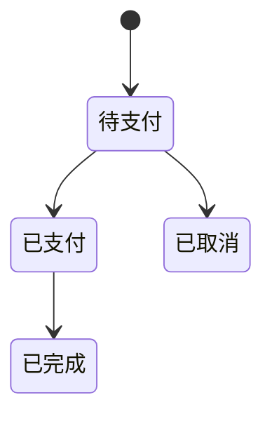

**文字描述检查：**
```markdown
订单状态流转：
1. 新订单 → 待支付 ✓
2. 支付成功 → 已支付 ✓
3. 取消订单 → 已取消 ✓
4. 确认收货 → 已完成 ✓
```

**状态属性检查：**

如果文档定义了状态属性：
```markdown
订单状态：
- 待支付: 可取消、可支付
- 已支付: 可发货、可退款
- 已完成: 可评价
```

则在类图或 ER 图中应有对应的状态字段。

### 数据逻辑一致性

#### 字段一致性

**表格定义：**
```markdown
| 字段 | 类型 | 说明 |
| order_id | string | 订单编号 |
| amount | decimal | 订单金额 |
```

**类图定义：**
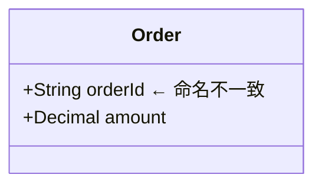

**修正：** 统一为 `orderId` 或 `order_id`

#### 关系一致性

**ER 图定义：**
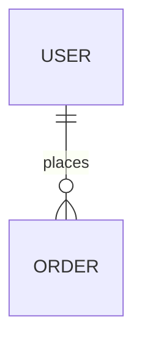

**文字描述：**
```markdown
一个用户可以下多个订单。
```

**检查项：**
- [ ] 关系方向正确
- [ ] 基数一致（1:1, 1:N, M:N）
- [ ] 关系名称有意义

## 双重校验模式

### 校验模式对比

| 特性 | 脚本校验 | 智能体校验 |
|:-----|:---------|:-----------|
| **执行方式** | 自动化 | 引导式 |
| **覆盖范围** | 规则明确的问题 | 语义理解问题 |
| **准确性** | 精确匹配 | 上下文理解 |
| **灵活性** | 固定规则 | 自适应 |
| **速度** | 快速 | 需要交互 |
| **适用场景** | 批量检查、兜底验证 | 复杂逻辑、语义分析 |

### 校验流程

```
┌─────────────────────────────────────────────────────────┐
│                    双重校验流程                          │
└─────────────────────────────────────────────────────────┘

步骤 1: 脚本自动校验
┌─────────────────────────────────────────────────────────┐
│                                                         │
│  执行: npx ts-node scripts/markdown-validator.ts file  │
│                                                         │
│  ├─ 检查标题层级                                        │
│  ├─ 检查目录一致性                                      │
│  ├─ 检查语法正确性                                      │
│  ├─ 检查图表语法                                        │
│  ├─ 提取实体定义                                        │
│  ├─ 检查实体命名一致性                                  │
│  └─ 生成校验报告                                        │
│                                                         │
│  输出: 错误列表 + 警告列表 + 实体统计                   │
│                                                         │
└─────────────────────────────────────────────────────────┘
                          │
                          ▼
步骤 2: 智能体深度校验
┌─────────────────────────────────────────────────────────┐
│                                                         │
│  智能体根据脚本报告进行深度分析：                        │
│                                                         │
│  ├─ 理解实体语义                                        │
│  │   └─ 判断"用户"和"User"是否指同一实体               │
│  │                                                     │
│  ├─ 分析业务逻辑                                        │
│  │   └─ 判断流程步骤是否合理、是否遗漏                  │
│  │                                                     │
│  ├─ 检查上下文一致性                                    │
│  │   └─ 判断图表描述是否与上下文匹配                    │
│  │                                                     │
│  ├─ 提供修正建议                                        │
│  │   └─ 给出具体的修改方案和示例                        │
│  │                                                     │
│  └─ 确认修正结果                                        │
│      └─ 重新校验确保问题解决                            │
│                                                         │
└─────────────────────────────────────────────────────────┘
                          │
                          ▼
步骤 3: 校验完成
┌─────────────────────────────────────────────────────────┐
│                                                         │
│  ✓ 所有错误已修正                                       │
│  ✓ 警告已处理或确认忽略                                 │
│  ✓ 实体定义一致                                         │
│  ✓ 图表逻辑正确                                         │
│  ✓ 文档符合规范                                         │
│                                                         │
└─────────────────────────────────────────────────────────┘
```

### 脚本校验清单

脚本自动检查的项目：

**基础校验：**
- [ ] 标题层级连续性
- [ ] H1 标题唯一性
- [ ] 目录链接有效性
- [ ] 链接语法正确性
- [ ] 图片替代文本
- [ ] 代码块闭合
- [ ] 表格格式

**图表校验：**
- [ ] Mermaid 图表类型声明
- [ ] PlantUML 标记配对
- [ ] ASCII 艺术格式

**实体校验：**
- [ ] 实体命名一致性（精确匹配）
- [ ] 实体定义来源追踪
- [ ] 实体重复定义检测

**逻辑校验：**
- [ ] 步骤编号连续性
- [ ] 条件分支配对
- [ ] 状态转换重复

### 智能体校验清单

智能体需要检查的项目：

**语义理解：**
- [ ] "用户"和"User"是否指同一实体
- [ ] "订单状态"在不同图表中是否一致
- [ ] 业务术语是否统一

**逻辑分析：**
- [ ] 流程步骤是否完整
- [ ] 分支处理是否合理
- [ ] 状态转换是否符合业务规则

**上下文一致性：**
- [ ] 图表描述是否与文档主题相关
- [ ] 实体属性是否符合业务场景
- [ ] 关系定义是否合理

**可读性：**
- [ ] 命名是否易于理解
- [ ] 逻辑是否清晰
- [ ] 结构是否合理

## 校验脚本使用

### 安装依赖

```bash
npm install -g typescript ts-node
```

### 执行校验

```bash
# 基础校验
npx ts-node scripts/markdown-validator.ts document.md

# 校验多个文件
npx ts-node scripts/markdown-validator.ts doc1.md doc2.md doc3.md
```

### 输出解读

```
📄 文件: /path/to/document.md
============================================================

❌ 错误:

  1. [第 15 行] 文档应该只有一个 H1 标题
     💡 建议: 将此标题改为 H2 或更低级别

  2. [第 45 行] 实体 "User" 在多个图表中定义
     💡 建议: 检查实体定义是否一致，考虑统一管理

⚠️  警告:

  1. [第 23 行] 实体 "用户" 和 "User" 可能指同一实体
     💡 建议: 统一实体命名规范

  2. [第 60 行] 流程图与时序图之间可能存在逻辑不一致
     💡 建议: 检查两个图表是否描述同一流程，实体命名是否一致

============================================================
📊 统计: 共发现 4 个问题
   - 错误: 2
   - 警告: 2

📋 实体统计: 发现 8 个实体
   - 类: 4
   - 参与者: 3
   - 状态: 5
   - 表: 2

📊 图表统计: 发现 5 个图表
   - mermaid: 3
   - plantuml: 2
```

### 常见问题处理

#### 问题 1：实体命名不一致

**脚本输出：**
```
实体 "用户" 和 "User" 可能指同一实体
```

**处理步骤：**
1. 检查两个实体是否确实指同一对象
2. 确定统一命名规范
3. 全局替换或保留映射关系
4. 重新运行校验

#### 问题 2：图表逻辑不一致

**脚本输出：**
```
流程图与时序图之间可能存在逻辑不一致
```

**处理步骤：**
1. 人工对比两个图表的流程
2. 检查步骤是否一一对应
3. 检查分支处理是否完整
4. 统一命名和流程描述
5. 重新校验

#### 问题 3：状态转换重复

**脚本输出：**
```
状态转换 "待支付->已支付" 被多次定义
```

**处理步骤：**
1. 检查是否需要多个触发条件
2. 如果需要，合并到一个定义中
3. 如果不需要，删除重复定义
4. 确保状态转换唯一且明确

### 最佳实践

1. **先脚本后智能体**
   - 先运行脚本校验，修正基础问题
   - 再由智能体进行深度分析

2. **建立实体词表**
   - 维护统一的实体命名词表
   - 中英文映射关系明确

3. **定期校验**
   - 文档修改后及时校验
   - 发布前完整校验

4. **版本控制**
   - 记录校验结果
   - 追踪修正历史
