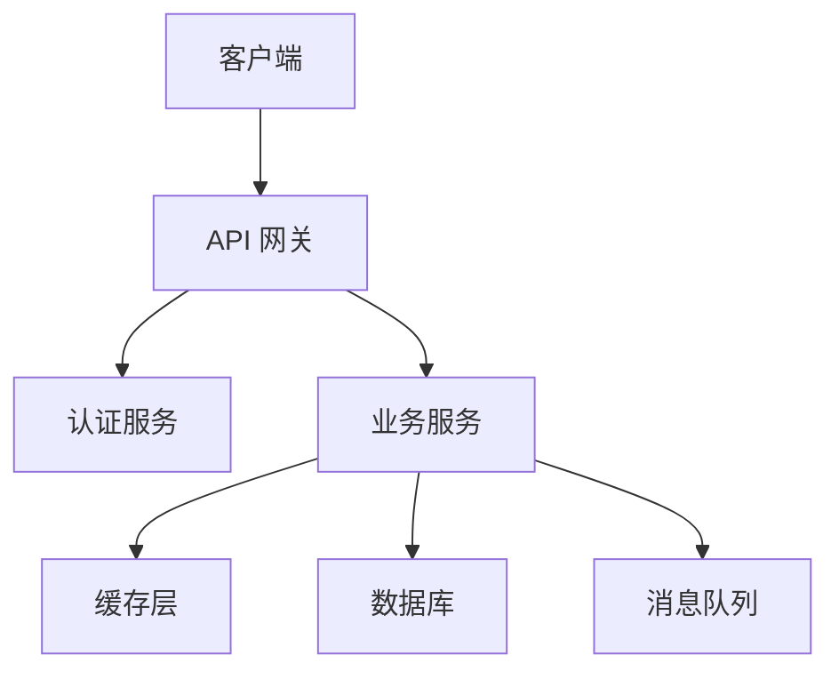
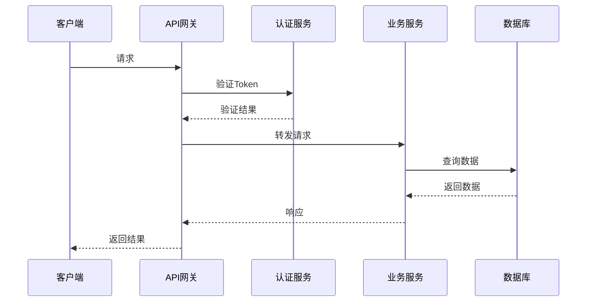
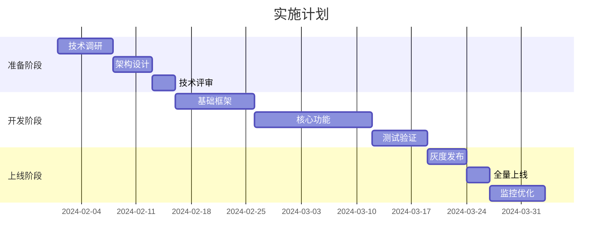
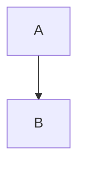
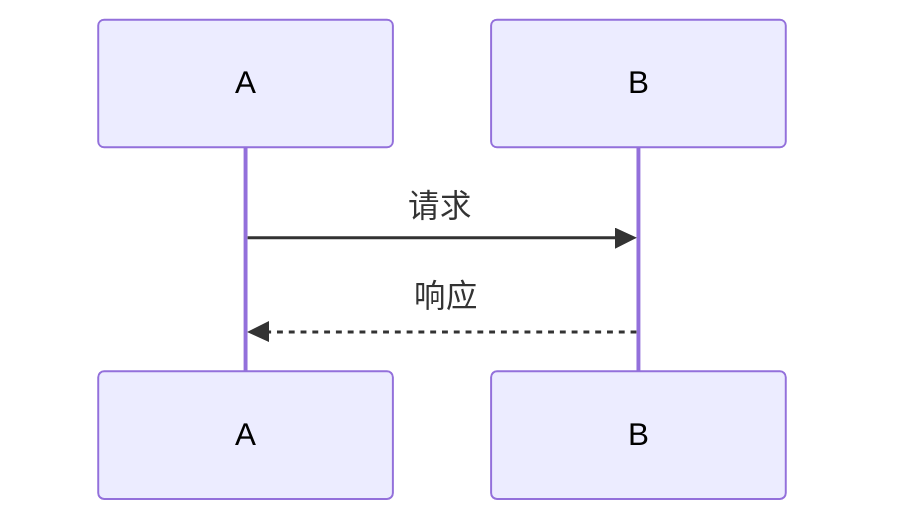
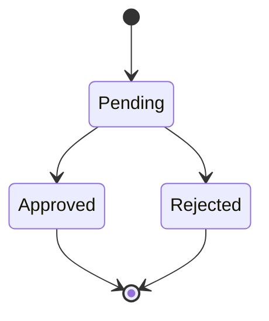

# 设计文档模板规范

## 文档定位

设计文档（Design Doc/RFC）用于描述系统设计方案、技术选型和实现细节。

## 标准结构

```markdown
# 设计文档：功能名称

| 字段 | 值 |
|------|-----|
| 作者 | 张三 |
| 状态 | 草稿 / 评审中 / 已批准 / 已实现 |
| 创建日期 | 2024-01-15 |
| 最后更新 | 2024-01-20 |
| 相关 Issue | #123, #456 |

## 目录

- [背景](#背景)
- [目标](#目标)
- [非目标](#非目标)
- [方案设计](#方案设计)
- [详细设计](#详细设计)
- [替代方案](#替代方案)
- [风险评估](#风险评估)
- [实施计划](#实施计划)
- [附录](#附录)

## 背景

### 问题陈述

描述当前存在的问题或需要改进的地方。

**现状：**

- 当前系统的行为 A
- 存在的性能问题 B
- 用户体验问题 C

**数据支持：**

- 用户反馈统计
- 性能测试数据
- 业务指标分析

### 相关资料

- [技术调研报告](./research.md)
- [用户调研结果](./user-research.md)
- [竞品分析](./competitive-analysis.md)

## 目标

### 主要目标

1. **性能提升**：将响应时间从 500ms 降低到 100ms
2. **用户体验**：简化操作流程，减少 50% 的步骤
3. **可扩展性**：支持未来 10 倍的用户增长

### 成功指标

| 指标 | 当前值 | 目标值 | 测量方法 |
|------|--------|--------|----------|
| 响应时间 | 500ms | 100ms | APM 监控 |
| 错误率 | 2% | 0.5% | 日志分析 |
| 用户满意度 | 3.5/5 | 4.5/5 | 用户调研 |

## 非目标

明确说明不在本次设计范围内的事项：

- 不包括移动端适配（将在第二阶段实现）
- 不涉及数据库迁移（已有独立项目负责）
- 不重构现有认证系统

## 方案设计

### 整体架构



### 核心组件

#### 1. API 网关

**职责：**

- 请求路由
- 认证鉴权
- 流量控制

**技术选型：**

| 方案 | 优点 | 缺点 | 结论 |
|------|------|------|------|
| Kong | 功能丰富 | 学习成本高 | ❌ |
| Nginx | 性能高 | 功能有限 | ❌ |
| 自研 | 可定制 | 开发成本高 | ✅ |

#### 2. 业务服务

采用微服务架构：

```
服务划分：
├── user-service      # 用户服务
├── order-service     # 订单服务
├── payment-service   # 支付服务
└── notification-service  # 通知服务
```

### 数据流



## 详细设计

### 数据模型

#### User 表

| 字段 | 类型 | 说明 |
|------|------|------|
| id | UUID | 主键 |
| name | VARCHAR(100) | 用户名 |
| email | VARCHAR(255) | 邮箱（唯一） |
| status | ENUM | 状态：active, inactive, banned |
| created_at | TIMESTAMP | 创建时间 |
| updated_at | TIMESTAMP | 更新时间 |

#### 索引设计

```sql
-- 主键索引
PRIMARY KEY (id)

-- 邮箱唯一索引
UNIQUE INDEX idx_email (email)

-- 状态索引（用于过滤）
INDEX idx_status (status)

-- 复合索引（用于查询）
INDEX idx_status_created (status, created_at)
```

### API 设计

#### 创建用户

```http
POST /api/v1/users
Content-Type: application/json
Authorization: Bearer <token>

{
  "name": "张三",
  "email": "zhangsan@example.com"
}
```

**响应：**

```json
{
  "id": "user_abc123",
  "name": "张三",
  "email": "zhangsan@example.com",
  "status": "active",
  "created_at": "2024-01-15T10:30:00Z"
}
```

### 错误处理

定义统一的错误码：

| 错误码 | HTTP状态码 | 说明 |
|--------|-----------|------|
| USER_NOT_FOUND | 404 | 用户不存在 |
| EMAIL_DUPLICATE | 409 | 邮箱已存在 |
| INVALID_INPUT | 400 | 输入参数错误 |

错误响应格式：

```json
{
  "error": {
    "code": "EMAIL_DUPLICATE",
    "message": "邮箱已被注册",
    "details": {
      "email": "zhangsan@example.com"
    }
  }
}
```

## 替代方案

### 方案 A：单体架构

**描述：**

所有功能部署在一个服务中。

**优点：**

- 部署简单
- 开发效率高
- 调试方便

**缺点：**

- 扩展性差
- 单点故障风险
- 技术栈受限

**不采用原因：**

无法满足 10 倍用户增长的扩展需求。

### 方案 B：Serverless

**描述：**

使用云函数实现业务逻辑。

**优点：**

- 无需管理服务器
- 按需付费
- 自动扩展

**缺点：**

- 冷启动延迟
- 调试困难
- 厂商锁定

**不采用原因：**

冷启动影响用户体验，且现有团队缺乏 Serverless 经验。

## 风险评估

| 风险 | 影响 | 概率 | 缓解措施 |
|------|------|------|----------|
| 数据迁移失败 | 高 | 中 | 分批迁移，保留回滚方案 |
| 性能不达标 | 高 | 低 | 提前压测，预留优化时间 |
| 团队经验不足 | 中 | 中 | 技术培训，引入专家顾问 |

### 回滚计划

如果上线后出现严重问题：

1. **立即回滚**：切换到旧版本服务
2. **数据回滚**：从备份恢复数据
3. **问题分析**：定位根本原因
4. **修复验证**：在测试环境验证修复

## 实施计划

### 阶段划分



### 里程碑

| 里程碑 | 日期 | 交付物 |
|--------|------|--------|
| M1 - 设计评审 | 2024-02-15 | 设计文档定稿 |
| M2 - 开发完成 | 2024-03-15 | 功能开发完成 |
| M3 - 测试通过 | 2024-03-22 | 测试报告 |
| M4 - 上线 | 2024-03-30 | 生产环境部署 |

## 附录

### 术语表

| 术语 | 说明 |
|------|------|
| API Gateway | API 网关 |
| Microservice | 微服务 |
| SLA | 服务等级协议 |

### 参考资料

- [微服务设计模式](https://microservices.io/patterns/)
- [API 设计指南](https://google.github.io/styleguide/jsoncstyleguide.xml)

### 变更历史

| 日期 | 版本 | 变更说明 |
|------|------|----------|
| 2024-01-15 | 0.1 | 初稿 |
| 2024-01-20 | 0.2 | 添加风险评估章节 |
| 2024-01-25 | 1.0 | 评审通过 |
```

## 必选章节

| 章节 | 说明 |
|------|------|
| 背景 | 问题描述和数据支持 |
| 目标 | 明确的目标和成功指标 |
| 方案设计 | 整体架构和技术选型 |
| 详细设计 | 数据模型、API、错误处理 |

## 推荐章节

| 章节 | 说明 |
|------|------|
| 非目标 | 明确不在范围内的事项 |
| 替代方案 | 分析其他可行方案 |
| 风险评估 | 风险识别和缓解措施 |
| 实施计划 | 时间线和里程碑 |

## 质量检查要点

1. **问题描述**：有数据支持的问题陈述
2. **目标明确**：可量化的成功指标
3. **方案对比**：分析多个备选方案
4. **图表清晰**：使用 Mermaid 绘制架构图
5. **风险评估**：识别潜在风险和缓解措施

## 图表使用规范

### 架构图

使用流程图或组件图：



### 时序图

描述交互流程：



### 状态图

描述状态转换：


