# Markdown 校验规则与修正指南

## 目录

1. [校验检查项](#校验检查项)
2. [常见错误清单](#常见错误清单)
3. [修正方法](#修正方法)
4. [校验工具使用](#校验工具使用)
5. [目录校验规则](#目录校验规则)
6. [图表格式校验](#图表格式校验)
7. [ASCII 艺术图表校验](#ascii-艺术图表校验)
8. [实体一致性校验](#实体一致性校验)
9. [图表间关系校验](#图表间关系校验)
10. [逻辑表达一致性校验](#逻辑表达一致性校验)
11. [双重校验模式](#双重校验模式)

## 校验检查项

### 结构性检查

| 检查项 | 规则说明 | 优先级 | 校验方式 |
|--------|----------|--------|----------|
| 标题层级 | H1 唯一，层级连续不跳级 | 高 | 脚本自动 |
| 空行使用 | 段落、列表、表格前后有空行 | 中 | 脚本自动 |
| 文档长度 | 适当分段，避免过长段落 | 低 | 人工判断 |
| 嵌套深度 | 列表、引用嵌套不超过 4 层 | 中 | 脚本自动 |
| 目录一致性 | 目录与标题结构对应 | 高 | 脚本自动 |

### 语法正确性检查

| 检查项 | 规则说明 | 优先级 | 校验方式 |
|--------|----------|--------|----------|
| 链接语法 | `[文本](URL)` 格式完整 | 高 | 脚本自动 |
| 图片语法 | `` 包含替代文本 | 高 | 脚本自动 |
| 代码块 | 开闭标记匹配，指定语言 | 高 | 脚本自动 |
| 表格格式 | 分隔行格式正确 | 中 | 脚本自动 |
| 列表格式 | 标记符号后有空格 | 中 | 脚本自动 |

### 内容完整性检查

| 检查项 | 规则说明 | 优先级 | 校验方式 |
|--------|----------|--------|----------|
| 链接有效性 | URL 格式正确，相对路径存在 | 高 | 脚本+人工 |
| 图片引用 | 图片路径正确，文件存在 | 高 | 脚本+人工 |
| 代码示例 | 代码可运行，语法正确 | 中 | 人工判断 |
| 目录更新 | 目录与标题结构一致 | 高 | 脚本自动 |

### 格式一致性检查

| 检查项 | 规则说明 | 优先级 | 校验方式 |
|--------|----------|--------|----------|
| 标题风格 | 统一使用 ATX 风格或 Setext 风格 | 低 | 人工判断 |
| 列表标记 | 同级列表使用相同符号 | 低 | 脚本自动 |
| 代码块语言 | 代码块指定语言标识 | 中 | 脚本自动 |
| 强调符号 | 统一使用 `*` 或 `_` | 低 | 人工判断 |

### 图表格式检查

| 检查项 | 规则说明 | 优先级 | 校验方式 |
|--------|----------|--------|----------|
| Mermaid 语法 | 图表类型声明正确，语法有效 | 高 | 脚本自动 |
| PlantUML 标记 | @startuml/@enduml 配对 | 高 | 脚本自动 |
| 图表闭合 | 代码块正确闭合 | 高 | 脚本自动 |
| 节点定义 | 节点名称和关系语法正确 | 中 | 脚本+人工 |

## 常见错误清单

### 1. 标题错误

#### 错误 1.1：标题层级跳跃

**错误示例：**
```markdown
# 一级标题

### 三级标题  ← 错误：跳过了二级标题
```

**修正方法：**
```markdown
# 一级标题

## 二级标题

### 三级标题
```

#### 错误 1.2：多个 H1 标题

**错误示例：**
```markdown
# 项目介绍

# 安装指南  ← 错误：文档应只有一个 H1
```

**修正方法：**
```markdown
# 项目介绍

## 安装指南
```

#### 错误 1.3：标题格式错误

**错误示例：**
```markdown
#标题  ← 错误：缺少空格
# 标题 ##  ← 错误：ATX 风格不需要闭合
```

**修正方法：**
```markdown
# 标题
```

### 2. 列表错误

#### 错误 2.1：列表标记后缺少空格

**错误示例：**
```markdown
-项目 1  ← 错误
*项目 2  ← 错误
1.项目 3  ← 错误
```

**修正方法：**
```markdown
- 项目 1
* 项目 2
1. 项目 3
```

#### 错误 2.2：嵌套列表缩进错误

**错误示例：**
```markdown
- 项目 1
 - 子项目  ← 错误：缩进不足
- 项目 2
```

**修正方法：**
```markdown
- 项目 1
  - 子项目  ← 正确：2-4 空格或 1 Tab
- 项目 2
```

#### 错误 2.3：列表项间多余空行

**错误示例：**
```markdown
- 项目 1

- 项目 2  ← 错误：空行会导致列表中断
```

**修正方法：**
```markdown
- 项目 1
- 项目 2
```

### 3. 链接和图片错误

#### 错误 3.1：链接语法不完整

**错误示例：**
```markdown
[链接文本  ← 错误：缺少闭合
](URL)  ← 错误：格式错误
[链接文本] (URL)  ← 错误：中间有空格
```

**修正方法：**
```markdown
[链接文本](URL)
```

#### 错误 3.2：图片缺少替代文本

**错误示例：**
```markdown
  ← 错误：缺少替代文本
```

**修正方法：**
```markdown

```

#### 错误 3.3：URL 包含空格未编码

**错误示例：**
```markdown
[链接](my document.pdf)  ← 错误：空格未编码
```

**修正方法：**
```markdown
[链接](my%20document.pdf)  ← 编码空格
或
[链接](<my document.pdf>)  ← 使用尖括号
```

### 4. 代码块错误

#### 错误 4.1：代码块未闭合

**错误示例：**
````markdown
```javascript
const x = 10;
继续文本...  ← 错误：代码块未闭合
````

**修正方法：**
````markdown
```javascript
const x = 10;
```

继续文本...
````

#### 错误 4.2：代码块反引号数量不匹配

**错误示例：**
````markdown
```javascript
const x = 10;
````  ← 错误：数量不匹配
````

**修正方法：**
````markdown
```javascript
const x = 10;
```
````

#### 错误 4.3：缺少语言标识

**错误示例：**
````markdown
```
function hello() {
  console.log("Hello");
}
```
````

**修正方法：**
````markdown
```javascript
function hello() {
  console.log("Hello");
}
```
````

### 5. 表格错误

#### 错误 5.1：分隔行格式错误

**错误示例：**
```markdown
| 列 1 | 列 2 |
|-|-|  ← 错误：至少需要三个减号
| 数据 | 数据 |
```

**修正方法：**
```markdown
| 列 1 | 列 2 |
|------|------|
| 数据 | 数据 |
```

#### 错误 5.2：列数不匹配

**错误示例：**
```markdown
| 列 1 | 列 2 | 列 3 |
|------|------|
| 数据 1 | 数据 2  ← 错误：缺少第三列
```

**修正方法：**
```markdown
| 列 1 | 列 2 | 列 3 |
|------|------|------|
| 数据 1 | 数据 2 | 数据 3 |
```

### 6. 格式不一致

#### 错误 6.1：列表标记混用

**错误示例：**
```markdown
- 项目 1
* 项目 2  ← 错误：混用标记符号
- 项目 3
```

**修正方法：**
```markdown
- 项目 1
- 项目 2
- 项目 3
```

#### 错误 6.2：强调符号混用

**错误示例：**
```markdown
这是 **粗体**
这是 __粗体__  ← 错误：混用符号
```

**修正方法：**
```markdown
这是 **粗体**
这是 **粗体**
```

### 7. 空行错误

#### 错误 7.1：缺少必要空行

**错误示例：**
```markdown
# 标题
段落内容  ← 错误：标题后缺少空行
```

**修正方法：**
```markdown
# 标题

段落内容
```

#### 错误 7.2：连续多个空行

**错误示例：**
```markdown
段落 1。


段落 2  ← 错误：多余空行
```

**修正方法：**
```markdown
段落 1。

段落 2
```

## 修正方法

### 自动修正流程

**步骤 1：结构扫描**
- 提取所有标题，检查层级
- 识别列表、代码块、表格等块级元素
- 标记需要修正的位置

**步骤 2：语法验证**
- 检查链接和图片语法完整性
- 验证代码块开闭标记
- 校验表格格式

**步骤 3：格式统一**
- 统一列表标记符号
- 统一强调符号
- 规范空行使用

**步骤 4：内容完善**
- 为图片添加替代文本
- 为代码块添加语言标识
- 检查链接有效性

### 修正优先级

1. **高优先级（影响渲染）**
   - 标题层级错误
   - 代码块未闭合
   - 链接/图片语法错误
   - 表格格式错误
   - 目录链接错误

2. **中优先级（影响可读性）**
   - 缺少必要空行
   - 列表格式问题
   - 代码块缺少语言标识
   - 图表语法错误

3. **低优先级（影响一致性）**
   - 标记符号混用
   - 多余空行
   - 格式不统一

### 修正示例

**原始文档（存在多个错误）：**
```markdown
# 项目介绍
这是项目介绍内容。
## 功能特性
-特性 1
* 特性 2
### 详细说明
```
const code = "示例";
````
[链接](http://example.com

```

**修正后文档：**
```markdown
# 项目介绍

这是项目介绍内容。

## 功能特性

- 特性 1
- 特性 2

### 详细说明

```javascript
const code = "示例";
```

[链接](http://example.com)


```

## 校验工具使用

### 使用校验脚本（推荐）

校验脚本提供自动化、标准化的校验能力。

#### 安装依赖

```bash
# 安装 TypeScript 和 ts-node
npm install -g typescript ts-node
```

#### 执行校验

```bash
# 校验单个文件
npx ts-node scripts/markdown-validator.ts README.md

# 校验多个文件
npx ts-node scripts/markdown-validator.ts doc1.md doc2.md doc3.md
```

#### 输出示例

```
📄 文件: /path/to/README.md
============================================================

❌ 错误:

  1. [第 15 行] 文档应该只有一个 H1 标题
     💡 建议: 将此标题改为 H2 或更低级别
     
  2. [第 23 行] 代码块未正确闭合
     💡 建议: 在代码块末尾添加 ```

⚠️  警告:

  1. [第 8 行] 标题层级跳跃：从 H1 直接跳到 H3
     💡 建议: 建议在 H1 和 H3 之间添加 H2
     
  2. [第 31 行] 代码块未指定语言标识
     💡 建议: 添加语言标识以启用语法高亮，如 ```javascript

============================================================
📊 统计: 共发现 4 个问题
   - 错误: 2
   - 警告: 2
```

### 校验脚本功能清单

| 功能 | 说明 | 错误类型 |
|:-----|:-----|:---------|
| **标题层级检查** | 检查 H1 唯一性和层级跳跃 | 错误/警告 |
| **目录一致性检查** | 验证目录链接有效性 | 错误/警告 |
| **链接语法检查** | 检查链接格式和空文本 | 错误/警告 |
| **图片语法检查** | 检查替代文本 | 错误 |
| **代码块检查** | 检查闭合和语言标识 | 错误/警告 |
| **表格格式检查** | 检查分隔行和列数 | 错误/警告 |
| **Mermaid 检查** | 检查图表类型和语法 | 错误/警告 |
| **PlantUML 检查** | 检查标记配对和语法 | 错误/警告 |

## 目录校验规则

### 1. 目录格式要求

#### 自动目录

部分 Markdown 渲染器支持自动生成目录：

```markdown
[toc]
<!-- 或 -->
[[toc]]
<!-- 或 -->
${toc}
```

**校验点：**
- 确认渲染器支持该语法
- 检查是否在正确位置（通常在文档开头）

#### 手动目录

```markdown
## 目录

- [简介](#简介)
  - [背景](#背景)
  - [目的](#目的)
- [快速开始](#快速开始)
  - [安装](#安装)
  - [使用](#使用)
- [API 参考](#api-参考)
```

### 2. 目录一致性检查

#### 检查项 1：链接锚点有效性

**规则：** 目录中的每个链接应该指向一个实际存在的标题。

**错误示例：**
```markdown
## 目录
- [简介](#简介)
- [安装](#installation)  ← 错误：锚点不存在

## 简介
...
## 安装指南  ← 实际标题是"安装指南"，不是"安装"
```

**修正方法：**
```markdown
## 目录
- [简介](#简介)
- [安装指南](#安装指南)  ← 使用正确的锚点
```

#### 检查项 2：标题覆盖完整性

**规则：** 目录应该包含文档中的所有主要标题（H2 及以上）。

**错误示例：**
```markdown
## 目录
- [简介](#简介)
- [安装](#安装)
<!-- 缺少 "使用方法" 和 "API 参考" -->

## 简介
## 安装
## 使用方法  ← 未出现在目录中
## API 参考  ← 未出现在目录中
```

**修正方法：**
```markdown
## 目录
- [简介](#简介)
- [安装](#安装)
- [使用方法](#使用方法)
- [API 参考](#api-参考)
```

#### 检查项 3：层级对应正确性

**规则：** 目录项的缩进层级应该与标题层级对应。

**错误示例：**
```markdown
## 目录
- [简介](#简介)
  - [安装](#安装)  ← 错误：安装不是简介的子章节
- [使用方法](#使用方法)

## 简介
## 安装  ← 安装与简介是同级，不是子级
## 使用方法
```

**修正方法：**
```markdown
## 目录
- [简介](#简介)
- [安装](#安装)
- [使用方法](#使用方法)
```

### 3. 标题 ID 生成规则

不同平台的标题 ID 生成规则可能不同：

**通用规则：**
1. 转为小写
2. 移除特殊字符（保留字母、数字、中文、连字符）
3. 空格转为连字符
4. 连续连字符合并

**示例：**

| 标题文本 | 生成的 ID |
|:---------|:----------|
| `简介` | `简介` |
| `Quick Start` | `quick-start` |
| `API 参考 (v2)` | `api-参考-v2` |
| `用户 & 权限` | `用户-权限` |

**注意事项：**
- 中文标题：部分平台保留中文，部分转为拼音
- 特殊字符：可能被移除或转义
- 数字开头：部分平台会添加前缀

### 4. 目录校验脚本检查

校验脚本会自动检查以下内容：

```typescript
// 检查项目示例
[
  "目录项链接的锚点是否存在",
  "目录是否包含所有 H2+ 标题",
  "目录层级是否与标题层级一致",
  "目录项文本是否与标题文本匹配"
]
```

## 图表格式校验

### 1. Mermaid 图表校验

#### 检查项 1：图表类型声明

**规则：** Mermaid 图表必须以有效的图表类型声明开头。

**支持的图表类型：**
- `graph` / `flowchart`：流程图
- `sequenceDiagram`：时序图
- `classDiagram`：类图
- `stateDiagram` / `stateDiagram-v2`：状态图
- `erDiagram`：ER 图
- `gantt`：甘特图
- `pie`：饼图
- `mindmap`：思维导图
- `journey`：用户旅程图
- `gitGraph`：Git 图
- `C4Context`：C4 架构图
- `requirementDiagram`：需求图

**错误示例：**
````markdown
```mermaid
A --> B  ← 错误：缺少图表类型声明
```
````

**修正方法：**
````markdown
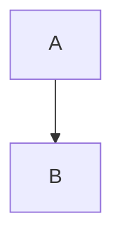
````

#### 检查项 2：流程图语法

**常见错误：**

````markdown
```mermaid
graph TD
  A[节点 A  ← 错误：未闭合方括号
  A --> B
```
````

**修正方法：**
````markdown
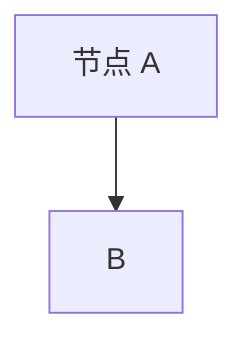
````

**节点形状语法检查：**
| 形状 | 正确语法 | 错误示例 |
|:-----|:---------|:---------|
| 矩形 | `[文本]` | `[文本` |
| 圆角 | `(文本)` | `(文本]` |
| 圆形 | `((文本))` | `(文本)` |
| 菱形 | `{文本}` | `{文本]` |

#### 检查项 3：时序图语法

**常见错误：**

````markdown
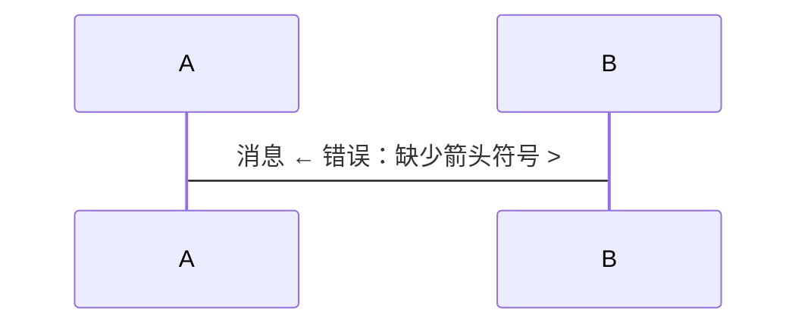
````

**修正方法：**
````markdown
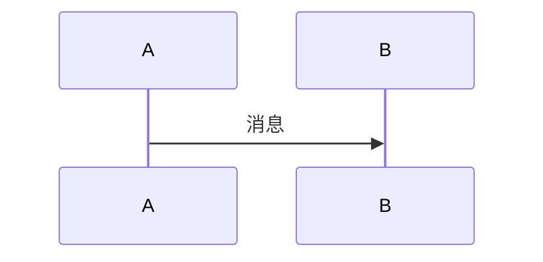
````

**箭头类型检查：**
| 箭头类型 | 正确语法 |
|:---------|:---------|
| 同步消息 | `->>` |
| 返回消息 | `-->>` |
| 异步消息 | `->)` |
| 失败消息 | `--x` |

#### 检查项 4：类图语法

**常见错误：**

````markdown
```mermaid
classDiagram
  class Animal
    +String name  ← 错误：缩进格式不正确
```
````

**修正方法：**
````markdown
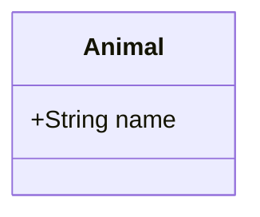
````

### 2. PlantUML 图表校验

#### 检查项 1：标记配对

**规则：** PlantUML 图表应该包含 `@startuml` 和 `@enduml` 标记。

**错误示例：**
````markdown
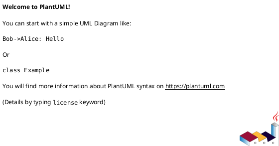
````

**修正方法：**
````markdown
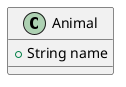
````

#### 检查项 2：未闭合标记

**错误示例：**
````markdown
```plantuml
@startuml
class Animal {
  +String name
}
<!-- 缺少 @enduml -->
```
````

**修正方法：**
````markdown

````

#### 检查项 3：关系语法

**常见错误：**

````markdown
```plantuml
@startuml
A - B  ← 错误：关系语法不完整
@enduml
```
````

**修正方法：**
````markdown
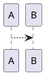
````

**关系类型检查：**
| 关系 | 正确语法 |
|:-----|:---------|
| 关联 | `-->` |
| 继承 | `<|--` |
| 实现 | `<|..` |
| 依赖 | `..>` |
| 组合 | `*--` |
| 聚合 | `o--` |

### 3. 图表代码块校验

#### 检查项 1：语言标识

**规则：** 图表代码块应该明确指定语言标识。

**错误示例：**
````markdown
```
graph TD
  A --> B
```
````

**修正方法：**
````markdown

````

#### 检查项 2：代码块闭合

**规则：** 图表代码块必须正确闭合。

**错误示例：**
````markdown
```mermaid
graph TD
  A --> B
<!-- 缺少闭合 -->
````

**修正方法：**
````markdown
```mermaid
graph TD
  A --> B
```
````

### 4. 图表校验脚本检查

校验脚本会自动检查以下内容：

```typescript
// Mermaid 检查项目
[
  "图表类型声明是否存在",
  "节点定义语法是否正确",
  "关系定义语法是否正确",
  "引号是否成对出现",
  "代码块是否正确闭合"
]

// PlantUML 检查项目
[
  "@startuml/@enduml 是否配对",
  "关系定义语法是否正确",
  "图表内容是否为空",
  "代码块是否正确闭合"
]
```

### 5. 图表校验最佳实践

1. **使用在线验证工具**
   - Mermaid: https://mermaid.live/
   - PlantUML: http://www.plantuml.com/plantuml

2. **分步验证**
   - 先验证代码块闭合
   - 再验证语法正确性
   - 最后验证渲染效果

3. **常见问题排查**
   - 中文编码问题：确保 UTF-8 编码
   - 特殊字符：使用引号包裹
   - 缩进问题：保持一致的缩进风格

## 校验报告模板

### 自动校验报告

校验脚本会生成标准格式的报告：

```markdown
## Markdown 校验报告

### 校验摘要
- 文件：README.md
- 行数：150 行
- 发现问题：5 个
  - 错误：2 个
  - 警告：3 个

### 问题详情

#### 错误 1：标题层级跳跃
- **位置**：第 23 行
- **优先级**：高
- **错误内容**：
  ```markdown
  # 项目介绍
  ### 功能特性  ← 从 H1 跳到 H3
  ```
- **修正方法**：在 H1 和 H3 之间添加 H2
- **修正后**：
  ```markdown
  # 项目介绍
  ## 功能概述
  ### 功能特性
  ```

[其他问题...]

### 修正建议

建议按优先级依次修正问题。是否需要自动应用所有修正？
```

### 快速校验清单

在编写或审阅 Markdown 文档时，使用以下清单快速校验：

```
[ ] 标题层级是否连续？
[ ] 是否只有一个 H1 标题？
[ ] 目录是否与标题结构一致？
[ ] 段落和块级元素之间是否有空行？
[ ] 列表标记后是否有空格？
[ ] 链接语法是否完整？
[ ] 图片是否有替代文本？
[ ] 代码块是否正确闭合并指定语言？
[ ] 表格分隔行格式是否正确？
[ ] Mermaid 图表是否有类型声明？
[ ] PlantUML 图表是否有 @startuml/@enduml？
[ ] 列表标记符号是否统一？
[ ] 是否有多余的空行？
```

### 常见平台差异

不同 Markdown 渲染器可能存在差异：

| 特性 | GitHub | GitLab | CommonMark | Typora |
|------|--------|--------|------------|--------|
| 自动链接 | ✅ | ✅ | ✅ | ✅ |
| 任务列表 | ✅ | ✅ | ❌ | ✅ |
| Mermaid | ✅ | ✅ | ❌ | ✅ |
| PlantUML | ⚠️ 需插件 | ✅ | ❌ | ✅ |
| 数学公式 | ✅ | ✅ | ❌ | ✅ |
| 脚注 | ✅ | ✅ | ❌ | ✅ |
| 目录生成 | ❌ | ✅ | ❌ | ✅ |

**注意**：在编写文档前，确认目标平台支持的特性。

## 使用校验工具的工作流程

### 工作流程图

````markdown
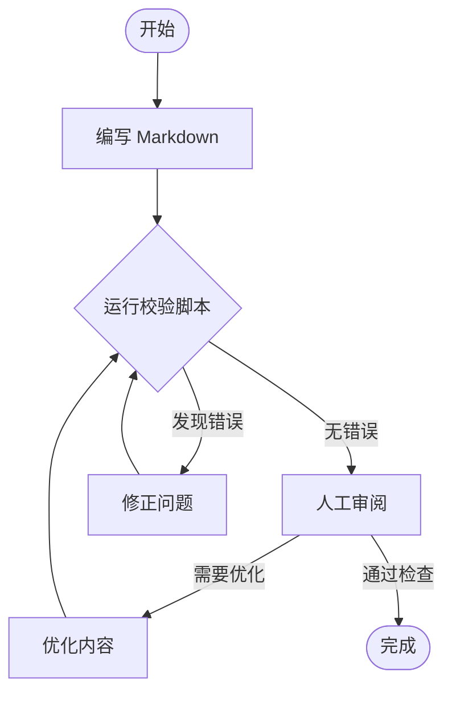
````

### 校验脚本集成建议

1. **编辑器集成**
   - VS Code: 安装 Markdown lint 插件
   - WebStorm: 内置 Markdown 支持

2. **CI/CD 集成**
   ```yaml
   # GitHub Actions 示例
   name: Markdown Lint
   on: [push, pull_request]
   jobs:
     lint:
       runs-on: ubuntu-latest
       steps:
         - uses: actions/checkout@v2
         - name: Setup Node.js
           uses: actions/setup-node@v2
         - name: Install dependencies
           run: npm install -g ts-node typescript
         - name: Run validation
           run: npx ts-node scripts/markdown-validator.ts *.md
   ```

3. **Pre-commit Hook**
   ```bash
   # .git/hooks/pre-commit
   #!/bin/bash
   npx ts-node scripts/markdown-validator.ts $(git diff --cached --name-only '*.md')
   ```

## ASCII 艺术图表校验

### 什么是 ASCII 艺术图表

ASCII 艺术图表是使用字符绘制的图表，常见于代码注释、终端输出、纯文本文档中。

**常见 ASCII 艺术图表类型：**
- 流程图（使用 `+---+`, `|`, `-->` 等）
- 方框图（使用 `+`, `-`, `|` 等）
- 树形图（使用 `├`, `└`, `─` 等）
- 箭头图（使用 `→`, `←`, `↑`, `↓` 等）

### ASCII 艺术字符集

| 字符类型 | 常用字符 | 用途 |
|:---------|:---------|:-----|
| 水平线 | `- ─ ━` | 水平连接 |
| 垂直线 | `| │ ┃` | 垂直连接 |
| 角落 | `+ ┌ ┐ └ ┘` | 方框角落 |
| 交叉 | `├ ┤ ┬ ┴ ┼` | 线条交叉 |
| 箭头 | `→ ← ↑ ↓ ↔ ↕` | 方向指示 |
| 方框 | `╔ ╗ ╚ ╝ ║ ═` | 双线方框 |

### 校验规则

#### 规则 1：方框闭合检查

**正确示例：**
```
+-------+
| 用户  |
+-------+
    |
    v
+-------+
| 订单  |
+-------+
```

**错误示例：**
```
+-------+
| 用户  |
+-------    ← 未闭合
    |
    v
+-------+
| 订单  |
+-------+
```

#### 规则 2：连接线连贯性

**正确示例：**
```
+---+       +---+
| A |------>| B |
+---+       +---+
```

**错误示例：**
```
+---+       +---+
| A |----  | B |  ← 连接线断开
+---+       +---+
```

#### 规则 3：对齐检查

**正确示例：**
```
+-------------+
| 用户管理    |
+-------------+
| 订单管理    |
+-------------+
```

**错误示例：**
```
+-------------+
| 用户管理    |
+-----------+   ← 宽度不一致
| 订单管理    |
+-------------+
```

#### 规则 4：箭头方向正确性

**正确示例：**
```
开始 --> 处理 --> 结束
```

**错误示例：**
```
开始 --< 处理 <-- 结束  ← 箭头方向混乱
```

### 脚本检测

校验脚本会自动检测并报告 ASCII 艺术问题：

```
⚠️  警告:

  1. [第 45 行] ASCII 艺术图表可能存在对齐问题
     💡 建议: 检查字符对齐是否正确
     
  2. [第 50 行] ASCII 艺术图表中存在未闭合的方框
     💡 建议: 检查方框是否正确闭合
```

## 实体一致性校验

### 实体定义

实体是文档中描述的核心对象，包括：
- **业务实体**：用户、订单、商品、支付等
- **系统组件**：服务、数据库、缓存等
- **参与者**：用户、管理员、系统等
- **状态**：待支付、已支付、已完成等

### 实体来源

| 来源 | 示例 | 提取方式 |
|:-----|:-----|:---------|
| 文档标题 | `## 用户管理` | 正则匹配 |
| 表格表头 | `\| 用户 \| ...` | 正则匹配 |
| Mermaid 类图 | `class User` | 语法解析 |
| Mermaid 时序图 | `participant User` | 语法解析 |
| Mermaid 状态图 | `待支付 --> 已支付` | 语法解析 |
| PlantUML 类图 | `class User` | 语法解析 |
| PlantUML 时序图 | `actor User` | 语法解析 |
| PlantUML ER 图 | `entity User` | 语法解析 |

### 校验规则

#### 规则 1：实体命名一致性

**检查项：** 同一实体在不同位置是否使用一致的命名。

**问题示例：**
```markdown
## 用户管理

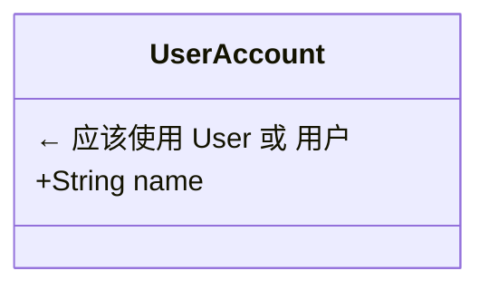

```plantuml
@startuml
class AppUser {  ← 第三个不同的名称
  -String name
}
@enduml
```
```

**修正建议：**
- 统一使用中文名或英文名
- 确定命名规范：业务描述用中文，技术实现用英文
- 建立命名映射表

#### 规则 2：属性定义一致性

**检查项：** 同一实体的属性在不同图表中是否一致。

**问题示例：**

位置 1：
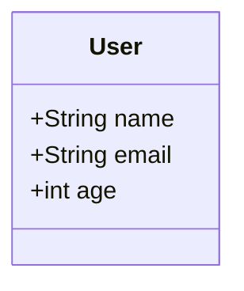

位置 2：
```plantuml
@startuml
class User {
  -String username  ← 应该是 name
  -String email
  ← 缺少 age 属性
}
@enduml
```

**修正建议：**
- 统一属性命名
- 确保属性类型一致
- 补充缺失的属性

#### 规则 3：实体定义完整性

**检查项：** 文档中提到的实体是否都在图表中有定义。

**问题示例：**
```markdown
## 订单处理涉及实体

订单处理涉及：用户、商品、支付、库存四个核心实体。

```mermaid
classDiagram
  class User
  class Product
  class Payment
  ← 缺少 Inventory (库存)
```
```

**修正建议：**
- 检查所有提到的实体
- 补充缺失的实体定义
- 或删除未定义的实体引用

#### 规则 4：关系定义一致性

**检查项：** 实体之间的关系在不同图表中是否一致。

**问题示例：**

位置 1：
```mermaid
erDiagram
  USER ||--o{ ORDER : places
```
（一个用户可以有多个订单）

位置 2：
```plantuml
@startuml
entity User {
  *id : INT
}
entity Order {
  *id : INT
  *user_id : INT  ← 外键关系
}
User ||--|| Order  ← 错误：应该是 1:N
@enduml
```

**修正建议：**
- 统一关系类型（1:1, 1:N, M:N）
- 确保关系方向正确
- 关系名称有意义

## 图表间关系校验

### 图表标识

为图表添加唯一标识，便于引用和校验：

```markdown
<a id="user-login-flow"></a>

```mermaid
graph TD
  A[用户登录] --> B{验证}
```
```

或使用注释：

```markdown
<!-- diagram: user-login-flow -->

```mermaid
graph TD
  A[用户登录] --> B{验证}
```
```

### 图表引用

在文档中引用图表：

```markdown
用户登录流程如 [登录流程图](#user-login-flow) 所示。
详细交互参见 [登录时序图](#login-sequence)。
```

### 校验规则

#### 规则 1：图表引用有效性

**检查项：** 图表引用是否指向存在的图表。

**错误示例：**
```markdown
详情参见 [流程图](#process-flow)。

<!-- 实际图表 ID 是 user-flow，引用错误 -->
```

**修正建议：** 检查并修正引用锚点

#### 规则 2：流程图与时序图一致性

**检查项：** 描述同一流程的流程图和时序图是否一致。

**问题示例：**

流程图（有失败分支）：
```mermaid
graph TD
  A[登录] --> B{验证}
  B -->|成功| C[跳转首页]
  B -->|失败| D[显示错误]
```

时序图（缺少失败分支）：
```mermaid
sequenceDiagram
  User->>System: 登录
  System->>DB: 验证
  DB-->>System: 成功
  System-->>User: 跳转首页
  ← 缺少失败处理
```

**修正建议：** 添加 `alt/else` 分支处理失败情况

#### 规则 3：状态图与文字描述一致性

**检查项：** 状态图中的状态与文字描述是否一致。

**问题示例：**

状态图：
```mermaid
stateDiagram-v2
  [*] --> 待支付
  待支付 --> 已支付
  待支付 --> 已取消
```

文字描述：
```markdown
订单状态：
- 待支付
- 已支付
- 已发货  ← 状态图中缺少
- 已完成  ← 状态图中缺少
- 已取消
```

**修正建议：** 补充状态图中缺失的状态

#### 规则 4：类图与代码定义一致性

**检查项：** 类图中的类定义与代码中的定义是否一致。

**问题示例：**

类图：
```mermaid
classDiagram
  class User {
    +String name
    +String email
  }
```

代码：
```typescript
interface User {
  id: number;      ← 类图中缺少
  username: string; ← 应该是 name
  email: string;
}
```

**修正建议：** 统一类图和代码定义

## 逻辑表达一致性校验

### 流程逻辑一致性

#### 规则 1：步骤编号连续性

**检查项：** 有序列表的编号是否连续。

**错误示例：**
```markdown
1. 第一步
3. 第三步  ← 跳过了第二步
4. 第四步
```

**修正建议：** 确保步骤编号连续

#### 规则 2：分支完整性

**检查项：** 条件分支是否都有处理。

**错误示例：**
```mermaid
graph TD
  A --> B{判断}
  B -->|是| C[处理]
  ← 缺少"否"分支
```

**修正建议：** 添加完整的分支处理

#### 规则 3：状态转换合理性

**检查项：** 状态转换是否符合业务逻辑。

**问题示例：**
```mermaid
stateDiagram-v2
  [*] --> 待支付
  待支付 --> 已发货  ← 错误：应该先支付才能发货
  已支付 --> 已完成
```

**修正建议：** 修正状态转换路径

### 数据逻辑一致性

#### 规则 1：字段类型一致性

**检查项：** 同一字段在不同位置的类型是否一致。

**问题示例：**
```markdown
| 字段 | 类型 |
| age | int |

```mermaid
classDiagram
  class User {
    +String age  ← 应该是 int
  }
```
```

**修正建议：** 统一字段类型

#### 规则 2：关系基数正确性

**检查项：** 实体关系的基数是否正确。

**问题示例：**
```markdown
一个用户只能有一个购物车。

```erDiagram
  USER ||--o{ CART : has  ← 错误：应该是 1:1
```
```

**修正建议：** 修正关系基数为 `||--||`

## 双重校验模式

### 模式对比

| 特性 | 脚本校验 | 智能体校验 |
|:-----|:---------|:-----------|
| **执行方式** | 自动化 | 引导式 |
| **覆盖范围** | 规则明确的问题 | 语义理解问题 |
| **准确性** | 精确匹配 | 上下文理解 |
| **灵活性** | 固定规则 | 自适应 |
| **速度** | 快速 | 需要交互 |
| **适用场景** | 批量检查、兜底验证 | 复杂逻辑、语义分析 |

### 校验流程

```
┌─────────────────────────────────────────┐
│           步骤 1: 脚本自动校验          │
│                                         │
│  • 标题层级检查                        │
│  • 目录一致性检查                      │
│  • 语法正确性检查                      │
│  • 图表语法检查                        │
│  • 实体提取与一致性                    │
│  • 逻辑基础检查                        │
│                                         │
│  输出: 错误列表 + 警告列表             │
└─────────────────────────────────────────┘
                    ↓
┌─────────────────────────────────────────┐
│           步骤 2: 智能体深度校验        │
│                                         │
│  • 实体语义理解                        │
│  • 业务逻辑分析                        │
│  • 上下文一致性                        │
│  • 提供修正建议                        │
│  • 确认修正结果                        │
│                                         │
│  输出: 修正建议 + 修正后文档           │
└─────────────────────────────────────────┘
                    ↓
┌─────────────────────────────────────────┐
│           步骤 3: 脚本确认校验          │
│                                         │
│  • 重新运行脚本校验                    │
│  • 确认所有问题已解决                  │
│  • 输出最终校验报告                    │
│                                         │
│  输出: 通过/失败                       │
└─────────────────────────────────────────┘
```

### 脚本校验清单

```markdown
基础校验：
- [ ] 标题层级连续性
- [ ] H1 标题唯一性
- [ ] 目录链接有效性
- [ ] 链接语法正确性
- [ ] 图片替代文本
- [ ] 代码块闭合
- [ ] 表格格式

图表校验：
- [ ] Mermaid 图表类型声明
- [ ] PlantUML 标记配对
- [ ] ASCII 艺术格式

实体校验：
- [ ] 实体命名一致性（精确匹配）
- [ ] 实体定义来源追踪
- [ ] 实体重复定义检测

逻辑校验：
- [ ] 步骤编号连续性
- [ ] 条件分支配对
- [ ] 状态转换重复
```

### 智能体校验清单

```markdown
语义理解：
- [ ] "用户"和"User"是否指同一实体
- [ ] "订单状态"在不同图表中是否一致
- [ ] 业务术语是否统一

逻辑分析：
- [ ] 流程步骤是否完整
- [ ] 分支处理是否合理
- [ ] 状态转换是否符合业务规则

上下文一致性：
- [ ] 图表描述是否与文档主题相关
- [ ] 实体属性是否符合业务场景
- [ ] 关系定义是否合理

可读性：
- [ ] 命名是否易于理解
- [ ] 逻辑是否清晰
- [ ] 结构是否合理
```

### 使用建议

1. **先脚本后智能体**
   - 先运行脚本校验，修正基础问题
   - 再由智能体进行深度分析

2. **处理优先级**
   - 错误：必须修正
   - 警告：建议修正或确认忽略
   - 信息：参考性建议

3. **迭代校验**
   - 修正后重新校验
   - 确保问题真正解决

4. **版本控制**
   - 记录校验结果
   - 追踪修正历史

### 校验命令

```bash
# 基础校验
npx ts-node scripts/markdown-validator.ts document.md

# 校验多个文件
npx ts-node scripts/markdown-validator.ts *.md

# 跨文件校验
npx ts-node scripts/markdown-validator.ts docs/**/*.md

# 输出到文件
npx ts-node scripts/markdown-validator.ts document.md > report.txt
```

## 代码块校验规则

### 语言类型标识校验

| 检查项 | 规则说明 | 优先级 | 校验方式 |
|--------|----------|--------|----------|
| 语言标识存在 | 代码块应指定语言标识 | 中 | 脚本自动 |
| 语言标识有效 | 使用标准的语言标识 | 中 | 脚本自动 |
| 未知语言标识 | 警告不常见的语言标识 | 低 | 脚本自动 |

### 拼写检查规则

| 检查项 | 规则说明 | 优先级 | 校验方式 |
|--------|----------|--------|----------|
| 文本拼写 | 检查文本内容中的拼写错误 | 中 | 脚本自动 |
| 技术词汇 | 跳过编程关键字和技术词汇 | - | 脚本自动 |
| 驼峰命名 | 跳过驼峰命名和下划线命名 | - | 脚本自动 |

### 语法检查规则

| 语言 | 检查内容 | 优先级 | 校验方式 |
|------|----------|--------|----------|
| JSON | JSON 语法有效性 | 高 | 脚本自动 |
| YAML | 缩进、格式规范 | 中 | 脚本自动 |
| SQL | 关键字、括号配对 | 中 | 脚本自动 |
| JavaScript/TypeScript | 括号、引号配对 | 中 | 脚本自动 |
| Python | 缩进一致性 | 中 | 脚本自动 |
| HTML/XML | 标签配对 | 高 | 脚本自动 |
| CSS | 大括号、分号 | 中 | 脚本自动 |

### 常见代码错误

#### JSON 错误

````markdown
❌ 错误:

```json
{
  "name": "John"
  "age": 30,  // 缺少逗号
  "skills": ["JS", "Python",  // 数组未闭合
}
```

✅ 正确:

```json
{
  "name": "John",
  "age": 30,
  "skills": ["JS", "Python"]
}
```
````

#### YAML 错误

````markdown
❌ 错误:

```yaml
server:
	port: 8080  # Tab 缩进
  host: localhost
database:
  name:mydb  # 缺少空格
```

✅ 正确:

```yaml
server:
  port: 8080
  host: localhost
database:
  name: mydb
```
````

## 工作流图表完整性校验规则

### 流程图完整性

| 检查项 | 规则说明 | 优先级 | 校验方式 |
|--------|----------|--------|----------|
| 起点存在 | 流程应有明确的起点 | 高 | 脚本自动 |
| 终点存在 | 流程应有明确的终点 | 高 | 脚本自动 |
| 分支完整 | 条件分支应有完整的处理路径 | 高 | 脚本自动 |
| 节点可达 | 所有节点应可达（无孤立节点） | 中 | 脚本自动 |
| alt/else 配对 | alt 块应有对应的 else 和 end | 高 | 脚本自动 |

#### 流程图示例

````markdown
✅ 完整流程图:

```mermaid
graph TD
    A([开始]) --> B{用户登录}
    B -->|成功| C[显示主页]
    B -->|失败| D[显示错误]
    D --> B
    C --> E([结束])
```

❌ 不完整流程图（缺少起点、终点、分支处理）:

```mermaid
graph TD
    A[处理订单] --> B{支付成功?}
    B -->|是| C[发货]
    B -->|否| D[取消订单]
```
````

### 时序图完整性

| 检查项 | 规则说明 | 优先级 | 校验方式 |
|--------|----------|--------|----------|
| 参与者定义 | 应明确定义参与者 | 高 | 脚本自动 |
| 消息完整 | 参与者之间应有消息交互 | 高 | 脚本自动 |
| 分支完整 | alt/opt/loop 应正确闭合 | 高 | 脚本自动 |
| 活跃度检查 | 所有参与者应参与交互 | 中 | 脚本自动 |

#### 时序图示例

````markdown
✅ 完整时序图:

```mermaid
sequenceDiagram
    participant U as 用户
    participant S as 系统
    participant D as 数据库
    
    U->>S: 登录请求
    S->>D: 查询用户
    D-->>S: 用户数据
    alt 用户存在
        S->>U: 登录成功
    else 用户不存在
        S->>U: 登录失败
    end
```

❌ 不完整时序图（参与者未参与交互）:

```mermaid
sequenceDiagram
    participant A as 用户
    participant B as 系统
    participant C as 日志服务
    
    A->>B: 发送请求
    B-->>A: 返回响应
    <!-- C 未参与任何交互 -->
```
````

### 用例图完整性

| 检查项 | 规则说明 | 优先级 | 校验方式 |
|--------|----------|--------|----------|
| Actor 定义 | 应有至少一个参与者 | 高 | 脚本自动 |
| 用例定义 | 应有至少一个用例 | 高 | 脚本自动 |
| 关系定义 | Actor 与用例之间应有关系 | 高 | 脚本自动 |

#### 用例图示例

````markdown
✅ 完整用例图:

```plantuml
@startuml
left to right direction
actor 用户 as U
actor 管理员 as A

rectangle "用户管理系统" {
  usecase "登录" as UC1
  usecase "注册" as UC2
  usecase "用户管理" as UC3
}

U --> UC1
U --> UC2
A --> UC1
A --> UC3
@enduml
```
````

### 状态图完整性

| 检查项 | 规则说明 | 优先级 | 校验方式 |
|--------|----------|--------|----------|
| 初始状态 | 应有初始状态 `[*]` | 高 | 脚本自动 |
| 终止状态 | 应有终止状态 `[*]` | 中 | 脚本自动 |
| 状态转换 | 状态之间应有转换 | 高 | 脚本自动 |
| 孤立状态 | 无孤立状态 | 中 | 脚本自动 |

#### 状态图示例

````markdown
✅ 完整状态图:

```mermaid
stateDiagram-v2
    [*] --> 待支付
    待支付 --> 已支付: 支付成功
    待支付 --> 已取消: 取消订单
    已支付 --> 已发货: 商家发货
    已发货 --> 已完成: 确认收货
    已完成 --> [*]
    已取消 --> [*]
```
````

## 跨文件校验规则

### 跨文件引用校验

| 检查项 | 规则说明 | 优先级 | 校验方式 |
|--------|----------|--------|----------|
| 文件存在 | 链接指向的文件存在 | 高 | 脚本自动 |
| 锚点有效 | 锚点在目标文件中存在 | 中 | 脚本自动 |
| 路径正确 | 相对路径解析正确 | 高 | 脚本自动 |

### 跨文件实体一致性

| 检查项 | 规则说明 | 优先级 | 校验方式 |
|--------|----------|--------|----------|
| 命名一致 | 同一实体使用一致命名 | 高 | 脚本自动 |
| 属性一致 | 同一实体属性定义一致 | 中 | 脚本自动 |
| 类型一致 | 同一实体类型定义一致 | 中 | 脚本自动 |

### 跨文件逻辑一致性

| 检查项 | 规则说明 | 优先级 | 校验方式 |
|--------|----------|--------|----------|
| 状态一致 | 状态定义在不同文件中一致 | 中 | 脚本自动 |
| 流程一致 | 流程描述在不同文件中一致 | 中 | 脚本自动 |
| 关系一致 | 实体关系在不同文件中一致 | 中 | 脚本自动 |

### 跨文件校验示例

```bash
# 校验多个文件
npx ts-node scripts/markdown-validator.ts docs/**/*.md
```

**校验输出：**
```
============================================================
📁 跨文件校验结果
============================================================

📂 校验文件: 5 个
   - api.md
   - database.md
   - user-guide.md
   - architecture.md
   - reference.md

🔗 实体一致性:
  1. [WARNING] 实体 "User/用户" 在不同文件中被定义为不同类型
     涉及文件: api.md, user-guide.md

📋 逻辑一致性:
  1. state-mismatch: 状态定义不一致
     涉及文件: order-flow.md, refund-flow.md
     描述: order-flow.md 有 0 个独有状态，refund-flow.md 有 1 个独有状态
```

## 嵌套 Markdown 校验规则

### 检测规则

当代码块中包含 Markdown 格式内容时，会自动进行嵌套校验。

| 检查项 | 规则说明 | 优先级 | 校验方式 |
|--------|----------|--------|----------|
| 嵌套检测 | 检测代码块中的 Markdown 内容 | 低 | 脚本自动 |
| 递归校验 | 对嵌套内容进行独立校验 | 中 | 脚本自动 |

### 示例

````markdown
```markdown
# 嵌套的 Markdown 内容

这是一个在代码块中的 Markdown 文档，校验工具会对其进行独立校验。

- 列表项1
- 列表项2

[链接](不存在.md)  <!-- 会检测到跨文件引用问题 -->
```
````

**校验输出：**
```
ℹ️  [第 1 行] 代码块中检测到嵌套的 Markdown 内容
    💡 建议: 对嵌套内容进行独立校验

⚠️  [第 8 行] [嵌套Markdown] 跨文件链接 "不存在.md" 指向的文件不存在
    💡 建议: 检查文件路径是否正确
```
