# 工作流图表完整性校验规则

## 目录

1. [概述](#概述)
2. [流程图完整性校验](#流程图完整性校验)
3. [时序图完整性校验](#时序图完整性校验)
4. [用例图完整性校验](#用例图完整性校验)
5. [状态图完整性校验](#状态图完整性校验)
6. [检查清单](#检查清单)
7. [最佳实践](#最佳实践)

## 概述

工作流图表用于描述业务流程、系统交互、状态转换等复杂逻辑。完整性校验确保图表清晰、准确、无遗漏。

### 校验能力

| 图表类型 | 校验内容 | 错误级别 |
|:---------|:---------|:---------|
| **流程图** | 起点/终点、分支完整性、节点可达性 | 警告 |
| **时序图** | 参与者定义、消息完整性、分支处理 | 警告 |
| **用例图** | Actor 定义、用例定义、关系完整性 | 警告 |
| **状态图** | 初始/终止状态、状态转换完整性 | 警告 |

### 支持的图表工具

| 工具 | Mermaid | PlantUML |
|:-----|:--------|:---------|
| 流程图 | `graph`, `flowchart` | `@startuml` + 关键字 |
| 时序图 | `sequenceDiagram` | `@startuml sequence` |
| 用例图 | - | `@startuml usecase` |
| 状态图 | `stateDiagram` | `@startuml state` |
| 类图 | `classDiagram` | `@startuml class` |
| ER图 | `erDiagram` | `@startuml er` |

## 流程图完整性校验

### 校验规则

| 规则 | 说明 | 重要性 |
|:-----|:-----|:-------|
| **起点检查** | 流程应有明确的起点 | 重要 |
| **终点检查** | 流程应有明确的终点 | 重要 |
| **分支完整性** | 条件分支应有完整的处理路径 | 重要 |
| **节点可达性** | 所有节点应可达（无孤立节点） | 一般 |
| **alt/else 配对** | alt 块应有对应的 else 和 end | 重要 |

### Mermaid 流程图

#### 完整示例

````markdown
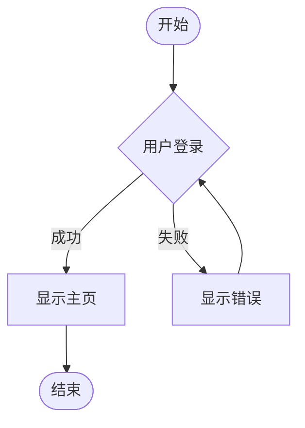
````

**校验结果：**
```
✅ 流程图完整性检查通过
   - 起点: 有 ([开始])
   - 终点: 有 ([结束])
   - 分支: 完整 (成功/失败都有处理)
```

#### 缺失起点示例

````markdown
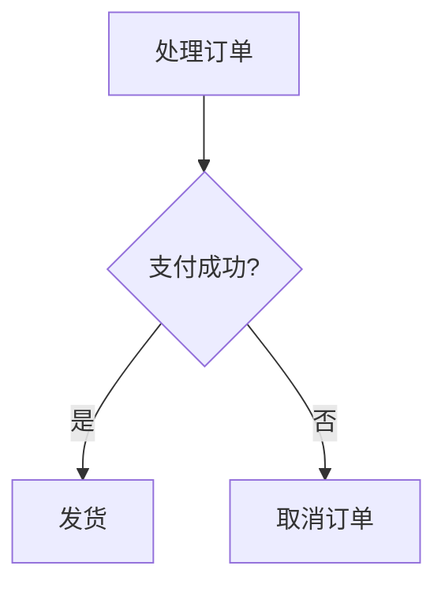
````

**校验输出：**
```
⚠️  [第 1 行] 流程图缺少明确的起点
    💡 建议: 添加起点节点，如 ([开始]) 或 [*]

⚠️  [第 1 行] 流程图缺少明确的终点
    💡 建议: 添加终点节点，如 ([结束]) 或 [*]
```

#### 分支不完整示例

````markdown
```mermaid
graph TD
    A([开始]) --> B{用户类型}
    B -->|管理员| C[显示管理面板]
    B -->|普通用户| D[显示用户面板]
    B -->|VIP用户| E[显示VIP面板]
    C --> F([结束])
    D --> F
    <!-- VIP用户分支未连接到终点 -->
```
````

**校验输出：**
```
⚠️  [第 1 行] 流程图节点 "E" 可能是孤立节点
    💡 建议: 检查节点是否有连接
```

#### alt/else 配对问题

````markdown
```mermaid
graph TD
    A --> B
    B --> C{条件判断}
    alt 条件A
        C --> D[处理A]
    <!-- 缺少 else 和 end -->
```
````

**校验输出：**
```
⚠️  [第 4 行] 流程图存在未处理的分支（缺少 else 分支）
    💡 建议: 为每个 alt 分支添加 else 处理

⚠️  [第 4 行] 流程图 alt 块未正确闭合
    💡 建议: 添加 end 关闭 alt 块
```

### PlantUML 流程图

#### 完整示例

````markdown
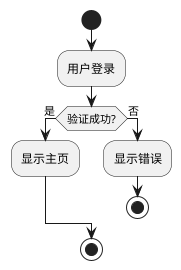
````

**校验结果：**
```
✅ 流程图完整性检查通过
```

#### 缺失分支处理

````markdown
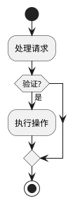
````

**校验输出：**
```
⚠️  [第 4 行] 流程图存在未处理的分支（缺少 else 分支）
    💡 建议: 为每个 if 添加 else 处理
```

## 时序图完整性校验

### 校验规则

| 规则 | 说明 | 重要性 |
|:-----|:-----|:-------|
| **参与者定义** | 应明确定义参与者 | 重要 |
| **消息完整性** | 参与者之间应有消息交互 | 重要 |
| **分支完整性** | alt/opt/loop 应正确闭合 | 重要 |
| **活跃度检查** | 所有参与者应参与交互 | 一般 |

### Mermaid 时序图

#### 完整示例

````markdown
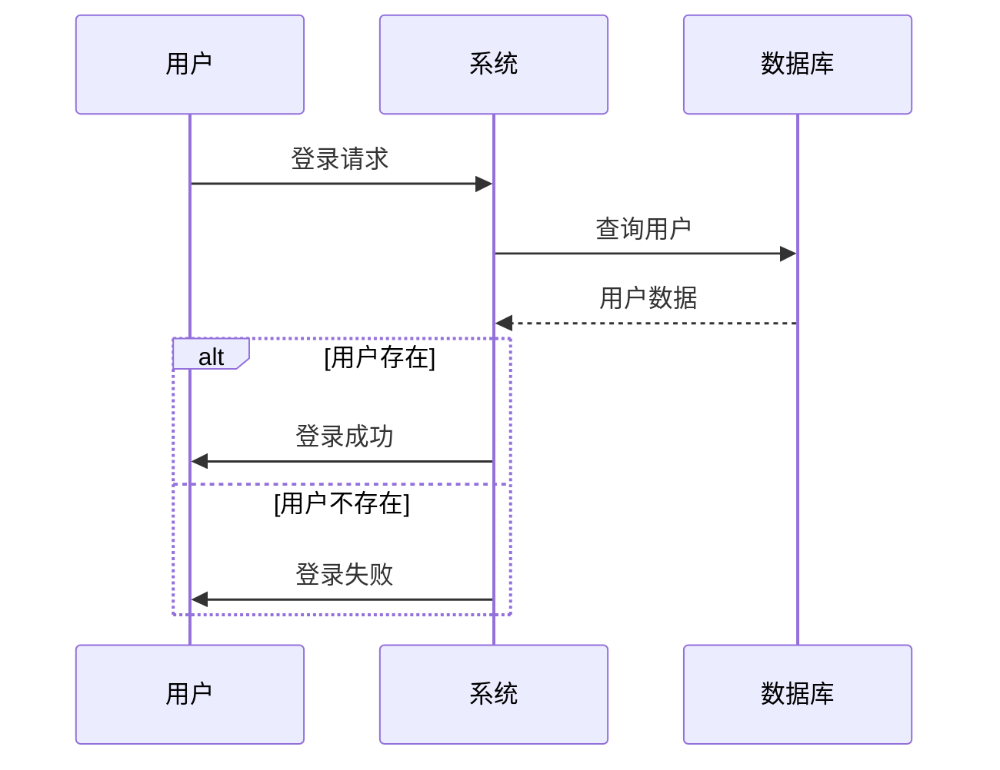
````

**校验结果：**
```
✅ 时序图完整性检查通过
   - 参与者: 3 个
   - 消息: 5 条
   - 分支: 完整
```

#### 缺少参与者交互

````markdown
```mermaid
sequenceDiagram
    participant A as 用户
    participant B as 系统
    participant C as 日志服务
    
    A->>B: 发送请求
    B-->>A: 返回响应
    <!-- C 未参与任何交互 -->
```
````

**校验输出：**
```
⚠️  [第 1 行] 参与者 "C" 未参与任何消息交互
    💡 建议: 检查是否遗漏了消息，或移除该参与者
```

#### 分支不完整

````markdown
```mermaid
sequenceDiagram
    participant A as 用户
    participant B as 系统
    
    A->>B: 请求数据
    alt 成功
        B-->>A: 返回数据
    <!-- 缺少 else 分支 -->
```
````

**校验输出：**
```
⚠️  [第 5 行] 时序图存在未处理的分支
    💡 建议: 为每个 alt 分支添加 else 处理

⚠️  [第 5 行] 时序图 alt 块未正确闭合
    💡 建议: 添加 end 关闭 alt 块
```

### PlantUML 时序图

#### 完整示例

````markdown
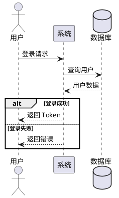
````

#### 常见问题

````markdown
```plantuml
@startuml
participant A
participant B
participant C

A -> B: 消息
alt 条件1
    B -> A: 响应1
<!-- 缺少 else 和 end -->
@enduml
```
````

**校验输出：**
```
⚠️  [第 6 行] 时序图存在未处理的分支
    💡 建议: 为每个 alt 分支添加 else 处理
```

## 用例图完整性校验

### 校验规则

| 规则 | 说明 | 重要性 |
|:-----|:-----|:-------|
| **Actor 定义** | 应有至少一个参与者 | 重要 |
| **用例定义** | 应有至少一个用例 | 重要 |
| **关系定义** | Actor 与用例之间应有关系 | 重要 |
| **关系类型** | 关系类型应正确（关联/包含/扩展） | 一般 |

### PlantUML 用例图

#### 完整示例

````markdown
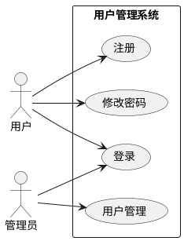
````

**校验结果：**
```
✅ 用例图完整性检查通过
   - 参与者: 2 个
   - 用例: 4 个
   - 关系: 5 个
```

#### 缺少 Actor

````markdown

````

**校验输出：**
```
⚠️  [第 1 行] 用例图缺少参与者（actor）
    💡 建议: 添加参与者，如 actor User
```

#### 缺少用例

````markdown
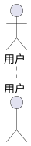
````

**校验输出：**
```
⚠️  [第 1 行] 用例图缺少用例
    💡 建议: 添加用例，如 usecase Login 或 (登录)
```

#### 缺少关系

````markdown

````

**校验输出：**
```
⚠️  [第 1 行] 用例图缺少参与者与用例之间的关系
    💡 建议: 添加关系，如 User --> (Login)
```

### 用例关系类型

| 关系类型 | 语法 | 说明 |
|:---------|:-----|:-----|
| **关联** | `-->` | Actor 与用例的基本关系 |
| **包含** | `.>` `<<include>>` | 用例必然包含另一用例 |
| **扩展** | `.>` `<<extend>>` | 用例可选扩展另一用例 |
| **继承** | `--|>` | Actor 或用例的继承关系 |

````markdown
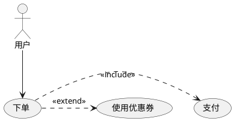
````

## 状态图完整性校验

### 校验规则

| 规则 | 说明 | 重要性 |
|:-----|:-----|:-------|
| **初始状态** | 应有初始状态 `[*]` | 重要 |
| **终止状态** | 应有终止状态 `[*]` | 一般 |
| **状态转换** | 状态之间应有转换 | 重要 |
| **孤立状态** | 无孤立状态 | 一般 |
| **转换完整性** | 状态转换应有事件/条件 | 一般 |

### Mermaid 状态图

#### 完整示例

````markdown
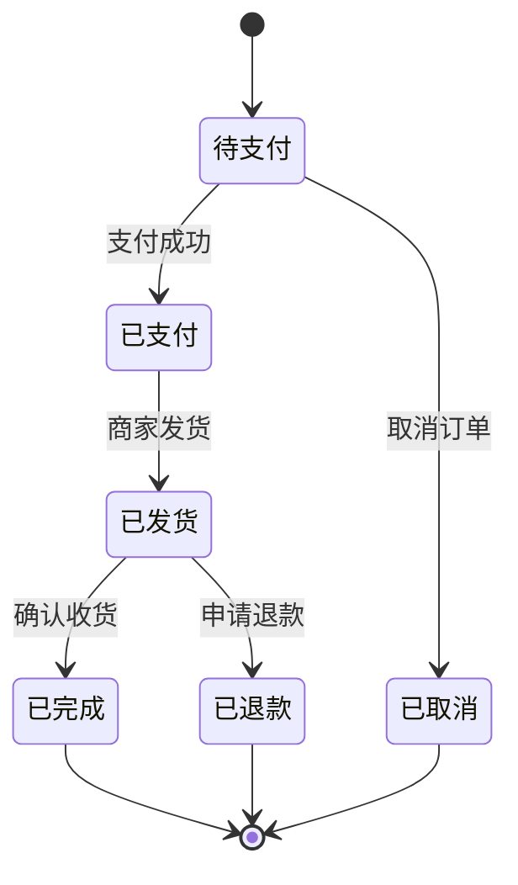
````

**校验结果：**
```
✅ 状态图完整性检查通过
   - 初始状态: 有
   - 终止状态: 有
   - 状态: 6 个
   - 转换: 8 个
```

#### 缺少初始状态

````markdown
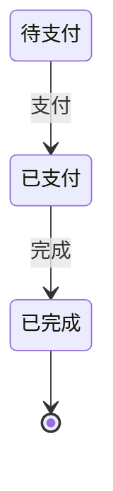
````

**校验输出：**
```
⚠️  [第 1 行] 状态图缺少初始状态
    💡 建议: 添加初始状态 [*]
```

#### 孤立状态

````markdown
```mermaid
stateDiagram-v2
    [*] --> 状态A
    状态A --> 状态B
    状态C --> 状态D  <!-- 状态C 和 状态D 未与其他状态连接 -->
    状态B --> [*]
```
````

**校验输出：**
```
⚠️  [第 4 行] 状态 "状态C" 可能是孤立状态
    💡 建议: 检查状态是否有转换连接

⚠️  [第 4 行] 状态 "状态D" 可能是孤立状态
    💡 建议: 检查状态是否有转换连接
```

### PlantUML 状态图

#### 完整示例

````markdown
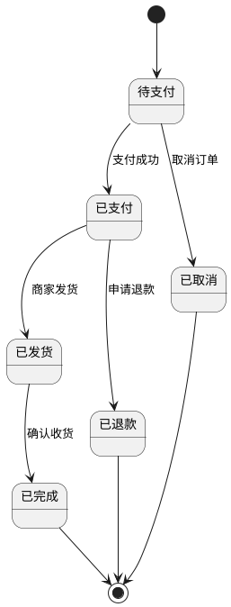
````

#### 复合状态

````markdown
```plantuml
@startuml
[*] --> 待处理

state 待处理 {
    [*] --> 新建
    新建 --> 审核中: 提交
    审核中 --> 已审核: 通过
    审核中 --> 新建: 驳回
}

待处理 --> 已完成: 完成
已完成 --> [*]
@enduml
```
````

## 检查清单

### 流程图检查清单

- [ ] 有明确的起点（`([开始])` 或 `[*]`）
- [ ] 有明确的终点（`([结束])` 或 `[*]`）
- [ ] 所有条件分支都有处理路径
- [ ] 所有节点都可达
- [ ] alt 块有对应的 else 和 end
- [ ] 流程逻辑清晰，无死循环

### 时序图检查清单

- [ ] 所有参与者都明确定义
- [ ] 所有参与者都参与消息交互
- [ ] 消息方向正确（`->>`, `-->>`）
- [ ] alt/opt/loop 块正确闭合
- [ ] 每个分支都有处理
- [ ] 返回消息使用虚线箭头

### 用例图检查清单

- [ ] 所有 Actor 都有定义
- [ ] 所有用例都有定义
- [ ] Actor 与用例之间有正确的关系
- [ ] include/extend 关系使用正确
- [ ] 用例命名清晰（动词短语）

### 状态图检查清单

- [ ] 有初始状态 `[*]`
- [ ] 有终止状态 `[*]`（如果适用）
- [ ] 所有状态都有转换
- [ ] 无孤立状态
- [ ] 状态转换有事件/条件说明
- [ ] 状态命名清晰

## 最佳实践

### 1. 命名规范

````markdown
✅ 推荐:
- 使用清晰的中文或英文命名
- 状态使用名词: 待支付、已支付
- 动作使用动词: 支付、发货、取消

❌ 不推荐:
- 使用模糊的命名: A、B、C
- 混用中英文: 待支付、Payment
````

### 2. 图表布局

````markdown
✅ 推荐:
- 从左到右或从上到下的流程方向
- 相关节点靠近放置
- 避免交叉的连接线
- 使用子图分组相关内容

```mermaid
graph LR
    subgraph 用户操作
        A[登录] --> B[浏览商品]
        B --> C[下单]
    end
```
````

### 3. 条件分支

````markdown
✅ 推荐:
- 所有分支都有处理
- 使用 else 处理默认情况

```mermaid
graph TD
    A --> B{条件判断}
    B -->|情况A| C[处理A]
    B -->|情况B| D[处理B]
    B -->|其他| E[默认处理]
```
````

### 4. 注释和说明

````markdown
✅ 推荐:
- 为复杂的逻辑添加注释
- 使用有意义的节点标签

```mermaid
graph TD
    A[接收请求] --> B{参数验证}
    %% 验证失败返回错误
    B -->|失败| C[返回400错误]
    %% 验证成功处理业务
    B -->|成功| D[执行业务逻辑]
```
````

### 5. 图表分层

````markdown
✅ 推荐:
- 复杂图表拆分为多层
- 使用子图表示层次结构

```mermaid
graph TD
    subgraph 表示层
        A[Web前端]
        B[移动端]
    end
    
    subgraph 业务层
        C[API服务]
        D[业务逻辑]
    end
    
    subgraph 数据层
        E[数据库]
        F[缓存]
    end
    
    A --> C
    B --> C
    C --> D
    D --> E
    D --> F
```
````

### 6. 一致性检查

确保文档中多个图表的一致性：

- 流程图与时序图描述的流程应一致
- 状态图中的状态应与文字描述一致
- 实体命名在不同图表中应一致
