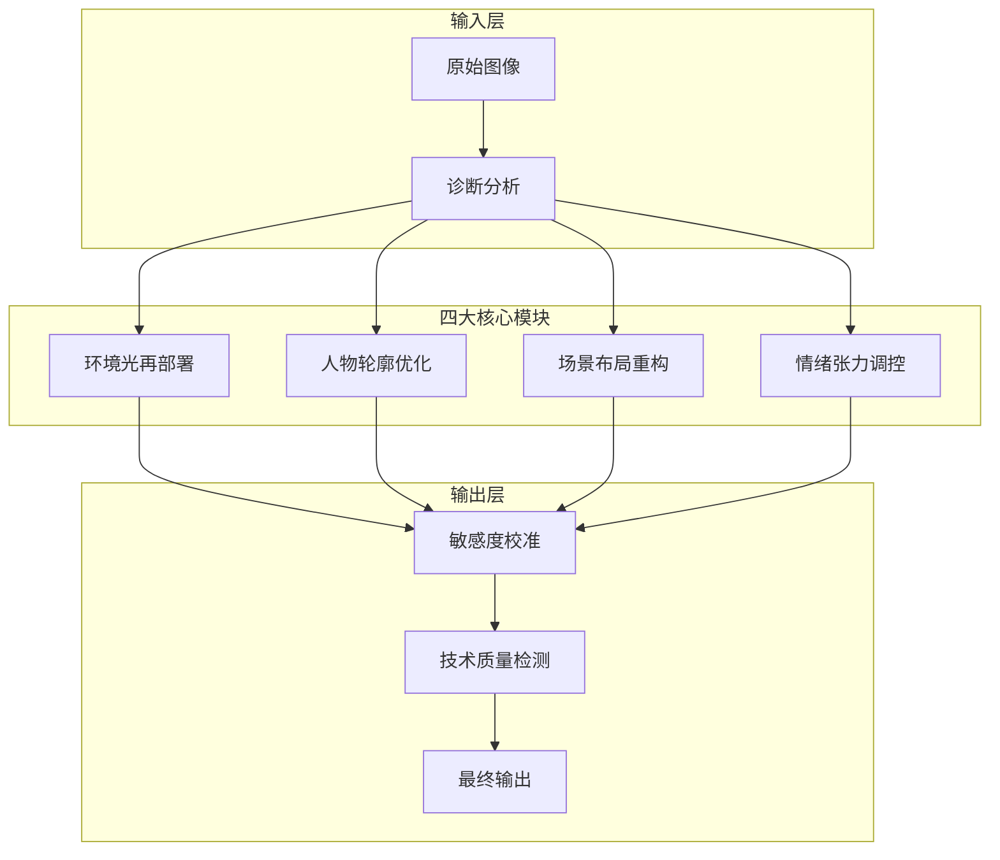
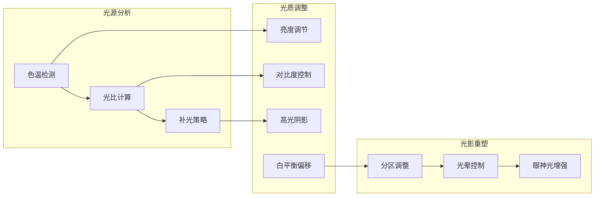
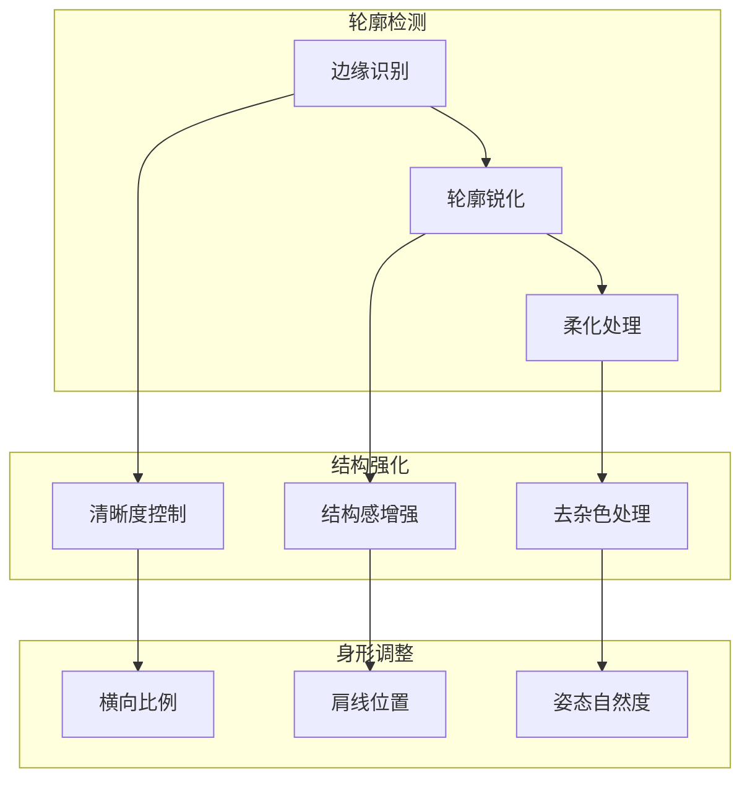
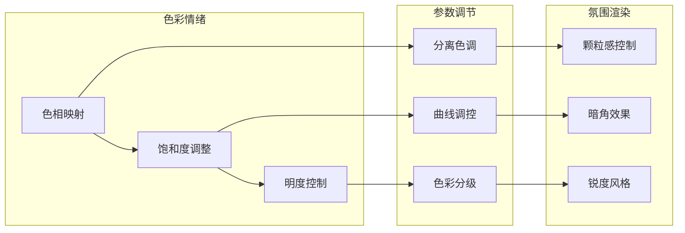
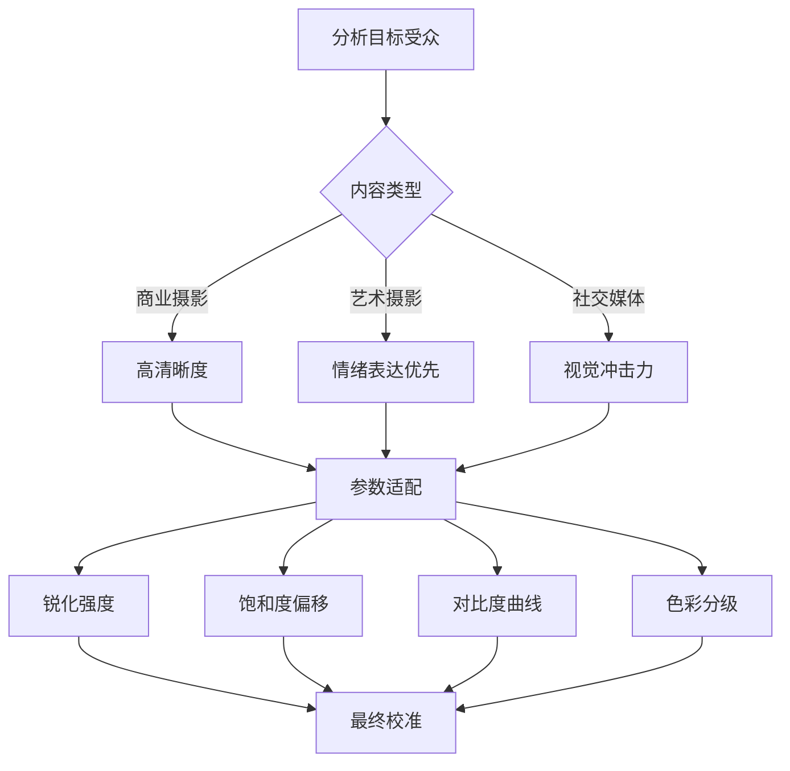
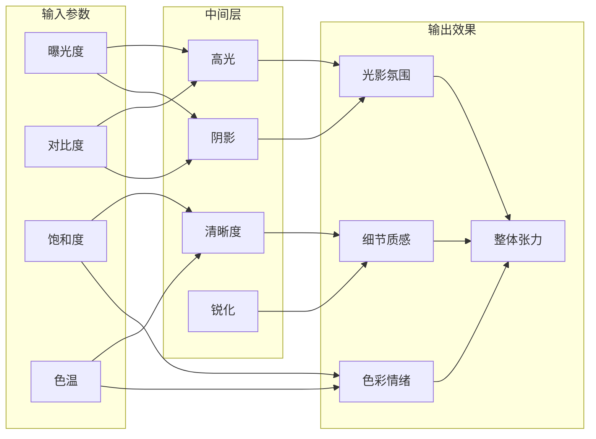
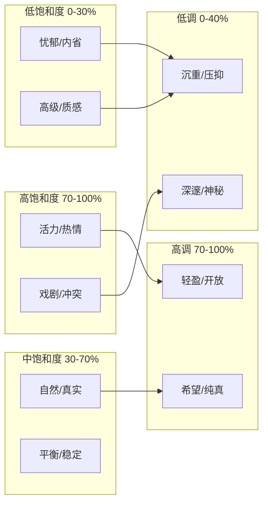
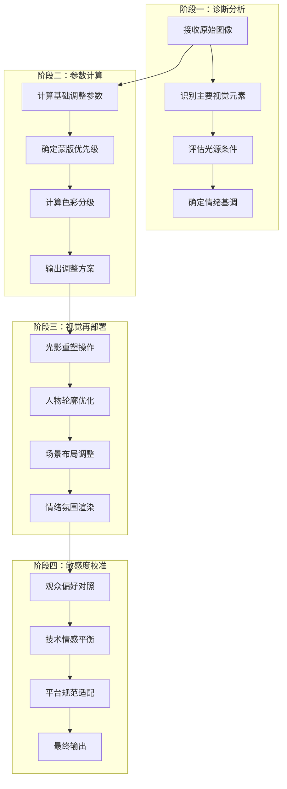
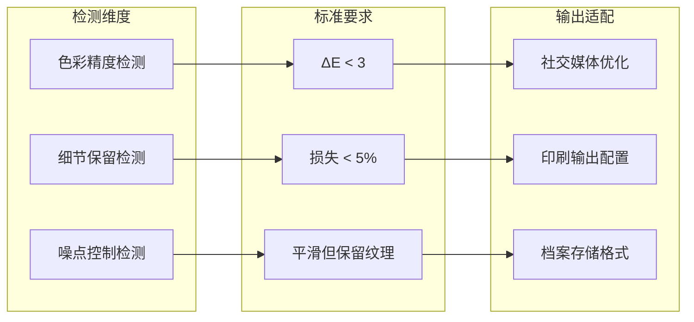
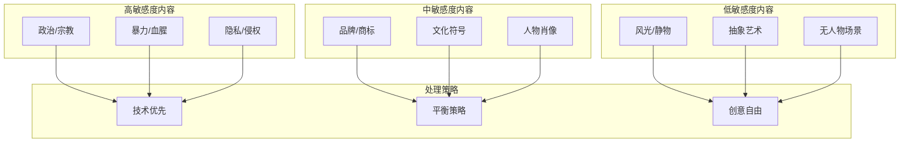

# 大师级修图框架可视化

## 整体工作流架构

## 环境光再部署系统

## 人物轮廓优化模块

## 情绪张力调控系统

## 视觉敏感度分析决策树

## 参数协同关系

## 情绪色彩映射坐标系

## 修图执行流程图

## 输出质量检测模型

## 敏感度层级模型

---

此框架图涵盖了大师级修图技能的完整逻辑结构，可作为工作流程参考和参数协同调整的视觉指南。