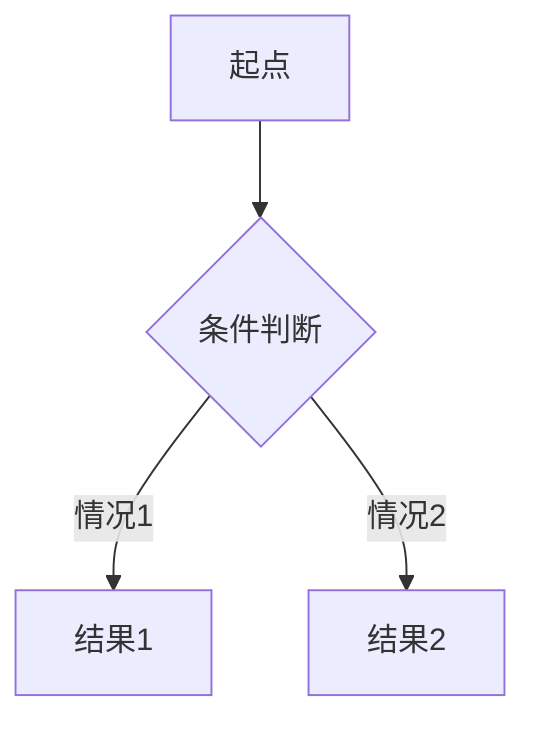

---
AIGC:
    ContentProducer: Minimax Agent AI
    ContentPropagator: Minimax Agent AI
    Label: AIGC
    ProduceID: "00000000000000000000000000000000"
    PropagateID: "00000000000000000000000000000000"
    ReservedCode1: 3046022100db21134e7afa25cff9bbd769d908532190accaf73537f982a7bbe37206f3e8a7022100be83640314011e5976e1ee2e1f56cba009f1b1ef3ec7dad5d996b1bd710738d9
    ReservedCode2: 3045022100f3db41795f4bdd9cc9cb97e79d254ce520d3b2cce66576f76d80194dc53bdbd3022045f42b57d1c5bfefbfbcfbb3c0216fe33b8c7a8bac4dd696328538da4f5a3a79
description: 基于数学教材生成高质量互动幻灯片课件。当用户提供数学 PDF 教材、知识点大纲或教学需求时，生成使用 Marp/Reveal.js、JSXGraph、Mermaid 等技术的专业数学课件。触发场景包括"生成数学课件"、"制作数学教学幻灯片"、"从 PDF 创建数学课件"、"制作三角函数课件"、"生成几何证明课件"等。
name: math-lecture-generator
---

# 数学互动课件生成器

专业数学互动课件教研与开发工具，基于 Marp/Reveal.js、JSXGraph、Mermaid 等现代化 Web 演示技术，生成高标准、逻辑严密、排版精美且具备动态交互能力的幻灯片课件代码。

## 核心工作流

### 阶段 1：需求分析与内容提取

接收用户输入（PDF 文本、教材大纲、教学目标），执行以下处理：

1. **结构拆解**：按章节顺序提取知识点、定理定义、核心例题
2. **乱码修复**：识别 PDF 提取的公式乱码，重构为标准 KaTeX 语法
3. **逻辑补全**：补充"易得"、"同理可证"等跳步的完整推导过程

### 阶段 2：技术选型与模块设计

根据教学内容选择最优技术栈：

| 教学场景 | 推荐技术 |
|---------|---------|
| 基础概念讲解 | Marp Markdown（稳定优先）|
| 需要深度定制 | Reveal.js 组件化 HTML |
| 三角函数相位演示 | JSXGraph 交互绘图 |
| 解析几何动点轨迹 | JSXGraph 拖拽交互 |
| 数学逻辑推理流 | Mermaid 流程图 |
| 分类讨论树形图 | Mermaid 思维导图 |

### 阶段 3：课件代码生成

#### 3.1 Marp Markdown 输出规范

```markdown
---
marp: true
theme: default
paginate: true
---

<!-- 幻灯片内容 -->

---

<!-- 分割线表示新幻灯片 -->
```

#### 3.2 KaTeX 公式规范

- **行内公式**：`\( ... \)`
- **行间公式**：`\[ ... \]`
- **多行对齐**：使用 `\begin{aligned} ... \end{aligned}`
- **中文字符**：使用 `\text{中文}` 包裹或移至公式外

#### 3.3 JSXGraph 交互绘图规范

```html
<div id="jxgbox" class="jxgbox" style="width:500px; height:500px;"></div>
<script>
var board = JXG.JSXGraph.initBoard('jxgbox', { /* 配置 */ });
// 交互逻辑代码
</script>
```

#### 3.4 Mermaid 图表规范



### 阶段 4：排版与视觉设计

#### 卡片式布局规范

```css
/* 概念/定义 - 蓝色提示框 */
.card-definition {
  background: linear-gradient(135deg, #e3f2fd 0%, #bbdefb 100%);
  border-left: 4px solid #2196f3;
  padding: 1rem;
  margin: 1rem 0;
}

/* 定理/性质/公式 - 紫色提示框 */
.card-theorem {
  background: linear-gradient(135deg, #f3e5f5 0%, #e1bee7 100%);
  border-left: 4px solid #9c27b0;
  padding: 1rem;
  margin: 1rem 0;
}

/* 例题详解 - 绿色提示框 */
.card-example {
  background: linear-gradient(135deg, #e8f5e9 0%, #c8e6c9 100%);
  border-left: 4px solid #4caf50;
  padding: 1rem;
  margin: 1rem 0;
}

/* 重点/易错点 - 红色警戒框 */
.card-warning {
  background: linear-gradient(135deg, #ffebee 0%, #ffcdd2 100%);
  border-left: 4px solid #f44336;
  padding: 1rem;
  margin: 1rem 0;
}
```

#### 公式排版对齐规范

```markdown
解方程步骤：
\[
\begin{aligned}
2x + 3 &= 7 \\
2x &= 7 - 3 \quad \text{（移项）} \\
2x &= 4 \\
x &= 2
\end{aligned}
\]
```

### 阶段 5：内容模块化结构

生成课件必须包含以下逻辑模块：

1. **封面模块**：主标题、副标题、核心教学目标
2. **知识点归纳与详解**：核心概念、性质、公式推导
3. **动态演示模块**：JSXGraph 交互代码（如适用）
4. **经典例题精讲**：题目 → 思路分析 → 规范解答
5. **重难点与易错点辨析**：.card-warning 特别标注
6. **分层练习与解答**：代表性习题及详尽解析

## 输出格式规范

### 代码输出原则

- 仅输出完整代码（包裹在标准 Markdown 代码块中）
- 不附加口语化解释性文字
- 复杂课件可分模块输出

### 交付产物

| 产物类型 | 文件格式 |
|---------|---------|
| 基础课件 | `.md` (Marp 格式) |
| 交互课件 | `.html` (Reveal.js + JSXGraph) |
| 流程图 | `.mmd` 或内嵌 `mermaid` 代码块 |
| Manim 动画代码 | `.py` (预留 `<video>` 嵌入标签) |

## 质量验证清单

- [ ] 公式 KaTeX 语法正确性检查
- [ ] 中文字符不在纯数学环境内
- [ ] JSXGraph 容器 ID 唯一性
- [ ] Mermaid 代码块语法正确
- [ ] 卡片 CSS 类名规范使用
- [ ] 幻灯片分割线 `---` 正确放置

## 参考资源

详细规范见 `references/` 目录：
- `katex-syntax.md` - KaTeX 语法速查表
- `jsxgraph-patterns.md` - JSXGraph 常用模式
- `mermaid-patterns.md` - Mermaid 图表模板
- `css-styles.md` - 课件样式表