---
AIGC:
    ContentProducer: Minimax Agent AI
    ContentPropagator: Minimax Agent AI
    Label: AIGC
    ProduceID: "00000000000000000000000000000000"
    PropagateID: "00000000000000000000000000000000"
    ReservedCode1: 3045022100ba0e417326931487054492dadb8643fd7877b94290e4a95b966d02854cfbb469022078332db5c2690db787cd42249d0f25188447509e4d07cd415856d7151cfa7785
    ReservedCode2: 304502207dc01db7c5c7e7cbcb208211b4b11b3444b2a6749cd4d04da9972fa4b53fdb18022100b704393894329a690e633691e2d254f80159522a72c1f85605f3927b8132c732
---

# Mermaid 图表模板参考

## 流程图 (Flowchart)

### 基本结构

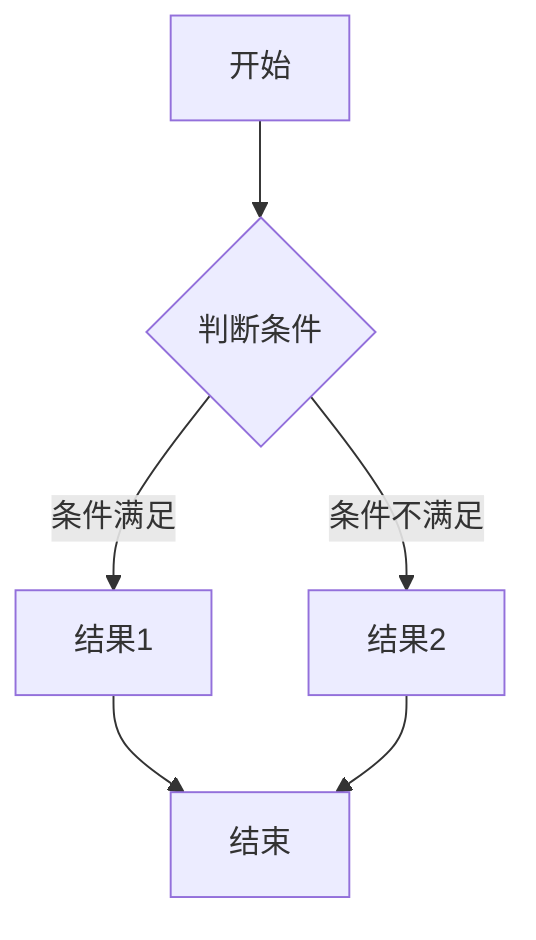

### 方向控制

| 方向 | 语法 | 说明 |
|------|------|------|
| TD/TB | `graph TD` | 从上到下 |
| BT | `graph BT` | 从下到上 |
| LR | `graph LR` | 从左到右 |
| RL | `graph RL` | 从右到左 |

### 节点形状

| 形状 | 语法 | 用途 |
|------|------|------|
| 圆角矩形 | `[文字]` | 过程/步骤 |
| 矩形 | `[文字]` | 标准节点 |
| 菱形 | `{文字}` | 判断/决策 |
| 圆形 | `((文字))` | 开始/结束 |
| 六边形 | `{{文字}}` | 准备/操作 |
| 平行四边形 | `[\文字\]` | 输入/输出 |
| 梯形 | `[/文字\]` | 子程序 |

### 连线样式

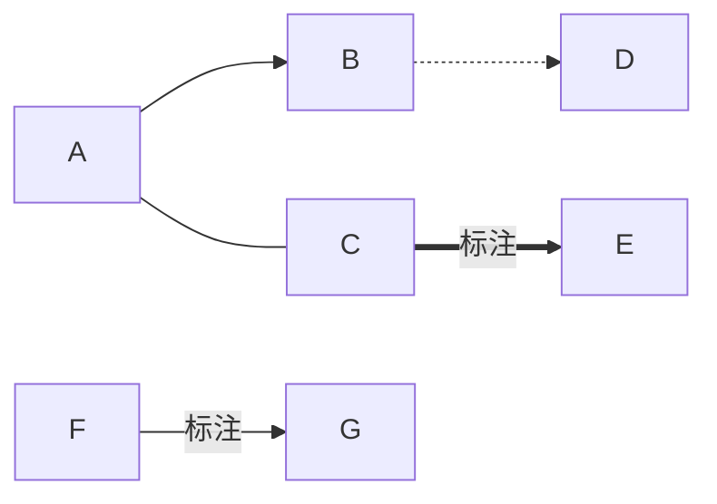

| 语法 | 样式 |
|------|------|
| `-->` | 实线箭头 |
| `---` | 实线无箭头 |
| `-.->` | 虚线箭头 |
| `==>` | 粗箭头 |
| `-.--` | 虚线无箭头 |

## 数学推理流程图

### 证明逻辑链

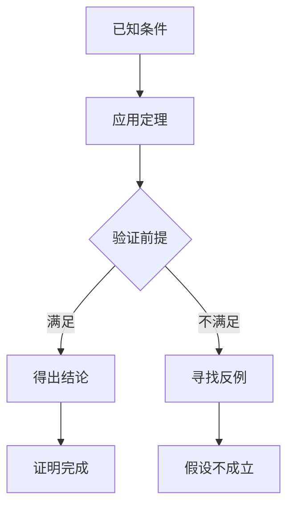

### 分类讨论树

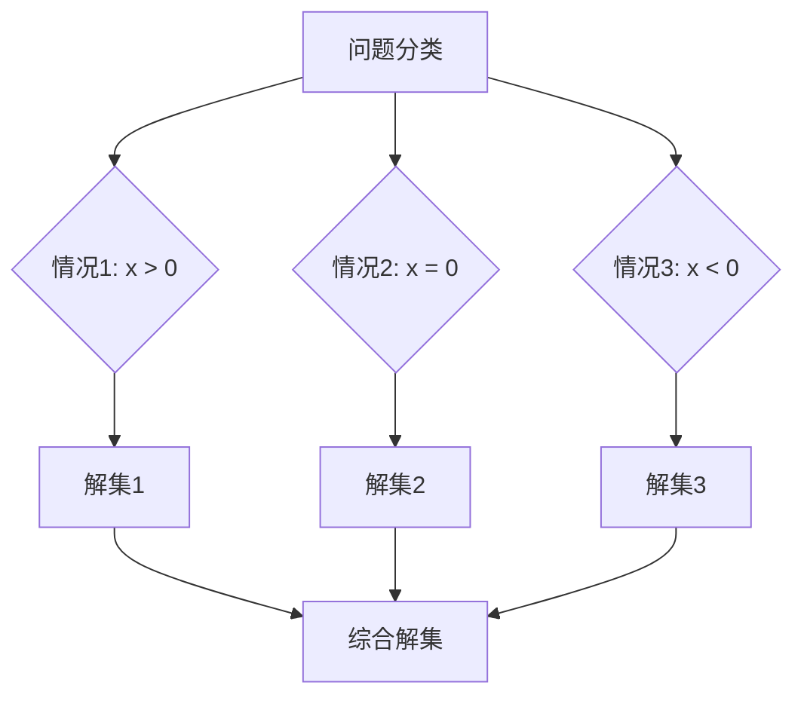

### 解题步骤流程

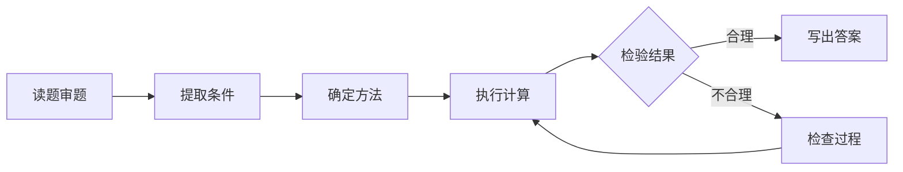

## 思维导图 (Mindmap)

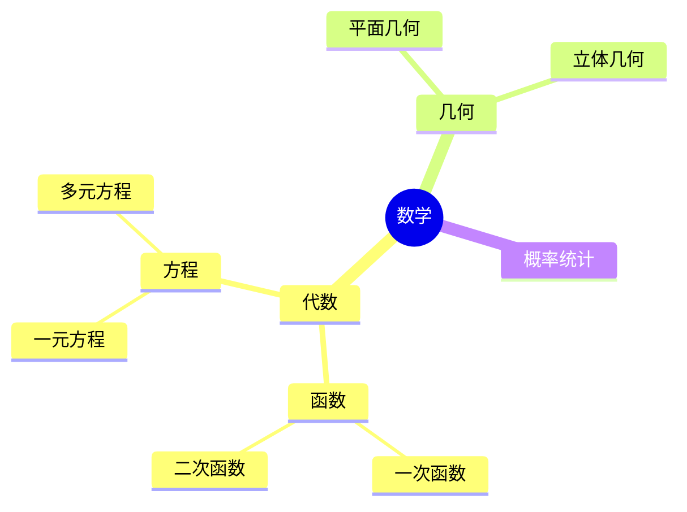

## 类图 (Class Diagram)

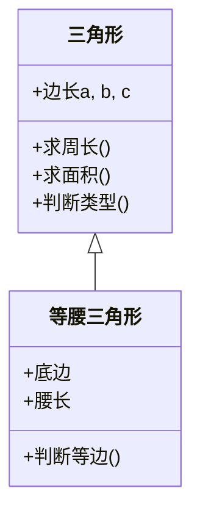

## 序列图 (Sequence Diagram)

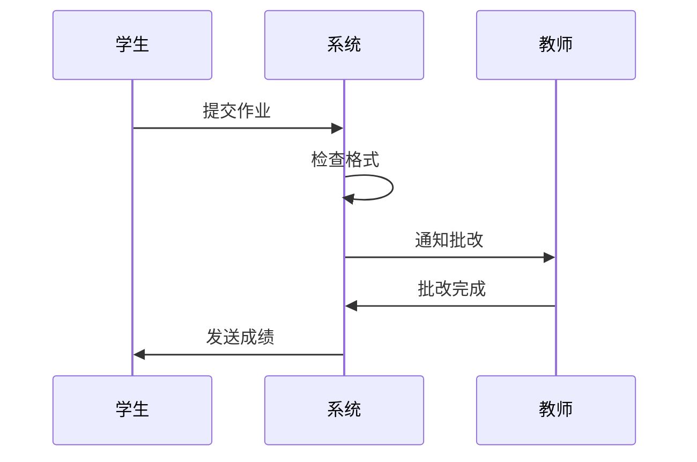

## 状态图 (State Diagram)

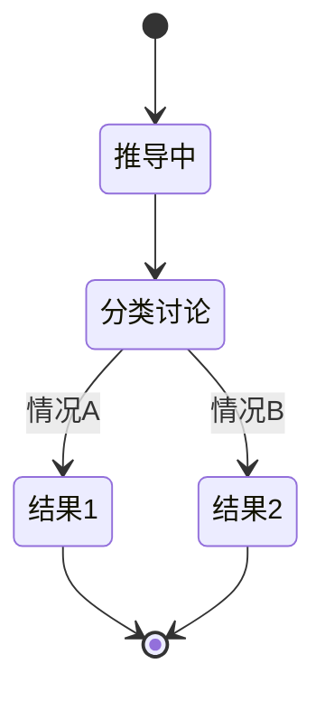

## 数学概念关系图

### 集合关系


### 运算性质

```mermaid
graph TD
    A[运算律] --> B[交换律]
    A --> C[结合律]
    A --> D[分配律]
    B --> E[a + b = b + a]
    C --> F[(a+b)+c = a+(b+c)]
    D --> G[a×(b+c) = a×b + a×c]
```

## 甘特图 (Gantt) - 教学进度

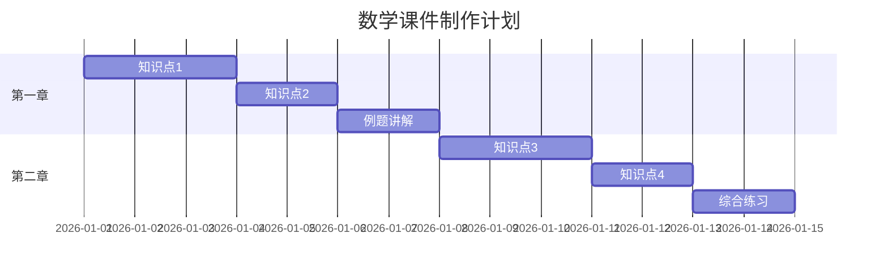

## 饼图 (Pie) - 课时分配

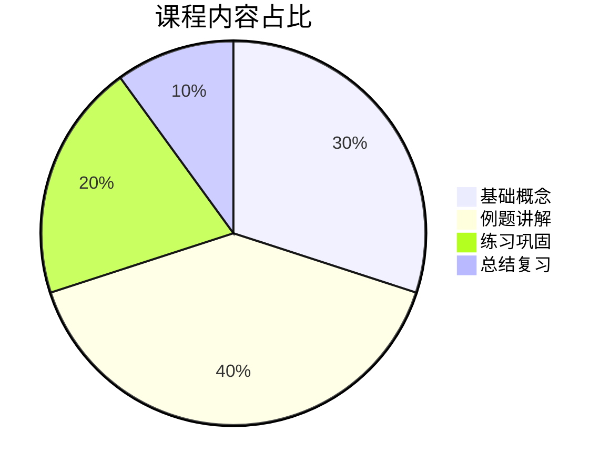