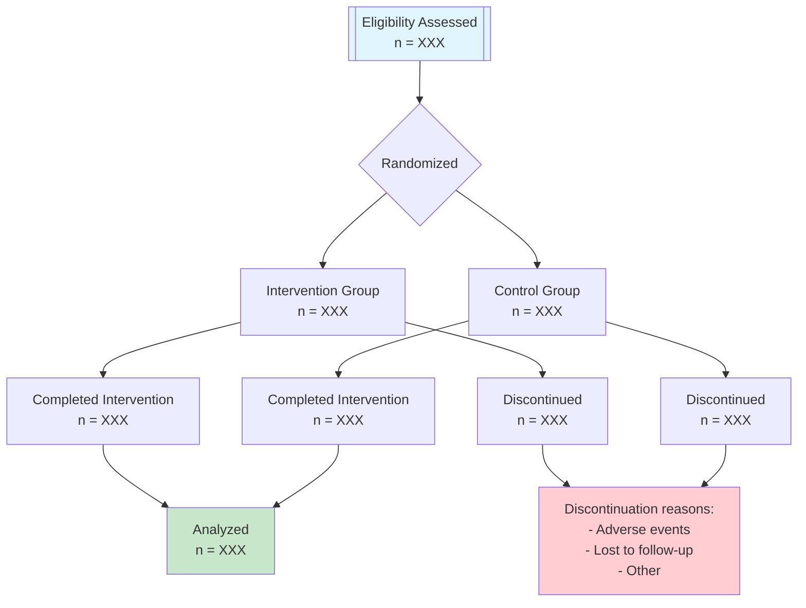
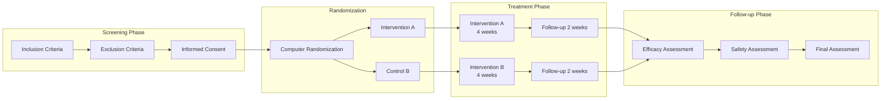
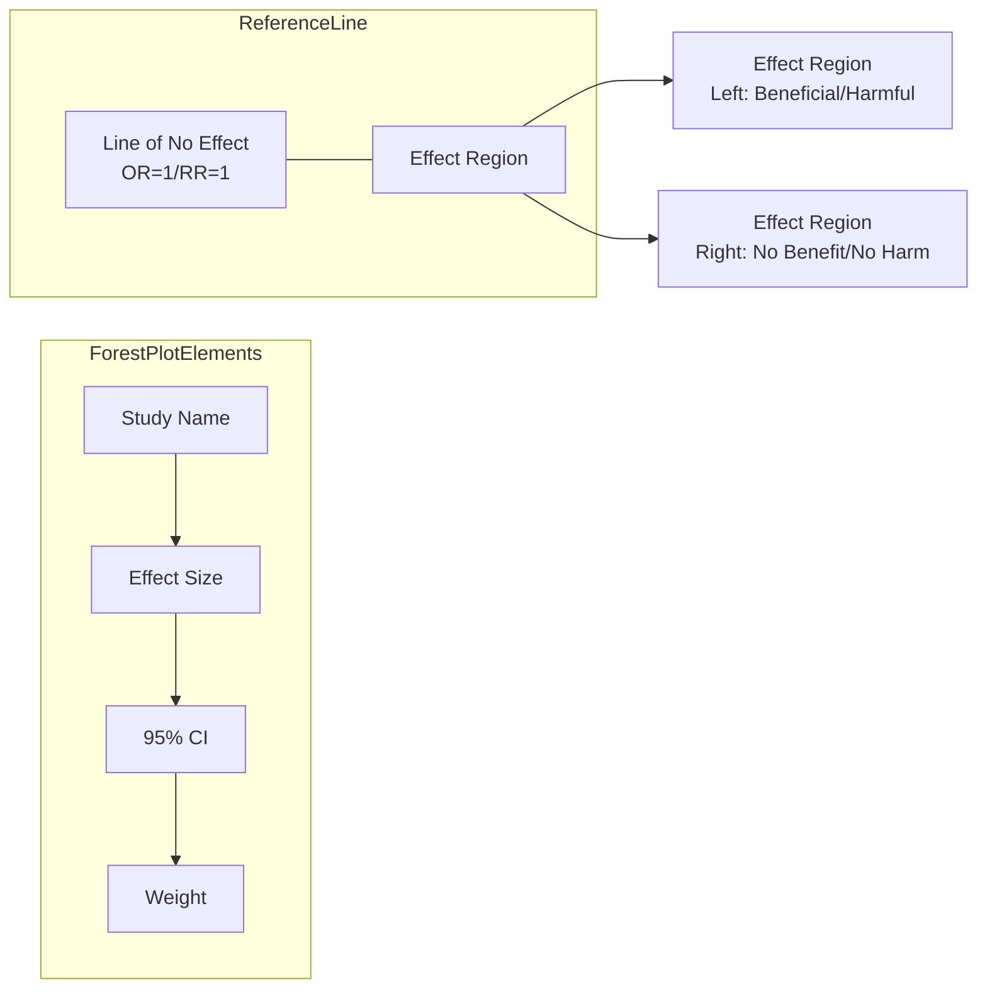
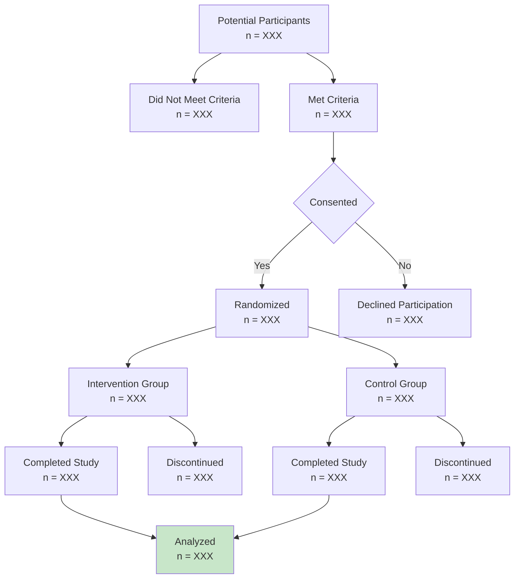

# Medical Research Chart Generation Guide

## Mermaid Chart Code Reference

### CONSORT Flowchart

### Study Design Diagram

### Forest Plot Structure

### Patient Enrollment Flowchart

## Data Visualization Best Practices

### Chart Selection Guide

| Data Type | Relationship | Recommended Chart |
|-----------|-------------|-------------------|
| Categorical | Part-to-whole | Pie Chart, Donut Chart |
| Categorical | Discrete comparison | Bar Chart, Column Chart |
| Continuous | Distribution | Histogram, Box Plot |
| Continuous | Trend over time | Line Chart |
| Two variables | Correlation | Scatter Plot |
| Multivariate | Complex comparison | Heat Map |

### Chart Design Principles

1. **Clarity**
   - Titles should be concise and clear
   - Axis labels should be readable
   - Legend positioning should be appropriate

2. **Accuracy**
   - Proportions should be correct
   - Scales should be reasonable
   - Data should not be distorted

3. **Aesthetics**
   - Colors should be coordinated
   - White space should be appropriate
   - Fonts should be consistent

4. **Standards**
   - Meet journal requirements
   - Sufficient resolution
   - Uniform format

### Common Mistakes to Avoid

X Avoid:
- 3D effects that distort data
- Dual Y-axes causing confusion
- Truncated axes
- Excessive colors
- Missing necessary labels

X Avoid:
- 3D effects that distort data
- Dual Y-axes causing confusion
- Truncated axes
- Excessive colors
- Missing necessary labels

Check Mark Recommended:
- Simple 2D charts
- Single axis
- Complete axis ranges
- Limited color schemes
- Complete legends and labels
