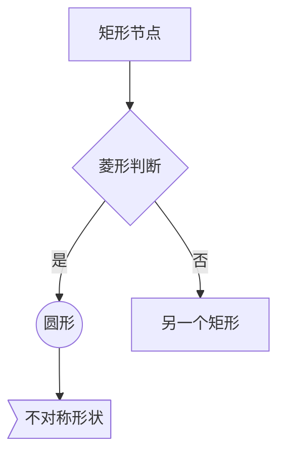
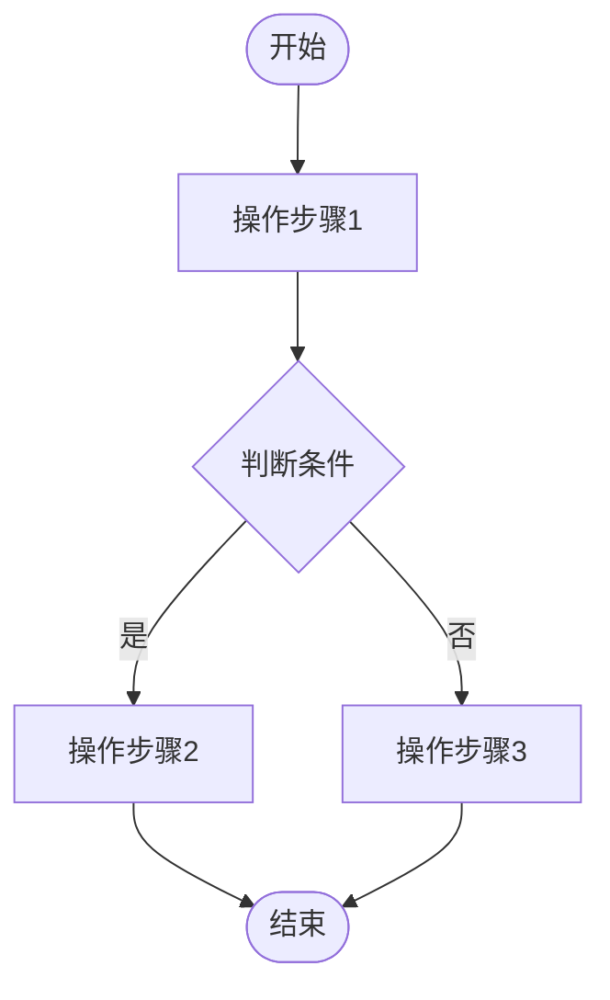
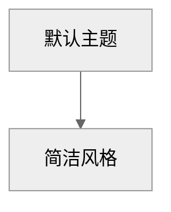
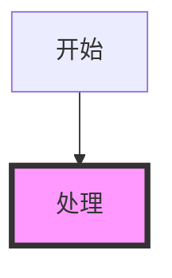

# Mermaid Flowchart Generator

专业的 Mermaid 流程图代码生成技能，帮助用户快速创建高质量的流程图。

## 支持的图表方向

| 方向 | 关键字 | 说明 |
|------|--------|------|
| TD/TB | 从上到下 | 默认，最常用 |
| BT | 从下到上 | 较少使用 |
| LR | 从左到右 | 适合横向流程 |
| RL | 从右到左 | 适合反向流程 |

## 节点形状语法



| 语法 | 形状 |
|------|------|
| `A[文本]` | 矩形 |
| `A(文本)` | 圆角矩形 |
| `A([文本])` | 体育场形 |
| `A[[文本]]` | 子程序 |
| `A[(文本)]` | 圆形 |
| `A{文本}` | 菱形 |
| `A{{文本}}` | 六边形 |
| `A>文本]` | 不对称形状 |

## 连接线语法

| 语法 | 说明 |
|------|------|
| `A --> B` | 箭头实线 |
| `A --- B` | 无箭头实线 |
| `A -.-> B` | 虚线箭头 |
| `A ==> B` | 加粗箭头 |
| `A -- 标签 --> B` | 带标签的箭头 |
| `A -. 标签 .-> B` | 带标签的虚线 |

## 工作流程

1. **理解需求**: 分析用户描述的流程步骤
2. **选择方向**: TD(默认)适合大多数流程，LR 适合步骤多的横向流程
3. **识别节点**: 区分开始/结束(圆角/圆形)、操作(矩形)、判断(菱形)
4. **构建关系**: 使用箭头连接各节点，标注判断条件
5. **输出代码**: 生成标准 Mermaid 代码

## 输出格式



## 常用模板

### 决策流程模板

```
START --> 判断{是否满足条件}
判断 -->|是| A[执行A操作]
判断 -->|否| B[执行B操作]
A --> END
B --> END
```

### 循环流程模板

```
START --> A[初始化]
A --> B{循环条件}
B -->|继续| C[循环操作]
C --> B
B -->|退出| END
```

### 分支流程模板

```
START --> B[基础操作]
B --> C{选择分支}
C -->|分支1| D1[操作1]
C -->|分支2| D2[操作2]
C -->|分支3| D3[操作3]
D1 --> END
D2 --> END
D3 --> END
```

## 主题配置



可选主题: `default`, `neutral`, `dark`, `forest`

## 样式类(可选)



## 快速参考

- ** flowchart ** 声明图表类型
- ** TD/TB/LR/RL ** 设置方向
- ** [ ] ** 矩形节点
- ** { } ** 菱形判断
- ** ( ) ** 圆角/圆形
- ** --> ** 箭头连接
- ** --标签-- ** 带标签连接
