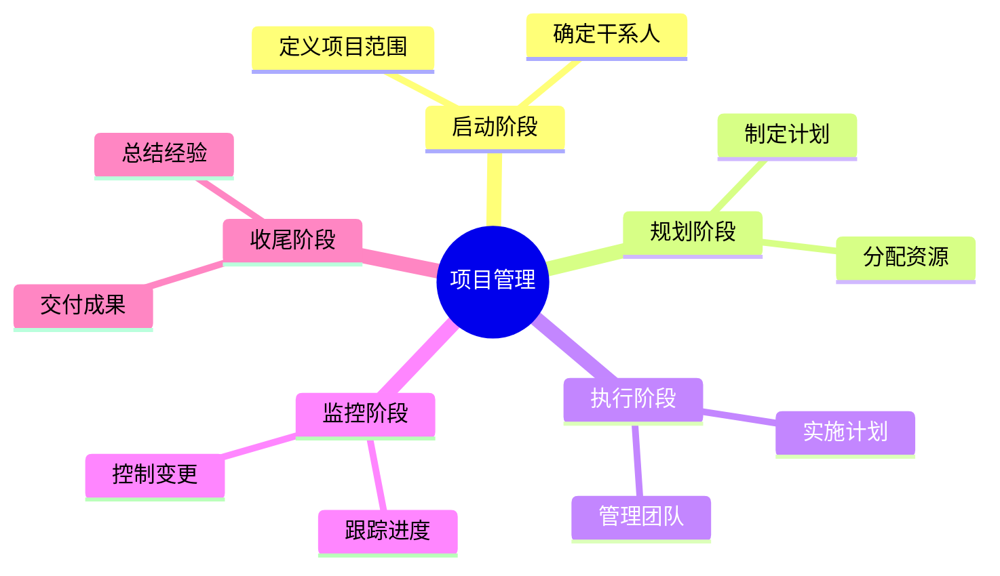

# 思维导图生成器

根据用户提供的文本内容，自动解析并生成结构化的思维导图。

## 工作流程

### 1. 解析输入文本

接收用户输入的文本内容，识别：
- **中心主题**：通常是第一句话或核心概念
- **分支主题**：识别主要分类或章节
- **子主题**：从属的细节内容
- **层级关系**：使用缩进、编号或连接词表示的包含关系

### 2. 构建思维导图结构

使用 Mermaid 思维导图语法构建：

```
mindmap
  root((中心主题))
    分支主题1
      子主题1.1
      子主题1.2
    分支主题2
      子主题2.1
      子主题2.2
```

### 3. 生成并渲染

使用 `render_mermaid` 工具将 Mermaid 代码渲染为可视化思维导图。

## 示例

**用户输入**：
```
项目管理的主要阶段包括：
1. 启动阶段 - 定义项目范围、确定干系人
2. 规划阶段 - 制定计划、分配资源
3. 执行阶段 - 实施计划、管理团队
4. 监控阶段 - 跟踪进度、控制变更
5. 收尾阶段 - 交付成果、总结经验
```

**生成思维导图**：


## 解析规则

| 输入特征 | 识别为 |
|---------|--------|
| 段落首句或核心名词 | 中心主题 |
| 一级编号/标题 | 分支主题 |
| 二级缩进/编号 | 子主题 |
| "包括/包含/分为"等关键词 | 分支标记 |
| 句号分隔的并列项 | 同级节点 |

## 注意事项

- 如果输入文本结构不明显，自动推断层级关系
- 保持主题简洁，必要时进行合理概括
- 对于过长的分支，进行适当精简
