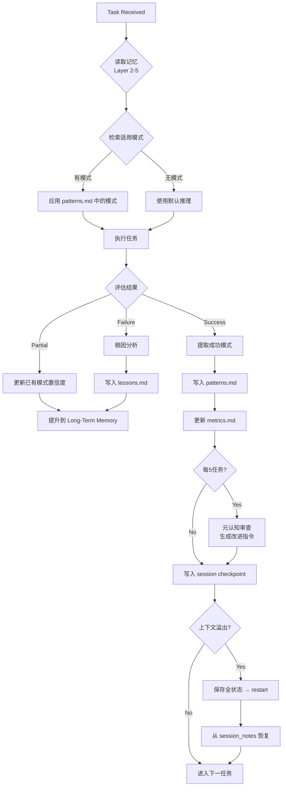

# MiniMax Hermes 架构详图

## 记忆体层级关系

```
┌─────────────────────────────────────────────────────────────────┐
│                    Layer 5: 元认知层                              │
│  ┌─────────────────────────────────────────────────────────┐    │
│  │ /memories/evolution/metrics.md                          │    │
│  │ - 任务成功率 | 平均完成轮次 | 记忆命中率 | 用户纠正频率   │    │
│  └─────────────────────────────────────────────────────────┘    │
└─────────────────────────────────────────────────────────────────┘
                              ↑
┌─────────────────────────────────────────────────────────────────┐
│                    Layer 4: 情境记忆层                           │
│  ┌────────────────┐  ┌────────────────┐  ┌─────────────────┐    │
│  │ patterns.md    │  │ lessons.md     │  │ cases/YYYY-MM/  │    │
│  │ 成功模式库     │  │ 失败教训库     │  │ 原始Episode     │    │
│  └────────────────┘  └────────────────┘  └─────────────────┘    │
└─────────────────────────────────────────────────────────────────┘
                              ↑
┌─────────────────────────────────────────────────────────────────┐
│                    Layer 3: 长期记忆层                            │
│  ┌────────────────┐  ┌────────────────┐  ┌─────────────────┐    │
│  │ user_         │  │ domain_        │  │ workflow_       │    │
│  │ preferences.md│  │ knowledge.md   │  │ library.md      │    │
│  └────────────────┘  └────────────────┘  └─────────────────┘    │
│  ┌─────────────────────────────────────────────────────────┐    │
│  │ /memories/project/[slug]/                                │    │
│  │ context.md | decisions.md | findings.md | architecture.md    │
│  └─────────────────────────────────────────────────────────┘    │
└─────────────────────────────────────────────────────────────────┘
                              ↑
┌─────────────────────────────────────────────────────────────────┐
│                    Layer 2: 短期记忆层                            │
│  ┌─────────────────────────────────────────────────────────┐    │
│  │ /memories/session_notes.md                               │    │
│  │ 任务ID | 当前焦点 | 中间结果 | 待完成步骤 | 活跃约束      │    │
│  └─────────────────────────────────────────────────────────┘    │
└─────────────────────────────────────────────────────────────────┘
                              ↑
┌─────────────────────────────────────────────────────────────────┐
│                    Layer 1: 感官记忆层                           │
│  ┌─────────────────────────────────────────────────────────┐    │
│  │ 当前上下文窗口内的即时输入/输出                            │    │
│  │ 最近3轮对话内的明确指令、文件路径、用户纠正               │    │
│  └─────────────────────────────────────────────────────────┘    │
└─────────────────────────────────────────────────────────────────┘
```

## 置信度晋升路径

```
[unconfirmed] ──→ [low] ──→ [medium] ──→ [high] ──→ [validated]
     │             │            │            │
     │             │            │            │
     └──── 3次验证 ─┘            │            │
                               │            │
                    反例推翻 ←──┘            │
                               │            │
                    90天未引用 [stale] ←──────┘
                               │
                    180天 [stale]+[unconfirmed] → 可硬删除
```

## 自我进化循环



## 记忆体文件结构

```
/memories/
├── session_notes.md          ← Layer 2: 短期/工作记忆
├── user_preferences.md       ← Layer 3: 长期记忆（用户偏好）
├── domain_knowledge.md       ← Layer 3: 长期记忆（领域知识）
├── workflow_library.md       ← Layer 3: 长期记忆（工作流程）
├── project/                  ← Layer 3: 长期记忆（项目级）
│   ├── index.md             ← 项目索引
│   └── [project-slug]/       ← 按项目 slug 隔离
│       ├── context.md       ← 项目上下文
│       ├── decisions.md     ← 关键决策记录
│       ├── findings.md     ← 重要发现
│       └── architecture.md  ← 架构决策记录
└── evolution/                ← Layer 4 + 5: 情境记忆 + 元认知
    ├── patterns.md           ← Layer 4: 成功模式库
    ├── lessons.md            ← Layer 4: 失败教训库
    ├── metrics.md            ← Layer 5: 性能指标 + 改进指令
    └── cases/                ← Layer 4: 原始 Episode 记录
        └── [YYYY-MM]/
            └── [id].md
```

## 工具调用时序图

```
┌──────────┐     ┌────────────────┐     ┌─────────────┐
│  Agent   │     │  Memory System │     │   /memories │
└────┬─────┘     └────────────────┘     └──────┬──────┘
     │                                        │
     │  view_memory(session_notes.md)         │
     │───────────────────────────────────────→│
     │                                        │
     │  返回: 任务状态、待办事项               │
     │←───────────────────────────────────────│
     │                                        │
     │  view_memory(user_preferences.md)      │
     │───────────────────────────────────────→│
     │                                        │
     │  返回: 用户偏好列表                     │
     │←───────────────────────────────────────│
     │                                        │
     │  str_replace_memory(session_notes.md)   │
     │  更新任务进度                           │
     │───────────────────────────────────────→│
     │                                        │
     │  成功                                  │
     │←───────────────────────────────────────│
     │                                        │
     │  create_memory(                        │
     │    evolution/cases/2026-04/001.md)      │
     │  记录新 Episode                         │
     │───────────────────────────────────────→│
     │                                        │
     │  成功                                  │
     │←───────────────────────────────────────│
     │                                        │
```
