# Mermaid 图表模板库

## 流程图模板

### 基础流程图
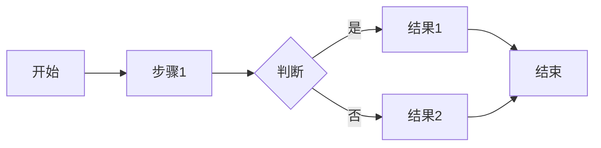

### 横向流程图
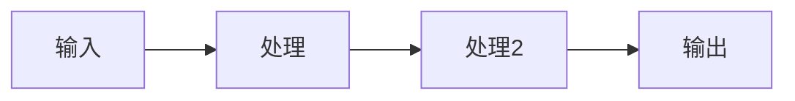

### 下向上流程图
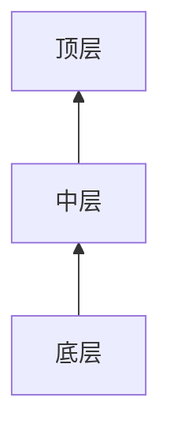

## 架构图模板

### 层级架构图
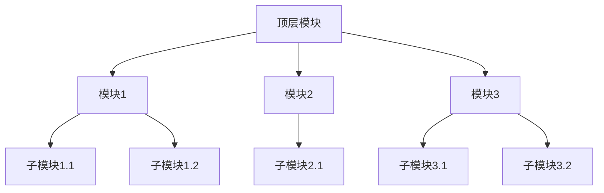

### 组件架构图
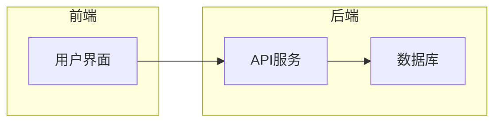

## 循环流程图
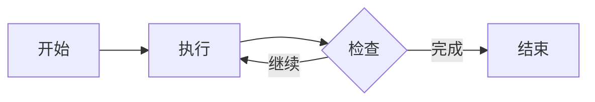

## 序列图模板

### 简单交互流程
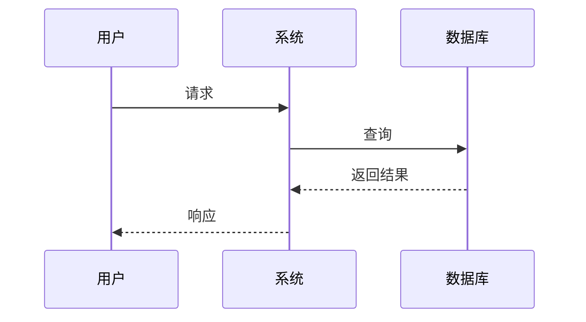

### 详细交互流程
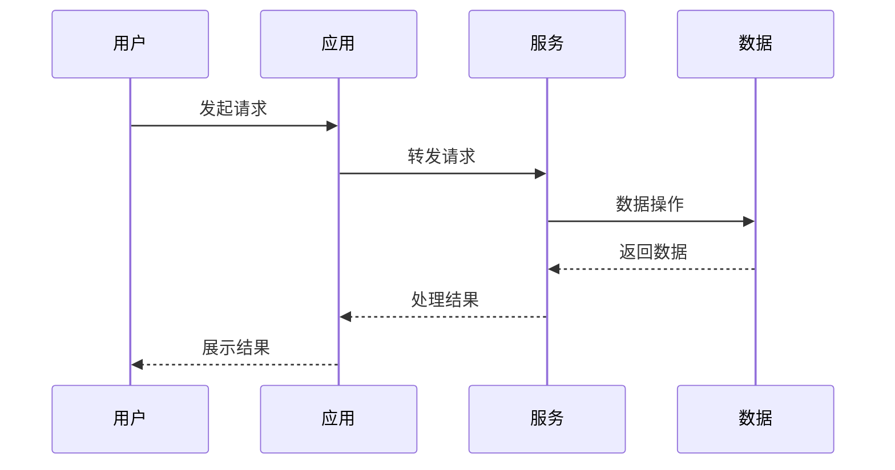

## 状态图模板

### 状态转换图
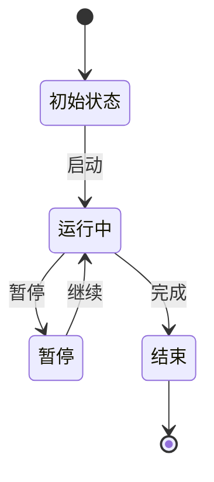

## 甘特图模板

### 学习计划甘特图
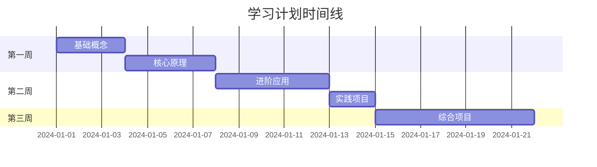

## ER图模板

### 实体关系图
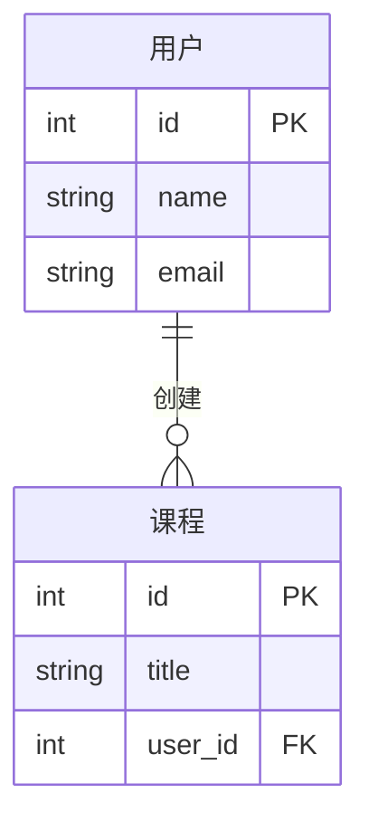

## 思维导图模板

### 主题发散图
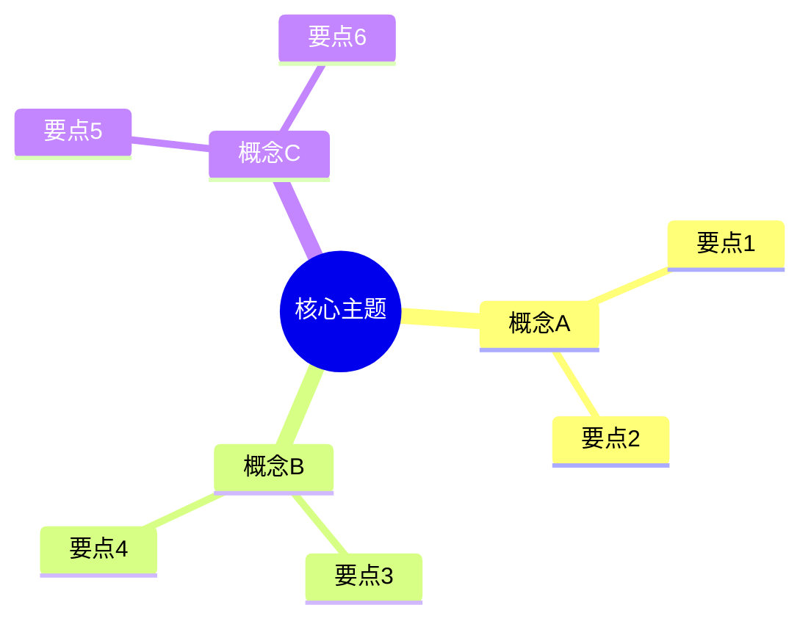

## 类图模板

### 简单类图
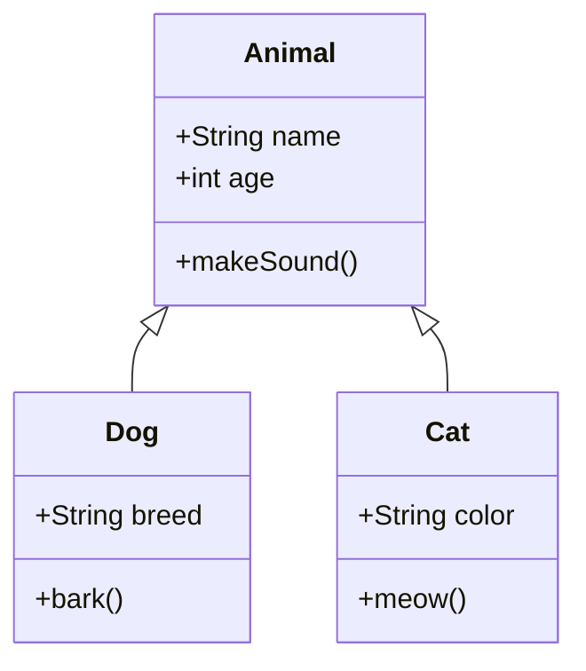

## 使用场景对照表

| 内容类型 | 推荐图表 | Mermaid类型 |
|----------|----------|-------------|
| 操作步骤 | 流程图 | graph LR/TB |
| 系统架构 | 架构图 | graph TB |
| 交互流程 | 序列图 | sequenceDiagram |
| 状态变化 | 状态图 | stateDiagram |
| 时间安排 | 甘特图 | gantt |
| 数据关系 | ER图 | erDiagram |
| 概念发散 | 思维导图 | mindmap |
| 类结构 | 类图 | classDiagram |

## 样式配置建议

### 颜色主题
- 基础概念：蓝色系 (#4A90E2)
- 重要内容：橙色系 (#F5A623)
- 关键节点：绿色系 (#7ED321)
- 警示/注意：红色系 (#D0021B)

### 字体大小
- 标题：18-20px
- 节点文字：14-16px
- 注释说明：12px

### 布局建议
- 横向流程：使用 LR
- 纵向层级：使用 TB
- 复杂关系：适当使用缩进和分组
