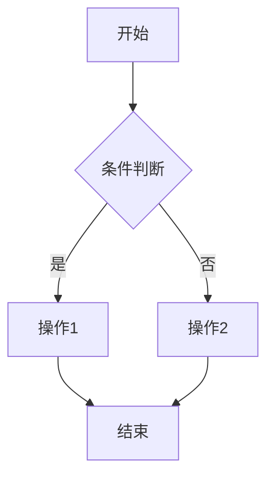
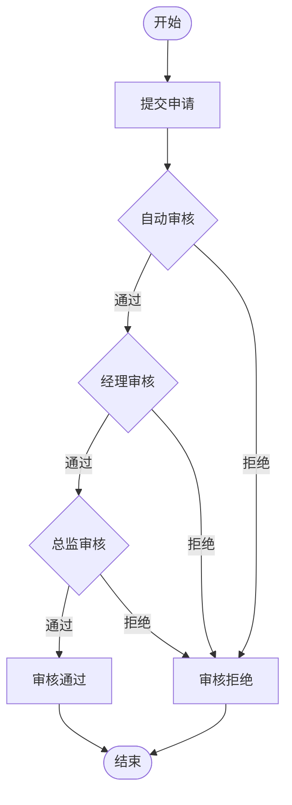
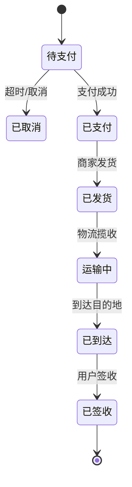
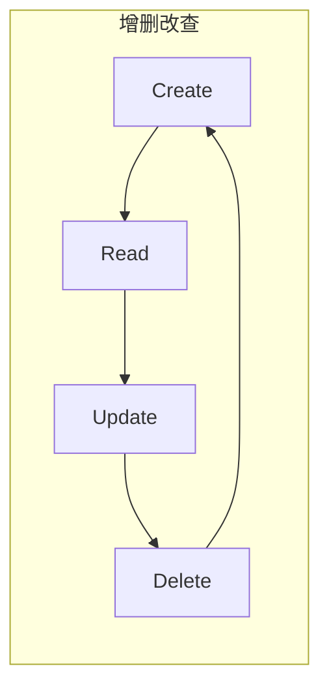

# PRD to Mermaid Flowchart

**一句话让产品需求秒变专业流程图** —— 输入PRD文本，输出可直接使用的Mermaid代码和可视化预览。

## 核心能力

- 解析产品需求文本，提取业务流程节点
- 识别决策分支、循环路径、并行处理
- 生成符合Mermaid语法规范的流程图代码
- 渲染可视化预览图

## 工作流程

### Step 1: 需求解析

分析用户提供的产品需求，提取：

```
关键要素：
- 用户角色（Actor）
- 系统模块（Module）
- 操作步骤（Action）
- 决策条件（Condition）
- 数据流向（Data Flow）
- 异常处理（Exception）
```

### Step 2: 流程建模

根据需求类型选择合适的流程模式：

| 需求类型 | 流程模式 | Mermaid类型 |
|---------|---------|------------|
| 审批流程 | 线性审批/会签审批 | flowchart |
| 订单处理 | 状态机流转 | stateDiagram |
| 数据管理 | CRUD增删改查 | flowchart |
| 权限管理 | 角色-权限矩阵 | flowchart |
| 异步任务 | 任务队列处理 | flowchart |

### Step 3: 节点设计

使用标准节点类型：

```
矩形 (rectangle): 普通流程节点
圆角矩形 (rounded_rect): 开始/结束节点
菱形 (diamond): 决策判断
圆柱形 (cylinder): 数据库/存储
人形图标 (person): 用户/角色
```

### Step 4: 生成代码

输出标准Mermaid代码块：



### Step 5: 渲染预览

使用 `render_mermaid` 工具生成可视化预览。

## 输出格式

### 标准输出

1. **Mermaid代码块**：可直接复制使用的代码
2. **流程说明**：节点含义和业务逻辑
3. **渲染预览**：可视化图形（可选）

### 代码规范

- 节点ID使用简短字母或数字
- 节点文本使用中文，简洁明了
- 条件分支必须标注分支条件
- 异常流程使用虚线箭头

## 常见场景模板

### 审批流程



### 订单处理



### 数据CRUD



## 质量检查

生成后自检：

- [ ] 所有分支都有明确出口
- [ ] 决策节点标注清晰的条件
- [ ] 开始和结束节点成对出现
- [ ] 节点文本不超过20字
- [ ] 无交叉连线导致的视觉混乱

## 参考资料

详细Mermaid语法见 `references/mermaid-syntax.md`
B端常见业务流程模式见 `references/bpmn-patterns.md`
