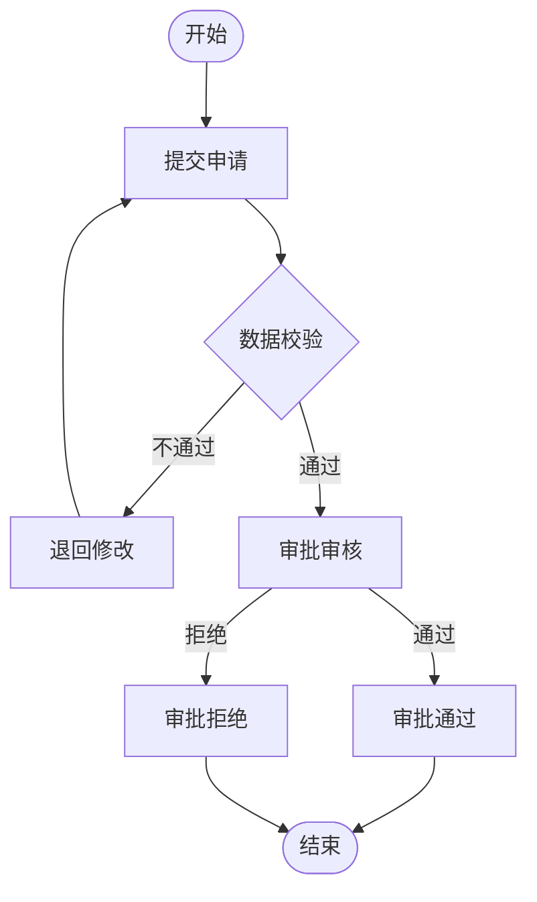
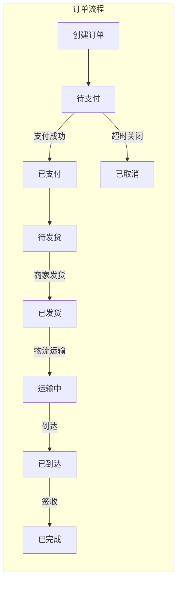
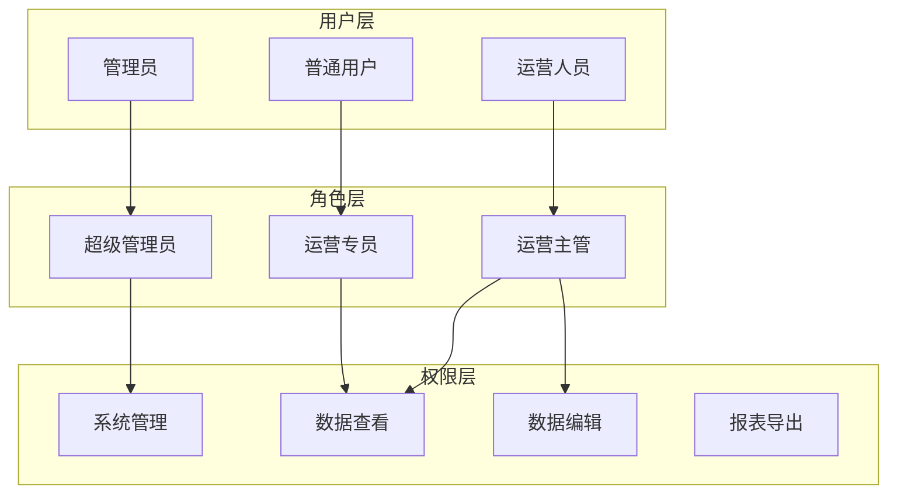
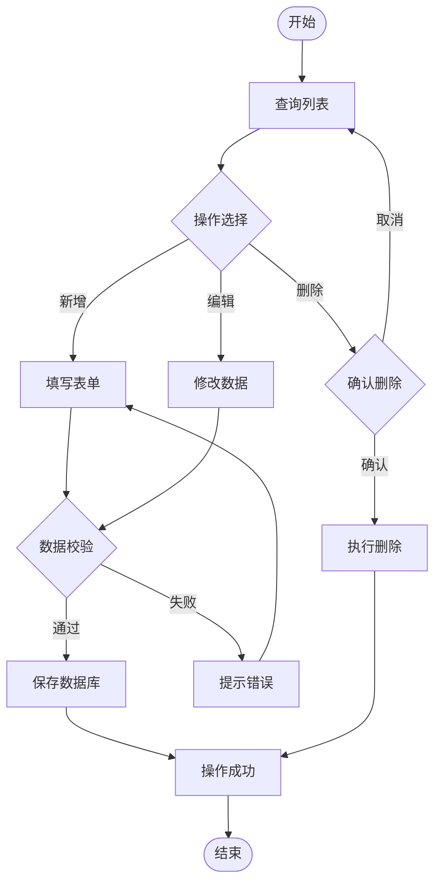
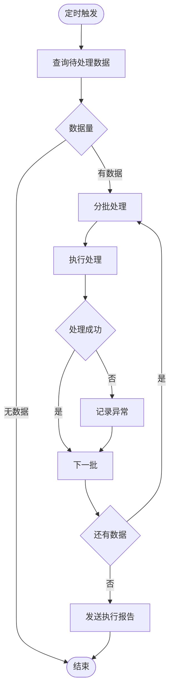
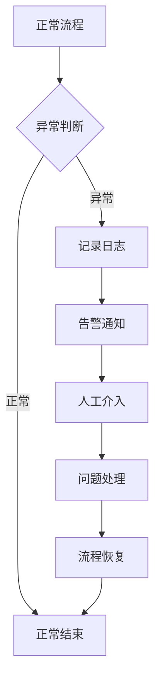

# B端常见业务流程模式

## 1. 审批流程类

### 单级审批

```
用户提交 → 自动校验 → 审批人审核 → 审批通过/拒绝 → 结束
```

**Mermaid模板**：


### 多级审批（会签）

```
提交申请 → 部门经理审核 → 总监审核 → HR复核 → 结束
```

### 条件审批

```
提交申请 → 根据金额判断
├─ 金额<1万 → 部门经理审批
├─ 1万≤金额<10万 → 部门+总监审批
└─ 金额≥10万 → 全员会签审批
```

## 2. 订单处理类

### 标准订单流程

```
下单 → 支付 → 商家确认 → 打包发货 → 物流运输 → 收货确认 → 评价完成
```

**Mermaid模板**：


### 退货退款流程

```
申请退货 → 审核退货 → 退回商品 → 验货 → 退款/拒绝
```

## 3. 权限管理类

### RBAC权限模型

```
用户 → 角色 → 权限
         ↓
      菜单权限
      数据权限
      操作权限
```

**Mermaid模板**：


### 资源访问控制

```
请求访问 → 登录校验 → 权限校验 → 资源校验 → 允许/拒绝
```

## 4. 数据管理类

### CRUD增删改查

```
列表查询 → 新增/编辑/删除 → 确认操作 → 更新数据库 → 返回结果
```

**Mermaid模板**：


### 数据导入导出

```
上传文件 → 文件解析 → 数据校验 → 预览确认 → 执行导入 → 结果反馈
```

## 5. 消息通知类

### 站内信通知

```
触发事件 → 消息创建 → 消息入库 → 消息推送 → 用户查看 → 标记已读
```

### 邮件通知

```
触发事件 → 邮件生成 → 邮件队列 → 邮件发送 → 发送结果记录
```

## 6. 定时任务类

### 批处理任务

```
定时触发 → 查询待处理 → 分批执行 → 结果记录 → 异常告警 → 任务结束
```

**Mermaid模板**：


## 7. 工作流引擎类

### 通用工作流

```
发起流程 → 流程节点审批 → 流程变量更新 → 流程分支判断 → 流程结束/退回
```

### 会签与或签

```
会签：所有审批人全部通过才算通过
或签：任一审批人通过即可继续
```

## 8. 异常处理模式

### 标准异常处理



### 重试机制

```
执行失败 → 重试计数 < 最大次数 → 等待重试 → 重新执行
                    ↓
              达到最大次数
                    ↓
               标记失败 → 告警通知
```
