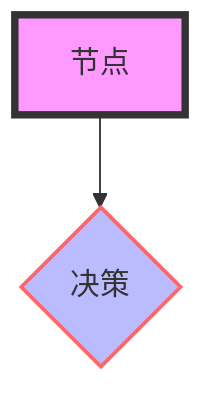
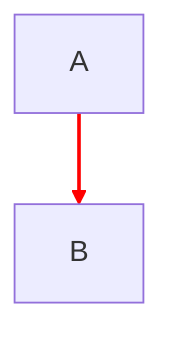
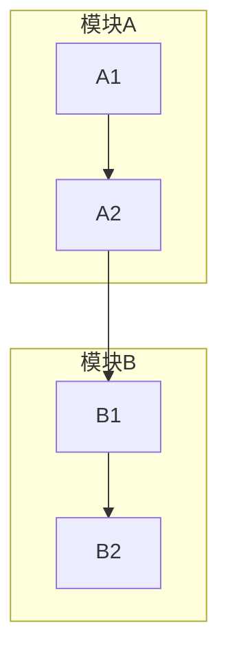
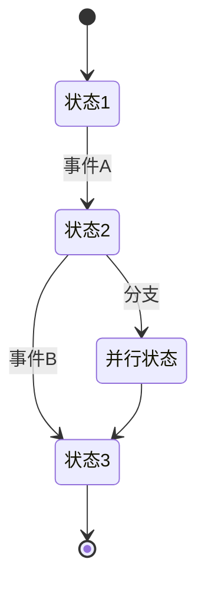
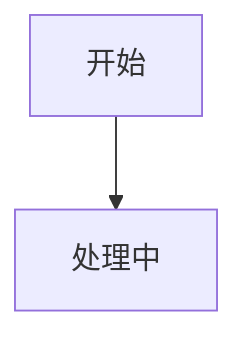
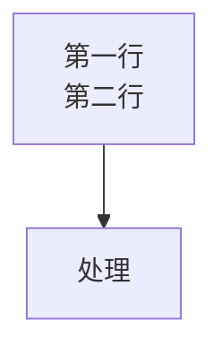
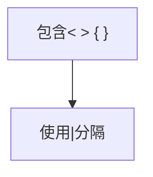

# Mermaid Flowchart 语法参考

## 基础语法

### 节点定义

```
graph TD
    A[矩形节点]
    B(圆角矩形)
    C([椭圆形])
    D((圆形))
    E{菱形}
    F{{六边形}}
    G[/平行四边形/]
    H[\反向平行四边形\]
    I[圆柱形]
    J[人形图标]
```

### 连接线

```
A --> B        直接箭头
A --- B        无箭头直线
A -->|标签| B  带标签箭头
A-.-> B       虚线箭头
A -.->|标签| B 带标签虚线
A ==> B       粗箭头
A ---|标签| B  带标签直线
```

### 流程图方向

```
TD / TB  - 从上到下
BT        - 从下到上
LR        - 从左到右
RL        - 从右到左
```

## 样式

### 节点样式



### 连接线样式



### 子图



## State Diagram (状态图)



## 常见问题

### 1. 中文显示

Mermaid支持Unicode，直接使用中文即可：


### 2. 节点内换行

使用`<br/>`换行：


### 3. 避免连线交叉

合理使用布局方向和子图分组

### 4. 特殊字符转义

使用引号包裹含特殊字符的文本：


## 最佳实践

1. **节点ID命名**：使用有意义的简短ID
2. **节点文本**：保持简洁，20字以内
3. **分支标注**：所有决策分支都要标注
4. **开始结束**：使用圆角或椭圆形标识
5. **异常处理**：虚线表示异常/错误路径
