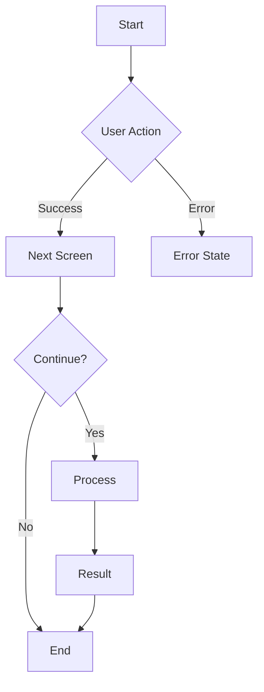
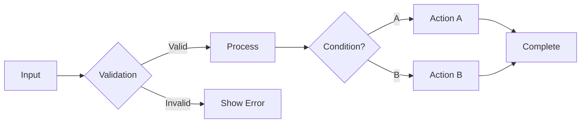
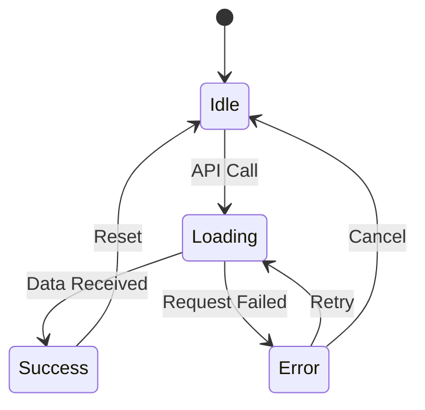
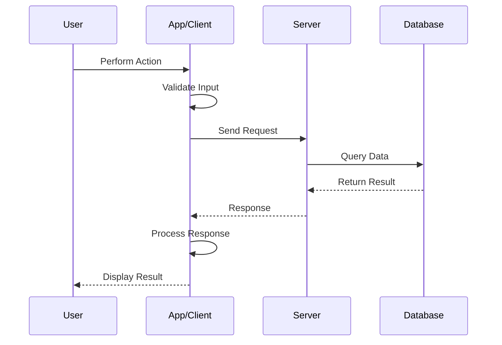
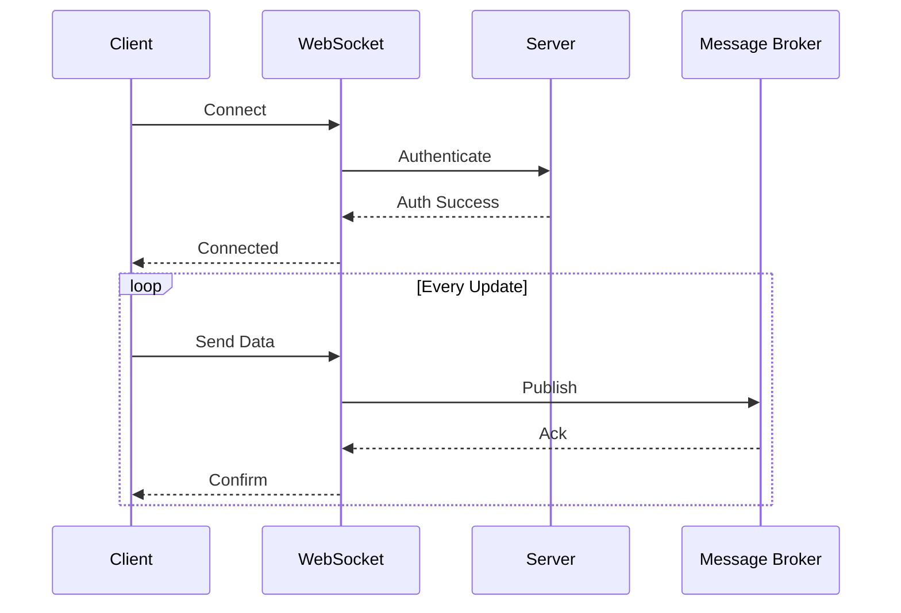
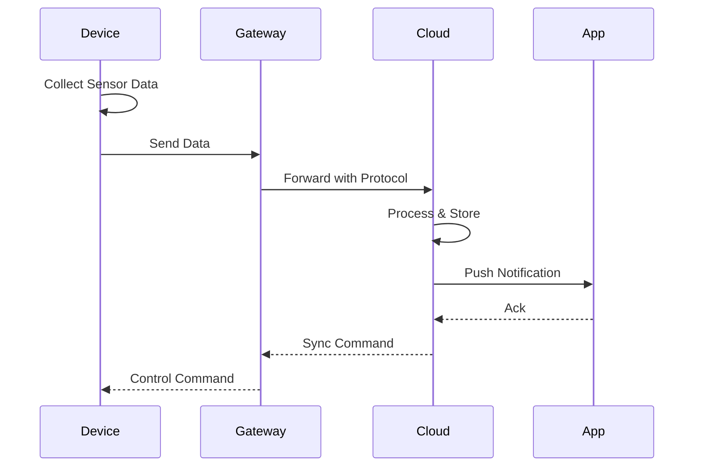
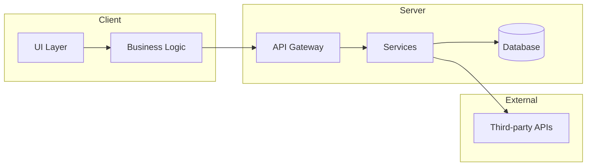
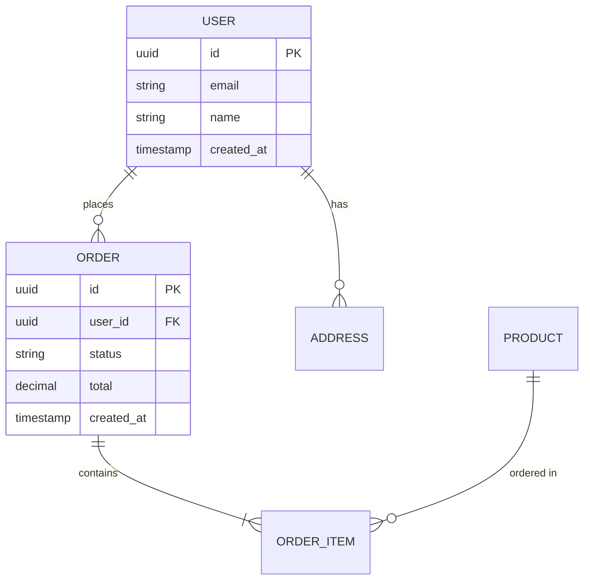

---
AIGC:
    ContentProducer: Minimax Agent AI
    ContentPropagator: Minimax Agent AI
    Label: AIGC
    ProduceID: d9d0b3655bd4419ca6b672ce524d7f8c
    PropagateID: d9d0b3655bd4419ca6b672ce524d7f8c
    ReservedCode1: 3046022100a9aee3fc1278e81ca76195ea112aaa9ef77ebc327d34162eb3bc3105adc83bf1022100ace2b602bf6ea384c590ed513c852cd3da0f4fc65aa4cfe0f42f92d2b251f41c
    ReservedCode2: 3046022100b46369d274d6fbbbc5c3caf94c08cfdb4065cbcb51fc114ea5b77bae86d12d17022100e824567a107b6df59462648ac8533e85fabc2fd993a2aa822a75a88d4f2b1e62
description: Used when users request UX design, interaction flow diagrams, sequence diagrams, data flow visualization, or wireframe generation based on PRD documents.
name: prd-ux-flow-design
---

# PRD to UX/Flow Design Skill

Convert Product Requirements Documents (PRD) into UX interaction designs, flow diagrams, sequence diagrams, and data flow visualizations.

## Core Workflow

### 1. PRD Analysis

**Input**: Product Requirements Document (can be text, markdown, or structured document)

**Processing**:
- Parse functional requirements
- Identify user interactions and touchpoints
- Extract data entities and relationships
- Map system components

**Output**:
```
## PRD Analysis Summary

### Key Features Identified
- [Feature 1]
- [Feature 2]

### User Roles
- [Role 1]
- [Role 2]

### Data Entities
- [Entity 1]
- [Entity 2]

### System Components
- [Component 1]
- [Component 2]
```

### 2. UX Interaction Design

Design user interactions based on functional requirements:

#### 2.1 Screen/Flow Identification

| Screen ID | Screen Name | Description | Connected Screens |
|-----------|-------------|-------------|------------------|
| S-001 | [Name] | [Purpose] | S-002, S-003 |
| ... | ... | ... | ... |

#### 2.2 Interaction Patterns

| Pattern | When to Use | Example |
|---------|-------------|---------|
| Button Click | Primary actions | Submit, Save, Confirm |
| Swipe/Gesture | Mobile interactions | Delete, Refresh |
| Modal Dialog | Confirmation required | Delete confirm, Settings |
| Pull-to-Refresh | Content update | News feed, List refresh |
| Infinite Scroll | Large content sets | Feeds, Search results |

#### 2.3 Navigation Structure

```
[Navigation Type: Tab Bar / Drawer / Stack]

├── Home
│   ├── Dashboard
│   └── Quick Actions
├── Features
│   ├── Feature A
│   │   ├── Detail View
│   │   └── Settings
│   └── Feature B
└── Profile
    ├── Settings
    └── Help
```

### 3. Flow Diagrams

Generate interaction flow diagrams using Mermaid syntax:

#### 3.1 User Journey Flows



#### 3.2 Decision Flows



#### 3.3 State Transitions



### 4. Sequence Diagrams

Generate data interaction sequence diagrams:

#### 4.1 API Interaction Sequence



#### 4.2 Real-time Communication



#### 4.3 Device-Server Communication (IoT)



### 5. Data Flow Diagrams

#### 5.1 System Architecture



#### 5.2 Data Entity Relationships



### 6. Output Artifacts

Generate complete design documentation:

1. **UX Documentation**
   - Screen specifications
   - Interaction patterns
   - Navigation structure
   - State definitions

2. **Flow Diagrams**
   - User journey maps
   - Decision trees
   - State machines

3. **Sequence Diagrams**
   - API interactions
   - Real-time flows
   - Device communication

4. **Data Diagrams**
   - Architecture diagrams
   - Entity relationships
   - Data pipelines

## Templates

See `references/` directory for:
- `ux-spec-template.md` - UX specification template
- `flow-diagram-patterns.md` - Common flow patterns
- `sequence-patterns.md` - Sequence diagram templates

## Quality Standards

- All diagrams use Mermaid syntax for rendering
- Clear labeling on all diagram elements
- Consistent notation throughout
- Include error/exception paths
- Show all data interactions
