# Flow Diagram Patterns

## Common User Flow Patterns

### 1. Authentication Flow

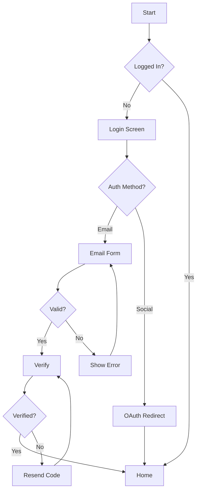

### 2. CRUD Operations

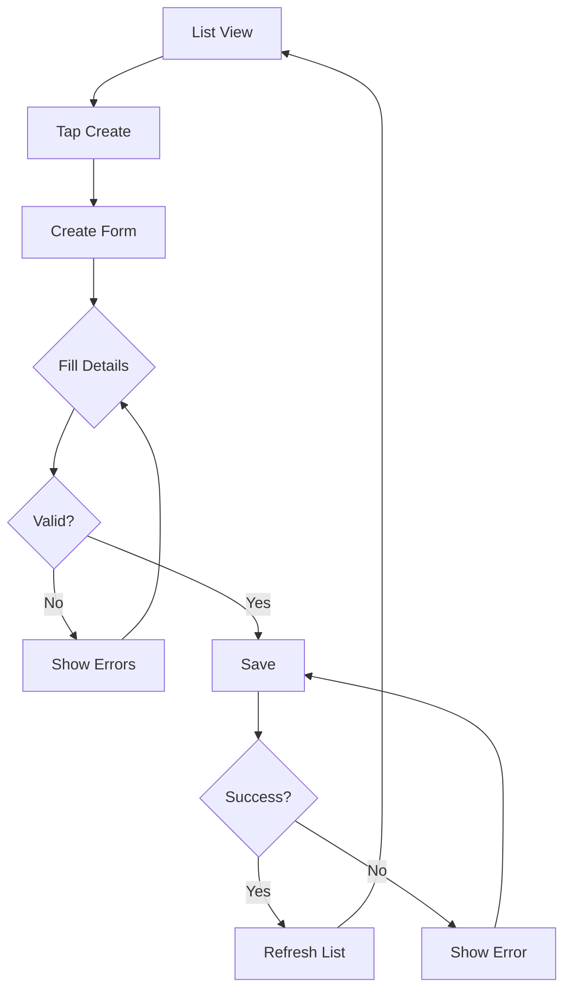

### 3. Search & Filter Flow

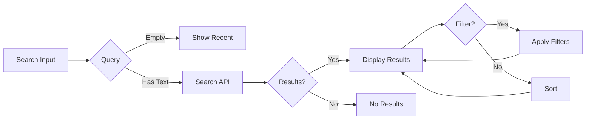

### 4. Checkout Flow

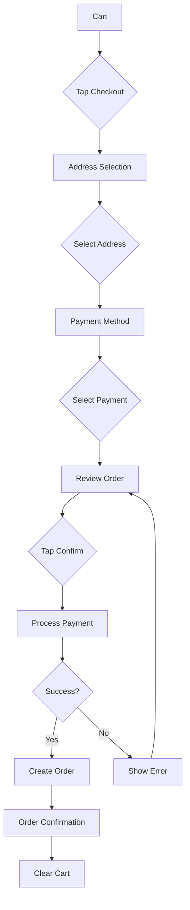

### 5. Pull-to-Refresh Pattern

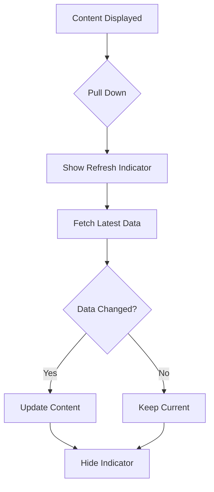

### 6. Infinite Scroll Pattern

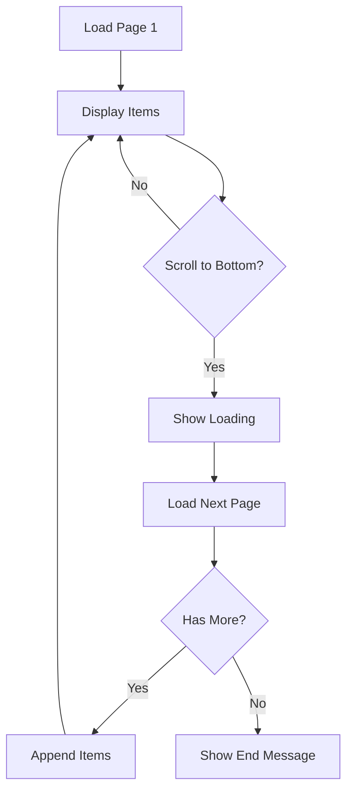

### 7. Form Validation Flow

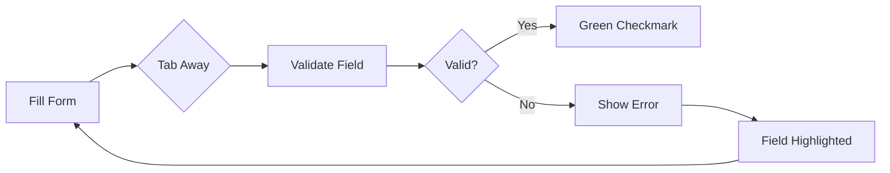

### 8. Notification Handling

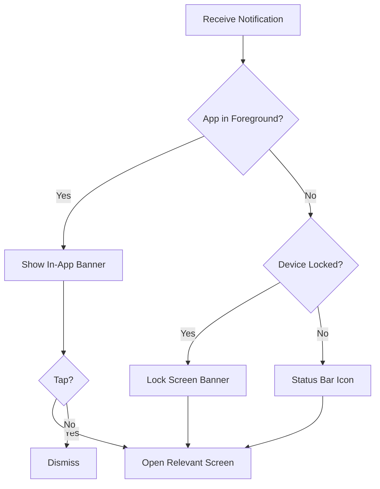

## State Machine Patterns

### 1. Order State Machine

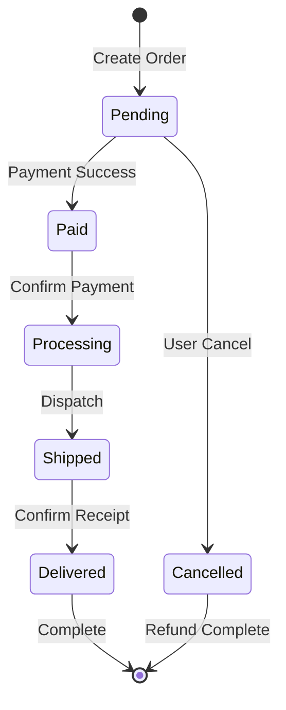

### 2. Document Sync State

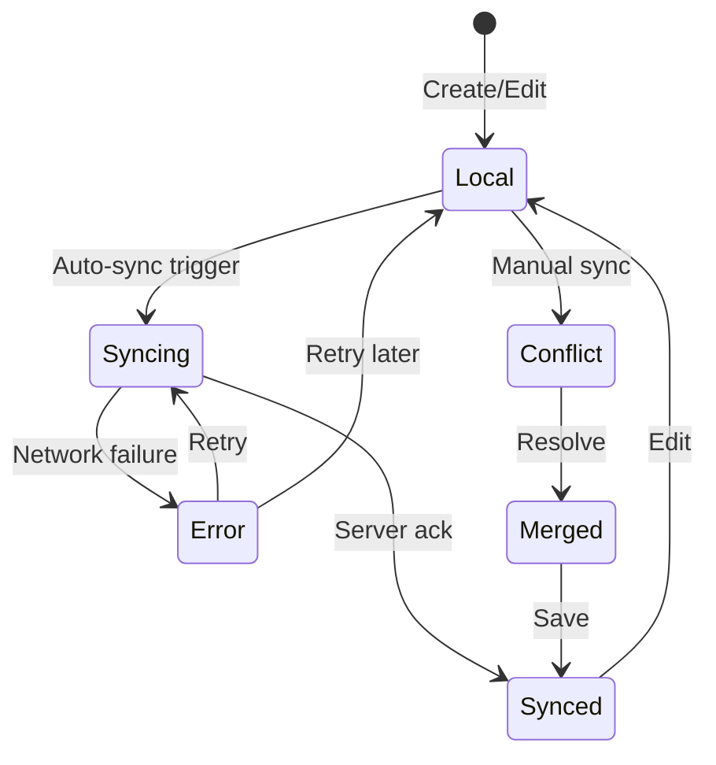

### 3. User Session State

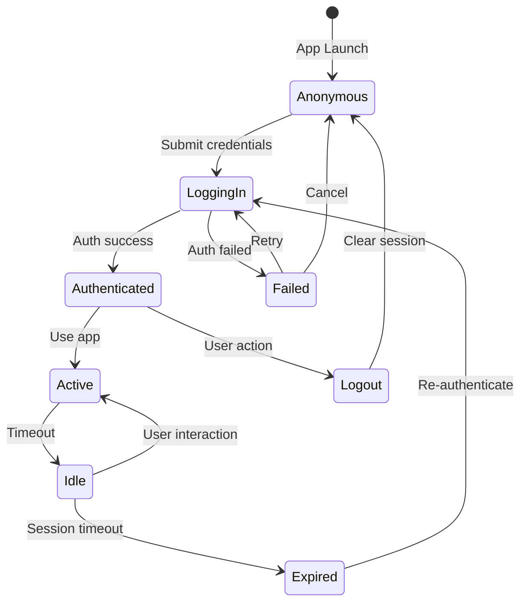

## Decision Tree Patterns

### 1. Permission Request Flow

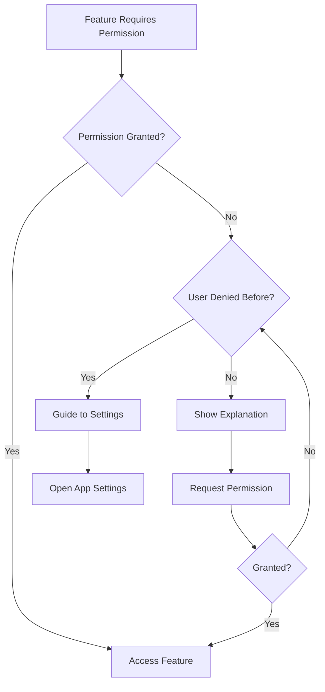

### 2. Deep Link Handling

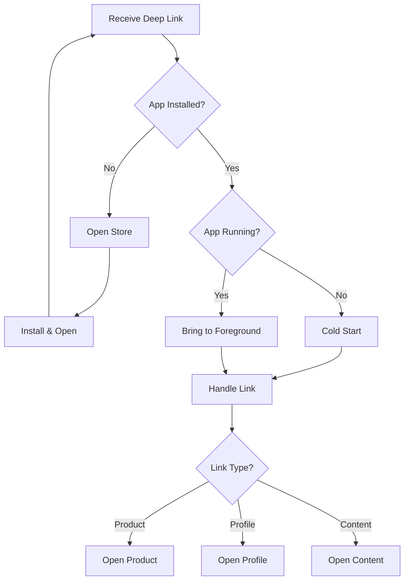
