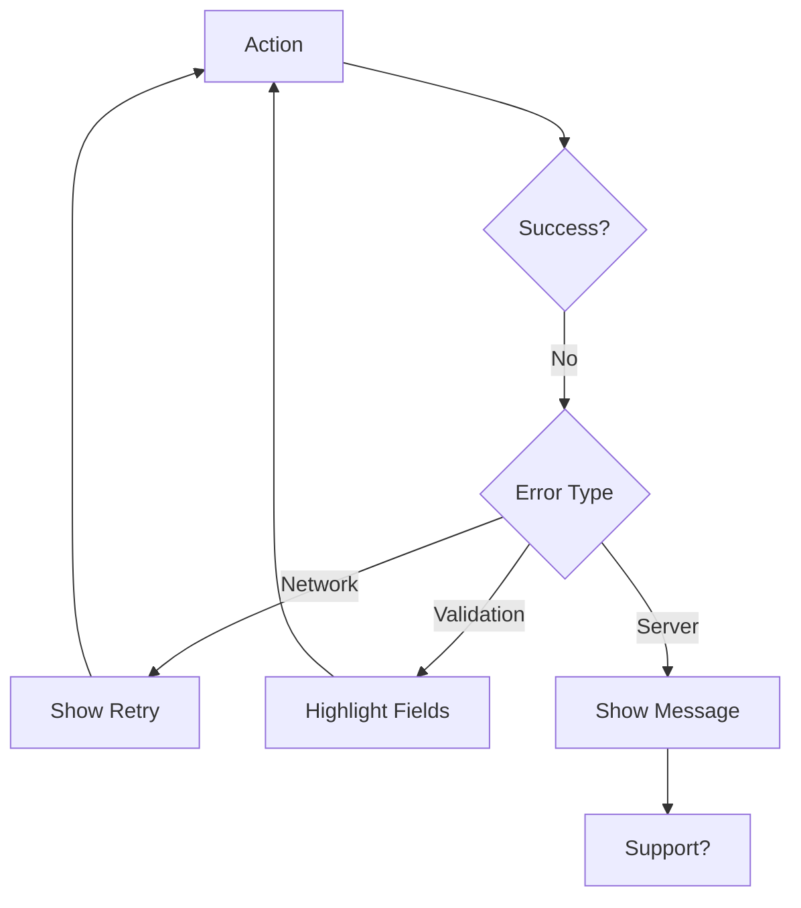

# UX Specification Template

```markdown
# [Product Name] UX Specification

| Property | Content |
|----------|---------|
| Document Version | V1.0 |
| Creation Date | [YYYY-MM-DD] |
| Based on PRD | [PRD Reference] |
| Author | [Name] |

---

## 1. Screen Inventory

### 1.1 Screen List

| Screen ID | Screen Name | Description | Priority |
|-----------|-------------|-------------|----------|
| S-001 | Home | Main dashboard | P0 |
| S-002 | [Name] | [Purpose] | P0/P1 |
| ... | ... | ... | ... |

### 1.2 Screen Details

#### S-001: [Screen Name]

| Property | Description |
|----------|-------------|
| Purpose | [What this screen does] |
| Access Path | [How to reach this screen] |
| Layout | [Screen layout description] |

**Elements:**
| Element | Type | Behavior |
|---------|------|----------|
| Header | Navigation Bar | Tap to go back |
| List | RecyclerView | Scroll, tap item |
| Button | Primary CTA | Tap to submit |

**Interactions:**
| Action | Response | Next Screen |
|--------|----------|-------------|
| Tap list item | Show detail | S-XXX |
| Pull down | Refresh data | - |
| Tap button | Submit form | S-XXX |

---

## 2. Navigation Structure

### 2.1 Navigation Type

- [ ] Tab Bar (Bottom Navigation)
- [ ] Drawer Navigation
- [ ] Stack Navigation
- [ ] Hybrid

### 2.2 Navigation Map

```
[Root Screen]
├── Tab 1
│   ├── Screen A
│   │   ├── Detail A1
│   │   └── Settings A
│   └── Screen B
├── Tab 2
│   ├── Screen C
│   └── Screen D
└── Profile
    ├── Settings
    └── Help
```

---

## 3. Interaction Patterns

### 3.1 Gestures

| Gesture | Screen Area | Action |
|---------|-------------|--------|
| Tap | Buttons/Items | Select/Submit |
| Long Press | List Items | Show context menu |
| Swipe Left | List Items | Delete/Reveal actions |
| Swipe Right | List Items | Favorite/Archive |
| Pull Down | Content Area | Refresh |
| Pinch | Images | Zoom in/out |

### 3.2 Animations

| Element | Animation | Duration |
|---------|-----------|----------|
| Screen Transition | Slide | 300ms |
| Modal | Slide Up | 250ms |
| Toast | Fade In/Out | 200ms |
| Loading | Spin/Pulse | Loop |

---

## 4. State Definitions

### 4.1 Screen States

| State | Description | Visual Indicator |
|-------|-------------|------------------|
| Default | Normal display | - |
| Loading | Fetching data | Spinner/Skeleton |
| Empty | No data | Empty illustration |
| Error | Request failed | Error message |
| Success | Action complete | Toast/Animation |

### 4.2 Component States

| Component | States |
|-----------|--------|
| Button | Default, Pressed, Disabled, Loading |
| Input | Empty, Focused, Filled, Error, Disabled |
| Card | Default, Selected, Pressed |

---

## 5. Error Handling

### 5.1 Error Types

| Error Type | User Message | Action |
|------------|--------------|--------|
| Network | "Connection failed" | Retry button |
| Validation | "Invalid input" | Highlight field |
| Server | "Something went wrong" | Support contact |
| Auth | "Session expired" | Redirect to login |

### 5.2 Error Flow



---

## 6. Responsive Design

| Breakpoint | Device | Layout |
|------------|--------|--------|
| < 480px | Mobile Portrait | Single column |
| 480-768px | Mobile Landscape | 2 columns |
| 768-1024px | Tablet | Grid layout |
| > 1024px | Desktop | Sidebar + Content |

---

**Review History**

| Version | Date | Changes |
|---------|------|---------|
| V1.0 | YYYY-MM-DD | Initial version |
```
