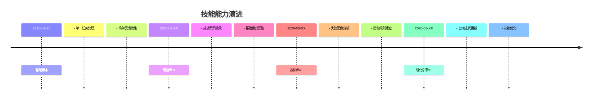

# 自我迭代进化代理 - 进化历史记录

## 进化日志格式

```yaml
迭代编号: EVO-YYYYMMDD-XXX
迭代时间: YYYY-MM-DD HH:MM:SS
触发任务: [任务标识]
迭代类型: 新增经验/新增教训/规则更新/知识重构
```

### 变更内容

**变更前**：
- 状态/知识/规则描述

**变更后**：
- 新的状态/知识/规则描述

### 变更原因

[为什么进行此次迭代]

### 影响评估

- 影响的经验/教训数量：X
- 影响的规则数量：X
- 预计效果提升：XX%

### 验证记录

- 验证方法：XXX
- 验证结果：通过/待验证
- 验证时间：YYYY-MM-DD

---

## 进化里程碑

| 日期 | 里程碑 | 说明 |
|------|--------|------|
| YYYY-MM-DD | 初始版本 | 技能创建 |
| YYYY-MM-DD | 经验库v1 | 收录首批X条经验 |
| YYYY-MM-DD | 教训库v1 | 收录首批X条教训 |
| YYYY-MM-DD | 规则引擎v1 | 建立决策规则体系 |

---

## 进化统计分析

### 迭代频率
- 每日平均迭代：X次
- 每周平均迭代：X次
- 每月平均迭代：X次

### 知识增长曲线
```
日期       经验数  教训数  规则数  成功率
YYYY-MM    X      X      X      XX%
YYYY-MM    X      X      X      XX%
YYYY-MM    X      X      X      XX%
```

### 高价值知识TOP10

1. **经验名称**
   - 类型：XXX
   - 使用次数：X
   - 成功率：XX%

2. **经验名称**
   - 类型：XXX
   - 使用次数：X
   - 成功率：XX%

### 警示教训TOP5

1. **教训名称**
   - 警示等级：高
   - 发生次数：X
   - 预防效果：XX%

---

## 能力演进轨迹



---

## 质量监控报告

### 知识库健康度

| 指标 | 当前值 | 目标值 | 状态 |
|------|--------|--------|------|
| 经验准确率 | XX% | >=90% | 正常/需改进 |
| 教训有效率 | XX% | >=85% | 正常/需改进 |
| 规则覆盖率 | XX% | >=80% | 正常/需改进 |
| 知识更新频率 | X次/周 | >=3次/周 | 正常/需改进 |

### 待处理事项

- [ ] 待验证经验：X条
- [ ] 待审核教训：X条
- [ ] 冲突规则检查：X对
- [ ] 过时知识清理：X条

---

## 未来进化计划

### 短期目标（1-4周）
- [ ] 目标1：XXX
- [ ] 目标2：XXX

### 中期目标（1-3月）
- [ ] 目标1：建立跨领域迁移能力
- [ ] 目标2：实现主动学习机制

### 长期愿景（3-6月）
- [ ] 目标1：形成完整的自我进化闭环
- [ ] 目标2：具备元认知能力
