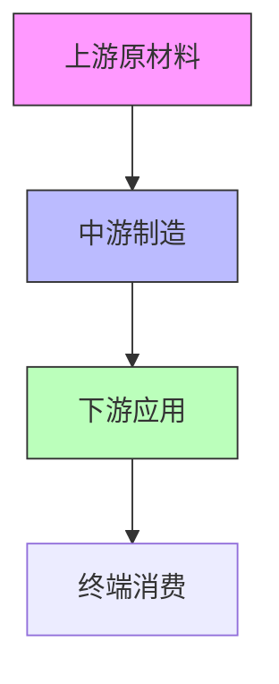

# 股市板块与产业链深度研究

## 核心能力

1. **多市场板块研究** - A股、港股、美股跨市场板块分析
2. **产业链深度剖析** - 上下游关系、供应链结构、价值链分布
3. **板块轮动追踪** - 资金流向、热点切换、配置时机
4. **龙头股挖掘** - 行业龙头、细分龙头、隐形冠军识别
5. **交易信号识别** - 资金信号、技术信号、量价信号识别
6. **报告自动生成** - 支持Markdown/HTML多格式报告输出
7. **数据可视化** - 自动生成图表、行业地图、竞争格局图
8. **双语研究支持** - 中英文搜索，信息全面覆盖

---

## 数据可视化

技能支持自动生成专业图表和概念图，用于直观展示分析结果。

### 支持的图表类型

| 图表类型 | 用途 | 输出格式 |
|---------|------|---------|
| **行业地图** | 产业链全景、上下游关系 | Mermaid SVG / PNG |
| **竞争格局图** | 市场集中度、竞争者分布 | Mermaid SVG / PNG |
| **资金流向图** | 主力资金、北向资金流向 | Mermaid SVG / PNG |
| **估值对比图** | 多市场、多指标估值对比 | Mermaid SVG / PNG |
| **轮动周期图** | 美林时钟、板块轮动节奏 | Mermaid SVG / PNG |
| **波特五力图** | 行业竞争强度雷达图 | Mermaid SVG / PNG |
| **时间序列图** | 历史估值、资金流向走势 | ASCII / SVG |

### 生成图表的Mermaid语法



### 图表自动生成流程

1. **数据分析** → 提取关键数据点
2. **模板匹配** → 选择合适的图表模板
3. **Mermaid生成** → 输出Mermaid语法
4. **渲染输出** → 生成SVG/PNG图表
5. **嵌入报告** → 图表插入研究报告

### 可视化示例

**产业链全景图**：
```
┌─────────────────────────────────────────────────────────────┐
│                     产业链结构                               │
├─────────────────────────────────────────────────────────────┤
│  [上游] 原材料/零部件                                       │
│    │                                                        │
│    ▼                                                        │
│  [中游] 生产制造                                            │
│    │                                                        │
│    ▼                                                        │
│  [下游] 终端应用                                            │
│    │                                                        │
│    ▼                                                        │
│  [配套] 服务支持                                            │
└─────────────────────────────────────────────────────────────┘
```

---

## 双语研究支持

技能支持中英文双语研究，确保信息全面性。

### 双语搜索策略

| 研究阶段 | 中文搜索 | 英文搜索 | 目的 |
|---------|---------|---------|------|
| 行业概况 | "新能源汽车行业" | "EV industry outlook" | 基础信息 |
| 政策分析 | "新能源汽车补贴政策" | "EV subsidies policy China" | 政策对比 |
| 市场数据 | "全球电动车销量" | "global EV sales 2024" | 数据交叉验证 |
| 公司研究 | "比亚迪公司分析" | "BYD company analysis" | 多角度分析 |
| 技术趋势 | "动力电池技术路线" | "battery technology roadmap" | 技术前沿 |

### 双语关键词对照表

| 领域 | 中文 | 英文 |
|-----|------|------|
| 板块/行业 | 板块、行业 | Sector, Industry |
| 产业链 | 产业链、供应链 | Industry Chain, Supply Chain |
| 估值 | 市盈率、估值 | PE Ratio, Valuation |
| 资金 | 主力资金、北向资金 | Institutional Flow, South/North Flow |
| 景气度 | 景气度、繁荣程度 | Prosperity, Business Cycle |
| 轮动 | 板块轮动、热点切换 | Sector Rotation, Style Rotation |

### 搜索执行流程

```
1. 确定研究主题（中英文）
   ↓
2. 并行执行双语搜索
   ├─ 中文搜索：multi-search-engine (CN)
   └─ 英文搜索：multi-search-engine (EN)
   ↓
3. 交叉验证信息
   ├─ 一致 → 置信度提升
   └─ 不一致 → 标注差异，需进一步核实
   ↓
4. 综合输出（可切换中英文）
```

---

## 数据可信度评级系统

### 可信度评级标准

| 评级 | 符号 | 定义 | 适用数据 |
|-----|------|------|---------|
| **官方权威** | ⭐⭐⭐ | 政府机构、交易所官方发布 | GDP、政策、交易数据 |
| **机构可信** | ⭐⭐ | 知名金融平台、研究机构 | 行业数据、估值数据 |
| **媒体参考** | ⭐ | 财经媒体、公开报道 | 新闻、分析文章 |
| **用户估算** | ⚠️ | 估算或推断数据 | 未经核实的数据 |
| **待核实** | ❓ | 来源不明或无法验证 | 匿名信息 |

### 来源标注格式（扩展）

```
[来源名称] [数据类型] [获取日期] [可信度评级]

示例：
东方财富 行业资金流向 2024-04-05 ⭐⭐
国家统计局 GDP数据 2024-Q1 ⭐⭐⭐
券商研报 行业预测 2024-03 ⭐⭐
```

### 可信度评级应用规则

| 数据可信度 | 可作为主要依据 | 可作为辅助依据 | 需特别说明 |
|-----------|--------------|--------------|-----------|
| ⭐⭐⭐ | ✅ 是 | ✅ 是 | 不需要 |
| ⭐⭐ | ✅ 是 | ✅ 是 | 建议标注 |
| ⭐ | ❌ 否 | ✅ 是 | 必须标注 |
| ⚠️ | ❌ 否 | ✅ 谨慎 | 必须标注+说明 |
| ❓ | ❌ 否 | ❌ 否 | 禁止使用 |

### 数据可信度检查清单

```markdown
## 数据可信度检查

| 数据项 | 来源 | 可信度 | 检查结果 |
|-------|------|-------|---------|
| 市场规模 | 东方财富 | ⭐⭐ | ✅ 可用 |
| 政策文件 | 国务院 | ⭐⭐⭐ | ✅ 可用 |
| 行业预测 | XX券商 | ⭐ | ⚠️ 需标注 |
| 市场传闻 | 匿名 | ❓ | ❌ 禁用 |
```

---

## 数据来源分类（扩展）

### 一级来源（最高可信度）

| 类别 | 来源 | 可信度 |
|-----|------|-------|
| 政府统计 | 国家统计局、央行、海关 | ⭐⭐⭐ |
| 交易所数据 | 上交所、深交所、港交所、纽交所 | ⭐⭐⭐ |
| 监管文件 | 证监会、银保监会、交易所公告 | ⭐⭐⭐ |
| 公司公告 | 年报、季报、招股说明书 | ⭐⭐⭐ |

### 二级来源（高可信度）

| 类别 | 来源 | 可信度 |
|-----|------|-------|
| 金融终端 | Wind资讯、Choice、同花顺iFind | ⭐⭐ |
| 官方平台 | 东方财富网、雪球、富途 | ⭐⭐ |
| 国际机构 | IMF、World Bank、IEA | ⭐⭐ |
| 行业协会 | 中国汽车工业协会、SEMI等 | ⭐⭐ |

### 三级来源（参考可信度）

| 类别 | 来源 | 可信度 |
|-----|------|-------|
| 财经媒体 | 21世纪经济报道、财新、彭博 | ⭐ |
| 券商研报 | 券商研究报告 | ⭐⭐（需交叉验证） |
| 咨询机构 | Gartner、IDC、McKinsey | ⭐⭐ |
| 社交媒体 | 论坛、自媒体 | ⚠️（慎用） |

---

## 数据可靠性与复核机制

### 核心原则

> **CRITICAL: 数据可靠性要求**
> - 所有数据必须来源于可靠、官方的数据源
> - **任何情况下都不得编造数据、数字或统计信息**
> - 每个数据点必须可追溯到具体来源
> - 如数据无法核实，必须明确标注"⚠️数据待核实"
> - 所有数据必须标注可信度评级

### 数据来源引用格式

```
[来源名称] [数据类型] [获取日期] [可信度评级]
```

**示例**：
- `东方财富 行业资金流向 2024-04-05 ⭐⭐`
- `国家统计局 GDP数据 2024-Q1 ⭐⭐⭐`
- `公司公告 年度报告 2024-04-01 ⭐⭐⭐`
- `Wind资讯 估值数据 2024-04-05 ⭐⭐`

### 禁止事项

- ❌ 禁止编造任何数据（包括百分比、金额、排名等）
- ❌ 禁止使用"大约"、"大概"、"估计"等模糊表述而不标注
- ❌ 禁止使用超过30天的陈旧数据作为主要依据
- ❌ 禁止将估算数据作为投资决策的主要依据
- ❌ 禁止使用可信度为❓的数据

---

## 报告复核机制

### 复核流程

```
生成报告 → 数据来源检查 → 数值核实 → 时效性检查 → 逻辑一致性检查 → 可信度评级检查 → 复核确认
```

### 复核清单（扩展）

| 检查项 | 检查内容 | 通过标准 |
|-------|---------|---------|
| ☐ 数据来源完整性 | 所有数据是否有来源标注 | 100%标注 |
| ☐ 数值准确性 | 关键数值是否经过核实 | 无明显错误 |
| ☐ 数据时效性 | 数据是否在有效期内 | 通常≤30天 |
| ☐ 逻辑一致性 | 各章节逻辑是否一致 | 无矛盾 |
| ☐ 风险揭示充分性 | 风险提示是否完整 | 无重大遗漏 |
| ☐ 可信度评级完整性 | 所有数据是否都有可信度评级 | 100%标注 |

### 复核输出格式

```markdown
## 复核确认

| 检查项 | 状态 | 说明 |
|-------|------|------|
| 数据来源完整性 | ✅ 通过 / ⚠️ 需补充 | - |
| 数值准确性 | ✅ 通过 / ⚠️ 待核实 | - |
| 数据时效性 | ✅ 有效 / ⚠️ 已过期 | - |
| 逻辑一致性 | ✅ 一致 / ⚠️ 需检查 | - |
| 风险揭示充分性 | ✅ 充分 / ⚠️ 需补充 | - |
| 可信度评级完整性 | ✅ 通过 / ⚠️ 需补充 | - |

**可信度分布**:
- ⭐⭐⭐ 官方权威: X条
- ⭐⭐ 机构可信: X条
- ⭐ 媒体参考: X条
- ⚠️ 用户估算: X条（需谨慎）

**复核结论**: ✅ 通过 / ⚠️ 需修正 / ⚠️ 数据待核实
```

---

## 自动化工具

技能包含以下自动化脚本，位于 `scripts/` 目录：

| 脚本 | 功能 | 使用方法 |
|-----|------|---------|
| `fetch_market_data.py` | 获取市场板块数据 | `python fetch_market_data.py` |
| `analyze_sector.py` | 板块多维度分析 | `python analyze_sector.py` |
| `compare_markets.py` | 跨市场对比分析 | `python compare_markets.py` |
| `generate_report.py` | 生成研究报告（含复核） | `python generate_report.py` |
| `generate_chart.py` | 生成可视化图表 | `python generate_chart.py` |

### generate_chart.py 功能

```python
from generate_chart import ChartGenerator

chart = ChartGenerator()

# 生成产业链图
chart.industry_chain(
    sectors=["原材料", "制造", "应用", "服务"],
    relationships=[("原材料", "制造"), ("制造", "应用")],
    output="industry_chain.svg"
)

# 生成竞争格局图
chart.competition_landscape(
    companies=[("公司A", 30), ("公司B", 25), ("公司C", 15)],
    output="competition.svg"
)

# 生成资金流向图
chart.capital_flow(
    flows=[("北向", 50), ("主力", -30), ("杠杆", 20)],
    output="capital.svg"
)
```

---

## 工作流程

### 步骤1：确定研究范围

确认以下关键信息：
- **目标市场**：A股 / 港股 / 美股 / 跨市场
- **研究深度**：板块概览 / 深度产业链 / 投资机会
- **具体板块**：单一板块 / 跨板块对比 / 全行业扫描
- **语言偏好**：中文 / 英文 / 双语

### 步骤2：自动实时数据搜索（强制执行）

> **⚠️ 重要**：所有数据必须通过 `multi-search-engine` 实时获取，禁止使用缓存或陈旧数据！

#### 搜索工具调用规范

**必须使用的搜索工具**：`multi-search-engine`

```python
# 使用示例：并行双语搜索
queries = [
    # 中文搜索
    {"query": "新能源汽车板块 资金流向 2024", "num_results": 10},
    {"query": "A股 板块轮动 最新", "num_results": 10},
    {"query": "比亚迪 宁德时代 最新消息", "num_results": 10},
    # 英文搜索
    {"query": "EV sector capital flow 2024", "num_results": 10},
    {"query": "China A-share sector rotation", "num_results": 10},
]
```

#### 自动搜索执行流程

```
┌─────────────────────────────────────────────────────────────┐
│              自动数据搜索流程 (强制执行)                      │
├─────────────────────────────────────────────────────────────┤
│                                                             │
│  1️⃣ 确定搜索关键词                                         │
│     ├─ 中文关键词 × 5-10条                                  │
│     └─ 英文关键词 × 5-10条                                  │
│                                                             │
│  2️⃣ 并行调用 multi-search-engine                           │
│     ├─ batch_web_search (queries)                          │
│     │   └─ 一次调用最多10个查询                             │
│     └─ 数据范围：当日或最近7日内                             │
│                                                             │
│  3️⃣ 提取关键数据点                                         │
│     ├─ 资金流向数据                                         │
│     ├─ 估值数据                                             │
│     ├─ 政策动态                                             │
│     └─ 行业新闻                                             │
│                                                             │
│  4️⃣ 来源记录与可信度评级                                    │
│     └─ [来源] [数据类型] [日期] [评级]                      │
│                                                             │
└─────────────────────────────────────────────────────────────┘
```

#### 搜索关键词生成规则

| 数据类型 | 中文搜索词 | 英文搜索词 |
|---------|-----------|-----------|
| 板块行情 | "XX板块 今日行情 资金流向" | "XX sector today capital flow" |
| 行业数据 | "XX行业 最新数据 统计" | "XX industry latest statistics" |
| 政策动态 | "XX行业 政策 最新" | "XX policy latest update" |
| 公司动态 | "XX公司 最新公告 业绩" | "XX company latest news" |
| 资金流向 | "北向资金 今日 净买入" | "Northbound flow today net buy" |
| 估值分析 | "XX板块 PE估值 历史分位" | "XX sector PE valuation percentile" |

#### 数据采集记录模板

| 数据类型 | 来源平台 | 获取日期 | 可信度 | URL |
|---------|---------|---------|-------|-----|
| 行业资金流向 | 东方财富 | 2024-04-05 | ⭐⭐ | data.eastmoney.com |
| 估值数据 | Wind资讯 | 2024-04-05 | ⭐⭐ | wind.com.cn |
| 政策文件 | 国务院/发改委 | 2024-04-05 | ⭐⭐⭐ | gov.cn |

#### 搜索结果处理规范

```markdown
## 搜索结果记录

### 搜索1：新能源汽车板块资金流向
- **搜索时间**: 2024-04-05 19:00
- **搜索平台**: multi-search-engine
- **数据可信度**: ⭐⭐
- **关键数据**:
  - 主力净流入: XX亿 [来源] [日期]
  - 北向净买入: XX亿 [来源] [日期]
- **原始链接**: [URL列表]

### 搜索2：...
```

#### 搜索质量检查

- [ ] 搜索结果时间戳为当日或近7日内
- [ ] 每个数据点都有对应来源
- [ ] 中英文搜索结果进行交叉验证
- [ ] 关键数据有多来源确认

### 步骤3：多维度分析

执行以下分析模块：

1. **波特五力分析** - 评估行业竞争强度
2. **政策影响评估** - 分析政策对板块的影响
3. **资金流向追踪** - 主力资金、北向资金、融资融券
4. **估值分析** - PE/PB历史分位、跨市场对比

### 步骤4：生成可视化图表

```bash
# 生成产业链全景图
python scripts/generate_chart.py --type industry_chain --sector EV

# 生成竞争格局图
python scripts/generate_chart.py --type competition --sector EV

# 生成资金流向图
python scripts/generate_chart.py --type capital_flow --market A
```

### 步骤5：生成研究报告

使用脚本生成专业报告：

```bash
# 生成Markdown报告（自动复核）
python scripts/generate_report.py --sector 新能源汽车 --format markdown

# 生成HTML报告（含图表）
python scripts/generate_report.py --sector 新能源汽车 --format html --include-charts
```

### 步骤6：报告复核（强制）

> **⚠️ 警告**：报告生成后必须经过复核机制检查，确认无误后再输出！

复核检查清单：
- [ ] 所有数据都有来源标注
- [ ] 所有数据都有可信度评级
- [ ] 关键数值已交叉核实
- [ ] 数据在有效期内
- [ ] 各章节逻辑一致
- [ ] 风险提示完整充分
- [ ] 无"待核实"、"待补充"等未完成内容

---

## 分析框架

### 波特五力分析
| 五力 | 评估要点 |
|-----|---------|
| 供应商议价能力 | 集中度、替代供应、前向整合 |
| 购买者议价能力 | 买方数量、转换成本、后向整合 |
| 新进入者威胁 | 规模经济，品牌认知、政策壁垒 |
| 替代品威胁 | 替代品性价比、用户转换成本 |
| 行业内竞争 | 竞争者数量、行业增速、退出壁垒 |

### 美林时钟模型
```
复苏期 → 股票 > 债券 → 周期性行业受益
过热期 → 大宗商品 > 股票 → 原材料能源
滞胀期 → 现金 > 大宗商品 → 防御性行业
衰退期 → 债券 > 现金 > 股票 → 公用事业
```

### 资金流向框架
- 主力资金净流入 > 5日连续正向 = 机构吸筹信号
- 北向资金单日净买入 > 50亿 = 外资看多信号
- 融资余额创新高 + 股价上涨 = 多头信号确认

---

## 触发场景

| 用户需求 | 执行流程 |
|---------|---------|
| "分析新能源车板块" | **实时搜索** → 板块概览 → 产业链分析 → 龙头挖掘 → **图表生成** → **报告复核** → 报告输出 |
| "港股科技股和美股对比" | **实时搜索** → 跨市场数据获取 → 估值对比 → **双语研究** → **报告复核** → 报告输出 |
| "半导体产业链机会" | **实时搜索** → 产业链图谱 → 波特五力 → 国产替代分析 → **可视化** → **报告复核** → 报告输出 |
| "最近哪些板块在轮动" | **实时搜索** → 资金流向追踪 → 热点分析 → 轮动规律 → **资金流向图** → **报告复核** → 报告输出 |
| "帮我找军工龙头股" | **实时搜索** → 龙头识别框架 → 竞争分析 → 估值对比 → **竞争格局图** → **报告复核** → 报告输出 |

---

## 参考资源

技能包含丰富的参考文档，位于 `references/` 目录：

| 文件 | 内容 |
|-----|------|
| `market-codes.md` | A股/港股/美股数据源及板块分类 |
| `analysis-frameworks.md` | 产业链分析、波特五力、板块轮动框架 |
| `industry-cases.md` | 新能源、半导体、医药、消费电子实战案例 |
| `data-sources-api.md` | 数据源API接口文档及代码示例 |
| `trading-signals.md` | 交易信号识别指南及信号组合 |

---

## 提示词模板库

技能包含标准化的提示词模板，使用者只需简单填空即可开展研究，位于 `prompts/` 目录：

| 文件 | 用途 | 使用场景 |
|-----|------|---------|
| `master-template.md` | 通用母模板 | A股/港股/美股通用 |
| `a-share-template.md` | A股特色模板 | 研究A股板块 |
| `hk-stock-template.md` | 港股特色模板 | 研究港股板块 |
| `us-stock-template.md` | 美股特色模板 | 研究美股板块 |
| `tech-sector-template.md` | 科技/互联网模板 | 研究科技/互联网板块 |
| `consumer-sector-template.md` | 消费板块模板 | 研究消费板块 |
| `new-energy-template.md` | 新能源/制造模板 | 研究新能源/高端制造 |
| `sector-rotation-template.md` | 板块轮动与景气度模板 | 轮动分析、景气排名、交易机会筛选 |
| `quick-start-guide.md` | 快速调用指南 | 模板选择和快捷指令 |

### 双语研究模板

```markdown
# 双语板块研究
请用中英文双语研究以下板块：

## 研究主题
[板块名称]

## 研究要求
1. 英文搜索关键词：[English keywords]
2. 中文搜索关键词：[中文关键词]
3. 交叉验证信息差异
4. 输出一份双语研究报告

## 输出格式
### 中文分析
[中文内容]

### English Analysis
[English content]

### 信息差异对比
[列出中英文信息不一致之处及原因]
```

---

## 模板文件

模板文件位于 `assets/templates/`：

| 文件 | 用途 |
|-----|------|
| `sector-research-template.md` | 完整研究报告模板（含复核清单） |
| `industry-chain-template.md` | 产业链图谱绘制模板 |

---

## 注意事项

1. **数据可视化** - 优先使用图表展示关键数据，提升报告可读性
2. **双语研究** - 重要信息需中英文对照，确保全面性
3. **可信度评级** - 所有数据必须标注可信度，不可使用❓级数据
4. **数据可靠性** - 所有数据必须来源可靠，**禁止编造**
5. **报告复核** - 生成报告后必须经过复核机制检查
6. **时效性** - 股票研究必须基于最新数据，定期更新
7. **风险揭示** - 明确标注投资风险，不做确定性承诺

---

## 版本信息

- **版本**: 7.0.0
- **更新日期**: 2024-04-05
- **核心更新**: 自动调用 multi-search-engine 实时获取数据
