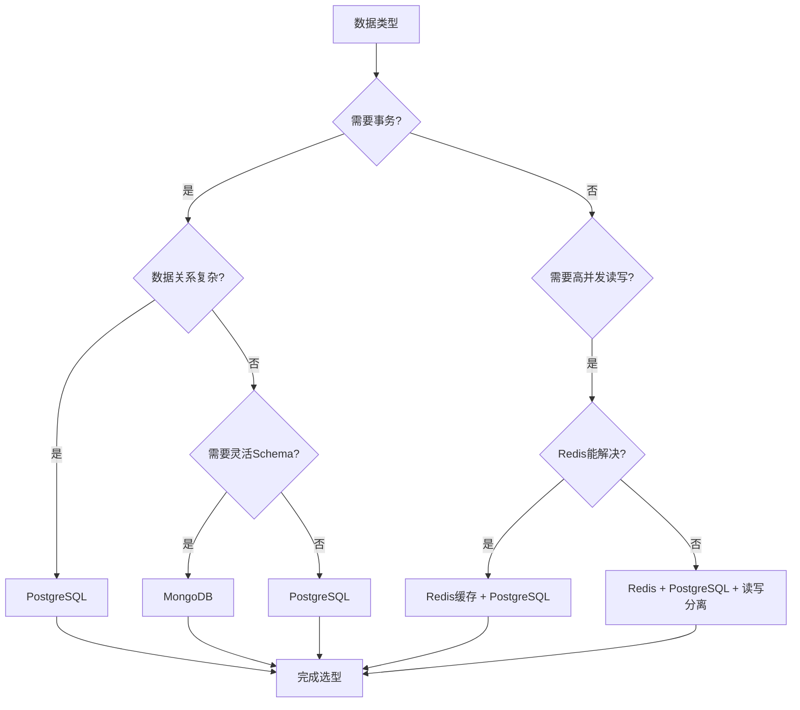

---
AIGC:
    ContentProducer: Minimax Agent AI
    ContentPropagator: Minimax Agent AI
    Label: AIGC
    ProduceID: da8e9f4d4bd78ae041215369a709569c
    PropagateID: da8e9f4d4bd78ae041215369a709569c
    ReservedCode1: 3044022018b1c06bd6f8a60692ea7a5d92a453ef43feb25594d4580a002b5d07162a4f1402200a364453f7ef8e4e090fd324a067fc61ffae20b1108991910cf0ff3095ad42b8
    ReservedCode2: 3045022100bc533f4ae55f0ae8d283c2603cb3efe660e18cb2d37dbfb9853d8d3a77ffa33b02205d03a56a9c3a43a75f09ca859cda77ccd28f3bb9f536d2a7a2ae274d27754037
description: 专业技术架构设计技能。当用户需要设计技术方案时使用，包括：创建PRD产品需求文档、设计技术架构（微服务/前后端分离）、设计数据库（PostgreSQL/MySQL/Redis/Elasticsearch）、制定部署方案（Kubernetes/Docker）、制定运维方案（监控/告警/备份）。触发短语：设计技术架构、创建技术方案、设计数据库、制定部署方案、制定运维方案、技术方案文档。
name: tech-architecture-designer
---

# 技术架构设计师

> 专业的技术架构设计技能，为产品提供完整的技术方案支持

## 技能概述

本技能为技术架构师提供一站式技术方案设计能力，涵盖从产品需求到技术落地的完整文档输出。

## 核心能力

### 1. PRD 产品需求文档

**输出内容**：

- 产品愿景与定位
- 用户画像与旅程地图
- 功能模块清单与优先级
- 非功能需求（性能、安全、兼容性）
- 验收标准与里程碑计划

**文档模板**：

```markdown
## 1. 产品概述

### 1.1 产品名称与愿景

**产品名称**: [产品名称]

**产品愿景**: 用一句话描述产品的核心价值和长远目标

### 1.2 产品定位

**一句话定位**: [简明扼要的产品定位]

**目标市场**: [目标市场描述]

**核心差异化**: [与竞品的核心区别]

## 2. 用户分析

### 2.1 目标用户画像

| 属性 | 描述 |
|------|------|
| 人口特征 | 年龄、职业、地区 |
| 行为特征 | 使用频率、付费意愿 |
| 目标与痛点 | 用户目标、核心驱动力、当前困扰 |

## 3. 功能需求

### 3.1 功能优先级矩阵 (MoSCoW)

| 优先级 | 定义 | 功能列表 |
|--------|------|----------|
| Must Have | 必须有 | [核心功能] |
| Should Have | 应该有 | [重要功能] |
| Could Have | 可以有 | [增强功能] |
| Won't Have | 不会有 | [后续考虑] |

## 4. 验收标准

| 阶段 | 交付日期 | 交付内容 |
|------|----------|----------|
| M1 需求确认 | YYYY-MM-DD | PRD文档 |
| M2 技术设计 | YYYY-MM-DD | 架构设计 |
| M3 开发完成 | YYYY-MM-DD | 可测试版本 |
| M4 上线发布 | YYYY-MM-DD | 正式版本 |
```

### 2. 技术架构设计

**架构模式选择**：

| 场景 | 推荐架构 | 说明 |
|------|----------|------|
| 小型项目 (<1万用户) | 单体架构 + MVC | 快速开发、维护简单 |
| 中型项目 (1-100万用户) | 微服务架构 | 解耦、独立扩展 |
| 大型项目 (100万+用户) | 云原生微服务 | 高可用、弹性伸缩 |
| 企业级 | 分布式微服务 | 多地域、多活架构 |

**技术栈推荐**：

#### 前端技术栈

| 选项 | 技术选型 | 适用场景 |
|------|----------|----------|
| 选项A | React 18 + TypeScript + Ant Design | 企业级后台系统 |
| 选项B | Vue 3 + TypeScript + Element Plus | 快速原型开发 |
| 选项C | Next.js + Tailwind CSS | SSR应用、SEO优先 |

#### 后端技术栈

| 选项 | 技术选型 | 适用场景 |
|------|----------|----------|
| 选项A | Spring Boot 3.x + MyBatis-Plus | Java技术栈团队 |
| 选项B | NestJS + TypeORM | Node.js技术栈 |
| 选项C | Go + GORM + Gin | 高性能需求 |

#### 数据库技术栈

| 类型 | 推荐选型 | 说明 |
|------|----------|------|
| 关系型 | PostgreSQL 15 | 功能丰富、扩展性强 |
| 缓存 | Redis 7 Cluster | 高性能、支持集群 |
| 搜索引擎 | Elasticsearch 8 | 全文检索、聚合分析 |
| 文档存储 | MongoDB 4.4 | 灵活Schema |

#### 基础设施

| 组件 | 推荐选型 | 说明 |
|------|----------|------|
| 容器化 | Docker + Kubernetes | 标准化交付 |
| CI/CD | GitLab CI + ArgoCD | 自动化部署 |
| 监控 | Prometheus + Grafana | 可观测性 |
| 日志 | ELK Stack / Loki | 日志分析 |
| 链路追踪 | Jaeger | 分布式追踪 |

### 3. 数据库设计

**数据库选型决策树**：



**表结构设计规范**：

```sql
-- 标准表结构模板
CREATE TABLE table_name (
    id UUID PRIMARY KEY DEFAULT gen_random_uuid(),

    -- 业务字段
    name VARCHAR(100) NOT NULL,
    description TEXT,
    status VARCHAR(20) DEFAULT 'active',

    -- 审计字段
    created_at TIMESTAMP WITH TIME ZONE DEFAULT CURRENT_TIMESTAMP,
    updated_at TIMESTAMP WITH TIME ZONE DEFAULT CURRENT_TIMESTAMP,
    deleted_at TIMESTAMP WITH TIME ZONE,

    -- 约束
    CONSTRAINT uk_name UNIQUE (name),
    CONSTRAINT chk_status CHECK (status IN ('active', 'inactive', 'deleted'))
);

-- 标准索引
CREATE INDEX idx_table_name_status ON table_name(status);
CREATE INDEX idx_table_name_created_at ON table_name(created_at DESC);

-- 注释
COMMENT ON TABLE table_name IS '表描述';
COMMENT ON COLUMN table_name.name IS '名称';
```

**数据库规范**：

| 规范类型 | 要求 |
|----------|------|
| 命名规范 | 小写+下划线，复数形式 |
| 字段类型 | UUID主键、UTC时间、金额用分 |
| 索引规范 | 选择性高字段、覆盖索引、联合索引 |
| 安全规范 | 参数化查询、敏感数据加密 |
| 备份规范 | 每日全量、增量6小时、异地90天 |

### 4. 部署方案

**Kubernetes 部署架构**：

```yaml
# 标准 Deployment 模板
apiVersion: apps/v1
kind: Deployment
metadata:
  name: {service-name}
  namespace: {namespace}
  labels:
    app: {service-name}
spec:
  replicas: {replicas}
  selector:
    matchLabels:
      app: {service-name}
  strategy:
    type: RollingUpdate
    rollingUpdate:
      maxSurge: 25%
      maxUnavailable: 0
  template:
    metadata:
      labels:
        app: {service-name}
    spec:
      containers:
      - name: {service-name}
        image: {registry}/{service-name}:{version}
        ports:
        - name: http
          containerPort: 8080
        resources:
          requests:
            cpu: 100m
            memory: 256Mi
          limits:
            cpu: 1000m
            memory: 2Gi
        livenessProbe:
          httpGet:
            path: /actuator/health/liveness
            port: 8080
          initialDelaySeconds: 60
        readinessProbe:
          httpGet:
            path: /actuator/health/readiness
            port: 8080
          initialDelaySeconds: 30
```

**CI/CD 流水线模板**：

```yaml
# GitLab CI 模板
stages:
  - build
  - test
  - deploy

build:
  stage: build
  image: maven:3.9-eclipse-temurin-17
  script:
    - mvn clean package -DskipTests
    - docker build -t $REGISTRY/$SERVICE:$CI_COMMIT_SHA .
    - docker push $REGISTRY/$SERVICE:$CI_COMMIT_SHA
  only:
    - main

test:
  stage: test
  image: maven:3.9-eclipse-temurin-17
  script:
    - mvn test
  coverage: '/Total coverage: \d+\.\d+%/'

deploy:
  stage: deploy
  image: bitnami/kubectl:latest
  script:
    - kubectl set image deployment/$SERVICE $SERVICE=$REGISTRY/$SERVICE:$CI_COMMIT_SHA -n production
    - kubectl rollout status deployment/$SERVICE -n production
  only:
    - main
  when: manual
```

### 5. 运维方案

**监控指标体系**：

| 监控层级 | 核心指标 | 告警阈值 |
|----------|----------|----------|
| 基础设施 | CPU/内存/磁盘使用率 | > 80% 告警 |
| 应用层 | QPS、响应时间、错误率 | P99 > 500ms |
| 数据库 | 连接数、查询延迟、缓存命中率 | 连接 > 70% |
| 业务层 | DAU、订单量、转化率 | 异常波动 > 50% |

**告警等级定义**：

| 等级 | 名称 | 响应时间 | 通知方式 |
|------|------|----------|----------|
| P0 | 紧急 | 5分钟 | 电话+短信+企微 |
| P1 | 严重 | 15分钟 | 短信+企微 |
| P2 | 警告 | 30分钟 | 企微+邮件 |
| P3 | 提示 | 2小时 | 邮件 |

**备份恢复策略**：

| 备份类型 | 频率 | 保留时间 | 存储位置 |
|----------|------|----------|----------|
| 全量备份 | 每日 | 30天 | 本地+OSS |
| 增量备份 | 每6小时 | 7天 | 本地+OSS |
| 实时备份 | 持续 | - | 从库流复制 |
| 跨区域备份 | 每日 | 90天 | 异地OSS |

## 输出文档结构

```
{project-name}/
├── SKILL.md                    # 技能入口文件
├── _meta.json                  # 技能元数据
│
├── docs/                       # 技术文档目录
│   ├── 00-文档索引.md           # 文档总览
│   ├── 01-PRD产品需求文档.md    # PRD文档
│   ├── 02-技术架构设计.md       # 架构设计
│   ├── 03-数据库设计.md         # 数据库设计
│   ├── 04-部署方案.md           # 部署方案
│   └── 05-运维方案.md           # 运维方案
│
├── templates/                  # 模板目录
│   ├── prd-template.md         # PRD模板
│   ├── db-migration/           # 数据库迁移
│   └── k8s-templates/          # K8s配置模板
│
└── diagrams/                    # 架构图目录
    ├── architecture.mmd        # 架构图
    ├── flow.mmm                # 流程图
    └── er.mmd                  # ER图
```

## 使用流程

### 1. 需求收集

通过交互表单收集：

- **产品类型**：Web应用/移动App/SaaS平台/电商平台/AI服务
- **业务规模**：小型/中型/大型/企业级
- **核心功能**：用户系统/支付/搜索/AI集成/工作流
- **技术偏好**：现代化/平衡/保守方案
- **云服务商**：阿里云/腾讯云/AWS/私有化

### 2. 方案生成

自动生成以下文档：

1. **PRD文档** - 产品需求分析
2. **架构设计** - 技术栈选型与架构图
3. **数据库设计** - ER图与DDL脚本
4. **部署方案** - K8s配置与CI/CD
5. **运维方案** - 监控告警与备份策略

### 3. 输出交付

- 完整 Markdown 文档
- Mermaid 架构图
- SQL 建表脚本
- YAML 配置文件
- 可部署的技术方案

## 质量保证

### 检查清单

| 检查项 | PRD | 架构 | 数据库 | 部署 | 运维 |
|--------|-----|------|--------|------|------|
| 产品愿景清晰 | ✅ | - | - | - | - |
| 用户画像完整 | ✅ | - | - | - | - |
| 功能无遗漏 | ✅ | - | - | - | - |
| 架构可扩展 | - | ✅ | - | - | - |
| 技术选型合理 | - | ✅ | - | - | - |
| 表结构规范 | - | - | ✅ | - | - |
| 索引设计优化 | - | - | ✅ | - | - |
| 部署高可用 | - | - | - | ✅ | - |
| 监控覆盖全 | - | - | - | - | ✅ |
| 告警及时准确 | - | - | - | - | ✅ |

### 最佳实践

1. **架构设计**
   - 遵循 SOLID 原则
   - 服务边界清晰
   - 异步解耦优先
   - 缓存无处不在

2. **数据库设计**
   - 第一范式起步，按需反规范化
   - 索引不是越多越好
   - 连接池合理配置
   - 定期分析慢查询

3. **部署运维**
   - 配置与代码分离
   - 环境一致性
   - 灰度发布策略
   - 故障快速恢复

## 模板资源

### PRD 模板

完整的产品需求文档模板，参见：[PRD模板](./templates/prd-template.md)

### 数据库模板

标准建表脚本模板，参见：[数据库模板](./templates/db-migration/)

### K8s 部署模板

Kubernetes 部署配置模板，参见：[K8s模板](./templates/k8s-templates/)

## 相关技能

- `pptx-generator` - 生成技术方案演示PPT
- `minimax-docx` - 导出为Word文档
- `minimax-pdf` - 导出为PDF报告
- `prd-design` - PRD设计专项技能
- `pptx-generator` - PPT生成技能

## 版本信息

| 版本 | 日期 | 说明 |
|------|------|------|
| V1.0 | 2026-03-29 | 初始版本，完整技术方案能力 |

---

**作者**: MiniMax Agent

**使用场景**: 产品技术方案设计、项目架构规划、技术选型决策
