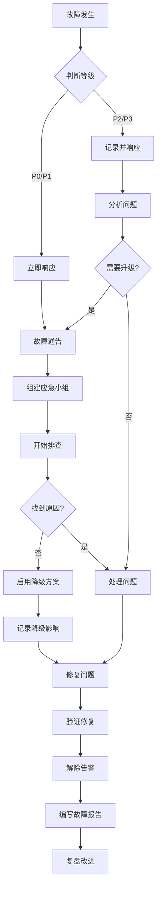

# Agent Skills 平台运维方案

---

## 1. 运维体系概述

### 1.1 运维目标

| 目标 | 描述 | 量化指标 |
|------|------|----------|
| **高可用** | 系统持续稳定运行 | 可用性 ≥ 99.9% |
| **高性能** | 快速响应用户请求 | P99响应时间 ≤ 500ms |
| **安全合规** | 数据安全与合规 | 安全事件 0 发生 |
| **快速恢复** | 故障快速恢复 | MTTR ≤ 30分钟 |
| **持续优化** | 持续改进系统性能 | 每季度优化 10% |

### 1.2 运维组织架构

```
┌─────────────────────────────────────────────────────────────┐
│                      运维组织架构                             │
├─────────────────────────────────────────────────────────────┤
│                                                             │
│                      ┌─────────────────┐                    │
│                      │    运维总监     │                    │
│                      └────────┬────────┘                    │
│                               │                             │
│            ┌─────────────────┼─────────────────┐            │
│            │                 │                 │            │
│      ┌─────▼─────┐    ┌─────▼─────┐    ┌─────▼─────┐      │
│      │  SRE团队   │    │ 安全团队   │    │  DBA团队   │      │
│      │ (3人)     │    │ (2人)     │    │ (2人)     │      │
│      └─────┬─────┘    └─────┬─────┘    └─────┬─────┘      │
│            │                 │                 │            │
│      ┌─────▼─────┐    ┌─────▼─────┐    ┌─────▼─────┐      │
│      │ 运维工程师 │    │ 安全工程师 │    │ 数据库工程师│      │
│      │ (6人)     │    │ (2人)     │    │ (3人)     │      │
│      └───────────┘    └───────────┘    └───────────┘      │
│                                                             │
└─────────────────────────────────────────────────────────────┘
```

### 1.3 运维值班制度

| 班次 | 时间 | 值班方式 | 响应时效 |
|------|------|----------|----------|
| 白天班 | 09:00-18:00 | 7x8在线 | 5分钟内响应 |
| 晚班 | 18:00-09:00 | 7x24待命 | 15分钟内响应 |
| 周末班 | 全天 | 7x24待命 | 30分钟内响应 |

---

## 2. 监控体系

### 2.1 监控层次架构

```
┌─────────────────────────────────────────────────────────────────────────┐
│                           监控层次架构                                    │
├─────────────────────────────────────────────────────────────────────────┤
│                                                                         │
│  ┌─────────────────────────────────────────────────────────────────┐  │
│  │                        业务层监控                                 │  │
│  │  • DAU/WAU/MAU • GMV/订单量 • 转化率 • 核心流程成功率              │  │
│  └─────────────────────────────────────────────────────────────────┘  │
│                                  │                                       │
│  ┌─────────────────────────────────────────────────────────────────┐  │
│  │                        应用层监控                                 │  │
│  │  • QPS/TPS • 响应时间(P50/P90/P99) • 错误率 • JVM/GC             │  │
│  └─────────────────────────────────────────────────────────────────┘  │
│                                  │                                       │
│  ┌─────────────────────────────────────────────────────────────────┐  │
│  │                        中间件监控                                 │  │
│  │  • 连接池 • 队列深度 • 缓存命中率 • 消息积压                      │  │
│  └─────────────────────────────────────────────────────────────────┘  │
│                                  │                                       │
│  ┌─────────────────────────────────────────────────────────────────┐  │
│  │                        基础设施监控                               │  │
│  │  • CPU/内存/磁盘 • 网络IO • Pod状态 • Node健康                    │  │
│  └─────────────────────────────────────────────────────────────────┘  │
│                                                                         │
└─────────────────────────────────────────────────────────────────────────┘
```

### 2.2 核心监控指标

#### 2.2.1 基础设施指标

| 指标名称 | 计算方式 | 阈值 | 告警级别 |
|----------|----------|------|----------|
| CPU使用率 | cpu_usage / cpu_total * 100 | > 80% 持续5分钟 | Warning |
| CPU使用率 | cpu_usage / cpu_total * 100 | > 95% 持续2分钟 | Critical |
| 内存使用率 | mem_used / mem_total * 100 | > 85% 持续5分钟 | Warning |
| 内存使用率 | mem_used / mem_total * 100 | > 95% 持续2分钟 | Critical |
| 磁盘使用率 | disk_used / disk_total * 100 | > 80% | Warning |
| 磁盘使用率 | disk_used / disk_total * 100 | > 90% | Critical |
| Pod重启次数 | pod_restart_count | > 3次/小时 | Warning |
| Pod重启次数 | pod_restart_count | > 10次/小时 | Critical |

#### 2.2.2 应用层指标

| 指标名称 | 计算方式 | 阈值 | 告警级别 |
|----------|----------|------|----------|
| HTTP请求量 | http_requests_total | 异常波动 > 50% | Warning |
| HTTP错误率 | http_errors / http_requests * 100 | > 1% | Warning |
| HTTP错误率 | http_errors / http_requests * 100 | > 5% | Critical |
| 平均响应时间 | avg(response_time) | > 200ms | Warning |
| P99响应时间 | quantile(0.99, response_time) | > 500ms | Warning |
| P99响应时间 | quantile(0.99, response_time) | > 1000ms | Critical |
| GC频率 | gc_count / minute | > 10次/分钟 | Warning |
| Full GC次数 | full_gc_count | > 1次/小时 | Critical |

#### 2.2.3 数据库指标

| 指标名称 | 计算方式 | 阈值 | 告警级别 |
|----------|----------|------|----------|
| 连接数使用率 | connections_used / connections_max * 100 | > 70% | Warning |
| 连接数使用率 | connections_used / connections_max * 100 | > 90% | Critical |
| 查询延迟 | avg_query_time | > 100ms | Warning |
| 慢查询数量 | slow_query_count | > 10/分钟 | Warning |
| 复制延迟 | replication_lag | > 5秒 | Warning |
| 复制延迟 | replication_lag | > 30秒 | Critical |
| 缓存命中率 | cache_hits / total_requests * 100 | < 80% | Warning |

#### 2.2.4 业务层指标

| 指标名称 | 计算方式 | 阈值 | 告警级别 |
|----------|----------|------|----------|
| 用户注册量 | user_register_count / hour | 异常波动 > 80% | Warning |
| 订单创建量 | order_create_count / hour | 异常波动 > 50% | Warning |
| 支付成功率 | payment_success / payment_total * 100 | < 95% | Warning |
| 支付成功率 | payment_success / payment_total * 100 | < 90% | Critical |
| 技能发布量 | skill_publish_count / hour | 异常波动 > 70% | Warning |

### 2.3 Grafana 监控面板

```yaml
# Grafana Dashboard 配置
apiVersion: v1
kind: ConfigMap
metadata:
  name: grafana-dashboard-skills-platform
  namespace: monitoring
data:
  skills-platform-overview.json: |
    {
      "dashboard": {
        "title": "Skills Platform Overview",
        "uid": "skills-platform-overview",
        "panels": [
          {
            "title": "系统健康状态",
            "type": "stat",
            "gridPos": {"h": 6, "w": 6, "x": 0, "y": 0},
            "targets": [
              {"expr": "up{service=~\".+\"}", "refId": "A"}
            ],
            "options": {
              "colorMode": "background",
              "graphMode": "none"
            }
          },
          {
            "title": "请求量趋势",
            "type": "timeseries",
            "gridPos": {"h": 8, "w": 12, "x": 6, "y": 0},
            "targets": [
              {"expr": "sum(rate(http_requests_total[5m])) by (service)", "refId": "A"}
            ]
          },
          {
            "title": "响应时间 P99",
            "type": "timeseries",
            "gridPos": {"h": 8, "w": 12, "x": 18, "y": 0},
            "targets": [
              {"expr": "histogram_quantile(0.99, rate(http_request_duration_seconds_bucket[5m]))", "refId": "A"}
            ]
          },
          {
            "title": "错误率",
            "type": "timeseries",
            "gridPos": {"h": 8, "w": 12, "x": 0, "y": 8},
            "targets": [
              {"expr": "rate(http_requests_total{status=~\"5..\"}[5m]) / rate(http_requests_total[5m]) * 100", "refId": "A"}
            ]
          },
          {
            "title": "服务依赖拓扑",
            "type": "nodegraph",
            "gridPos": {"h": 12, "w": 24, "x": 0, "y": 16},
            "targets": [
              {"expr": "traces_spanmetrics_duration_seconds_bucket", "refId": "A"}
            ]
          }
        ]
      }
    }
```

---

## 3. 告警管理

### 3.1 告警等级定义

| 等级 | 名称 | 定义 | 响应时间 | 通知方式 |
|------|------|------|----------|----------|
| **P0** | 紧急 | 核心服务不可用，影响全部用户 | 5分钟 | 电话+短信+企微 |
| **P1** | 严重 | 核心功能故障，影响大部分用户 | 15分钟 | 短信+企微 |
| **P2** | 警告 | 非核心功能故障，部分用户受影响 | 30分钟 | 企微+邮件 |
| **P3** | 提示 | 监控指标异常，无实际影响 | 2小时 | 邮件 |

### 3.2 AlertManager 规则

```yaml
# AlertManager 告警规则
apiVersion: v1
kind: ConfigMap
metadata:
  name: alert-rules
  namespace: monitoring
data:
  alerts.yml: |
    groups:
    - name: infrastructure
      interval: 30s
      rules:
      - alert: HighCPUUsage
        expr: cpu_usage_percent > 80
        for: 5m
        labels:
          severity: warning
          team: sre
        annotations:
          summary: "CPU使用率过高"
          description: "服务 {{ $labels.service }} CPU使用率超过80%，当前值: {{ $value }}%"
          runbook_url: "https://wiki.example.com/runbooks/high-cpu"

      - alert: HighMemoryUsage
        expr: memory_usage_percent > 85
        for: 5m
        labels:
          severity: warning
          team: sre
        annotations:
          summary: "内存使用率过高"
          description: "服务 {{ $labels.service }} 内存使用率超过85%，当前值: {{ $value }}%"

      - alert: PodNotReady
        expr: pod_status_ready == 0
        for: 2m
        labels:
          severity: critical
          team: sre
        annotations:
          summary: "Pod未就绪"
          description: "Pod {{ $labels.namespace }}/{{ $labels.pod }} 未就绪超过2分钟"

      - alert: PodRestartingTooMuch
        expr: increase(pod_container_restart_count[1h]) > 5
        labels:
          severity: warning
          team: sre
        annotations:
          summary: "Pod重启过于频繁"
          description: "Pod {{ $labels.namespace }}/{{ $labels.pod }} 在过去1小时重启超过5次"

    - name: application
      interval: 30s
      rules:
      - alert: HighErrorRate
        expr: rate(http_requests_total{status=~"5.."}[5m]) / rate(http_requests_total[5m]) > 0.01
        for: 2m
        labels:
          severity: critical
          team: backend
        annotations:
          summary: "HTTP错误率过高"
          description: "服务 {{ $labels.service }} 错误率超过1%，当前值: {{ $value | humanizePercentage }}"

      - alert: HighLatency
        expr: histogram_quantile(0.99, rate(http_request_duration_seconds_bucket[5m])) > 0.5
        for: 5m
        labels:
          severity: warning
          team: backend
        annotations:
          summary: "响应延迟过高"
          description: "服务 {{ $labels.service }} P99响应时间超过500ms，当前值: {{ $value | humanizeDuration }}"

      - alert: ServiceDown
        expr: up{service=~".+"} == 0
        for: 1m
        labels:
          severity: critical
          team: sre
        annotations:
          summary: "服务不可用"
          description: "服务 {{ $labels.service }} 不可用超过1分钟"

    - name: database
      interval: 30s
      rules:
      - alert: DatabaseConnectionHigh
        expr: postgresql_connections_used / postgresql_connections_max > 0.8
        for: 5m
        labels:
          severity: warning
          team: dba
        annotations:
          summary: "数据库连接数过高"
          description: "PostgreSQL连接数使用率超过80%"

      - alert: DatabaseReplicationLag
        expr: pg_replication_lag_seconds > 30
        for: 5m
        labels:
          severity: critical
          team: dba
        annotations:
          summary: "数据库复制延迟过高"
          description: "PostgreSQL复制延迟超过30秒"

      - alert: RedisMemoryHigh
        expr: redis_memory_used_bytes / redis_memory_max_bytes > 0.85
        for: 5m
        labels:
          severity: warning
          team: dba
        annotations:
          summary: "Redis内存使用率过高"
          description: "Redis内存使用率超过85%"

    - name: business
      interval: 60s
      rules:
      - alert: PaymentSuccessRateLow
        expr: rate(payment_success_total[5m]) / rate(payment_total[5m]) < 0.95
        for: 5m
        labels:
          severity: critical
          team: backend
        annotations:
          summary: "支付成功率过低"
          description: "支付成功率低于95%，当前值: {{ $value | humanizePercentage }}"

      - alert: OrderCreationDropped
        expr: abs(delta(order_creation_total[10m])) > abs(order_creation_total[10m] * 0.5)
        for: 5m
        labels:
          severity: warning
          team: backend
        annotations:
          summary: "订单创建量异常"
          description: "订单创建量相比正常水平下降超过50%"
```

### 3.3 告警通知配置

```yaml
# AlertManager 配置
apiVersion: v1
kind: ConfigMap
metadata:
  name: alertmanager-config
  namespace: monitoring
data:
  alertmanager.yml: |
    global:
      resolve_timeout: 5m
      smtp_smarthost: 'smtp.example.com:587'
      smtp_from: 'alertmanager@example.com'
      smtp_auth_username: 'alertmanager'
      smtp_auth_password: '${SMTP_PASSWORD}'
      wechat_api_url: 'https://qyapi.weixin.qq.com/cgi-bin/'
      wechat_api_secret: '${WECHAT_SECRET}'
      wechat_api_corp_id: '${WECHAT_CORP_ID}'

    templates:
      - '/etc/alertmanager/templates/*.tmpl'

    route:
      group_by: ['alertname', 'cluster', 'service']
      group_wait: 30s
      group_interval: 5m
      repeat_interval: 4h
      receiver: 'default-receiver'
      routes:
      - match:
          severity: critical
        receiver: 'critical-receiver'
        continue: true
      - match:
          severity: warning
        receiver: 'warning-receiver'

    receivers:
    - name: 'default-receiver'
      email_configs:
      - to: 'ops@example.com'
        send_resolved: true
        headers:
          subject: '[{{ .Status | toUpper }}] {{ .GroupLabels.alertname }}'
      wechat_configs:
      - corp_id: '${WECHAT_CORP_ID}'
        agent_id: '1000001'
        api_secret: '${WECHAT_SECRET}'
        to_user: '@all'
        send_resolved: true

    - name: 'critical-receiver'
      webhook_configs:
      - url: 'http://notification-service.monitoring:8080/webhook/p0'
        send_resolved: true
      pagerduty_configs:
      - service_key: '${PAGERDUTY_KEY}'
        severity: critical
        send_resolved: true

    - name: 'warning-receiver'
      email_configs:
      - to: 'ops@example.com'
        send_resolved: true
```

---

## 4. 日志管理

### 4.1 日志规范

#### 4.1.1 日志级别定义

| 级别 | 使用场景 | 示例 |
|------|----------|------|
| **ERROR** | 系统错误，影响功能 | 空指针异常、数据库连接失败 |
| **WARN** | 潜在问题，需要关注 | 重试操作、超时警告 |
| **INFO** | 重要业务事件 | 用户登录、订单创建、支付成功 |
| **DEBUG** | 开发调试信息 | 参数值、中间状态 |
| **TRACE** | 详细追踪信息 | 方法入口/出口、循环次数 |

#### 4.1.2 日志格式

```json
{
  "timestamp": "2026-03-29T12:00:00.000Z",
  "level": "INFO",
  "service": "user-service",
  "trace_id": "abc123def456",
  "span_id": "span789",
  "user_id": "user_12345",
  "action": "user.login",
  "message": "用户登录成功",
  "data": {
    "ip": "192.168.1.100",
    "device": "Chrome 120",
    "login_method": "password"
  },
  "duration_ms": 45
}
```

### 4.2 日志收集架构

```
┌─────────────────────────────────────────────────────────────────────────┐
│                         日志收集架构                                     │
├─────────────────────────────────────────────────────────────────────────┤
│                                                                         │
│   ┌─────────┐   ┌─────────┐   ┌─────────┐                             │
│   │  Pod1   │   │  Pod2   │   │  Pod3   │                             │
│   │ stdout  │   │ stdout  │   │ stdout  │                             │
│   └────┬────┘   └────┬────┘   └────┬────┘                             │
│        │             │             │                                    │
│        └─────────────┼─────────────┘                                    │
│                      │                                                  │
│              ┌───────▼───────┐                                          │
│              │    Fluentd    │                                          │
│              │    DaemonSet  │                                          │
│              └───────┬───────┘                                          │
│                      │                                                  │
│                      ▼                                                  │
│              ┌───────────────┐                                          │
│              │    Loki       │                                          │
│              │  (时序存储)    │                                          │
│              └───────┬───────┘                                          │
│                      │                                                  │
│                      ▼                                                  │
│              ┌───────────────┐                                          │
│              │   Grafana     │                                          │
│              │   (可视化)    │                                          │
│              └───────────────┘                                          │
│                                                                         │
└─────────────────────────────────────────────────────────────────────────┘
```

### 4.3 日志查询示例

```logql
# 查询特定服务的错误日志
{service="user-service", level="ERROR"}

# 查询带trace_id的完整请求链路
{service=~".+"} |= "trace_id=abc123"

# 统计各服务错误率
sum(rate({__name__=~"log_messages_total.*ERROR"}[5m])) by (service)
  /
sum(rate({__name__=~"log_messages_total"}[5m])) by (service)

# 查询用户操作日志
{service="order-service"} | json | user_id="user_12345"

# 统计慢查询日志
{service="skill-service"} | json | duration_ms > 1000
```

---

## 5. 备份与恢复

### 5.1 备份策略

| 备份类型 | 频率 | 保留时间 | 存储位置 | 说明 |
|----------|------|----------|----------|------|
| 全量备份 | 每日 02:00 | 30天 | 本地+OSS | pg_dump全库 |
| 增量备份 | 每6小时 | 7天 | 本地+OSS | WAL归档 |
| 实时备份 | 持续 | - | 从库 | 流复制 |
| 跨区域备份 | 每日 03:00 | 90天 | 异地OSS | 灾备 |
| 配置备份 | 每次变更 | 90天 | OSS | ConfigMap/Secret |
| 密钥备份 | 每次变更 | 永久 | 密钥保险箱 | 加密存储 |

### 5.2 备份脚本

```bash
#!/bin/bash
# backup-postgres.sh

set -e

BACKUP_DIR="/backup/postgres"
DATE=$(date +%Y%m%d)
TIME=$(date +%H%M%S)
OSS_BUCKET="oss://skills-platform-backup"
RETENTION_DAYS=30

# 创建备份目录
mkdir -p ${BACKUP_DIR}/${DATE}

echo "[$(date)] Starting PostgreSQL backup..."

# 全量备份
echo "[$(date)] Creating full backup..."
pg_dump -h ${DB_HOST} \
        -U ${DB_USER} \
        -d skills_platform \
        -F c \
        -b \
        -v \
        -f ${BACKUP_DIR}/${DATE}/full_backup_${TIME}.dump

# 压缩
echo "[$(date)] Compressing backup..."
gzip ${BACKUP_DIR}/${DATE}/full_backup_${TIME}.dump

# 计算校验和
sha256sum ${BACKUP_DIR}/${DATE}/full_backup_${TIME}.dump.gz > \
          ${BACKUP_DIR}/${DATE}/full_backup_${TIME}.sha256

# 上传到OSS
echo "[$(date)] Uploading to OSS..."
ossutil cp ${BACKUP_DIR}/${DATE}/ \
    ${OSS_BUCKET}/postgres/${DATE}/ \
    --recursive \
    --force

# 清理本地过期备份
echo "[$(date)] Cleaning local expired backups..."
find ${BACKUP_DIR} -type f -mtime +${RETENTION_DAYS} -delete
find ${BACKUP_DIR} -type d -empty -delete

# 清理OSS过期备份
echo "[$(date)] Cleaning OSS expired backups..."
ossutil rm ${OSS_BUCKET}/postgres/ \
    --include "*" \
    --older-than ${RETENTION_DAYS}days \
    -r

echo "[$(date)] Backup completed successfully!"
```

### 5.3 恢复流程

```bash
#!/bin/bash
# restore-postgres.sh

set -e

BACKUP_FILE=$1
TARGET_DB=${2:-skills_platform}
OSS_BUCKET="oss://skills-platform-backup"

if [ -z "$BACKUP_FILE" ]; then
    echo "Usage: $0 <backup-file> [target-database]"
    echo "Example: $0 20260329/full_backup_020000.dump.gz"
    exit 1
fi

echo "[$(date)] Starting restore process..."
echo "Backup file: $BACKUP_FILE"
echo "Target database: $TARGET_DB"

# 确认操作
read -p "This will overwrite the database. Continue? (yes/no): " confirm
if [ "$confirm" != "yes" ]; then
    echo "Restore cancelled."
    exit 0
fi

# 下载备份
echo "[$(date)] Downloading backup from OSS..."
mkdir -p /tmp/restore
ossutil cp ${OSS_BUCKET}/postgres/${BACKUP_FILE} /tmp/restore/

# 解压
echo "[$(date)] Extracting backup..."
gunzip -k /tmp/restore/*.dump.gz

# 停止应用
echo "[$(date)] Stopping application..."
kubectl scale deployment --all -n production --replicas=0

# 恢复数据库
echo "[$(date)] Restoring database..."
pg_restore -h ${DB_HOST} \
           -U ${DB_USER} \
           -d ${TARGET_DB} \
           -c \
           --if-exists \
           -v \
           /tmp/restore/*.dump

# 验证恢复
echo "[$(date)] Verifying restore..."
psql -h ${DB_HOST} -U ${DB_USER} -d ${TARGET_DB} -c "SELECT COUNT(*) FROM users;"

# 启动应用
echo "[$(date)] Starting application..."
kubectl scale deployment --all -n production --replicas=1

# 清理临时文件
rm -rf /tmp/restore

echo "[$(date)] Restore completed successfully!"
```

### 5.4 灾难恢复演练

```yaml
# 灾难恢复演练计划 (每季度)
disaster_recovery_drills:
  - name: "数据库恢复演练"
    frequency: quarterly
    duration: 4 hours
    steps:
      - 从OSS下载最新备份
      - 在测试环境恢复数据库
      - 验证数据完整性
      - 执行应用连接测试
      - 记录恢复时间(RTO)

  - name: "全量故障切换演练"
    frequency: semi_annual
    duration: 8 hours
    steps:
      - 模拟主库故障
      - 触发自动切换
      - 验证从库提升
      - 验证应用自动重连
      - 验证数据一致性
      - 记录切换时间(RTO)

  - name: "跨区域恢复演练"
    frequency: annual
    duration: 24 hours
    steps:
      - 从异地备份恢复
      - 重建全部服务
      - 验证全部功能
      - 验证数据完整性
```

---

## 6. 安全管理

### 6.1 安全运维流程

```
┌─────────────────────────────────────────────────────────────────────────┐
│                        安全运维流程                                       │
├─────────────────────────────────────────────────────────────────────────┤
│                                                                         │
│  ┌──────────┐    ┌──────────┐    ┌──────────┐    ┌──────────┐         │
│  │ 预防     │───►│ 检测     │───►│ 响应     │───►│ 恢复     │         │
│  │ 阶段     │    │ 阶段     │    │ 阶段     │    │ 阶段     │         │
│  └──────────┘    └──────────┘    └──────────┘    └──────────┘         │
│       │                │               │               │               │
│       ▼                ▼               ▼               ▼               │
│  ┌──────────┐    ┌──────────┐    ┌──────────┐    ┌──────────┐         │
│  │ • 漏洞扫描│    │ • 入侵检测│    │ • 事件调查│    │ • 系统修复│         │
│  │ • 安全配置│    │ • 日志审计│    │ • 隔离止损│    │ • 验证恢复│         │
│  │ • 访问控制│    │ • 威胁情报│    │ • 通知升级│    │ • 总结复盘│         │
│  └──────────┘    └──────────┘    └──────────┘    └──────────┘         │
│                                                                         │
└─────────────────────────────────────────────────────────────────────────┘
```

### 6.2 密钥管理

```yaml
# Vault 配置
apiVersion: v1
kind: ConfigMap
metadata:
  name: vault-config
  namespace: security
data:
  vault.hcl: |
    ui = true
    listener "tcp" {
      address = "[::]:8200"
      cluster_address = "[::]:8201"
      tls_disable = false
      tls_cert_file = "/etc/vault/tls/tls.crt"
      tls_key_file = "/etc/vault/tls/tls.key"
    }

    storage "raft" {
      path = "/vault/data"
      node_id = "vault-0"
    }

    service_registration "kubernetes" {}

    # 审计日志
    audit "file" {
      file_path = "/var/log/vault/audit.log"
    }

    # 策略
    plugin "kubernetes" {
      role_type = "kubernetes"
    }

# Vault 密钥策略
apiVersion: v1
kind: Secret
metadata:
  name: vault-policy
  namespace: security
type: Opaque
stringData:
  app-policy.hcl: |
    path "secret/data/skills-platform/*" {
      capabilities = ["read"]
    }

    path "secret/data/skills-platform/production/*" {
      capabilities = ["read"]
    }

    path "database/creds/*" {
      capabilities = ["read"]
    }
```

### 6.3 安全扫描计划

| 扫描类型 | 频率 | 工具 | 范围 |
|----------|------|------|------|
| 容器镜像扫描 | 每次构建 | Trivy, Clair | 所有镜像 |
| 代码安全扫描 | 每次MR | SonarQube | 源码 |
| 依赖漏洞扫描 | 每日 | Dependabot | 第三方依赖 |
| 基线扫描 | 每周 | kube-bench | K8s配置 |
| 网络漏洞扫描 | 每月 | Nessus | 全网段 |
|渗透测试 | 每季度 | 外部团队 | 全系统 |

---

## 7. 容量规划

### 7.1 容量评估模型

```python
# 容量评估脚本
#!/usr/bin/env python3

def calculate_capacity(
    current_users: int,
    peak_multiplier: float = 1.5,
    growth_rate: float = 1.2,  # 月增长率
    target_months: int = 6
):
    """
    容量规划计算模型

    Args:
        current_users: 当前用户数
        peak_multiplier: 峰值系数
        growth_rate: 月增长率
        target_months: 规划周期(月)
    """

    # 计算预期用户增长
    projected_users = current_users * (growth_rate ** target_months)
    peak_users = projected_users * peak_multiplier

    # 资源需求计算
    resources = {
        "cpu_cores": int(peak_users / 1000) + 10,  # 每1000用户需要1核
        "memory_gb": int(peak_users / 500) + 20,   # 每500用户需要1GB
        "db_connections": int(peak_users / 100) + 50,  # 连接池
        "redis_memory_gb": int(peak_users / 2000) + 4,  # 缓存内存
    }

    return {
        "current_users": current_users,
        "projected_users": int(projected_users),
        "peak_users": int(peak_users),
        "resources": resources
    }

# 示例
result = calculate_capacity(
    current_users=50000,
    peak_multiplier=1.5,
    growth_rate=1.15,
    target_months=6
)

print(f"当前用户: {result['current_users']:,}")
print(f"6个月后预计: {result['projected_users']:,}")
print(f"峰值用户: {result['peak_users']:,}")
print(f"需要资源: {result['resources']}")
```

### 7.2 扩容阈值

| 资源类型 | 扩容阈值 | 缩容阈值 | 扩容步长 |
|----------|----------|----------|----------|
| CPU | > 70% 持续10分钟 | < 30% 持续30分钟 | +2 Pod |
| 内存 | > 80% 持续10分钟 | < 40% 持续30分钟 | +2 Pod |
| Pod数量 | 当前副本数 | 当前副本数 | ±1~3 |
| 数据库连接 | > 70% | < 30% | 升级规格 |
| Redis内存 | > 75% | < 50% | 升级规格 |

### 7.3 容量规划表

| 时间节点 | 预计用户量 | 日活用户 | 峰值并发 | CPU需求 | 内存需求 | 数据库规格 |
|----------|-----------|----------|----------|---------|---------|-----------|
| 当前 | 50,000 | 10,000 | 500 | 16核 | 64GB | 8核32G |
| +3个月 | 80,000 | 16,000 | 800 | 24核 | 96GB | 16核64G |
| +6个月 | 120,000 | 24,000 | 1,200 | 32核 | 128GB | 16核64G |
| +12个月 | 200,000 | 40,000 | 2,000 | 48核 | 192GB | 32核128G |

---

## 8. 故障管理

### 8.1 故障等级定义

| 等级 | 影响范围 | 响应时间 | 恢复时间 | 升级路径 |
|------|----------|----------|----------|----------|
| **P0** | 全站不可用 | 5分钟 | < 1小时 | 立即通知CTO |
| **P1** | 核心功能不可用 | 15分钟 | < 4小时 | 1小时内通知VP |
| **P2** | 非核心功能故障 | 30分钟 | < 8小时 | 2小时内通知总监 |
| **P3** | 性能下降/局部故障 | 2小时 | < 24小时 | 日常处理 |

### 8.2 故障处理流程



### 8.3 故障报告模板

```markdown
# 故障报告

## 基本信息

| 项目 | 内容 |
|------|------|
| 故障编号 | INC-20260329-001 |
| 故障等级 | P1 |
| 发现时间 | 2026-03-29 14:30:00 |
| 恢复时间 | 2026-03-29 16:45:00 |
| 影响时长 | 2小时15分钟 |
| 处理人 | 张三 |
| 审核人 | 李四 |

## 故障描述

[详细描述故障现象]

## 影响范围

- 受影响服务: user-service, order-service
- 受影响用户: 约 5,000 用户
- 业务影响: 订单创建失败

## 故障原因

[根本原因分析]

## 处理过程

| 时间 | 操作 | 操作人 |
|------|------|--------|
| 14:30 | 收到告警 | 监控系统 |
| 14:32 | 确认故障 | 张三 |
| 14:35 | 开始排查 | 张三 |
| 15:20 | 发现原因 | 张三 |
| 16:30 | 完成修复 | 张三 |
| 16:45 | 验证通过 | 张三 |

## 改进措施

| 措施 | 负责人 | 完成时间 |
|------|--------|----------|
| 添加数据库连接池监控 | 王五 | 2026-04-05 |
| 优化连接池配置 | 王五 | 2026-04-05 |
| 增加告警阈值 | 赵六 | 2026-04-02 |
```

---

## 9. 变更管理

### 9.1 变更分类

| 变更类型 | 定义 | 审批级别 | 变更窗口 |
|----------|------|----------|----------|
| **紧急变更** | 故障修复、安全补丁 | 值班负责人 | 任意时间 |
| **常规变更** | 功能发布、配置调整 | 运维负责人 | 维护窗口 |
| **重大变更** | 架构调整、大版本升级 | 技术总监 | 预留窗口 |

### 9.2 变更流程

```
变更申请 → 技术评审 → 审批 → 变更窗口 → 变更执行 → 验证 → 关闭
   │          │          │        │          │         │       │
   ▼          ▼          ▼        ▼          ▼         ▼       ▼
  填写       评估风险    批准     通知用户   执行      业务    记录
  变更单     制定方案    授权     准备回滚   实施      验证    归档
```

### 9.3 维护窗口

| 窗口类型 | 时间 | 通知要求 |
|----------|------|----------|
| 常规维护 | 每周二、四 02:00-06:00 | 提前72小时通知 |
| 月度维护 | 每月第一个周日 00:00-08:00 | 提前1周通知 |
| 重大维护 | 提前协商 | 提前2周通知 |

---

## 10. SLA 承诺

### 10.1 服务可用性承诺

| 服务类别 | SLA | 年度最大停机时间 |
|----------|-----|------------------|
| API服务 | 99.9% | 8.7小时 |
| 数据库服务 | 99.95% | 4.4小时 |
| 支付服务 | 99.99% | 52分钟 |
| 管理后台 | 99.5% | 1.8天 |
| 文档服务 | 99.9% | 8.7小时 |

### 10.2 响应时间承诺

| 指标类型 | 承诺 | 说明 |
|----------|------|------|
| API平均响应时间 | ≤ 200ms | P50 |
| API P99响应时间 | ≤ 500ms | 99%请求 |
| 页面加载时间 | ≤ 3秒 | 首屏 |
| 数据库查询时间 | ≤ 100ms | P99 |
| 工单响应时间 | ≤ 4小时 | 工作时间 |

### 10.3 补偿机制

| 违约情况 | 补偿方式 |
|----------|----------|
| 月度可用性 < 99.5% | 返还当月服务费 5% |
| 月度可用性 < 99% | 返还当月服务费 15% |
| 月度可用性 < 95% | 返还当月服务费 30% |
| 单次故障 > 4小时 | 返还当月服务费 10% |
