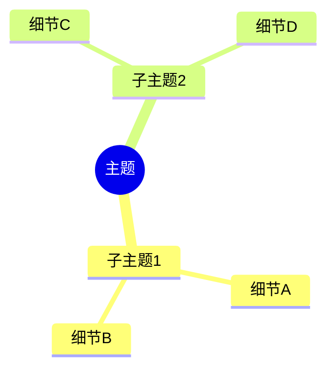

# Universal Mind Map Generator

将各种数据源智能转换为可视化脑图，支持拖拽编辑和多样式主题。

## 支持的数据源

| 类型 | 扩展名 | 提取方式 |
|------|--------|----------|
| 文本 | .txt | 直接读取 |
| Word | .doc, .docx | python-docx |
| PDF | .pdf | pdfplumber |
| Markdown | .md | 直接读取 |
| CSV | .csv | pandas |
| Excel | .xls, .xlsx | openpyxl |
| JSON | .json | json 解析 |
| XML | .xml | xml 解析 |
| YAML | .yaml, .yml | yaml 解析 |
| SQL | .sql | SQL 解析 |
| HTML | .html | BeautifulSoup |
| 网页链接 | url | extract_content_from_websites |
| 音频 | .mp3, .wav, .aac | Whisper 转录 |
| 视频 | .mp4, .avi, .mkv | Whisper 转录 |
| PPT | .ppt, .pptx | python-pptx |
| RTF | .rtf | 正则提取 |
| EPUB | .epub | ebooklib |
| 图片 | .jpg, .png | OCR (pytesseract) |
| Log | .log | 直接读取 |
| INI/CFG | .ini, .conf | configparser |

## 核心功能

### 拖拽编辑
- 节点自由拖拽定位
- 缩放和平移
- 双击编辑节点文本
- 撤销/重做操作

### 样式主题
- **紫色渐变** - 默认主题
- **蓝色科技** - 科技感设计
- **绿色自然** - 自然清新风格
- **橙色活力** - 活力商务风
- **暗黑模式** - 夜间使用

## 执行流程

### Step 1: 识别数据源类型

根据文件扩展名或输入类型判断数据源类别：
- **本地文件**：读取文件内容
- **URL**：提取网页内容
- **视频/音频**：转录为文本

### Step 2: 内容提取

根据类型选择提取策略：

```
if extension in ['.txt', '.md', '.log']:
    content = 直接读取
elif extension == '.pdf':
    content = pdfplumber 提取文本
elif extension in ['.doc', '.docx']:
    content = python-docx 提取
elif extension == '.csv':
    content = pandas 读取并结构化
elif extension == '.json':
    content = json 解析
elif extension == '.url' or 输入为 URL:
    content = extract_content_from_websites
elif extension in ['.mp3', '.wav', '.mp4']:
    content = Whisper 转录
else:
    content = 通用文本提取
```

### Step 3: 智能结构化分析

使用 AI 分析提取的内容：
1. 识别核心主题/概念
2. 提取关键实体和关键词
3. 建立层级关系
4. 生成树状结构数据

### Step 4: 脑图渲染

使用 Mermaid.js 思维导图语法生成可视化：



### Step 5: 输出交付

提供多种格式输出：
- **交互式 HTML**：可拖拽、可缩放、可编辑的脑图
- **Mermaid 代码**：可复用的源文件
- **Markdown 树**：结构化文本格式

## 输出示例

当处理完成后，提供：
1. 渲染后的脑图预览（支持拖拽编辑）
2. 可下载的 HTML 文件
3. 原始 Mermaid 代码
4. 内容摘要（提取的关键点）

## 错误处理

- 不支持的文件类型：提示用户并列出支持格式
- 提取失败：尝试备用方法或提示具体问题
- 空内容：提示用户检查文件内容

## 使用示例

```
用户：帮我把这个 PDF 文件转成脑图
技能：1. 提取 PDF 内容 → 2. AI 结构化分析 → 3. 生成 Mermaid 脑图 → 4. 渲染交付

用户：这个视频里的内容做个脑图
技能：1. 音频提取 → 2. Whisper 转录 → 3. AI 结构化 → 4. 生成脑图

用户：https://example.com/article 这个链接转脑图
技能：1. 提取网页内容 → 2. AI 结构化 → 3. 生成脑图
```
