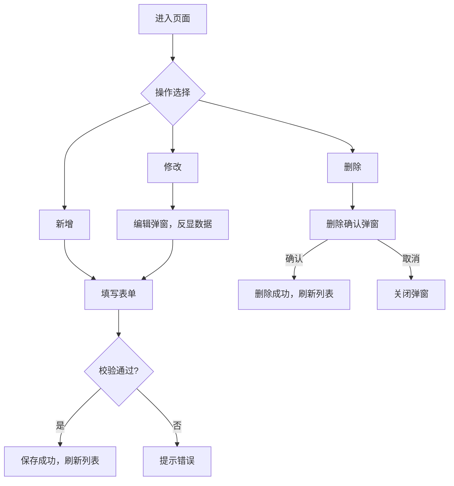
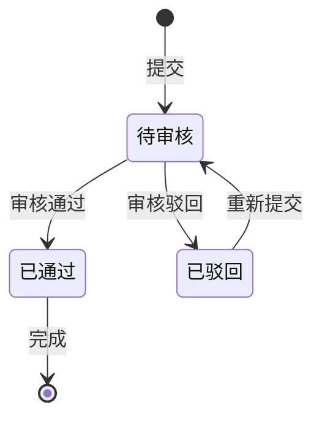

# list-to-prd

把"一份需求清单"变成"一份标准中文 PRD 功能规格文档"。

---

## 文档风格来源

本 skill 的文档结构学习自以下真实项目需求规格书：

| 文档 | 特征 |
|------|------|
| CSL6 ISCS 集中告警/培训管理系统功能需求规格书 | 标准封面 + 版本记录 + 目录 + 概述 + 项目概述 + 软件功能需求（功能描述/输入/输出/用例/界面原型） |
| 华佳 Mos2.0 线网指挥系统需求规格说明书 | 系统目标 + 角色权限 + 一般限制 + 出错处理 + 分模块功能说明（每模块含字段说明表） |
| 线网指挥 V3.0 智慧能源管理平台需求规格书 | 状态流转 + 页面布局（ASCII/原型描述）+ 交互逻辑 + 接口说明 |

---

## 一句话定位

用户输入需求清单（可以是 bullet list、简短说明、功能列举），AI 经过一轮澄清后，产出符合规格书写作规范的完整 Markdown PRD 文档，并保存到指定路径。

---

## 触发场景

- 用户说"帮我写 PRD"、"把这些需求整理成规格书"、"生成功能需求说明"
- 用户给出一段功能描述或需求 bullet list
- 用户说"我有一个新产品/功能的需求清单，帮我整理成规格书"

---

## 执行流程

### 第一步：接收需求清单

读取用户提供的需求清单。若内容过于简短（少于 3 条），先询问：

> "需求清单比较简短，能再补充一下背景吗？比如：这个功能是做什么的？主要用户是谁？"

若内容足够，直接进入第二步。

---

### 第二步：发起澄清问卷

生成文档前提出以下问题（用户可回答如 "1A 2B 3自定义"）：

```
生成 PRD 前，需要确认几个关键信息：

1. 产品 / 系统名称是什么？
   A) 请直接输入（如：内部运营平台、数据管理系统）

2. 本次 PRD 描述的功能 / 模块名称？
   A) 请直接输入（如：用户管理、数据报表、权限配置）

3. 文件编号前缀（可选）？
   A) 自动生成（如：PRD-XXX-2026-001）
   B) 请输入自定义前缀

4. 主要用户角色（多选，逗号分隔）？
   A) 系统管理员
   B) 普通用户 / 操作员
   C) 审核 / 审批人员
   D) 浏览级用户
   E) 其他（请注明）

5. 文档编制人姓名？
   A) 请直接输入

6. 是否涉及以下功能？（多选）
   A) 列表 + 增删改查
   B) 审批 / 审核流程
   C) 数据导入（Excel）
   D) 数据导出
   E) 状态流转（如：草稿→审核中→已通过）
   F) 与外部系统接口对接
   G) 都没有 / 不确定

7. PRD 文档保存路径？
   A) 当前工作目录下的 prds/ 文件夹（默认）
   B) 请指定路径（如：D:\项目\需求文档\）
```

等待用户回答后，进入第三步。

---

### 第三步：生成 PRD 文档

根据需求清单 + 澄清信息，按以下**标准规格书结构**生成完整 Markdown 文档。

---

## PRD 文档标准结构

### 封面与文档信息

```markdown
# [产品名称]
## [功能名称]功能需求规格书

---

| 项目     | 内容                              |
| -------- | --------------------------------- |
| 文件编号 | [自动生成或用户输入]              |
| 文件版本 | V1.0                              |
| 产品名称 | [产品名称]                        |
| 所属系统 | [系统名称]                        |
| 文件编写 | [编制人]                          |
| 文件审核 | [留空，供填写]                    |
| 文件批准 | [留空，供填写]                    |
| 发布日期 | [今日日期 YYYY-MM-DD]             |
| 建设单位 | [留空，供填写]                    |
| 集成单位 | [留空，供填写]                    |

### 文件版本更新记录

| 版本 | 版本更新记录 | 编制/修订 | 批准者   | 日期       |
| ---- | ------------ | --------- | -------- | ---------- |
| V1.0 | 初版         | [编制人]  | [留空]   | [今日日期] |
```

---

### 第 1 章：概述

#### 1.1 目的

[说明本规格书的编写目的，明确软件需求、支持项目规划与进度、组织开发与测试。主要读者为产品经理、项目经理、UI设计师、开发人员以及测试人员。]

#### 1.2 范围

[说明本文档所描述功能的适用范围、系统边界。]

#### 1.3 术语和缩略词

| 缩写词 | 英文说明 | 中文 |
| ------ | -------- | ---- |
| [缩写] | [英文]   | [中文] |

[根据需求清单中出现的专业术语自动填写；如无则保留表格空行。]

#### 1.4 参考资料

| 编号 | 文档名称 | 版本号 | 发表日期 | 出版单位 |
| ---- | -------- | ------ | -------- | -------- |
| 1    | [相关文档名] | [版本] | [日期] | [单位] |

---

### 第 2 章：项目概述

#### 2.1 工程概况

[描述本产品/项目所属的工程背景，包括项目名称、建设目标、主要参与方。]

#### 2.2 系统概况

[描述系统的整体架构定位：系统提供什么核心能力，面向哪些用户，解决什么问题。可包含模块部署说明和数据流描述。]

---

### 第 3 章：软件功能需求

> 本章按功能模块逐一描述，每个功能模块遵循统一的子章节结构。

#### 3.1 [功能模块一名称]

##### 3.1.1 功能描述

[描述该功能的核心目的、使用场景及对用户的价值，1-3段话。]

##### 3.1.2 用户角色与权限

| 角色   | 可执行操作                           | 数据权限   |
| ------ | ------------------------------------ | ---------- |
| [角色1] | 查看/新增/修改/删除/导入/导出（勾选适用） | 全量/本机构 |
| [角色2] | 查看/查询                            | 仅本机构   |

**角色操作矩阵：**

| 功能点   | [角色1] | [角色2] |
| -------- | :-----: | :-----: |
| 查看列表 |   是    |   是    |
| 查看详情 |   是    |   是    |
| 新增     |   是    |   否    |
| 修改     |   是    |   否    |
| 删除     |   是    |   否    |
| 查询     |   是    |   是    |
| 导入     |   是    |   否    |
| 导出     |   是    |   是    |

##### 3.1.3 输入

[描述触发本功能的操作条件或用户输入，如：操作员账号、密码；点击某按钮；选择某条件。]

##### 3.1.4 输出

[描述功能执行后系统产生的输出结果，如：显示对应权限的界面；生成 Excel 报表；提示操作成功。]

##### 3.1.5 业务流程

[如涉及业务流程，用 Mermaid flowchart 描述：]



[如涉及状态流转，补充 stateDiagram：]



##### 3.1.6 页面与交互说明

**模块路径：** 系统首页 → [一级菜单] → [二级菜单] → [本功能]

**页面清单：**

| 序号 | 页面名称      | 类型 | 描述                     |
| :--: | ------------- | ---- | ------------------------ |
|  1   | 列表页        | 主页面 | 显示数据列表，支持查询操作 |
|  2   | 新增/编辑弹窗 | 弹窗 | 新增或编辑单条数据        |
|  3   | 查看详情弹窗  | 弹窗 | 只读查看字段详情          |
|  4   | 删除确认弹窗  | 弹窗 | 删除操作二次确认          |

**列表页面布局：**

```
┌────────────────────────────────────────────────────────────┐
│  查询条件区                                                  │
│  ┌──────────────┐ ┌──────────────┐ ┌──────┐ ┌──────┐      │
│  │ [查询字段1  ] │ │ [查询字段2▼] │ │ 查询 │ │ 重置 │      │
│  └──────────────┘ └──────────────┘ └──────┘ └──────┘      │
├────────────────────────────────────────────────────────────┤
│  工具栏  [+新增]  [导入]  [批量删除]              [导出]   │
├────────────────────────────────────────────────────────────┤
│  列表区                                                      │
│  ┌───┬────┬──────────┬──────────┬──────┬──────────────┐    │
│  │ □ │ 序号 │ 字段1   │ 字段2   │ 状态 │ 操作         │    │
│  ├───┼────┼──────────┼──────────┼──────┼──────────────┤    │
│  │ □ │  1  │  xxx    │  xxx    │已启用│[详情][修改][删除]│  │
│  └───┴────┴──────────┴──────────┴──────┴──────────────┘    │
├────────────────────────────────────────────────────────────┤
│  分页  [< 1 2 3 ... >]  每页 10▼  共 XX 条                 │
└────────────────────────────────────────────────────────────┘
```

**列表字段说明：**

| 字段名   | 组件类型 | 位置 | 说明                          |
| -------- | -------- | ---- | ----------------------------- |
| 复选框   | 复选框   | 首列 | 批量操作时勾选                |
| 序号     | 文本     | 居中 | 自动递增                      |
| [字段1]  | 文本     | 居左 | [说明]                        |
| [字段2]  | 文本     | 居左 | [说明]                        |
| 状态     | 标签     | 居中 | 枚举值，badge 样式            |
| 操作     | 按钮组   | 居中 | [详情] [修改] [删除]          |

**操作交互逻辑：**

| 操作   | 触发操作      | 可用性       | 正向输出                                 | 异常处理           | 日志 |
| ------ | ------------- | ------------ | ---------------------------------------- | ------------------ | ---- |
| 查询   | 点击"查询"    | 始终可用     | 按条件筛选，列表刷新                     | 提示字段格式错误   | 接口 |
| 重置   | 点击"重置"    | 始终可用     | 清空条件，恢复初始状态                   | 无                 | 接口 |
| 新增   | 点击"+新增"   | 始终可用     | 打开"新增[对象]"弹窗                     | 无                 | 接口 |
| 查看   | 点击"详情"    | 始终可用     | 打开只读详情弹窗                         | 无                 | 接口 |
| 修改   | 点击"修改"    | 未被引用可用 | 打开"编辑[对象]"弹窗，反显数据          | 已引用则灰化       | 接口 |
| 删除   | 点击"删除"    | 未被引用可用 | 弹出确认框；确认后删除，列表刷新         | 已引用则灰化       | 接口 |
| 导入   | 点击"导入"    | 始终可用     | 打开导入弹窗，上传 Excel，全部校验通过后入库 | 遇错即停，Toast 提示行号+原因 | 接口 |
| 导出   | 点击"导出"    | 始终可用     | 勾选则导出选中行；未勾选则导出全量       | 无数据时 Toast 提示 | 接口 |

> **导出文件命名规范**：`{业务前缀}_{YYYYMMDD}_{HHMMSS}.xlsx`

**新增/编辑弹窗布局：**

```
┌───────────────────────────────────────────┐
│  新增/编辑[对象]                    [X]  │
├───────────────────────────────────────────┤
│  [字段1]*                                 │
│  [输入框                               ]  │
│  [字段2]*                                 │
│  [下拉框                              ▼]  │
│  [字段3]（只读，系统自动生成）            │
│  [文本展示区                           ]  │
│                           [取消]  [确定]  │
└───────────────────────────────────────────┘
```

**表单字段说明：**

| 字段     | 组件类型 | 是否必填 | 约束规则             | 展示规则 | 举例或枚举 |
| -------- | -------- | :------: | -------------------- | -------- | ---------- |
| [字段1]  | 输入框   |    是*   | [长度/格式约束]      | 明文     | [示例]     |
| [字段2]  | 下拉框   |    是*   | 枚举，见数据字典     | 明文     | [枚举A/B]  |
| [字段3]  | 文本     |    否    | 系统自动生成，只读   | 明文     | [示例]     |

**弹窗规则：**

| 规则项   | 说明                                          |
| -------- | --------------------------------------------- |
| 打开方式 | 点击工具栏"新增"或操作列"修改"按钮            |
| 标题     | 新增时"新增[对象]"；编辑时"编辑[对象]"        |
| 数据反显 | 编辑时回填当前记录数据；新增时所有字段为空    |
| 校验时机 | 失焦时单字段校验；点击"确定"时全量校验        |
| 保存规则 | 全部校验通过后提交；失败时字段边框变红+提示   |
| 关闭确认 | 有未保存修改时，关闭前弹出"是否放弃编辑？"   |

##### 3.1.7 错误处理

**表单校验错误：**
- 显示方式：字段下方红色提示文本，字段边框变红
- 触发时机：失焦时单字段校验；提交时全量校验

| 字段    | 为空时提示        | 格式错误时提示           |
| ------- | ----------------- | ------------------------ |
| [字段1] | [字段1]不能为空   | [字段1]格式不正确        |
| [字段2] | 请选择[字段2]     | —                        |

**系统异常处理：**

| 场景        | 触发条件           | 提示文案                   | 处理方式       |
| ----------- | ------------------ | -------------------------- | -------------- |
| 接口超时    | 请求超时           | 接口异常，请稍候再试       | Toast 提示     |
| 导入格式错误 | 上传非 .xlsx       | 请上传正确格式的Excel文件  | Toast 提示，阻断 |
| 导入超大文件 | 文件 >10MB         | 文件大小不能超过 10MB      | Toast 提示，阻断 |
| 导入校验失败 | 数据存在错误       | 第N行：[字段名]+错误原因   | 遇错即停，不入库 |
| 导出无数据  | 查询结果为空       | 暂无数据可导出             | Toast 提示     |
| 删除失败    | 后端删除异常       | 删除失败，请重试           | Toast 提示     |

---

[按需继续添加 3.2、3.3 等功能模块，结构与 3.1 相同]

---

### 第 4 章：一般限制

#### 4.1 安全与访问控制

- 基于 RBAC 角色权限机制，最小权限原则
- 所有用户操作需通过身份鉴别后方可访问
- 敏感操作（删除、导出、导入）需记录操作日志

#### 4.2 操作日志

| 操作类型 | 日志级别 | 记录内容               |
| -------- | -------- | ---------------------- |
| 新增     | 接口级   | 操作人、时间、记录内容 |
| 修改     | 接口级   | 操作人、时间、变更内容 |
| 删除     | 接口级   | 操作人、时间、被删记录 |
| 导出     | 接口级   | 操作人、时间、导出条件 |
| 查看     | 不记录   | —                      |

#### 4.3 敏感数据脱敏

[如涉及手机号、身份证、银行卡等敏感字段，说明脱敏规则；无则标注"本功能无敏感字段"]

#### 4.4 出错处理原则

- 系统错误统一记录到系统日志文件
- 服务类接口返回统一的系统错误代码
- 界面类接口返回标准 HTTP 错误码 + 系统错误码

---

### 第 5 章：性能需求

| 需求项          | 指标要求           | 说明             |
| --------------- | ------------------ | ---------------- |
| 列表查询响应    | ≤ 2s               | 含分页查询       |
| 保存/提交响应   | ≤ 3s               | 写操作           |
| 导出响应时间    | ≤ 5s（1000条以内） | 超出建议异步     |
| 页面首屏加载    | ≤ 3s               | —                |
| 并发用户数      | [按项目实际填写]   | —                |

---

### 第 6 章：数据字典

[集中定义本功能所有枚举/字典值]

#### 6.1 [状态字段名]

| 枚举值（code） | 显示文本（label） | 说明     |
| :------------: | ----------------- | -------- |
|       0        | [状态A]           | [描述]   |
|       1        | [状态B]           | [描述]   |

#### 6.2 下拉框数据来源

| 字段名   | 数据来源类型 | 来源说明              |
| -------- | ------------ | --------------------- |
| [字段]   | 字典项       | 参见 6.1              |
| [字段]   | 接口动态加载 | 来源：[模块] /api/xxx |

---

### 第 7 章：外部系统接口说明

[如无外部系统对接，本章写"本功能无外部系统接口，暂不适用"。]

#### 7.1 接口清单

| 接口名称   | 功能描述 | 交互方向    | 依赖系统   | 数据流向          |
| ---------- | -------- | ----------- | ---------- | ----------------- |
| [接口名]   | [描述]   | 调用/被调用 | [系统名称] | 本系统→外部系统   |

#### 7.2 接口详细说明

**[接口名]**

| 规则项   | 说明                         |
| -------- | ---------------------------- |
| 触发时机 | [何时调用该接口]             |
| 请求条件 | [前置条件]                   |
| 成功处理 | [成功后业务状态变更]         |
| 失败处理 | [失败后状态保持/回滚]        |
| 重试机制 | [是否自动重试及次数]         |

---

*文档结束*
```

---

## 填写规范（生成时遵守）

1. **风格一致**：参考 PCI 规格书风格——专业、简洁、结构清晰，用表格优先于段落描述
2. **功能描述聚焦业务**：只写业务逻辑、数据约束、权限控制，不写技术实现（CSS类名、列宽像素、接口URL）
3. **每个功能模块**都要有：功能描述 → 角色权限 → 输入 → 输出 → 业务流程 → 页面交互说明 → 错误处理
4. **Mermaid 图语法正确**：必须可正常渲染，flowchart 和 stateDiagram 语法须严格符合规范
5. **枚举值与流程图一致**：§6 数据字典中的枚举值要与流程图中的状态保持一致
6. **空章节处理**：无相关内容的章节写"本功能无相关需求，暂不适用"，不直接删除
7. **占位符全部替换**：生成时将所有 [xxx] 替换为实际内容，不保留任何空括号

---

## 保存规则

生成完成后：

1. 如指定了路径，在该路径下保存文档；否则默认保存到当前工作目录 `prds/` 子文件夹
2. 文件命名格式：`[系统名称]-[功能名称]-功能需求规格书.md`
3. 如该路径不存在，自动创建
4. 输出保存确认：

```
✅ PRD 已生成并保存
📄 文件路径：[完整路径]/[文件名].md
📋 文档结构：7章，共 [N] 个功能模块

下一步建议：
- 补充 §1.4 参考资料中的关联文档
- 确认 §6 数据字典中枚举值的 code 与后端对齐
- 填写封面中的"文件审核"和"文件批准"字段
- 如需原型设计，可调用 prototype-design skill
```

---

## 质量自检清单（生成后执行）

- [ ] 封面信息完整（文件编号、版本、产品名、系统名、编写人、发布日期）
- [ ] 版本更新记录已填写
- [ ] 每个功能模块都有：功能描述 / 角色权限 / 输入 / 输出 / 流程图 / 页面交互 / 错误处理
- [ ] Mermaid 流程图语法正确（无缺失箭头、无语法错误）
- [ ] 数据字典枚举值与流程图状态一致
- [ ] 所有 [占位符] 已替换为实际内容
- [ ] 无章节被意外删除（无内容章节写"暂不适用"）
- [ ] 文件已保存到正确路径
